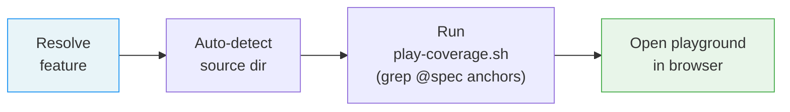

# /spec-play-coverage

---
description: "Open spec coverage playground with live grep data"
argument-hint: "[feature-name]"
---

> **Read** [`system/anti-drift-block.md`](../../../system/anti-drift-block.md) before starting — 6-field step shape (§1), ERROR/BLOCKED format (§2).

# Command: /spec-play-coverage

> Launch the Spec Coverage playground in a browser, pre-loaded with `@spec` anchor data from the codebase.

---



---

## Steps

### Step 1 — Resolve Feature

1. If feature name provided as argument: find `.specs/features/NNN-feature-name/`
2. If no feature name: detect from current git branch (`feature/NNN-feature-name`)
3. If still ambiguous: list all features and ask user to choose

Store the resolved feature directory name (e.g. `004-notifications`).

### Step 2 — Auto-detect Source Directory

Check for common source directories at project root: `app/`, `src/`, `lib/`, `packages/`.

- If exactly one exists: use it
- If multiple exist: run `grep -rn "@spec FR-" <dir>/` on each, pick the one with matches
- If none exist or no matches: fall back to `.`

### Step 3 — Run Script

Resolve the script path and run it:

```bash
SCRIPT=$(dirname "$(readlink ~/.claude/.agent-sync/skills/spec-play-coverage/SKILL.md)")/../scripts/play-coverage.sh
bash "$SCRIPT" <FEATURE> <SOURCE_DIR>
```

Replace `<FEATURE>` with the resolved feature name and `<SOURCE_DIR>` with the detected source directory.

The script handles grep, JSON encoding, base64, and browser opening. Do **not** attempt to do these steps manually.

---

## Execution Tasks

> Machine-readable task inventory parsed by `livespec goal render`.
> Format: `- [branch] task description`
> Active branches per run:
> `always` · `visual` (UI feature with ## Screens, no --no-visual) · `penflow` (visual + penflow/ dir exists) · `generate` (no --audit-only, no --no-generate) · `visual-generate` (visual + generate both active) · `execute` (no --audit-only)

### Phase 1 — Resolve Feature

- [always] Resolve feature by argument, git branch, or interactive selection <!-- evidence:documentary -->

### Phase 2 — Auto-detect Source Directory

- [always] Check for common source directories (app/, src/, lib/, packages/) <!-- evidence:documentary -->
- [always] Select directory with most @spec anchor matches; fall back to . <!-- evidence:documentary -->

### Phase 3 — Run Coverage Script

- [always] Resolve play-coverage.sh path from skill symlink chain <!-- evidence:documentary -->
- [always] Execute `bash play-coverage.sh <FEATURE> <SOURCE_DIR>` <!-- evidence:documentary -->
- [always] Open playground in browser with pre-loaded @spec anchor data <!-- evidence:documentary -->

## Definition of Done (Command-Level)

`/spec-play-coverage` is complete only if all are true:

- [ ] Feature resolved to a valid feature directory <!-- evidence:documentary -->
- [ ] Source directory detected with @spec anchor matches <!-- evidence:documentary -->
- [ ] play-coverage.sh executed without error <!-- evidence:documentary -->
- [ ] Playground opened in browser with coverage data loaded <!-- evidence:documentary -->

---

*LiveSpec Command v1.0*
