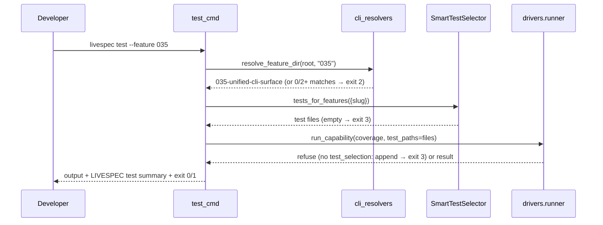
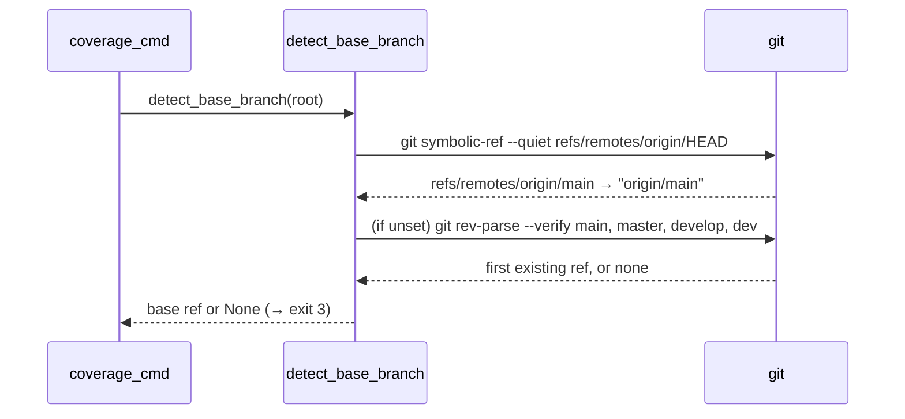

# Plan — Unified CLI Surface (Feature 035)

## Summary

Five Typer subcommands (`test`, `coverage`, `drivers`, `mutation`, `preflight`) sit directly under the `livespec` root. Each command module stays thin, auto-detection is centralized in `validator/cli_resolvers.py`, and exit codes follow the constitution (0/1/2/3/130) in `validator/cli_exit_codes.py`. This revision (2026-10-12) applies the human decisions recorded in the spec Clarifications: the exit-code taxonomy, the base-branch order, the JSON summary channel and feature-scoped test selection. It also completes AC-002, AC-013 and SC-003.

## Technical Context

- **Language/runtime:** Python 3.12, Typer/Click (`typer.testing.CliRunner` for tests).
- **Dependencies:** existing driver registry and runner (`validator/drivers/`, features 016/017), patch coverage (feature 024), mutation reports (feature 025), preflight autofix (feature 034), smart selection `SmartTestSelector` (`validator/selector.py`, feature 033).
- **Storage:** none beyond existing files (`lcov.info`, `.specs/reports/`).
- **Testing:** pytest unit/CLI tests in `tests/test_cli_unified.py`; git fixtures are created in `tmp_path`.
- **Project type:** single Python CLI package.

## Constitution Check

- **Principle 4 (Fail Fast, Exit Clearly):** the five commands use only 0 (success), 1 (run failure or unexpected exception), 2 (invalid arguments: Typer usage errors and an unresolvable `--feature`), 3 (missing configuration) and 130 (Ctrl+C). The shared `.specs/` resolver keeps exit 1 for a missing `.specs/` or a run outside git, which the spec documents as an explicit exception. Each error prints one actionable line naming the missing file or reference and the fix. Stack traces appear only with `--debug`.
- **Principle 5 (Minimal surface):** no new top-level command; the five commands already exist. The driver schema change is one optional, additive field.
- **Determinism and testability:** resolvers only read files and git refs, and every behaviour is covered by CLI tests that run the real Typer app.

## Exit codes (AC-011, FR-007)

| Code | Constant | Meaning |
|------|----------|---------|
| 0 | `EXIT_OK` | Success |
| 1 | `EXIT_FAILURE` | Test suite failed, coverage or mutation threshold not met, unexpected exception; also `.specs/` missing or not a git repository (`EXIT_MISSING_SPECS`, shared resolver exception) |
| 2 | `EXIT_USAGE` | Invalid arguments: Typer/Click usage errors, `--feature` matching zero or several feature directories |
| 3 | `EXIT_CONFIG` | Missing configuration: no driver detected, lcov report not found, capability absent, coverage capability without `test_selection: append` for `--feature`, no test selected for the feature, preflight manifest or critical tool missing, no resolvable base branch |
| 130 | `EXIT_INTERRUPTED` | Ctrl+C |

The former constants `EXIT_NO_DRIVER` (2), `EXIT_COVERAGE_FAIL` (3), `EXIT_CAPABILITY_UNSUPPORTED` (4) and `EXIT_PREFLIGHT_FAIL` (5) are removed. Only these five commands, `_common.py` and the docs use them. The visual-gate and finalize codes 6 to 10 belong to other features and are unchanged.

## Gherkin Scenarios + Mermaid Sequence Diagrams

```gherkin
Feature: Feature-scoped test run
  Scenario: Selected tests are appended to the coverage command
    Given exactly one directory matches .specs/features/035-*/
    And SmartTestSelector maps tests/test_cli_unified.py to 035-unified-cli-surface
    And the python coverage capability declares test_selection: append
    When the developer runs `livespec test --feature 035`
    Then the runner executes the coverage command followed by tests/test_cli_unified.py
    And the summary line is printed and the command exits 0 when tests pass and the threshold is met

  Scenario: Driver without test selection
    Given the primary driver's coverage capability has no test_selection field
    When the developer runs `livespec test --feature 035`
    Then the CLI refuses with one actionable message
    And exits with code 3
```



```gherkin
Feature: Base branch resolution
  Scenario: Remote default branch wins
    Given origin/HEAD points to origin/main
    When `livespec coverage` runs without --base
    Then the base is origin/main

  Scenario: Local fallback order
    Given origin/HEAD is not set and only master and develop exist locally
    When `livespec coverage` runs without --base
    Then the base is master
```



## Implementation Plan

| Step | Files | Work | Requirements |
|---|---|---|---|
| 1 | `tests/test_cli_unified.py` | RED first, through the real Typer app: exit codes per category (no driver 3; failing suite 1; coverage and mutation threshold 1; capability absent 3; lcov absent 3; no base 3; preflight manifest or critical tool missing 3; unexpected exception 1; Ctrl+C 130; bad flag 2). Base order on a real temporary git repository (origin/HEAD, then main, master, develop, dev). `drivers --json` keeps stdout pure JSON with the summary on stderr. `--feature` resolution (0, 1, 2+ matches, `NNN` vs `NNN.1-` sibling directories, exact name), selection appended, refusal without `test_selection`, empty selection. Each `--help` contains an `Example: livespec <command> …` line whose arguments the command's own parser accepts. | AC-002, AC-004, AC-011, AC-012, AC-013, SC-003 |
| 2 | `validator/cli_exit_codes.py` | Replace codes 2–5 of the five commands with `EXIT_FAILURE`, `EXIT_USAGE`, `EXIT_CONFIG` and `EXIT_INTERRUPTED`. Keep `EXIT_OK`, `EXIT_MISSING_SPECS` (1) and codes 6–10. | FR-007, AC-011 |
| 3 | `validator/cli_commands/_common.py` | `resolve_primary_driver` exits 3. `run_with_debug` maps `KeyboardInterrupt` to 130 and generic exceptions to 1. `emit_summary(..., to_stderr=False)` routes the summary line. Add `help_epilog(example)`, which renders `Example: <example>`. | AC-011, AC-012, FR-008, FR-009, AC-013 |
| 4 | `validator/cli_resolvers.py` | `detect_base_branch`: `git symbolic-ref --quiet refs/remotes/origin/HEAD`, mapped to `origin/<branch>`, then the first of `main`, `master`, `develop`, `dev` accepted by `git rev-parse --verify`. Add `resolve_feature_dir(project_root, value)`: an exact directory name under `.specs/features/` wins, otherwise the `.specs/features/<value>-*` directories match (so `005` never matches `005.1-*`); zero or several matches raise `FeatureResolutionError` listing them. | AC-004, AC-002, FR-006 |
| 5 | `validator/drivers/schemas.py`, `validator/drivers/runner.py`, `livespec/drivers/python.yaml`, `livespec/drivers/templates/custom-driver-template.yaml` | Additive, backward-compatible field `DriverCapability.test_selection: Literal["append"] \| None = None`. `run_capability(..., test_paths=None)` appends the paths to the argv only when the capability declares `append`. Otherwise it raises `TestSelectionUnsupportedError`. The built-in python coverage capability declares `test_selection: append`, and the template documents the field. Existing manifests load unchanged. | AC-002 |
| 6 | `validator/cli_commands/test_cmd.py`, new `validator/cli_commands/test_selection.py` | The feature resolution, test selection and lcov percentage move to `test_selection.py` so `test_cmd.py` drops below the constitution's 300-line limit. The resolved slug feeds the journey counts and the journey run; journey errors exit 1. The native execution and review modes (feature 078) keep their own `--feature` contract. `--feature` resolves through step 4 (exit 2 on 0 or 2+ matches) and selects with `SmartTestSelector(specs_root).tests_for_features({slug})` (exit 3 when empty). It runs coverage with `test_paths`; `TestSelectionUnsupportedError` exits 3. Failing suite or threshold exits 1, missing capability exits 3, and `Example: livespec test --feature 035` goes in the epilog. | AC-002, AC-011, AC-013 |
| 7 | `validator/cli_commands/coverage_cmd.py` | No base exits 3, lcov absent exits 3, threshold failure exits 1, missing capability exits 3. Epilog `Example: livespec coverage --base origin/main`. | AC-004, AC-005, AC-011, AC-013 |
| 8 | `validator/cli_commands/drivers_cmd.py` | With `--json`, the summary goes to stderr. Epilog `Example: livespec drivers --json`. | AC-007, AC-012, AC-013 |
| 9 | `validator/cli_commands/mutation_cmd.py` | Missing capability exits 3, below threshold exits 1. Epilog `Example: livespec mutation --threshold 70`. | AC-011, AC-013 |
| 10 | `validator/cli_commands/preflight_cmd.py` | Missing manifest or critical tool exits 3 (read-only and `--fix`). Epilog `Example: livespec preflight --fix`. | AC-009, AC-010, AC-011, AC-013 |
| 11 | `docs/cli-reference.md`, `.claude/commands/cli.md` | Update the exit-code table, base order, JSON summary channel, `--feature` selection and `test_selection`. Every command example matches its `--help` epilog. | AC-015, AC-016, FR-010, FR-011 |
| 12 | `.specs/features/035-unified-cli-surface/implementation.md`, `changelog.md`; `.specs/features/016-cross-language-test-driver-architecture/changelog.md` | Create the FR/AC→code/test map. Record the additive driver-schema field in the schema owner's changelog (feature 016). | All |

The unchanged parts from the original delivery (2026-05-07) are the module layout and AC-001, AC-003, AC-005 to AC-010, AC-014 to AC-016. They are mapped in `implementation.md`, with the existing tests in `tests/test_cli_unified.py`.

## Testing Strategy

- Unit and CLI: new tests go in `tests/test_cli_unified_exit_codes.py` (exit codes, base order, JSON channel, `--help` examples) and `tests/test_cli_unified_feature.py` (`--feature` selection, driver `test_selection`), so `tests/test_cli_unified.py` does not grow past 300 lines; `pytest tests/test_cli_unified*.py -q`, plus driver regression with `pytest tests/test_driver*.py tests/test_selector*.py -q`.
- Full suite: the unit suite outside `tests/integration`, level_3a, `ruff check .`, `ruff format --check .`, `pyright validator`, `livespec conventions verify --feature repo`.
- Requirement-to-test linkage lives in `implementation.md` § Acceptance Criteria Mapping, one named test per AC. SC-003 is covered by the `--help` test over the five commands. SC-004 is covered by the full suite staying green.

## Risks & Considerations

- **Exit-code change:** CI scripts that relied on the old codes 2–5 change behaviour. The CLI reference documents the new table, and the change is recorded in the changelog.
- **Driver selection:** only drivers declaring `test_selection: append` support `--feature`. The others refuse explicitly (exit 3) instead of silently running the full suite.
- **`origin/HEAD`:** may be absent on clones that never ran `git remote set-head`. The local fallback order covers that case.
