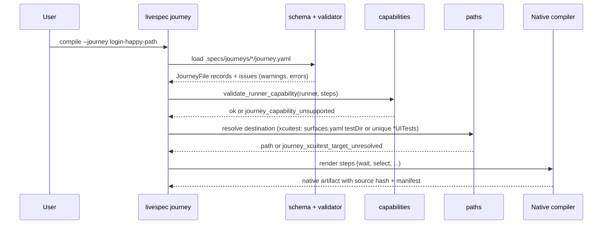
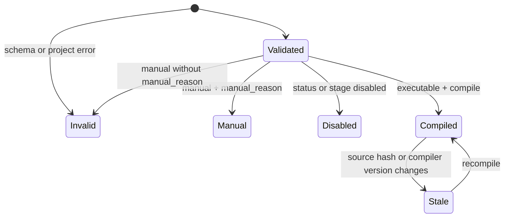
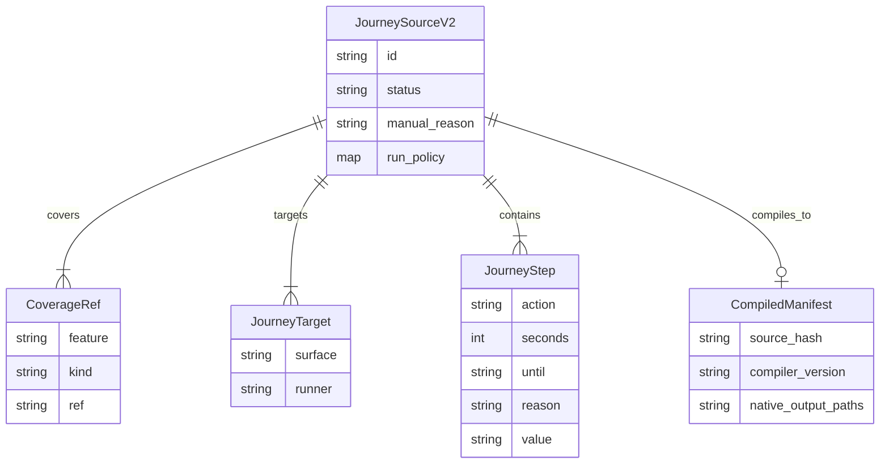

# Plan — 056 Executable User Journeys

## Summary

Canonical YAML journeys (schema version 2, `.specs/journeys/<journey-id>/journey.yaml`) are validated by a Pydantic boundary plus project-aware checks. They are compiled ahead of time to Playwright, XCUITest or Maestro artifacts that embed a source hash, run without compiling, audited by Spec Doctor, and reported separately from direct tests. This revision (2026-10-12) brings the plan in line with the v2 pipeline shipped by feature 057 and completes the unmet AC-003, AC-004 and AC-015. It also implements FR-005 `select` on Playwright and resolves the FR-007 XCUITest destination from the project's own UI test target instead of a hardcoded consumer name.

## Technical Context

- **Language:** Python ≥ 3.11 (CI runs 3.11); Pydantic v2 at the YAML boundary (`validator/journeys/schema.py`), PyYAML for parsing.
- **CLI:** Typer group `livespec journey` (`validator/cli_commands/journey_cmd.py`): `validate`, `compile`, `run`, `test` (alias of `run`), `impact`, `list`, `inspect`, `migrate --from-v1`.
- **Outputs:** Playwright `tests/e2e/journeys/<id>.spec.ts`; XCUITest `<Target>UITests/Journeys/<Name>Journey.swift`; Maestro `.specs/maestro/journeys/<id>.yaml`; manifest `.specs/journeys/<id>/compiled/manifest.json`.
- **Testing:** pytest CLI and unit tests on `tmp_path` projects; no HTTP API, no database.

## Constitution Check

- **Principle 1 (layered validation):** schema errors (`journey_schema_invalid`) come before project-aware errors (requirement refs, changelog, fixtures, manual reason) and before compile-time capability checks.
- **Principle 4 (fail fast, exit clearly):** every issue carries a stable code, the source path and an actionable message. `journey validate` exits 0 with warnings and 1 with errors. `journey compile` exits 3 for the configuration error `journey_xcuitest_target_unresolved` and 1 for other errors. `journey run`/`test` exit 0 or 1.
- **Principle 5 (minimal surface):** no new top-level command. The new fields are optional (`until`, `reason`, `manual_reason`) and extend the existing v2 schema without breaking valid sources.
- **Testing rules:** the new tests drive the real CLI and compiler, including malformed inputs (a wait without `seconds`, `until` on a non-wait step, a manual journey without a reason, an ambiguous UI test target).

## Implementation Plan

Steps 1 to 8 describe the shipped v2 pipeline; feature 057 replaced the original 2026-06-02 v1 files. Steps 9 to 16 are this revision.

| Step | Files | Work | Requirements |
|---|---|---|---|
| 1 | `system/testing/user-journeys.md` | Canonical v2 format reference: directory contract, YAML shape, actions, commands, compilers, doctor findings. | FR-001 |
| 2 | `validator/journeys/schema.py`, `models.py` | `JourneySourceV2` and `JourneyStep` Pydantic models. `JourneyAction` accepts exactly `open`, `click`, `fill`, `select`, `wait`, `assert`, `assert_not`, `screenshot`, `back` and `press`, and an unknown action fails as `journey_schema_invalid`. Unsupported surfaces fail as `journey_target_unsupported`. | FR-002, FR-005, AC-001, AC-002, AC-013 |
| 3 | `validator/journeys/paths.py` | `iter_journey_source_paths` discovers only `.specs/journeys/<journey-id>/journey.yaml`. The id must match the directory (`journey_id_path_mismatch`). Legacy per-feature `*.journey.yaml` files are reported as `journey_v1_leftover` and converted only by `journey migrate --from-v1` (`migration.py`). | FR-004, AC-001 |
| 4 | `validator/journeys/validator.py` | Project-aware validation: qualified `covers` refs must exist in the covered feature spec (`journey_requirement_missing`), `changelog.md` is required, plus fixtures and history. Produces `JourneyFile` records for compilation and reporting. | FR-002, AC-001, AC-010 |
| 5 | `validator/journeys/capabilities.py`, `compiler.py`, `compiler_registry.py`, `manifest.py` | Capability check before writing, then Playwright/XCUITest/Maestro compilation. Every artifact embeds `livespec-journey-source-hash`, which is the SHA-256 of the raw YAML bytes, so it is deterministic. A manifest records the hash and the compiler version. | FR-006, FR-007, FR-008, FR-009, AC-005, AC-006, AC-007, AC-008, AC-013 |
| 6 | `validator/journeys/scanner.py`, `validator/doctor/scanner.py` | A journey that covers an AC or FR absent from the covered spec fails validation, so it never counts as current coverage. `scan_journeys(project_root)` reports `journey_compiled_stale`, `journey_compiler_stale`, `journey_compiled_missing`, `journey_requirement_missing` (an AC removed from or superseded in the covered spec, so it no longer appears there), `journey_disabled` and `journey_manual`. Spec Doctor consumes it. | FR-009, FR-013, AC-009, AC-010, AC-014 |
| 7 | `validator/journeys/runner.py`, `validator/cli_commands/journey_cmd.py` | `journey run` (and its alias `journey test`) executes fresh compiled artifacts through the native runner and never compiles. Per-stage `run_policy` and `status` select executed, manual or disabled journeys. | FR-003, AC-014 |
| 8 | `validator/cli_commands/test_cmd.py`; `.agent-sync/skills/spec-specify/SKILL.md`, `spec-feature/SKILL.md`, `spec-test/SKILL.md` | `livespec test` prints direct tests, executable journeys, manual tests and disabled journeys separately. `/spec-specify` proposes 1–3 global v2 journeys for interactive features and requires `manual_reason` for manual ones. `/spec-feature`'s Executable Journey Gate runs `journey impact` and `journey run --feature` before the functional suite. That gate passes only when every executable journey has a fresh compiled artifact. Compilation happens in the journey authoring workflow (`$spec-journey create|edit`, which runs `livespec journey compile`), so it always precedes the functional tests (spec clarification on AC-012). `/spec-test` audits the three categories. | FR-010, FR-011, FR-012, AC-011, AC-012 |
| 9 | `tests/test_journeys.py` | RED first, through the real CLI and compiler. `wait` warnings (`wait_reason_missing`, exit 0) and their absence with `reason` or `until`. Rejection of a `wait` without `seconds` and of `until` on a non-wait step. Bounded conditional waits in all three runners and fixed delays on Playwright/XCUITest. Maestro fixed wait refused. Manual journey without `manual_reason` → `journey_manual_reason_missing` (validate exit 1, not counted as manual, `journey run` reports it). Manual journey with a reason is reported as manual. Playwright `select` → `selectOption`, and the XCUITest/Maestro refusal. XCUITest destination from the unique `*UITests` directory, the watchOS target, the `surfaces.yaml` `testDir` override, and `journey_xcuitest_target_unresolved` (compile exit 3) for zero or several candidates. | AC-003, AC-004, AC-006, AC-007, AC-013, AC-015, FR-005, FR-007 |
| 10 | `validator/journeys/schema.py` | `JourneyStep.until: JourneyTargetRef \| None` and `reason: str \| None`. A model validator requires `seconds` on `wait` and rejects `until` elsewhere. `JourneySourceV2.manual_reason: str \| None`, plus the `is_manual` property (status or any stage `manual`) and the `lacks_manual_reason` property (manual with a blank or missing reason). | AC-003, AC-004, AC-015 |
| 11 | `validator/journeys/validator.py` | WARNING `wait_reason_missing` (`wait.seconds at step N needs until or reason`, with N the 1-based step index; a blank `reason` counts as absent; `seconds` is a positive integer) and ERROR `journey_manual_reason_missing` (`manual journeys require manual_reason`). `JourneyFile.manual_reason` is set. The legacy step payload carries `seconds`, `until` and `reason`. | AC-004, AC-015 |
| 12 | `validator/journeys/capabilities.py`, `compiler.py` | `wait` is allowed on all three runners; Maestro requires `until`. `select` (target and string `value`) is allowed only on Playwright. Rendering: Playwright `await expect(<locator>).toBeVisible({ timeout: N000 })`, fixed `await page.waitForTimeout(N000)`, `select` → `await <locator>.selectOption(<value>)`. XCUITest waits on `XCTNSPredicateExpectation("exists == true AND hittable == true")` with `XCTWaiter` (timeout N), fixed `Thread.sleep(forTimeInterval: N)`. Maestro `extendedWaitUntil: {visible: <target>, timeout: N000}`. Journeys that previously compiled produce identical output, so `COMPILER_VERSION` is unchanged. | AC-003, FR-005 |
| 13 | `validator/journeys/paths.py`, `compiler.py`, `validator/cli_commands/journey_cmd.py` | `resolve_xcuitest_target_dir(project_root, surface)`. An explicit `testDir` from the `runner: xcuitest` surface in `.specs/surfaces.yaml` matching `platform` wins. Otherwise use the unique top-level `*UITests` directory: without `watch` (case-insensitive) in the name for `ios`, with `watch` for `watchos`. Zero or several candidates → ERROR `journey_xcuitest_target_unresolved` whose message lists the candidates found and the `.specs/surfaces.yaml` `testDir` override, no artifact; `journey compile` exits 3 when that error is present. The dead hardcoded helper `compiled_artifact_path` is removed. | FR-007, AC-006, AC-007 |
| 14 | `validator/journeys/runner.py` | A manual journey without `manual_reason` produces an ERROR `journey_manual_reason_missing` instead of joining the `manual` list. | AC-015 |
| 15 | `validator/journeys/migration.py`, `system/testing/user-journeys.md` | Migration copies a v1 `manual_reason`. The docs cover `wait`/`until`/`reason`, `manual_reason`, `select` support, XCUITest destination resolution and the new codes. | FR-001, AC-004, AC-015 |
| 16 | `tests/test_journey_v2_compiler.py`, `tests/_journey_v2_runner_01.py`, `tests/test_journey_v2_fixtures_contract.py` | Existing XCUITest tests that assumed `STRAPTUITests` now create an explicit `AppUITests` target directory. | FR-007 |

## Gherkin Scenarios + Mermaid Sequence Diagrams

```gherkin
Feature: Journey compilation
  Scenario: Canonical journey compiles before native execution
    Given a valid v2 journey ".specs/journeys/login-happy-path/journey.yaml"
    And the target runner supports every step
    When the user runs "livespec journey compile --journey login-happy-path"
    Then LiveSpec validates the YAML first
    And writes a deterministic native artifact embedding the source hash

  Scenario: XCUITest target cannot be resolved
    Given an iOS journey and two "*UITests" directories without a surfaces.yaml testDir
    When the user runs "livespec journey compile"
    Then the compile reports "journey_xcuitest_target_unresolved"
    And exits with code 3 without writing an artifact
```



## Gherkin Scenarios + Mermaid State Diagrams

```gherkin
Feature: Journey lifecycle
  Scenario: Manual journey requires a reason
    Given a journey with status manual and no manual_reason
    When LiveSpec validates it
    Then validation fails with journey_manual_reason_missing
    And the journey is not reported as a manual obligation

  Scenario: Compiled journey becomes stale
    Given a compiled executable journey
    When its YAML changes
    Then doctor reports journey_compiled_stale until it is recompiled
```



## Mermaid ER Diagrams



## Testing Strategy

- `pytest tests/test_journeys.py tests/test_journey_v2_validation.py tests/test_journey_v2_compiler.py tests/test_journey_v2_runner.py tests/test_journey_v2_fixtures_contract.py -q`.
- Full unit suite (outside `tests/integration`), level_3a, `ruff check .`, `ruff format --check .`, `pyright validator`, `livespec conventions verify --feature repo`.
- Requirement-to-test linkage is in `implementation.md` § Acceptance Criteria Mapping, one named test per AC. AC-012 and FR-010/FR-011 are skill instructions, verified by the skill text and the `/spec-feature` gate commands.
- Every change gets an entry in `changelog.md` and `.specs/changelog.md`.

## Risks

- Projects that relied on the implicit `STRAPTUITests` destination must keep a single matching `*UITests` directory or declare `testDir` in `.specs/surfaces.yaml`. Compilation fails explicitly rather than writing to a wrong path.
- Orphan compiled artifacts (YAML deleted) are an edge case without an AC. They are not implemented in this revision and remain a tracked follow-up.
