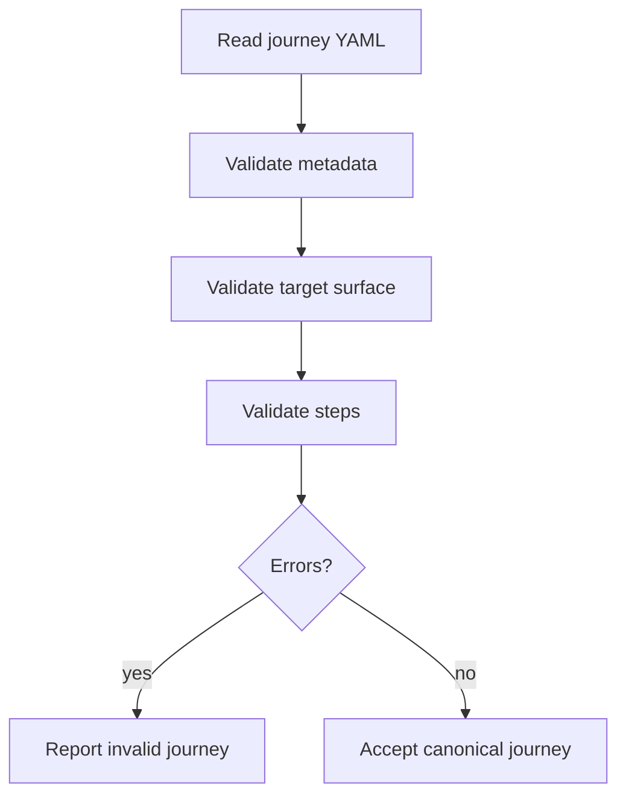
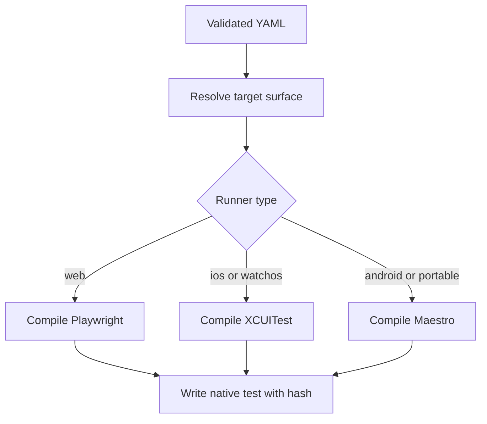
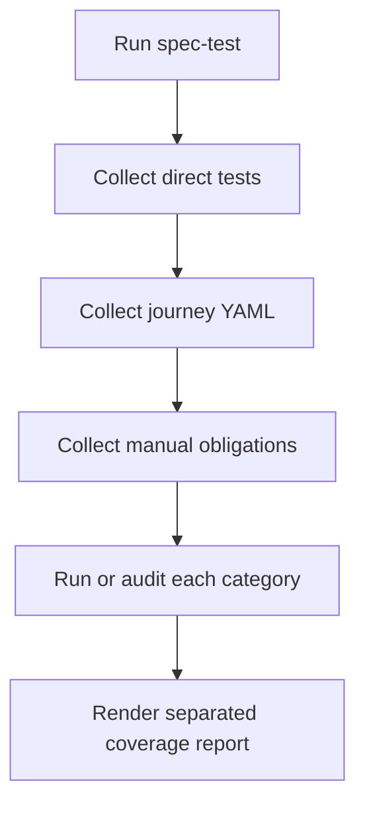
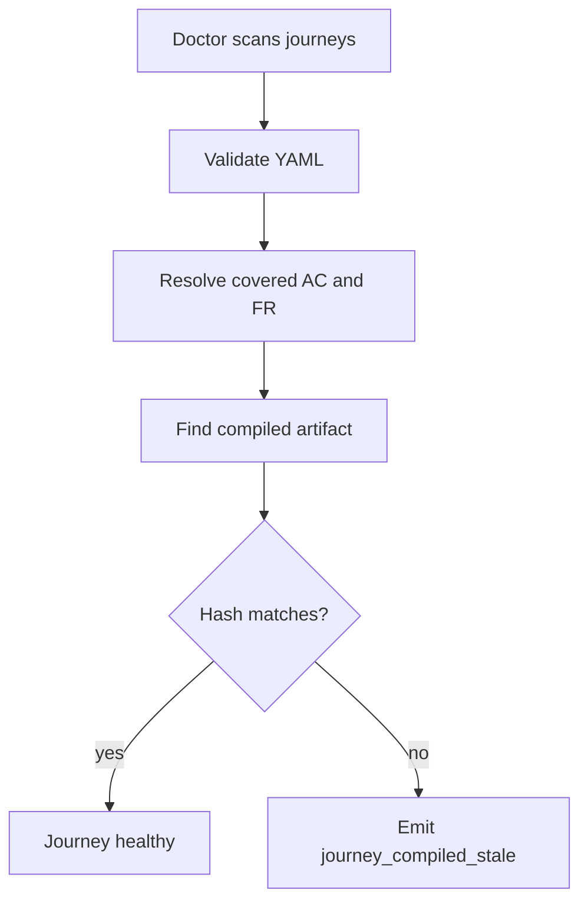

# Feature 056 - Executable User Journeys

- **Feature Name:** Executable User Journeys
- **Branch:** `feature/056-executable-user-journeys`
- **Date:** 2026-06-01
- **Status:** Implemented
- **Input:** Add human-readable functional user journeys as YAML source files that LiveSpec can validate, compile ahead-of-time to native project test frameworks, run as regression tests, and audit through Spec Doctor. These journeys must be distinct from direct tests generated by `/spec-test`.

## User Scenarios & Testing

### Story 1 (P1) - Product owner defines a functional journey in YAML

**Description:** A user needs to describe a real user flow in a format that remains readable, reviewable, and independent of Playwright, XCUITest, Maestro, or any single project test framework.

**Priority reason:** User journeys are functional source-of-truth artifacts; generated tests are implementation artifacts.

**Independent test:** A valid YAML journey with `open`, `fill`, `click`, `wait`, and `assert` passes schema validation.

```gherkin
Feature: Journey YAML validation
  Scenario: Valid login journey is accepted
    Given a journey file ".specs/journeys/login-happy-path/journey.yaml"
    And the journey contains open, fill, click, wait, and assert steps
    When the user runs "livespec journey validate"
    Then the journey validates successfully
```



### Story 2 (P1) - Developer compiles journeys ahead-of-time to native tests

**Description:** A developer needs LiveSpec to compile the canonical YAML into the project's native test framework before execution, so syntax or target errors are caught early and not generated dynamically at runtime.

**Priority reason:** Dynamic translation at test time would create a new source of flakiness and ambiguity.

**Independent test:** A web journey compiles to Playwright and an iOS journey compiles to XCUITest with a source hash embedded in each artifact.

```gherkin
Feature: Journey compilation
  Scenario: Web journey compiles to Playwright
    Given a valid journey targeting surface "web"
    When the user runs "livespec journey compile --feature 012-auth"
    Then a Playwright spec is generated under "tests/e2e/journeys"
    And the generated file contains the journey source hash

  Scenario: iOS journey compiles to XCUITest
    Given a valid journey targeting surface "ios"
    When the user runs "livespec journey compile --feature 012-auth"
    And the project has exactly one iOS UI test target directory "AppUITests"
    Then a Swift UI test is generated under "AppUITests/Journeys"
    And the generated file contains the journey source hash
```



### Story 3 (P1) - Regression runs distinguish journeys from direct tests

**Description:** A developer needs `/spec-test` and feature pipelines to distinguish direct generated tests from executable user journeys and from manual test obligations.

**Priority reason:** Ambiguous test categories make coverage reports misleading.

**Independent test:** A test audit report shows separate counts for direct tests, journeys, and manual tests.

```gherkin
Feature: Test category reporting
  Scenario: Test report separates user journeys
    Given a feature has direct unit tests
    And the feature has two executable user journeys
    And the feature has one manual test obligation
    When "/spec-test" audits the feature
    Then the report lists direct tests separately from executable user journeys
    And manual tests remain separately labeled with their reason
```



### Story 4 (P1) - Spec Doctor detects stale or incoherent journeys

**Description:** A maintainer needs `spec-doctor` to detect invalid YAML, stale compiled artifacts, journeys covering removed ACs, and journeys targeting unsupported runners.

**Priority reason:** User journeys must not become another stale documentation layer.

**Independent test:** Modifying a journey YAML after compilation produces `journey_compiled_stale` in the doctor report.

```gherkin
Feature: Journey doctor integration
  Scenario: Compiled artifact is stale
    Given a journey YAML was compiled to a native test file
    And the YAML content changes after compilation
    When the maintainer runs "livespec doctor"
    Then the report includes "journey_compiled_stale"
```



## Acceptance Criteria

- **AC-001:** A valid canonical `journey.yaml` file is accepted by `livespec journey validate`.
- **AC-002:** A journey with an unknown action fails with a clear validation error.
- **AC-003:** `wait.seconds` with `until` compiles to a bounded conditional wait.
- **AC-004:** `wait.seconds` without `until` and without `reason` produces a warning.
- **AC-005:** `livespec journey compile` generates a Playwright artifact for a web surface.
- **AC-006:** `livespec journey compile` generates an XCUITest artifact for an iOS surface.
- **AC-007:** `livespec journey compile` generates an XCUITest artifact for a watchOS surface when the project exposes that runner.
- **AC-008:** Each compiled artifact includes a deterministic source hash for the YAML.
- **AC-009:** Changing the YAML after compilation makes Spec Doctor report `journey_compiled_stale`.
- **AC-010:** A journey covering a removed or superseded AC produces a doctor finding.
- **AC-011:** `/spec-test` reports direct tests, executable user journeys, and manual tests as distinct categories.
- **AC-012:** `/spec-feature` compiles journeys before running the feature's functional test suite.
- **AC-013:** A journey targeting a surface without a compatible runner fails with an actionable message.
- **AC-014:** `disabled` journeys are not executed but remain visible in doctor reports.
- **AC-015:** `manual` journeys require a reason before they can suppress executable coverage expectations.

## Functional Requirements

- **FR-001:** Add `system/testing/user-journeys.md` as the canonical format reference.
- **FR-002:** Add a `validator/journeys/` package with schema validation, compilation, hashing, and reporting.
- **FR-003:** Add CLI commands `livespec journey validate`, `livespec journey compile`, and `livespec journey test`; `journey test` is the compatibility alias of `livespec journey run`, which executes compiled artifacts without compiling.
- **FR-004:** Define canonical journey source files under `.specs/journeys/<journey-id>/journey.yaml` (schema version 2); legacy `.specs/journeys/<feature-slug>/<journey-id>.journey.yaml` files are migration input for `livespec journey migrate --from-v1` only.
- **FR-005:** Support v1 actions: `open`, `click`, `fill`, `select`, `wait`, `assert`, `assert_not`, `screenshot`, `back`, and `press`.
- **FR-006:** Compile web journeys to Playwright tests under the project's native e2e test location.
- **FR-007:** Compile iOS and watchOS journeys to XCUITest Swift files under native UI test targets.
- **FR-008:** Compile Maestro journeys when a compatible Maestro runner is available.
- **FR-009:** Embed a source hash in compiled artifacts and expose stale detection to Spec Doctor.
- **FR-010:** Update `/spec-specify` to propose 1 to 3 journeys for interactive features.
- **FR-011:** Update `/spec-feature` to generate, compile, and execute journeys as part of the feature pipeline.
- **FR-012:** Update `/spec-test` to distinguish direct tests, executable journeys, and manual obligations.
- **FR-013:** Add `scan_journeys(project_root)` so Feature 055 integrates with Feature 056 without duplicating journey logic.

## Key Entities

- **JourneyFile:** Canonical YAML source for one functional user path.
- **JourneyStep:** A typed action such as `click`, `fill`, `wait`, or `assert`.
- **JourneyTarget:** Surface and runner resolution data for web, iOS, watchOS, Android, or Maestro.
- **CompiledJourneyArtifact:** Native generated test file with source hash and back-reference to the YAML.
- **JourneyRunPolicy:** `always`, `smoke`, `manual`, `disabled`, or future policy extension.

## Canonical YAML Shape

```yaml
schema_version: 2
id: login-happy-path
title: User can log in
status: active
description: A registered user logs in and reaches the dashboard.
covers:
  - feature: 012-auth
    kind: ac
    ref: AC-001
    reason: Login is the journey entry point.
run_policy:
  local: always
targets:
  - surface: web
    runner: playwright
steps:
  - action: open
    target: { route: "/login" }
  - action: fill
    target: { label: "Email" }
    value: "user@example.com"
  - action: click
    target: { role: "button", name: "Login" }
  - action: wait
    seconds: 10
    until: { text: "Dashboard", product_contract: true }
  - action: assert
    target: { text: "Dashboard", product_contract: true }
privacy:
  llm_allowed: false
  retention: none
```

A `manual` journey adds a top-level `manual_reason`; a fixed `wait` without `until` adds a step-level `reason`.

## Edge Cases

- A journey waits for a fixed delay only: warn unless it includes a reason.
- A journey references a deleted AC: doctor reports incoherence and the journey does not count as current coverage.
- A compiled artifact exists but the source YAML is missing: doctor reports an orphan compiled journey.
- A project has several UI test target directories for one surface and no explicit `testDir` in `.specs/surfaces.yaml`: compilation fails with `journey_xcuitest_target_unresolved` instead of guessing; the runner itself is never ambiguous because each target declares it.
- A journey uses `select` on XCUITest or Maestro: compilation fails with `journey_capability_unsupported` and writes no artifact; only Playwright compiles `select`.
- A watchOS journey in a project without a watchOS UI test target: compilation fails with `journey_xcuitest_target_unresolved`.
- A journey is marked manual: require a reason and keep it separate from executable regression coverage.

## Success Criteria

- **SC-001:** Journey validation rejects malformed YAML and unknown actions with actionable errors.
- **SC-002:** Playwright and XCUITest compilers produce deterministic artifacts from the same YAML.
- **SC-003:** Spec Doctor detects stale compiled journeys using source hashes.
- **SC-004:** `/spec-test` reports journey coverage separately from direct generated tests.
- **SC-005:** The format is portable enough that Swift-only projects do not need Playwright as a dependency.

## Clarifications

### Session 2026-10-12

- Q: Which stage applies when `journey run` (or `journey test`) has no `--stage`, and what does `smoke` mean (FR-003)? -> A: Without `--stage` the `local` stage policy applies, including in the `/spec-feature` gate. `smoke` marks a journey as part of the fast subset a pipeline may choose to run on its own; `journey run` executes `always`, `smoke` and `impacted` journeys identically, and the policies differ only for `manual` and `disabled`.
- Q: What are the fields of each action and which runner compiles it (FR-005)? -> A: `open` takes `target.route` (Playwright and Maestro accept a route or URL; XCUITest requires a URL or deep link); `click`, `assert` and `assert_not` take a `target`; `fill` and `select` take a `target` and a string `value`; `press` takes a `key`; `wait` takes `seconds` with optional `until` or `reason`; `screenshot` and `back` take no field. A target uses at least one locator among `semantic_id`, `test_id`, `i18n_key`, `role` (with `name`), `accessibility_label`, `label`, `route` or `text`; `text` requires `product_contract: true` because visible copy becomes a product contract. Playwright compiles every action; XCUITest compiles all but `select` and `press`; Maestro compiles all but `select`, `screenshot` and a fixed `wait`. Any other combination fails compilation with `journey_capability_unsupported` and writes no artifact.
- Q: How do run policies and stages behave, and what happens to a stale artifact (FR-003, AC-014)? -> A: `run_policy` maps the stages `local`, `pre_commit`, `pre_push`, `ci` and `nightly` to `always`, `smoke`, `impacted`, `manual` or `disabled`; an undeclared stage means `impacted`. `journey run` executes every selected journey whose stage policy is `always`, `smoke` or `impacted` (selection is by `--journey`, `--feature` or all journeys; `livespec journey impact` is how pipelines narrow to impacted ones), skips `manual` and `disabled` ones while listing them, and reports a missing or stale artifact or compiler version as an error (`journey_compiled_missing`, `journey_compiled_stale`, `journey_compiler_stale`) without running it.
- Q: Which exit codes do the journey commands use? -> A: `journey validate` exits 0 when only warnings remain and 1 on any error (unknown action, malformed YAML, schema error, missing manual reason, missing requirement); `journey compile` exits 3 when an XCUITest target cannot be resolved and 1 for any other error such as `journey_capability_unsupported`; `journey run` and `journey test` exit 0 without errors and 1 otherwise.
- Q: Where do Playwright and Maestro artifacts go (FR-006, FR-008)? -> A: Playwright writes `tests/e2e/journeys/<journey_id>.spec.ts` (the project-root `tests/e2e` convention); Maestro writes `.specs/maestro/journeys/<journey_id>.yaml` when a target declares `runner: maestro`; both embed the source hash.
- Q: What is a superseded AC for AC-010? -> A: Any covered AC or FR that no longer appears in the covered feature's spec (removed, renumbered or replaced). Validation and Spec Doctor both report it as `journey_requirement_missing` (ERROR) and the journey no longer counts as valid coverage.
- Q: Which features are interactive for FR-010, and what does `/spec-specify` propose? -> A: A feature is interactive when its spec declares a UI surface (`Surfaces:` web, ios, watchos or android) or a `## Screens` section. `/spec-specify` then lists 1 to 3 proposed global journey IDs with the ACs each would cover, to be created through `$spec-journey create`; it does not write journey YAML itself.
- Q: Does `/spec-feature` compile journeys itself (AC-012, FR-011)? -> A: Journeys are compiled ahead of time whenever they are created or edited (`$spec-journey` or `livespec journey compile`), never at test time. Before the functional suite, the `/spec-feature` Executable Journey Gate runs `livespec journey impact` and `livespec journey run --feature <slug>` and fails on any missing or stale compiled artifact, so the functional suite only runs once every executable journey of the feature is compiled from its current source.
- Q: Where do XCUITest artifacts go, and when does a project expose an iOS or watchOS runner (FR-007, AC-006, AC-007)? -> A: An explicit `testDir` on the matching `runner: xcuitest` surface of `.specs/surfaces.yaml` (matched by `platform: ios|watchos`) wins. Otherwise the destination is `<Target>/Journeys/` under the project's unique top-level directory named `*UITests`: for `ios`, the one whose name does not contain `watch`; for `watchos`, the one whose name contains `watch` (case-insensitive). A surface is exposed only when that target directory resolves. Zero or several candidates fail compilation with `journey_xcuitest_target_unresolved` (a configuration error: `livespec journey compile` exits 3) naming the candidates and the `testDir` override; no project name is hardcoded.
- Q: Which runners compile `select` (FR-005)? -> A: `select` takes a target and a string `value`. Playwright compiles it to `<locator>.selectOption(<value>)`; XCUITest and Maestro refuse it with `journey_capability_unsupported` and write no artifact.
- Q: When is a journey `disabled` (AC-014)? -> A: For a run stage, a journey is disabled when its `status` is `disabled` or that stage's `run_policy` is `disabled`; `livespec journey run --stage <stage>` never executes it and lists it as disabled. Doctor reports `journey_disabled` (INFO) when the status or any stage policy is `disabled`, and the journey stays out of executable coverage.
- Q: Which journey layout and YAML shape are canonical (FR-004, AC-001)? -> A: The schema-version-2 layout `.specs/journeys/<journey-id>/journey.yaml` with the shape shown in Canonical YAML Shape; a journey covers qualified `feature`/`kind`/`ref` requirements and declares per-stage `run_policy` and `targets` with `surface` and `runner`. Legacy per-feature `.journey.yaml` files are not validated in place; they are converted with `livespec journey migrate --from-v1`.
- Q: Is the execution command `journey test` or `journey run` (FR-003)? -> A: Both: `livespec journey run` executes fresh compiled artifacts through their native runner and never compiles; `livespec journey test` is its compatibility alias with the same selection, reporting and exit codes (0 without errors, 1 otherwise).
- Q: Where are the `wait` fields declared, and which command reports AC-004? -> A: On the `wait` step itself: `action: wait` with a positive integer `seconds`, an optional `until` target that must become visible, and an optional free-text `reason`. `livespec journey validate` reports a `wait` step that has `seconds` but neither `until` nor a non-blank `reason` as the warning `wait_reason_missing` (severity WARNING, naming the 1-based step index). Warnings do not change the exit code. Every `wait` step declares `seconds`, so every wait stays bounded, and `until` is accepted only on `wait` steps.
- Q: What does the bounded conditional wait of AC-003 compile to? -> A: The runner waits until the `until` target is visible, for at most `seconds`, and fails the journey on timeout. Playwright emits `expect(<locator>).toBeVisible({ timeout: <seconds × 1000> })`. XCUITest waits through `XCTWaiter` for the element to exist and be hittable within `<seconds>` and fails the test otherwise. Maestro emits `extendedWaitUntil` with `visible` and `timeout` in milliseconds. A fixed wait (no `until`) compiles to a fixed delay on Playwright and XCUITest. Maestro has no fixed-delay command, so a fixed wait there fails compilation with `journey_capability_unsupported` (AC-013).
- Q: Which journeys are `manual`, and where is the reason declared for AC-015? -> A: A journey is manual when its `status` is `manual` or any `run_policy` stage is `manual`. It declares a top-level, non-blank `manual_reason`. Without one, `livespec journey validate` fails with the error `journey_manual_reason_missing`. The journey is then neither counted nor reported as a manual obligation, and `livespec journey run` reports the same error instead of silently skipping it.
- Q: For FR-008, is Maestro a surface or a runner, and when is a compatible Maestro runner available? -> A: Each journey target declares `surface` and `runner` separately. Maestro is a runner (`runner: maestro`) used for the `android` surface or the portable `maestro` surface. It is available when its registered compiler backend supports every step of the journey. Otherwise compilation fails with `journey_capability_unsupported` and no artifact is written (AC-013).
