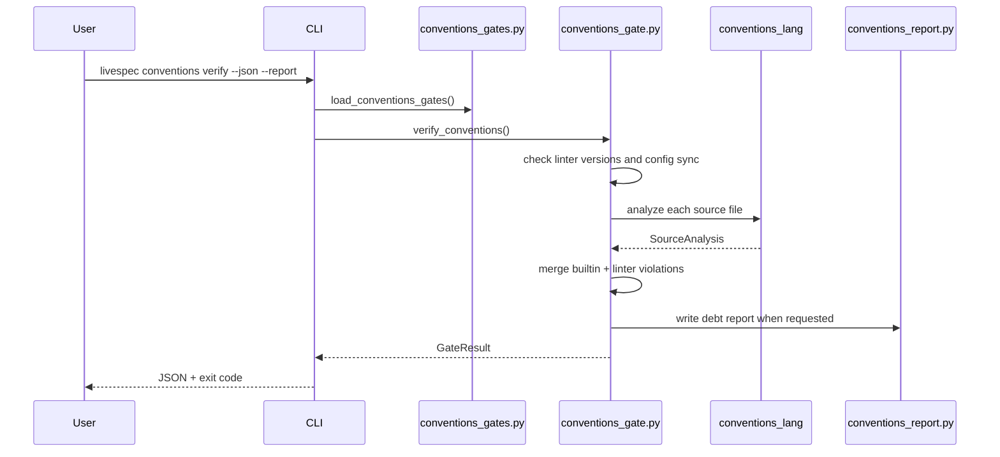
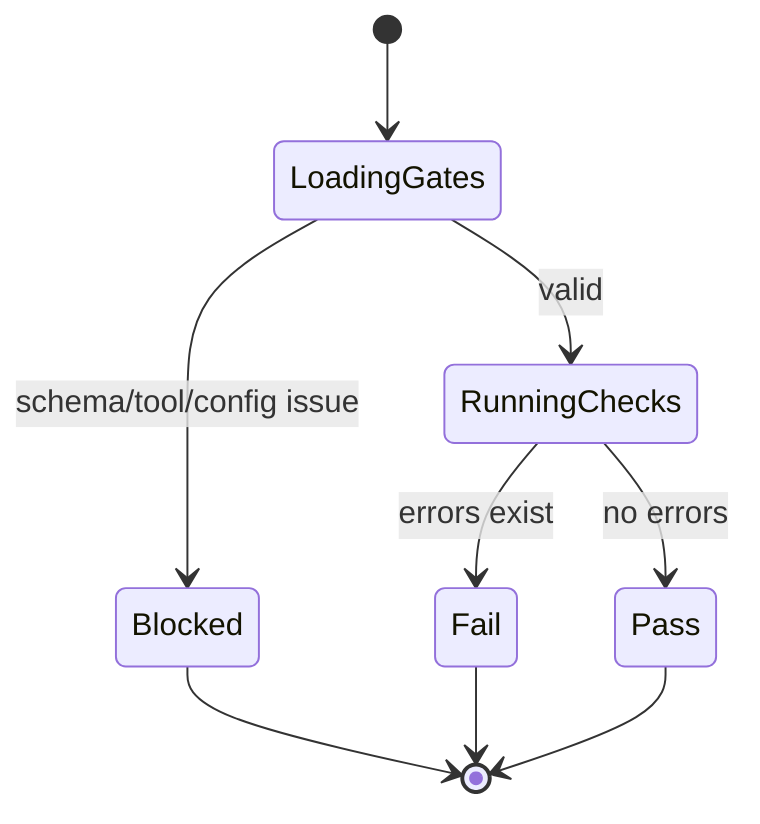
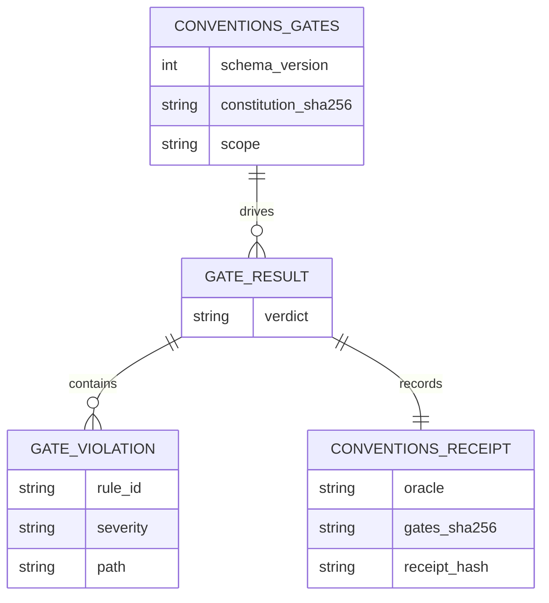

# Plan - Conventions Gates Engine

## Summary

Add the deterministic conventions gate as a set of small Python modules: gates schema/generator,
adapter registry, verification engine, debt report, receipt oracle, CLI wiring, and focused tests.

## Technical Context

| Aspect | Choice |
|---|---|
| Language | Python 3.11+ |
| CLI | Typer existing `conventions_app` |
| Validation | Pydantic v2 |
| YAML | PyYAML |
| Tests | pytest |
| Formatting | ruff via `uvx` in this environment |

## Constitution Check

- **Layered validation:** schema load precedes tool execution; BLOCKED is reserved for invalid
  environment/config.
- **Provider agnostic:** no LLM is involved; Python computes every verdict.
- **Filesystem source of truth:** gates live in `.specs/conventions-gates.yaml`.
- **Fail fast:** invalid gates, tool mismatch, and config mismatch stop before producing PASS/FAIL.
- **Minimal surface:** one nested `gates init`, one `verify`, one `scaffold`.

## Sequence Diagram — Verify

```gherkin
Feature: Verify conventions
  Scenario: Deterministic fail
    Given a valid gates file
    And   at least one builtin error violation
    When  livespec conventions verify --json runs
    Then  the CLI exits 1
    And   the JSON verdict is FAIL

  Scenario: Deterministic block
    Given a declared linter version mismatch
    When  livespec conventions verify --json runs
    Then  the CLI exits 2
    And   the JSON verdict is BLOCKED
```



## State Diagram — Verdict

```gherkin
Feature: Verdict state
  Scenario: PASS without errors
    Given no blockers and no error violations
    When  the result is computed
    Then  verdict is PASS

  Scenario: FAIL with errors
    Given no blockers and at least one error violation
    When  the result is computed
    Then  verdict is FAIL

  Scenario: BLOCKED with blockers
    Given at least one blocker
    When  the result is computed
    Then  verdict is BLOCKED
```



## ER Diagram — File Artifacts



## Implementation Plan

1. Add tests first for schema/generation, verify/report/CLI, and receipt.
2. Implement `validator/conventions_gates.py`.
3. Implement `validator/conventions_lang/` adapters.
4. Implement `validator/conventions_gate.py` and `validator/conventions_report.py`.
5. Implement `validator/conventions_receipt.py`.
6. Wire Typer commands in `validator/cli_commands/utility_cmd.py`.
7. Generate `.specs/conventions-gates.yaml`.
8. Run focused tests, ruff, and broader pytest.

## Testing Strategy

- `tests/test_conventions_gates_schema.py`
- `tests/test_conventions_verify.py`
- `tests/test_conventions_receipt.py`
- `python3 -m pytest tests/test_conventions_*.py -q`
- `uvx ruff check ...`
- `uvx ruff format --check ...`

## Risks & Considerations

- Full repo `conventions verify` may report debt before later remediation features; 061 only installs the
  engine and report machinery.
- TS/Swift function parsing is heuristic until delegated linters cover richer language semantics.

## Current Guarantees and Regression Ownership

This describes the existing behavior required by the current spec; it does not add runtime scope. Source pointers and test names identify implementations to inspect and execute, not evidence of a current PASS. Framework source still follows the constitution's 300/50 limits; generated consumer defaults remain 400/500 and 30/60.

| Requirement | Implementation and verification step |
|---|---|
| AC-002 | Keep `conventions_gates._build_default_gates` generated thresholds; assert exact values and constitution hash in `test_generate_gates_uses_two_level_thresholds_and_source_hash`. |
| AC-004 | Check version and configured SwiftLint limit synchronization in `_version_blockers` and `_sync_limit_blockers`; run mismatch and managed-config tests. |
| AC-005, AC-013, AC-016 | `_collect_violations` runs file/function length, headers, public docs, token scale, suppressions and import checks independently of declared linters; keep real oversized sources blocking. Run builtin/linter coexistence and warning/error fixtures. |
| AC-006, FR-003, FR-006 | Keep Python AST analysis, TS/React and Swift deterministic heuristics, and visible `GenericAdapter.coverage=partial` fallback through `registry.adapter_for_path`. Add dedicated TS lexical-boundary regressions described below, alongside existing adapter fixtures. |
| AC-007, AC-012 | `verify_conventions_receipt` verifies payload, gates hash, scoped identity and verdict consistency. Reject PASS containing error/blockers and reject a receipt after its current gates bytes change. Execute the existing receipt negative tests. |
| AC-008 | `write_debt_report`, `_group_debt`, `_summary` and `_sort_key` write both debt-report.md and regenerable debt.json, ordered worst-first with warning/error/suppression counts; assert actual report artifacts. |
| AC-009 | `scaffold_linter_configs` / `_scaffold_swiftlint` apply managed SwiftLint limits only via requested `--apply --sync-limits`; execute the existing CLI sync fixture. |
| AC-010, SC-001 | Execute the prescribed focused pytest suite; inspect the real aggregate runner/JUnit outcome and require zero skips before declaring this obligation met. Preserve lint and format checks for touched files. |
| AC-011, FR-007 | `parse_linter_json` / `_ruff_violation` recognize Ruff flat filename/location/message records, map to ERROR, and fail conventions. Execute `test_verify_extracts_ruff_flat_json_violations`. |
| AC-013 | `GatesBaseModel` forbids extra fields; `ConventionsGates` and `GateCommand` reject schema-v1 delegation/wiring fields. Execute both existing strict-schema tests; never disable builtins through linter declaration. |
| AC-014 | `_staleness_blockers` compares current constitution SHA256 to generated metadata; stale input blocks. Keep debt.json ignored/regenerable and run the stale constitution fixture. |
| AC-015 | Conventions receipts provide audit traceability only. Feature 063 owns mandatory fresh supervisor re-execution; `supervisor_conventions_gate` ignores stale worker PASS when the fresh result fails. Preserve both scoped feature evidence and separate repo-scope completion obligations; receipt alone is insufficient. Run the existing stale-worker/fresh-failure boundary test without changing 063. |
| AC-017, FR-007 | Source PermissionError/OSError becomes an auditable blocking `file_read_error` in `_collect_violations` / `_result_from`, without traceback; run the unreadable-source fixture. Retain invalid-encoding and linter-timeout BLOCKED tests. |

## Targeted TS Function Boundary Repair (FR-003 / AC-006)

Before source writes, require current Clarify and Analyze readiness and authentic current reviews. Mask lexical strings, comments, regular-expression bodies/character classes and template literals while retaining newline positions. Count only structural braces when computing function end; distinguish division from regular-expression delimiters. Keep the adapter explicitly heuristic, with no new parser dependency or threshold/exclusion changes.

Regression inputs include the real five-line `isRedirectOnlyFile` body, whose regex `[^<{]` currently extends its span to EOF; escaped quotes/slashes, multiline comments/templates, multiple function boundaries and division expressions. Assert exact inclusive line counts and that genuine functions longer than the declared gate limit still fail. The actual file's physical size remains subject to file-length checks. Read [`test_conventions_typescript_boundaries.py`](../../../tests/test_conventions_typescript_boundaries.py) for the dedicated regression inputs; maintain existing TS imports/suppressions/token analysis and public-doc behavior. Run targeted regressions plus the existing conventions regression suite, Ruff format/check and strict type checks. Freeze governed writes before final receipt capture and require fresh feature and supervisor repo gates before phase completion.
