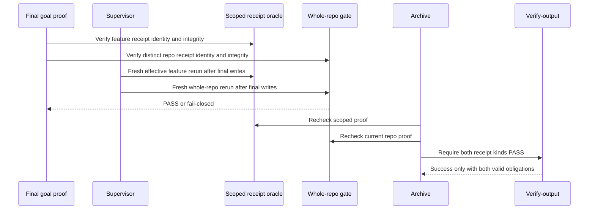
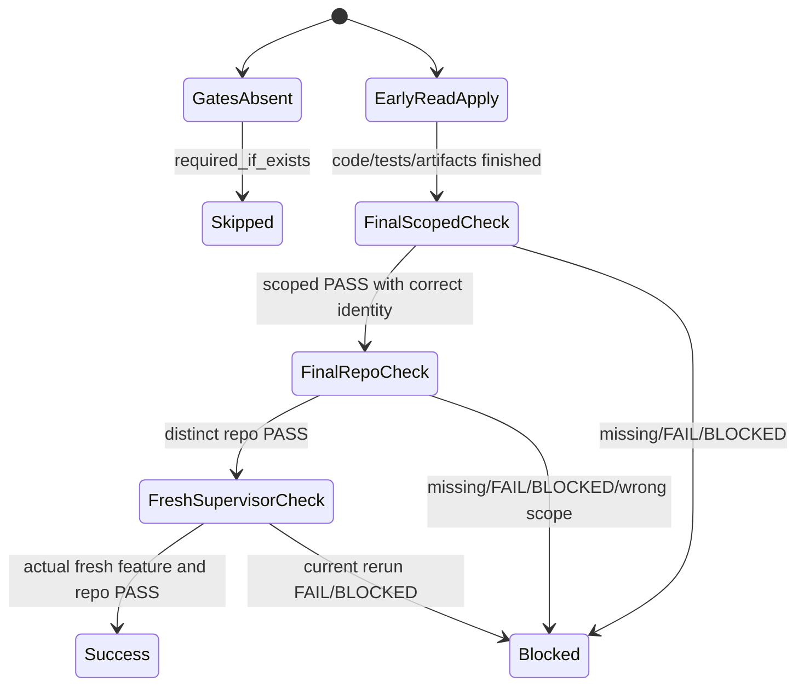

# Plan — Conventions Blocking Pipeline

## Summary

Wire conventions receipts into the command completion pipeline so final command success requires a fresh repo-scope conventions PASS.

## Technical Context

- Language: Python 3.12+
- Test runner: pytest
- Quality gates: ruff, ruff format, pyright
- Command docs: `.agent-sync/skills/*/{SKILL.md,expectations.md}` and `.agent-sync/agents/*/prompt.md`

## Constitution Check

- Keep new modules focused and below the line limit.
- Prefer typed dataclasses and pure helpers for diff/hash locks.
- Preserve existing command contracts and extend them through tests first.

## Gherkin Scenarios + Mermaid Sequence Diagrams

```gherkin
Feature: Conventions receipt verification
  Scenario: A command archives final scoped and repo PASS receipts
    Given a final goal task submits conventions_receipt_path and repo_conventions_receipt_path
    And the supervisor has freshly rerun both effective scopes after final writes
    When RunArtifact archiving re-verifies receipts
    Then the conventions receipt is marked verified
    And verify-output can require verdict PASS

  Scenario: A command archives a FAIL conventions receipt
    Given a verified conventions receipt has verdict FAIL
    When verify-output evaluates receipt_verdict PASS
    Then the artifact outcome is drift
```



## Mermaid State Diagrams



## Implementation Plan

1. Add the feature spec before code.
2. Add failing tests for receipt re-verification, artifact outcome, verify-output, goal proof, R7, diff/hash/fresh locks, and command docs.
3. Extend `validator/run_receipts.py` for conventions receipts.
4. Extend `validator/verify_output.py` and `validator/expectations.py` for `receipt_verdict`.
5. Extend `validator/goal_contracts.py` so gates-aware tasks require and verify `conventions_receipt_path`.
6. Add `validator/coherence/rules/r7_conventions_gates.py` and register it.
7. Add `validator/conventions_diffguard.py` for supervisor diff, hash, and fresh-run locks.
8. Update command expectations, command SKILLs, and verifier/supervisor prompts.
9. Run targeted tests, full tests, ruff, format check, and pyright.

## Testing Strategy

- Read and run [`tests/test_run_receipts.py`](../../../tests/test_run_receipts.py) for conventions receipt re-verification.
- Read and run [`tests/test_conventions_diffguard.py`](../../../tests/test_conventions_diffguard.py) for supervisor locks.
- Read and run [`tests/test_conventions_pipeline_docs.py`](../../../tests/test_conventions_pipeline_docs.py) for command documentation contracts.
- Re-run the full `pytest tests/ -x -q` suite.

## Risks & Considerations

- `validator/goal_contracts.py` is pre-existing large shared code; this plan limits edits to the conventions receipt proof path.
- The global test suite contains existing skipped tests; the feature-specific targeted tests add no skips.

## Bounded final-only correction (2026-10-09)

- Declare a final documentary DoD row in the gated skills; compile its two conventions receipt obligations after all other DoD rows, immediately before archive. Do not fabricate an unclassified task or reuse another specialized evidence family. Preserve convention read/apply fields on every existing row.
- Require distinct feature and repo evidence keys, with canonical identity checks in goal proof and archive consumers; never reinterpret existing immutable goals.
- Before final acceptance execute current feature and whole-repo gates; FAIL/BLOCKED blocks final success even when a historical receipt is internally valid.
- Align affected skills/expectations with both final obligations; preserve all FR/AC declarations, protected gate checks and supervisor reruns.
- Add regressions for early documentary proof, missing read/apply, missing/non-PASS final proof, feature/repo substitution, changed-code reruns and historical receipt compatibility.

## Final conventions evidence reconciliation

- FR-006 / AC-004 / EC-003 apply only to final command completion, after code, tests and artifact writes. Early tasks retain 053 read/apply evidence and all progression prerequisites; an early baseline FAIL is recorded without pretending final readiness.
- FR-002 / AC-007 require the actual feature identity in `conventions_receipt_path`. Separately, 065 FR-005 / AC-013 require `repo_conventions_receipt_path` with identity `repo`; a feature PASS cannot substitute for repo PASS. Repo goals may reference the same actual repo receipt under both distinct obligations.
- FR-010 / AC-015 and 061 AC-015 require a fresh supervisor rerun of the whole repository before final success. Receipt integrity alone, a stale worker PASS, or historical debt never waives this rerun or authorizes `PHASE_RESULT: OK`.
- Existing receipt schemas 1/2 do not bind source-code hashes or enumerate the verified source dataset. Preserve their historical meaning; final current verification must execute the actual scoped and repo gates again.
- Inspect: [repo completion requirements](../065-conventions-migration-docs/spec.md).
- Inspect: [receipt contract](../061-conventions-gates-engine/spec.md).
- Inspect: [conventions enforcement](../../../system/conventions-enforcement.md).
- Inspect: [installed system](../../spec-system.md).
- Inspect: [system template](../../../system/spec-system.md).
- Inspect: [implement skill](../../../.agent-sync/skills/spec-implement/SKILL.md).
- Inspect: [test skill](../../../.agent-sync/skills/spec-test/SKILL.md).
- Inspect: [fix skill](../../../.agent-sync/skills/spec-fix/SKILL.md).

- Inspect: [implement expectations](../../../.agent-sync/skills/spec-implement/expectations.md).
- Inspect: [test expectations](../../../.agent-sync/skills/spec-test/expectations.md).
- Inspect: [fix expectations](../../../.agent-sync/skills/spec-fix/expectations.md).

- Preserve final conventions blocking in spec-ship through the same final DoD row; retain its batch, branch, merge, roadmap and child workflow unchanged. Batch/repo goals use explicit repo identity.
- Inspect: [ship skill](../../../.agent-sync/skills/spec-ship/SKILL.md).
- Inspect: [ship expectations](../../../.agent-sync/skills/spec-ship/expectations.md).
