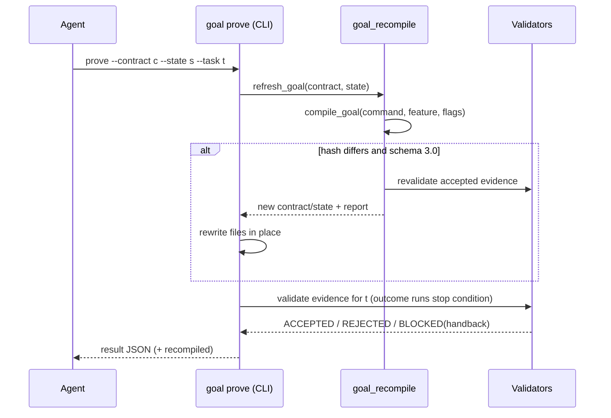
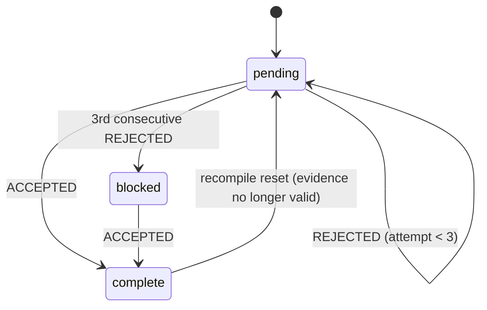

# Technical Plan: Lightweight Outcome-Based Goals

- **Feature:** 081-lightweight-outcome-goals
- **Date:** 2026-10-10

## Summary

Keep the deterministic goal compiler and its receipt validators, but compile contract schema 3.0: one executable stop condition (`outcome.verified`, proven by the goal running it), required tasks restricted to receipt-backed families, the skill inventory kept as an indicative checklist, in-place recompilation on input drift, bounded retries with a BLOCKED handback, and short neutral prompts limited to autonomous runs.

## Technical Context

- **Language:** Python ≥3.11 (`validator/`), Typer CLI, Markdown skills.
- **Dependencies:** none; the stop condition reuses `validator.cli validate` / `validator.init_from_code --verify-only`.
- **Storage:** `$TMPDIR/livespec-goals/` contract/state; archives in `.specs/.runs/`.
- **Testing:** pytest unit, integration 3A, ruff, pyright. **Type:** CLI + skills.

## Constitution Check

- Spec is source of truth: every behavior maps to FR-001..FR-009 with `@spec` anchors.
- Files stay under 300 lines (new `goal_outcome.py`, `goal_recompile.py`, `goal_canonical.py`; CLI helpers moved out of `goal_cli_actions.py`).
- No new dependency or runtime; existing receipt verifiers (078, 058, visual, conventions) are reused unchanged.
- Conventions modules (`validator/conventions*.py`) are untouched.

## Design Decisions

| Decision | Choice | Rationale |
|---|---|---|
| Stop condition | Derived in code from command/feature/flags | Agents cannot edit it; same argv after recompilation |
| Outcome proof | Goal executes the argv itself | Independent verifier; declared exit codes are ignored |
| Required tasks | Typed execution/review rows + receipt families + outcome + archive | Keeps AC mapping and observable output, drops documentary prose |
| Drift | Recompile only schema 3.0 + current evidence policy contracts | Historical goals keep original obligations (078) |
| Retries | Three consecutive rejections → `BLOCKED` + `handback` with a canonical §2 line | Bounded, still accepts a later valid proof |
| Feature scope | A supplied feature always yields `livespec validate .specs/features/<feature>` | A missing feature can never pass project-wide validation |
| Scope | `goal_requirement` (spec-ship, spec-implement default, auto flag of the 6 other autonomous-capable commands) + STEP 0 only in those 8 skills | Short commands answer directly; `--auto` children keep archives for the parent's Verify phase |
| Silent check | Exit 0 needs check output or an existing in-project artifact | Agent-declared output text is never a substitute |
| Status | `goal status` appends `blocked:N (ids)` | Handback visible before DONE |

## Interaction Scenarios

```gherkin
Feature: Recompile on drift
  Scenario: Hook context changes after render
    Given a saved schema 3.0 contract with qe.analysis complete
    When a before-test hook is added and the agent proves outcome.verified
    Then the CLI recompiles, revalidates qe.analysis and rewrites both files in place
    And the proof result reports recompiled with carried qe.analysis

  Scenario: Historical contract
    Given a schema 2.0 contract
    When the agent proves a task
    Then no recompilation happens and original obligations apply
```



```gherkin
Feature: Task state
  Scenario: Three rejections
    Given a pending task
    When three consecutive proofs are rejected
    Then the task is marked blocked and the result status is BLOCKED

  Scenario: Recovery after handback
    Given a blocked task
    When a valid proof is submitted
    Then the task is complete and no longer blocked
```



## Implementation Plan

### Step 1 — Outcome policy module

**FR covered:** FR-001, FR-003. `validator/goal_outcome.py`: `goal_requirement`, `stop_condition`, `outcome_task`, `conventions_gate_task`, `run_stop_condition`, `validate_outcome_evidence`.

### Step 2 — Contract 3.0 compilation

**FR covered:** FR-002, FR-006. `goal_payload.py`, `goal_tasks.py`: filter required tasks after evidence classification, append `conventions.gate`/`outcome.verified`/`archive.run`, renumber ordinals; drop the conventions payload, expectation prose and per-task convention proofs; keep `execution_tasks`/`definition_of_done` as checklist; delete `goal_conventions.py` and `init_goal_conventions.py`.

### Step 3 — Proof, retries and recompilation

**FR covered:** FR-005, FR-007. `goal_proof.py` (rejected streak, handback), `goal_render.py` (`goal status` blocked count), `goal_recompile.py` (refresh + carry, in-place rewrite helper, state reuse), `goal_cli_actions.py` (wires prove/archive/render), `goal_compile.py` (slug resolution for all commands), `goal_pairing.py` (accept 3.0). A recompilation that fails on invalid inputs blocks prove/archive (exit 2) without rewriting files; a removed command keeps its saved contract; render adopts the state of a pair recompiled in place.

### Step 4 — Deadline

**FR covered:** FR-008. Remove the post-completion deadline check in `init_from_code._generate`.

### Step 5 — Prompts and docs

**FR covered:** FR-004, FR-009. Goal section of anti-drift ≤15 lines and no `MUST`/`ABSOLU` anywhere in the block; ≤20-line STEP 0 in the 8 autonomous-capable skills, none elsewhere; Phase 0 rows, spec-feature Analyze/Preflight verification, expectations reference, README, spec-system; bump changed `last_reviewed`. CLAUDE.md only routes to spec-system.

### Step 6 — Tests and dead code

**FR covered:** all. `tests/test_lightweight_goals.py` (one assertion per AC; edge cases: launch failure, failed recompilation, missing-feature scope, ≤10 tasks); adapt goal tests to the checklist/required split; delete child-goal and per-task convention code; record before/after metrics in `progress.md`; update `implementation.md`, `changelog.md`.

## Resolved Test Commands

```bash
ruff check . && ruff format --check .
pyright validator
pytest tests/ --ignore=tests/integration -q
pytest tests/integration/ -m level_3a -q
```

## Testing Strategy and QE Gates

- Unit: requirement matrix (spec-propose/refine/preflight auto modes optional), stop-condition scopes, outcome rules (non-zero, launch failure, timeout, silent check), contract shape for every skill, skill text, retries, CLI drift recompilation, real stop condition, deadline.
- Regression: unit suite versus the `main` baseline failures; integration 3A unchanged.
- A stubbed stop condition (autouse) isolates proof mechanics; `real_stop_condition` tests run the subprocess.

## Risks & Considerations

- Merge risk with parallel edits of skill STEP 0 blocks and `system/` docs; older contracts are not migrated.
- The stop condition is structural; runtime behavior stays proven by execution receipts.
