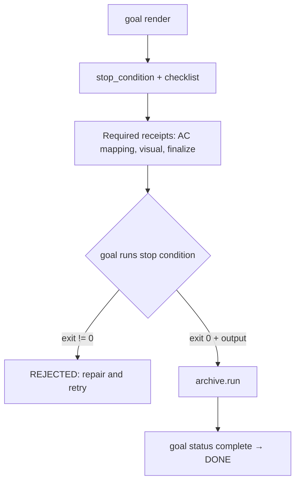
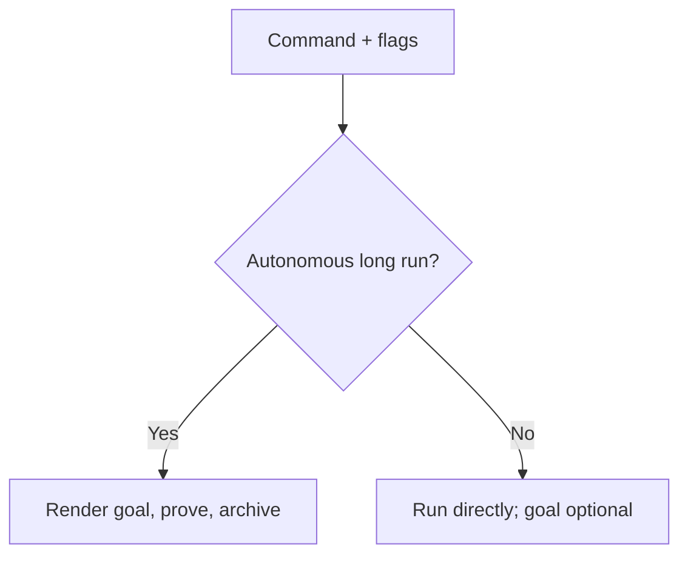
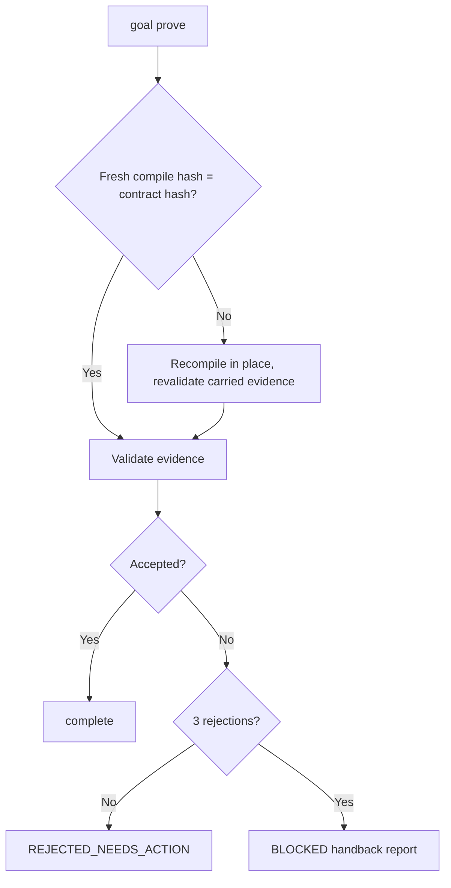

# Feature Spec: Lightweight Outcome-Based Goals

- **Feature:** Replace task-by-task goal locks with one verifiable stop condition per autonomous run
- **Feature Number:** 081
- **Branch:** feat/lightweight-goals
- **Date:** 2026-10-10
- **Status:** Implemented
- **Input:** 150 measured Codex sessions (Sept.–Oct. 2026): 81 BLOCKED stops, ~41 % false blocks or defective contracts, 100 % of false blocks caused by the `/goal`-only rule and "active goal exists → stop"; immutable hashed contracts unrecoverable on input drift (~23 blocks); per-task convention proofs over a third of rejections; a 49/49 run blocked by an expired 300 s deadline. Keep the high-value checks: observable output/artifact, acceptance mapping, `goal status` before DONE, `.specs/.runs` archive receipt.

## Scope and Source Evidence

- Goal compilation and proof: goal payload (`validator/goal_payload.py`), task builder (`validator/goal_tasks.py`), proof (`validator/goal_proof.py`), CLI actions (`validator/goal_cli_actions.py`).
- Runtime prompt: anti-drift block §5 (`system/anti-drift-block.md`) and every `STEP 0 — Goal Lock` in `.agent-sync/skills/spec-*/SKILL.md`.
- Deadline: autonomous init backend (`validator/init_from_code.py`) post-completion deadline check.
- Out of scope: conventions gate modules (`validator/conventions*.py`), install/runtime isolation, archive/RunArtifact v2 schema, typed execution/review receipt verification (078).

## User Scenarios & Testing

### Story 1 — Prove an autonomous run by its outcome `P1`

**As a** maintainer running `/spec-feature --auto`, **I want** the goal to hold one executable stop condition plus the high-value receipts, **so that** a correct run finishes without dozens of documentary proofs while a false DONE stays impossible.

**Priority reason:** Contracts of 25–62 tasks dominate prompt cost and rejections. **Independent test:** Render goals for every command and count required tasks; prove `outcome.verified` against passing and failing stop conditions.

```gherkin
Feature: Outcome goal contract
  Scenario: Contract keeps one stop condition and an indicative checklist
    Given a command skill with an Execution Tasks inventory
    When livespec goal render compiles the command
    Then the contract has a stop_condition with an executable argv
    And every inventory row appears in the non-blocking checklist
    And required tasks are limited to receipts, outcome.verified and archive.run

  Scenario: The goal verifies the stop condition itself
    Given a rendered contract whose stop condition exits non-zero
    When the agent proves outcome.verified with a claimed exit code 0
    Then the proof is rejected with stop_condition_exit_zero missing
    And the same proof is accepted once the stop condition exits 0 with output
```



### Story 2 — Run short commands without a goal lock `P1`

**As a** user running `/spec-check` or `/spec-status`, **I want** no goal ceremony, **so that** short interactive commands answer directly.

**Priority reason:** 20 of 23 skills carried an absolute Goal Lock. **Independent test:** Query the goal requirement for every command/flag combination and grep skills for the lock.

```gherkin
Feature: Goal scope
  Scenario: Autonomous long runs require a goal
    Given spec-ship, spec-feature --auto, spec-init --auto, spec-implement without --step, or a child spawned with --auto
    When the goal requirement is resolved
    Then it is required

  Scenario: Interactive and short commands do not
    Given spec-check, spec-explain, spec-status or spec-feature without --auto
    When the goal requirement is resolved
    Then it is optional and no goal is rendered
    And short commands such as spec-check, spec-explain and spec-status have no goal step
```



### Story 3 — Recover instead of blocking `P1`

**As an** autonomous agent, **I want** missing native goal tools, input drift and repeated rejections to degrade gracefully, **so that** I either finish or hand back a precise report.

**Priority reason:** False blocks and unrecoverable contracts were ~41 % of stops. **Independent test:** Prove against a drifted contract, prove a task three times with bad evidence, rerender an existing goal.

```gherkin
Feature: Recoverable goals
  Scenario: Input drift recompiles and keeps valid evidence
    Given a saved contract whose acceptance criteria changed after render
    When the agent proves a task
    Then the contract and state are recompiled in place under a new hash
    And previously accepted evidence that still validates stays complete

  Scenario: Bounded retries hand back control
    Given a task rejected three times
    When the third rejection is recorded
    Then the result status is BLOCKED with the attempts and the missing evidence

  Scenario: Native goal tools are optional
    Given a runtime without /goal or create_goal
    When an autonomous command starts
    Then it warns and continues with the CLI contract
```



## Acceptance Criteria

### AC-001

Every rendered contract (schema 3.0) carries `stop_condition` with an argv starting with `livespec` and a display string, a `checklist` with every active inventory row, and required tasks drawn only from typed execution/review receipts, visual/finalize receipts, QE, before-hook, conventions-gate, `outcome.verified` and `archive.run` families (at most 10 per contract); no required task demands `observable_output_or_artifact` from documentary prose.

### AC-002

`goal prove --task outcome.verified` executes the contract stop condition itself; a non-zero exit, a launch failure or a timeout is rejected with the observed error; exit 0 is accepted when the check prints output or the evidence names an existing in-project artifact; agent-declared exit codes and output text are never trusted.

### AC-003

`goal_requirement` returns `required` exactly for spec-ship, spec-implement without `--step`/`--dry-run`, spec-feature and spec-init with `--auto`/`-a` (including `--from-code --auto`; spec-init `--dry-run` previews stay optional), and spec-specify, spec-plan, spec-test and spec-fix with `--auto` (the children an autonomous parent spawns); every other combination is `optional`, including short commands that accept an auto flag such as spec-propose, spec-refine or spec-preflight. Only skills that can run in those modes (spec-ship, spec-feature, spec-init, spec-implement, spec-specify, spec-plan, spec-test, spec-fix) keep a goal step.

### AC-004

No skill or anti-drift text blocks on a missing native goal tool or an already active goal; Codex create_goal/get_goal/update_goal, Claude Code `/goal` or no native goal are all accepted, and absence produces a warning only; an already active native goal is updated when the tool allows, otherwise left untouched with a warning.

### AC-005

When the fresh compile of a saved schema 3.0 contract under the current evidence policy differs (feature slug, acceptance, hook context, skill inventory), prove and archive recompile the contract and state in place, carry forward every accepted evidence that revalidates, reset the rest to pending and report `recompiled` with old/new hashes (also recorded as `recompiled_from` in the state); an unnumbered feature slug resolves to the existing numbered feature; a recompilation that fails on invalid current inputs blocks prove and archive without rewriting files; re-rendering an identical goal keeps its existing state, including progress of a pair recompiled in place.

### AC-006

Contracts contain no `required_conventions`, `convention_domains_recorded`, `convention_sources_read` or `conventions_applied_to_output`; conventions-gated commands with a gates file require one `conventions.gate` task with a PASS feature-scope receipt.

### AC-007

After three rejected attempts on one task, prove returns status `BLOCKED` with a `handback` whose report uses the canonical `BLOCKED at step <N> - verification_failed - <reason>` line and lists each attempt's missing evidence, the current missing evidence and repair actions; `goal status` reports the blocked count; a later valid proof is still accepted.

### AC-008

Autonomous init no longer raises a deadline error after all generation, probes and profile checks succeeded; individual subprocesses stay bounded by the shared deadline.

### AC-009

The anti-drift goal section has at most 15 lines, every remaining STEP 0 at most 20 lines, and the whole anti-drift block (all sections) contains no `MUST`, `ABSOLU`, `/goal clear` or `BLOCKED and stop`; the expectations reference, README and spec-system describe the same contract (CLAUDE.md only routes to spec-system); obsolete goal code is deleted and the goal module line count decreases.

## Functional Requirements

- **FR-001:** Compile one executable stop condition per command (feature-scoped `livespec validate .specs/features/<feature>` whenever a feature is supplied, project-scoped `livespec validate`, autonomous from-code check displayed as `livespec init-from-code --verify-only` and executed as `python -m validator.init_from_code . --verify-only`; every stop condition is bounded to 300 s) into contract schema 3.0 and verify it independently at proof time. **Maps to:** AC-001, AC-002.
- **FR-002:** Record the Execution Tasks / Definition of Done inventory as an indicative checklist and keep only high-value evidence families as required tasks, preserving acceptance mapping and observable output in the final verification. **Maps to:** AC-001.
- **FR-003:** Resolve goal requirement by command and flags (spec-ship, spec-implement default, auto flag of the autonomous-capable commands only); keep a short goal step only in skills that can run autonomously and remove it elsewhere. **Maps to:** AC-003.
- **FR-004:** Treat native goal tools as optional mirrors of the CLI contract; update an already active native goal when the tool allows, otherwise leave it untouched with a warning, never stop, and mark the mirror complete after CLI closure. **Maps to:** AC-004.
- **FR-005:** Recompile drifted current (schema 3.0, current evidence policy) contracts in place at prove/archive time with revalidated evidence carry-over, never rewriting historical contracts; resolve unnumbered feature slugs to existing numbered features for every command; preserve state when the same goal is re-rendered. **Maps to:** AC-005.
- **FR-006:** Remove per-task convention proofs and the hashed conventions payload; gate conventions once per feature scope through the existing receipt verifier. **Maps to:** AC-006.
- **FR-007:** Bound rejected attempts per task to three and return a BLOCKED handback report while keeping later acceptance possible. **Maps to:** AC-007.
- **FR-008:** Never block a completed autonomous initialization on the total deadline. **Maps to:** AC-008.
- **FR-009:** Rewrite goal prompts in short neutral outcome language, synchronize docs and expectations, and delete obsolete goal modules. **Maps to:** AC-009.

## Key Entities

- **Stop condition:** Command-derived argv executed by `goal prove`; the single completion criterion besides receipts.
- **Checklist:** Ordered, non-blocking inventory of the command skill.
- **Required task:** Contract task whose proof is a verifiable receipt or the stop condition.
- **Handback:** BLOCKED report with attempts and missing evidence returned to the user.

## Edge Cases

- Feature-scoped command rendered before the feature exists: the stop condition still targets `.specs/features/<feature>` and fails until the feature exists; spec-ship and commands without a feature use project validation.
- Historical contracts (schema 2.0 or an older evidence policy) are never recompiled and keep their original obligations; archived run artifacts stay readable.
- Stop condition runner cannot start or exceeds its bound: proof rejected with the error recorded, never accepted.
- Recompile fails because current inputs are invalid: prove and archive block (exit 2) without rewriting either file; a command whose expectations were removed keeps its saved contract.

## Quality Engineering

- **Risk:** High criticality, shared blast radius (every command goal); primary Contract risk.
- **Applicable dimensions:** Functional correctness, contract compatibility, regression, operability, prompt size. Accessibility not applicable.
- **P0 gates/evidence:** Unit tests per AC, full unit suite against the main baseline, integration level 3A, ruff/pyright, rendered task counts before/after.
- **Boundary:** Tests prove behavior; this spec defines the expected proof; review assesses wording.

## Clarifications

- Lead-authorized: the Goal Lock of this very run uses the CLI contract (`livespec goal render/prove/status/archive`) because a subagent cannot invoke `/goal`.
- Children spawned with `--auto` by an autonomous parent (spec-specify, spec-plan, spec-test, spec-fix) are autonomous runs and keep their own goal and archive. The parent checks that archive in its skill's Supervisor Verify phase (`livespec verify-output <child> --run <artifact>`), not through a task of its own contract.
- Short commands that accept an auto flag (spec-propose, spec-refine, spec-preflight) stay optional: their auto mode skips prompts but is not a long autonomous run.
- spec-implement counts as autonomous unless `--step` or `--dry-run` is active.

## Success Criteria

- **SC-001:** Required tasks per contract drop from 25–62 to at most 10 for every command in this repository.
- **SC-002:** Zero `stop`/`BLOCKED` instructions tied to native `/goal` availability or an active goal remain in skills and system docs.
- **SC-003:** Goal module line count decreases while all preserved-value tests stay green.
