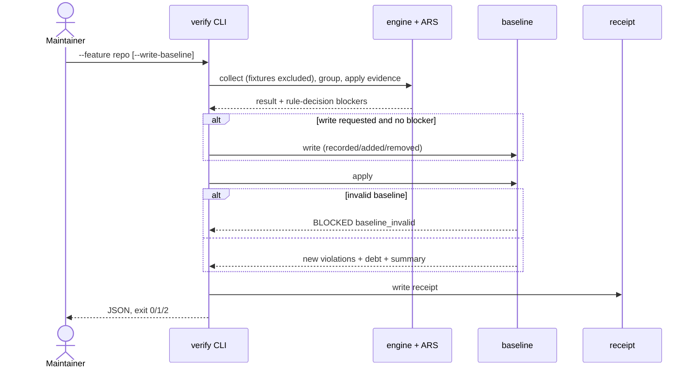
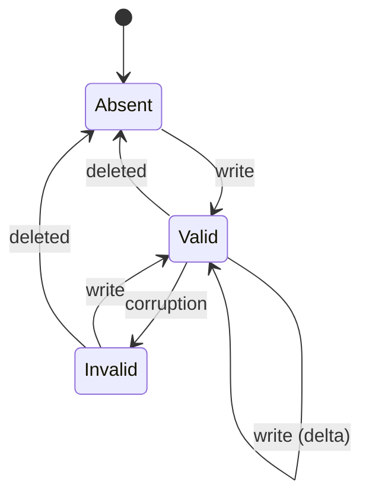

# Technical Plan: Conventions Gate Signal

- **Feature:** 082-conventions-gate-signal · **Status:** Planned · **Scope:** M (7 FR, 8 AC)

## Summary

Exclude `tests/fixtures/conventions_ast/**` from source collection, group shared ARS family matches per file with `rule_ids`, gate framework-sourced ARS rules on the spec's Framework Evidence, and partition repo-scope errors against `.specs/conventions/baseline.json` (written only by `verify --write-baseline`). Read [spec](spec.md).

## Technical Context

Python ≥3.11 stdlib, frozen dataclasses, Typer flag on `conventions verify`, verify exits PASS 0 / FAIL 1 / BLOCKED 2 (feature 061), pytest, Ruff, Pyright, mypy. No LLM, network or new dependency.

## Constitution Check

- ✅ Deterministic layer only; file system is the source of truth; one flag, no subcommand; local only.
- ✅ Fail fast: `baseline_invalid` names path, reason and `--write-baseline` hint; a feature slug with `--write-baseline` is invalid arguments (exit 2).
- ⚠️ Deviation: BLOCKED keeps exit 2 (feature 061 contract) instead of config code 3, as the spec requires.
- ⚠️ Size: new modules ≤300 lines, new or modified functions ≤50 lines (`conventions_verify_command` and `verify_conventions_receipt` are split first). Legacy modules already over 300 lines grow ≤10 lines net and none reaches the 500-line gates limit (`conventions_gate.py` 487 → ≤490).

## Design

1. `DETECTOR_FIXTURE_EXCLUSIONS` plus `effective_source_exclusions()` in `conventions_gates.py`, used by source collection and the linter runner; generated gates files stay unchanged.
2. New `conventions_ast/ars_applicability.py`: language suffixes (moved from `ars_rules.py`) and the Framework Evidence table (imports, `.jsx`/`.tsx`, `drizzle/`/`prisma/`, CSS directives); `framework_for_source()` strips `ai-ressources/`. Fixture-scoped scans (only under the declared root) skip framework evidence.
3. New `conventions_ast/ars_grouping.py`: one evaluation per shared helper per file; `ars.family.<family>` when the helper is the shared family detector, own id otherwise; sorted `rule_ids`, first matching line, family/count message. `GateViolation.rule_ids` is additive.
4. New `conventions_baseline.py` (model, load, render, write; one message per occurrence) and `conventions_baseline_apply.py` (partition by rule and path: message first, then count, `rule_ids` subset; resolved count; receipt fields; hash check). Warnings, encoding/read errors, linter timeouts and linter tool failures are never baselined.
5. CLI repo scope (`--feature repo` or none) and the supervisor repo run (slug absent or `repo`) apply the baseline after rule-decision blockers; a write happens only without blockers and replaces an invalid previous file. Repo receipts add `baseline` and `baselined_violations`; a changed or deleted baseline raises `ConventionsReceiptError("baseline_sha256_mismatch")`. The diff guard protects the baseline.

```gherkin
Scenario: Repo verify against a baseline
  Given a valid baseline recording current debt
  When verify --json --feature repo runs
  Then debt is reported separately, the receipt records the baseline and the exit code is 0
  When one new error appears
  Then only it is listed and the exit code is 1
```



```gherkin
Scenario: Baseline lifecycle
  Given no baseline
  When --write-baseline runs unblocked
  Then the baseline is valid
  When it is corrupted
  Then verify is BLOCKED until --write-baseline replaces it
```



## Implementation Plan

### Step 1 — Fixture exclusion
**FR covered:** FR-001.1: Fixture root exclusion, FR-002.1: Swift fixture headers
Files: `conventions_gates.py`, `conventions_gate.py`, `conventions_linter_runner.py`, Swift `pass.swift`/`fail.swift`.

### Step 2 — Applicability
**FR covered:** FR-004.1: Framework evidence table
Files: new `conventions_ast/ars_applicability.py`.

### Step 3 — Grouping
**FR covered:** FR-002.2: Fixture contract via runtime, FR-003.1: Family grouping, FR-004.2: Runtime evidence
Files: new `conventions_ast/ars_grouping.py`, `ars_rules.py`, `conventions_gate_types.py`, `tests/test_conventions_ars_rules.py` (assert membership in `rule_ids`).

### Step 4 — Baseline core
**FR covered:** FR-005.1: Load, partition, verdict
Files: new `conventions_baseline.py`, `conventions_baseline_apply.py`, `conventions_gate_types.py`.

### Step 5 — CLI, receipt, guard
**FR covered:** FR-005.2: Repo entry points, FR-006.1: Write flag, FR-007.1: Feature independence and binding
Files: `cli_commands/conventions_cmd.py`, `conventions_receipt.py`, `conventions_diffguard.py`.

### Step 6 — Docs, traceability, LiveSpec baseline
**FR covered:** FR-001.2: Zero fixture errors, FR-005.3: LiveSpec repo PASS, FR-006.2: Baseline file, FR-007.2: Traceability
Update `system/conventions-enforcement.md` (locks 1 and 10, CLI). Add `@spec` anchors, `implementation.md`, `progress.md`. Then, from this worktree (no nested worktrees), with 082 feature scope PASS: write the baseline, confirm no entry on 082 paths, verify repo PASS and its receipt, prove a temporary new error FAILs, confirm 073 PASS, record counts and scan time.

## Resolved Test Commands

| Action | Command |
|---|---|
| Feature | `.venv/bin/pytest -q tests/test_conventions_gate_signal.py tests/test_conventions_baseline.py` |
| Regression | `.venv/bin/pytest -q tests/test_conventions_*.py` and `.venv/bin/pytest tests/ --ignore=tests/integration -q` (main `457a252`: 3916 passed, 85 env failures) |
| Static | `.venv/bin/ruff check .`, `.venv/bin/ruff format --check .`, `.venv/bin/pyright validator`, `.venv/bin/mypy .` |
| Conventions | `.venv/bin/livespec conventions verify --json --feature repo` and `--feature 082-conventions-gate-signal` / `073-conventions-multilang-catalog` |

## Testing Strategy

| Test file | Covers |
|---|---|
| `tests/test_conventions_gate_signal.py` | AC-001 (repo/feature scope, Go control copy, no gates edit); AC-002 (all inventory fixtures via runtime, Swift header); AC-003 (Go: one violation, ten sorted ids, line, message; single-rule fixture; 02508; feature scope); AC-004 (each evidence row positive/negative via runtime, Cloudflare via its detector, `.mjs`, `next/link`, prefix mapping) |
| `tests/test_conventions_baseline.py` | AC-005 (PASS/FAIL, summary fields, receipt, no-feature form); AC-006 (line shift, drift, count, subset, resolved, never-baselined, invalid JSON/schema/scope/count); AC-007 (deterministic write, delta, invalid previous, blocked and slug refusal); AC-008 (feature scope, edited/deleted baseline receipts, receipt without baseline, diff guard, supervisor `repo` slug) |

QE: High risk, shared blast radius; P0 = the two files plus LiveSpec evidence; P1 = regression and static suites.

## Risks

- A careless rewrite hides regressions: protected path, `added` count, hash-bound receipts. The supervisor guard reports this branch's baseline by design; the coordinator's merge review approves it.
- Nested agent worktrees in a shared checkout are scanned (pre-existing); run repo verification from a clean checkout.
- Family ids replace per-rule ids in ARS violations; `rule_ids` keeps traceability.
- `spec-system.md` closure wording and registry merge conflicts with 081/083 are left to the coordinator.
