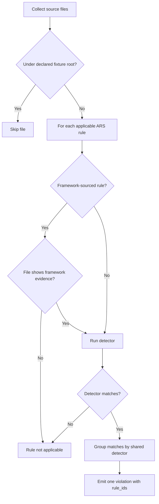
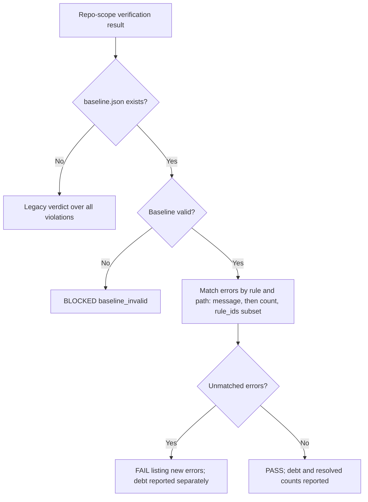
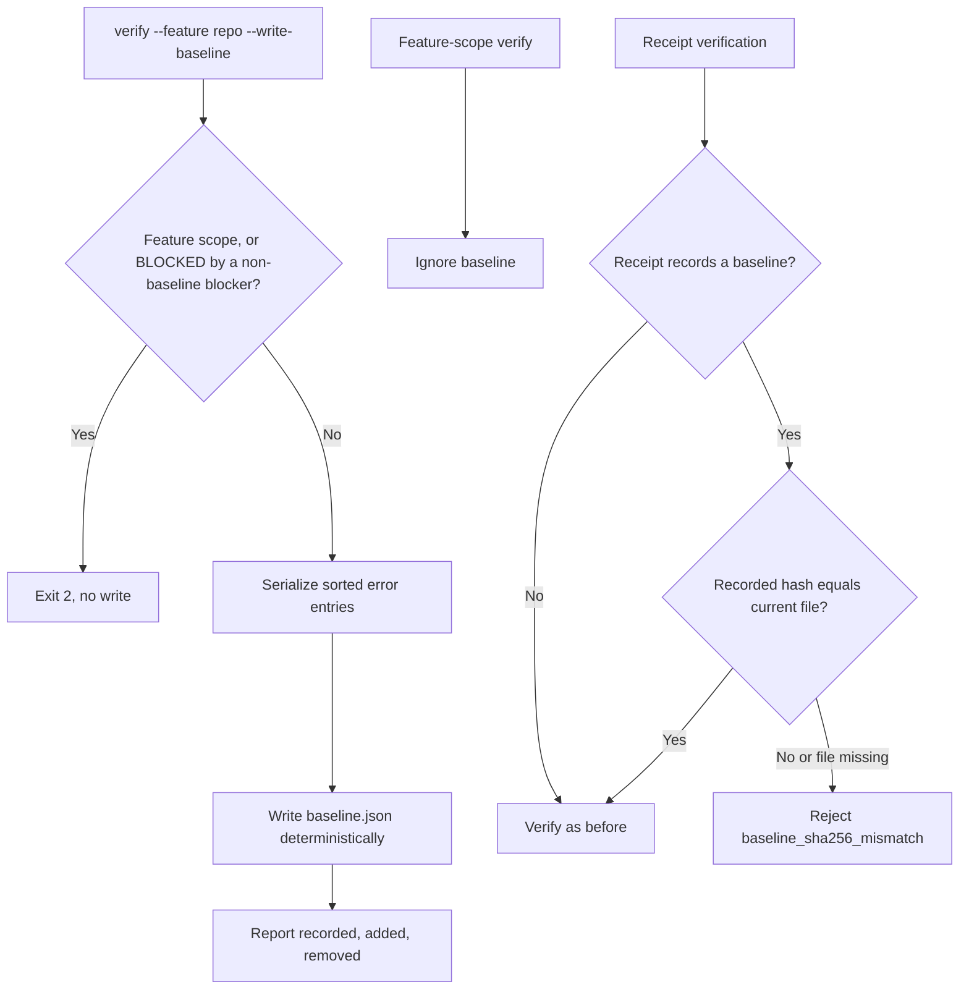

# Feature Spec: Conventions Gate Signal

- **Feature:** Actionable repo-scope conventions signal: fixture exclusion, family deduplication, framework applicability and a versioned baseline ratchet
- **Feature Number:** 082
- **Branch:** `fix/conventions-gate-signal`
- **Date:** 2026-10-10
- **Status:** Planned
- **Input:** The repo-scope conventions gate on LiveSpec reports 1186 errors (main `457a252`): 849 come from intentionally invalid detector fixtures, one shared regex family detector multiplies a single match into 34 to 100 errors, framework rules (Next.js, Remotion) fire on a plain Node script, and there is no baseline, so pre-existing debt and new regressions are indistinguishable.

## Scope and Source Evidence

- Repair the existing deterministic conventions verification; no new linter, no LLM call, no hosted service.
- Inspect [the ARS runtime](../../../validator/conventions_ast/ars_rules.py): `_FAMILY_DETECTORS` applies one shared matcher per family to every rule of that family; `_fixture_inventory_id()` scopes per-rule fixtures to their own rule only.
- Inspect [the verify engine](../../../validator/conventions_gate.py) and [the default exclusions](../../../validator/conventions_gates.py): `tests/fixtures/conventions_ast/**` is not excluded although `pyproject.toml` already excludes its `ars_rules` and `generated/python_code` payloads from ruff and mypy as intentionally invalid snippets.
- Inspect [the debt report writer](../../../validator/conventions_report.py): `debt.json` is written but never read back; no ratchet exists.
- Inspect [the CLI](../../../validator/cli_commands/conventions_cmd.py) and [the receipt oracle](../../../validator/conventions_receipt.py): feature-scope receipts and their verdict coherence rules must remain compatible.
- Scope by behavior: fixture exclusion, family grouping and framework applicability correct detector semantics and apply at every scope, so feature-scope findings can only disappear or merge, never appear; the baseline ratchet applies to repo scope only, and feature-scope (`--feature NNN-slug`) verdict computation, receipt fields and coherence rules are unchanged (only ARS `rule_id` values of shared detectors become `ars.family.<family>` and ARS violations gain `rule_ids`).
- Out of scope: rewriting the ARS catalog or its proxy detectors, language-agnostic SQL/platform heuristics, and any closure rule requiring repository-wide PASS.

## User Scenarios & Testing

### Story 1 — Repo scope reports real code once `P1`

**As a** LiveSpec maintainer, **I want** conventions verification to ignore declared detector fixtures, report one violation per shared detector match and apply framework rules only to files of that framework, **so that** each reported error is a real, distinct finding.

**Priority reason:** With 849 fixture errors and up to 100 duplicates per line, the repo gate is unusable as a signal. **Independent test:** Verify a temporary project containing detector fixtures, a Go file with one `panic(` call, a plain `.mjs` Node script using `require(` and a Next.js `.tsx` file using `require(`; inspect violations.

```gherkin
Feature: Real findings only
  Scenario: Declared detector fixtures are not repository violations
    Given a project carrying the ARS inventory and a FAIL fixture under tests/fixtures/conventions_ast/
    When livespec conventions verify --json runs at repo scope
    Then no violation path starts with tests/fixtures/conventions_ast/
    And the same file content copied under src/ is still reported

  Scenario: Every declared per-rule fixture still triggers exactly its rule
    Given every executable ARS rule and its declared PASS and FAIL fixtures
    When each fixture is scanned through the ARS runtime
    Then each FAIL fixture yields exactly one violation whose rule_ids is exactly its own runtime rule id
    And each PASS fixture yields no violation
    And the Swift PASS fixture satisfies the configured Swift file header rule

  Scenario: One shared family match produces one violation
    Given a Go source file containing a single panic( call
    And ten applicable Go rules share the go_code family detector
    When repo-scope verification runs
    Then exactly one ARS violation is reported for that file
    And its rule_id is ars.family.go_code
    And its rule_ids lists the ten matched runtime rule ids

  Scenario: A single matched rule of a shared family keeps the family identity
    Given a declared FAIL fixture scoped to one go_code rule
    When it is scanned through the ARS runtime
    Then its rule_id is ars.family.go_code
    And its rule_ids lists exactly that rule

  Scenario: Framework rules require framework evidence
    Given a plain Node .mjs script that calls require( and imports no framework
    When repo-scope verification runs
    Then no Next.js, Remotion, React, Astro, shadcn or TanStack rule id is reported for that script
    And a .tsx file importing next/link that calls require( reports Next.js rule ids
```



### Story 2 — Only new violations fail the repo gate `P1`

**As a** maintainer or CI job, **I want** `livespec conventions verify --feature repo` to compare against a versioned baseline, **so that** existing debt is reported separately and only regressions fail.

**Priority reason:** Without a ratchet the repo gate either always fails or must be ignored. **Independent test:** Write a baseline for a temporary project with known errors, verify (PASS), add one new error, verify again (FAIL listing only the new error).

```gherkin
Feature: Repo baseline ratchet
  Scenario: Existing debt is reported separately and passes
    Given .specs/conventions/baseline.json records every current error violation
    When livespec conventions verify --json --feature repo runs
    Then the verdict is PASS with exit code 0
    And violations contains no error entry
    And baseline.baselined_count equals the recorded error count
    And the written receipt verifies with verdict PASS and records the baseline sha256

  Scenario: A new violation fails while debt stays separate
    Given a baseline recording the current errors
    And a new file introducing one error violation
    When livespec conventions verify --json --feature repo runs
    Then the verdict is FAIL with exit code 1
    And violations lists only the new error
    And baselined_violations still lists the recorded debt

  Scenario: Line shifts do not create new violations but extra occurrences do
    Given a baseline recording two errors of one rule in one file
    When lines are inserted above them and one message changes
    Then both remain baselined
    When a third error of the same rule appears in that file
    Then exactly one error is reported as new

  Scenario: A newly matched rule inside a baselined family violation is new
    Given a baseline recording ars.family.go_code for a file with rule_ids R
    When the same file also matches a go_code rule outside R
    Then that family violation is reported as new
```



### Story 3 — Maintain the baseline safely `P2`

**As a** maintainer, **I want** an explicit flag to (re)write the baseline and protections against silent baseline edits, **so that** the ratchet cannot hide regressions.

**Priority reason:** A baseline writable by a pipeline would become an exemption mechanism. **Independent test:** Run the write flag twice and compare bytes; run it on a BLOCKED project; modify or delete the baseline after writing a receipt and verify the receipt; run the supervisor diff guard on a change touching the baseline.

```gherkin
Feature: Baseline maintenance and integrity
  Scenario: Explicit deterministic baseline write
    Given a project whose repo-scope verification is FAIL with error violations
    When livespec conventions verify --json --feature repo --write-baseline runs twice
    Then .specs/conventions/baseline.json is byte-identical after both runs
    And the output reports recorded, added and removed counts
    And the verdict is PASS because every current error is now recorded debt

  Scenario: A corrupted baseline can be rewritten explicitly
    Given .specs/conventions/baseline.json contains invalid JSON
    When livespec conventions verify --json --feature repo runs
    Then the verdict is BLOCKED with blocker baseline_invalid and a fix hint naming --write-baseline
    When livespec conventions verify --json --feature repo --write-baseline runs
    Then a valid baseline is written, the previous baseline is reported as invalid and every recorded entry counts as added

  Scenario: Blocked verification or feature scope cannot be baselined
    Given a project whose conventions gates are stale
    When livespec conventions verify --feature repo --write-baseline runs
    Then it exits 2 and the baseline file is not written
    When livespec conventions verify --feature 001-demo --write-baseline runs
    Then it exits 2 as an invalid argument combination and nothing is written

  Scenario: Feature scope ignores the baseline and baseline edits are guarded
    Given a baseline recording a feature file error
    When livespec conventions verify --feature 001-demo runs
    Then the verdict is FAIL exactly as without a baseline
    And a receipt whose recorded baseline sha256 differs from the current file, or whose baseline file was deleted, is rejected with baseline_sha256_mismatch
    And a receipt recording no baseline (feature scope or legacy) is verified as before
    And a pipeline diff touching .specs/conventions/baseline.json is reported as a protected conventions path
```



## Acceptance Criteria

### AC-001

Given a project with the ARS inventory and FAIL fixtures under `tests/fixtures/conventions_ast/`, repo-scope and feature-scope verification report no violation whose path is under that root, while identical content outside it is reported.

### AC-002

For every executable ARS rule in the inventory (currently 564, `EXPECTED_ARS_RULE_COUNT`), scanning its declared FAIL fixture through the ARS runtime yields exactly one violation whose `rule_ids` equals the rule's own runtime id, and its PASS fixture yields none; the Swift AST PASS fixture satisfies the configured Swift file header pattern.

### AC-003

At every scope, a source file matched by a shared family detector produces exactly one ARS violation per file and detector, with `rule_id` `ars.family.<family>` (even when a single rule matched), sorted `rule_ids` listing every applicable matched rule, the first line matching the detector, and a message naming the family and the matched rule count; a rule-specific detector keeps its own runtime rule id with `rule_ids` containing only that id.

### AC-004

At every scope, ARS rules whose source document is a framework convention (Astro, Next.js, React, Remotion, shadcn/ui, TanStack, Drizzle, Prisma, Tailwind, Cloudflare; see Framework Evidence) are not reported for a file without that framework's evidence; every Framework Evidence row is exercised by one file with the evidence (rules applicable) and one without (rules not applicable); in particular a plain Node `.mjs` script using `require(` reports none of them, and a `.tsx` file importing `next/link` reports the matched Next.js rule ids.

### AC-005

With a valid `.specs/conventions/baseline.json`, repo-scope verification (`livespec conventions verify --json --feature repo`, or no `--feature`) reports baselined error violations under `baselined_violations`, a `baseline` summary (path, sha256, baselined, new, resolved counts) and computes the verdict from new violations only: PASS (exit 0) when none are new, FAIL (exit 1) listing only new errors otherwise; with `--feature repo` the written receipt verifies and records the same baseline summary (without `--feature` no receipt is written, as today).

### AC-006

Baseline matching ignores line numbers: errors are matched per rule id and path, first by identical message, then up to the recorded count; a violation carrying `rule_ids` is matchable only when its `rule_ids` are a subset of the recorded `rule_ids` for that rule id and path; occurrences beyond the recorded count are new and missing recorded occurrences are counted as resolved. An unreadable or schema-invalid baseline yields BLOCKED with blocker code `baseline_invalid`, a message naming the baseline path and the reason, a fix hint naming `--write-baseline`, and exit 2. Without a baseline file, repo-scope verification is unchanged.

### AC-007

`livespec conventions verify --feature repo --write-baseline [--repo PATH] [--json]` writes a deterministic, sorted baseline of current repo-scope error violations (byte-identical on unchanged input, no timestamp), reports recorded/added/removed counts and then evaluates against the written baseline; an unreadable previous baseline is reported as invalid, counts every recorded entry as added and is replaced; it exits 2 without writing when verification is BLOCKED by any blocker other than `baseline_invalid` or when combined with a feature slug.

### AC-008

Feature-scope verification (`--feature NNN-slug`) never consults the baseline and its receipts carry no baseline field; `.specs/conventions/baseline.json` is a protected conventions path for the supervisor diff guard; receipt verification rejects a receipt whose recorded baseline sha256 differs from the current baseline file (including a deleted file) with `baseline_sha256_mismatch`, and verifies receipts without a recorded baseline exactly as before.

## Functional Requirements

- **FR-001:** Treat `tests/fixtures/conventions_ast/**` as a declared detector-fixture root excluded by default from conventions source collection at every scope, without requiring edits to existing gates files. **Maps to:** AC-001.
- **FR-002:** Keep every declared per-rule ARS fixture executable through the runtime path: FAIL fixtures trigger exactly their rule and PASS fixtures trigger none; shipped AST PASS fixtures satisfy the built-in header rule of their language. **Maps to:** AC-002.
- **FR-003:** At every scope, group ARS matches that come from one shared family detector in one file into a single violation identified by `ars.family.<family>` with the sorted list of matched runtime rule ids as metadata; the identifier depends on the detector kind, not on the match count; rule-specific detectors keep their runtime rule id. **Maps to:** AC-002, AC-003.
- **FR-004:** At every scope, apply ARS rules sourced from a framework convention document only to files showing that framework's evidence as defined in Framework Evidence; a declared per-rule fixture is scoped to its own rule and remains applicable to it. **Maps to:** AC-002, AC-004.
- **FR-005:** At repo scope, when a baseline file exists, partition error violations into baselined debt and new violations using line-independent rule/path matching (message first, then count, `rule_ids` subset), compute the verdict from new violations, report debt, resolved counts and baseline identity separately in verify JSON and receipts, and fail closed on an invalid baseline. **Maps to:** AC-005, AC-006.
- **FR-006:** Provide an explicit `--write-baseline` flag on `conventions verify`, valid only at repo scope, that deterministically records current repo-scope error violations, reports the delta against the previous baseline (replacing an invalid one), and refuses to write for a verification BLOCKED by any other blocker. **Maps to:** AC-007.
- **FR-007:** Leave feature-scope verification independent from the baseline, protect the baseline file in the supervisor diff guard and bind receipts to the current baseline hash. **Maps to:** AC-008.

## Framework Evidence

A rule is framework-sourced when its inventory `source_path` names one of the framework convention documents below. Import evidence means a static `import ... from`, side-effect `import`, dynamic `import(` or `require(` of the package or one of its subpaths.

| Framework (source document) | Deterministic evidence in the file |
|---|---|
| Astro (`code-conventions/astro.md`) | Import of `astro`, `astro:*` or `@astrojs/*` |
| Next.js (`code-conventions/nextjs.md`) | Import of `next` or `next/*` |
| React (`code-conventions/react.md`) | Import of `react`, `react-dom` or their subpaths, or a `.jsx`/`.tsx` file (automatic JSX runtime) |
| Remotion (`code-conventions/remotion.md`) | Import of `remotion` or `@remotion/*` |
| shadcn/ui (`code-conventions/shadcn.md`) | Import of `@/components/ui/*`, `@radix-ui/*` or `class-variance-authority` |
| TanStack (`code-conventions/tanstack.md`) | Import of `@tanstack/*` |
| Drizzle (`code-conventions/drizzle.md`) | Import of `drizzle-orm` or `drizzle-kit`, or a path segment `drizzle/` |
| Prisma (`code-conventions/prisma.md`) | Import of `@prisma/client`, or a path segment `prisma/` |
| Tailwind (`code-conventions/tailwind.md`) | CSS directive `@tailwind`, `@apply`, `@theme`, `@config` or `@import "tailwindcss"` |
| Cloudflare (`code-conventions/cloudflare.md`) | Import of `cloudflare:*`, `@cloudflare/*` or `wrangler` |

## Key Entities

- **Declared detector fixture:** A PASS or FAIL snippet under `tests/fixtures/conventions_ast/` that proves a detector; never a repository violation.
- **Family violation:** One ARS violation per file and shared detector, carrying `rule_ids`.
- **Framework evidence:** Deterministic per-file marker (import, require, path segment, directive) proving that a file belongs to a framework.
- **Conventions baseline:** Versioned `.specs/conventions/baseline.json` with schema version, scope `repo`, and sorted entries `{rule_id, path, count, messages, rule_ids}` for error violations.
- **Baseline summary:** Path, sha256, baselined, new and resolved counts attached to repo-scope verify output and receipts.

## Edge Cases

- Baseline file missing: legacy behavior; no implicit exemption.
- Baseline JSON malformed, wrong schema version or wrong scope: BLOCKED `baseline_invalid`, exit 2.
- A baselined file is deleted or fixed: its entries count as resolved; the verdict is unaffected.
- A baselined file is renamed or moved: its debt surfaces as new under the new path until the baseline is rewritten (accepted cost of path keys).
- A function grows longer (message changes) without new occurrences: still baselined (count-bounded).
- Blocking system violations (encoding/read errors, linter timeouts) and blockers are never baselined.
- A framework file imports the framework through a subpath (`next/image`, `@remotion/player`): evidence matches.
- Warnings are not recorded in the baseline and never affect the verdict.
- A repo receipt written before the baseline existed records no baseline and keeps verifying; a receipt recording a baseline whose file is later changed or deleted is rejected.
- A catalog upgrade adds a rule to a shared family: affected family violations surface as new until the baseline is rewritten (a newly applicable rule is a new finding by design).
- Fixing one error and adding another of the same rule in the same file stays within the recorded count and remains baselined (accepted limit of count-bounded keys).
- A Next.js App Router file importing nothing from `next` shows no Next.js evidence; only its React evidence (`.tsx`) applies.

## Quality Engineering

- **Risk:** High criticality (a ratchet can hide regressions); shared blast radius (every LiveSpec project using conventions verify); primary Contract/Regression risk; confidence conditional on executed tests.
- **Applicable dimensions:** Functional correctness, regression, CLI/receipt contract compatibility, data integrity of the baseline file, security posture of the gate (baseline protection), bounded performance of the scan, operability of reports. Accessibility/UX not applicable (CLI only).
- **P0 gates/evidence:** pytest transcripts mapping every AC; repo-scope verify receipt on LiveSpec after baseline write (PASS) with before/after error counts; receipt verification with stale baseline hash rejected; feature-scope 073 verdict unchanged.
- **P1 gates/evidence:** Existing conventions test modules unchanged-green; ruff, ruff format and pyright clean; CI-equivalent unit suite with no new failure versus main `457a252`.
- **Non-functional expectations:** Output is deterministic and sorted; the baseline write has no timestamp. Scan time is observed and reported (about 20 s on LiveSpec today) but is not a release threshold.
- **Gaps:** Language-agnostic SQL/platform heuristics still match non-SQL files; such findings remain baselined debt.
- **Boundary:** QE defines expected proof; implementation review and test execution prove behavior; this feature does not decide closure policies of other commands. Without the supervisor guard (plain CI), baseline growth is visible only through the `added` count reported by the write flag and the versioned diff.

## Clarifications

- Coordinator-approved scope: one feature for the four behaviors; feature-scope verdict computation and receipts unchanged; no requirement of repository-wide PASS at closure is introduced.
- Fixture exclusion, family grouping and framework applicability apply at every scope because they correct detector semantics; feature-scope findings can only disappear or merge. The baseline never applies to feature scope.
- Baseline granularity: error violations keyed by rule id and path, count-bounded, message-first matching, `rule_ids` subset for family violations; line numbers excluded so unrelated edits do not surface debt as new.
- The baseline is written only by the explicit `--write-baseline` flag; plain verification never rewrites it. A flag on the existing verify command follows the constitution's composition-by-flags principle instead of a new subcommand.
- Exit codes follow the existing conventions verify contract (feature 061): PASS 0, FAIL 1, BLOCKED 2; `baseline_invalid` is a BLOCKED verdict like `gates_stale`, so it exits 2.
- The coordinator explicitly requested fixing the missing header of `tests/fixtures/conventions_ast/swift/no_try_force/pass.swift`; making shipped AST PASS fixtures satisfy their language header rule is approved scope.

## Success Criteria

- **SC-001:** On LiveSpec, repo-scope errors attributed to `tests/fixtures/conventions_ast/` drop from 849 to 0.
- **SC-002:** After `livespec conventions verify --feature repo --write-baseline`, `livespec conventions verify --json --feature repo` on LiveSpec returns PASS with exit 0 and a verifiable receipt; adding one new error turns it into FAIL listing exactly that error.
- **SC-003:** Feature-scope verification of `073-conventions-multilang-catalog` returns PASS before and after this feature with an error count that does not increase (0 before).
