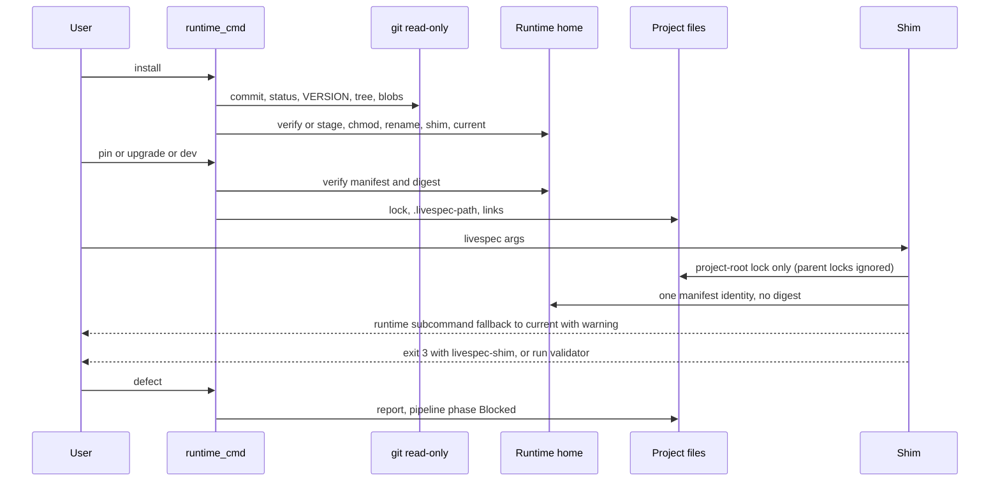
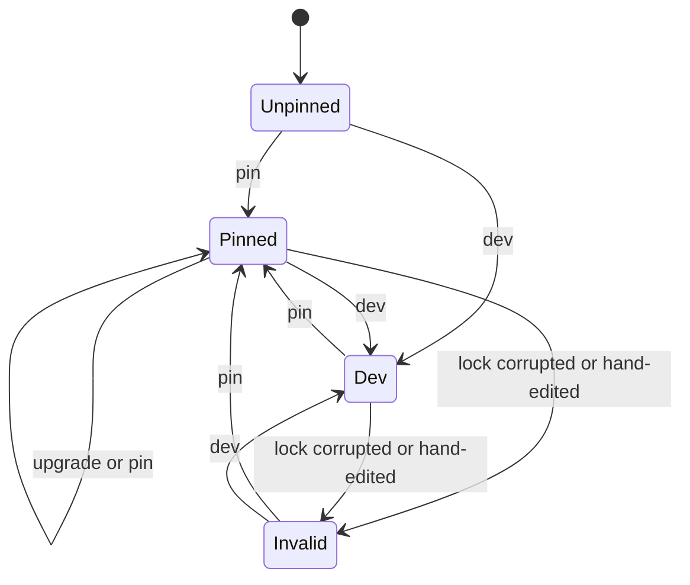
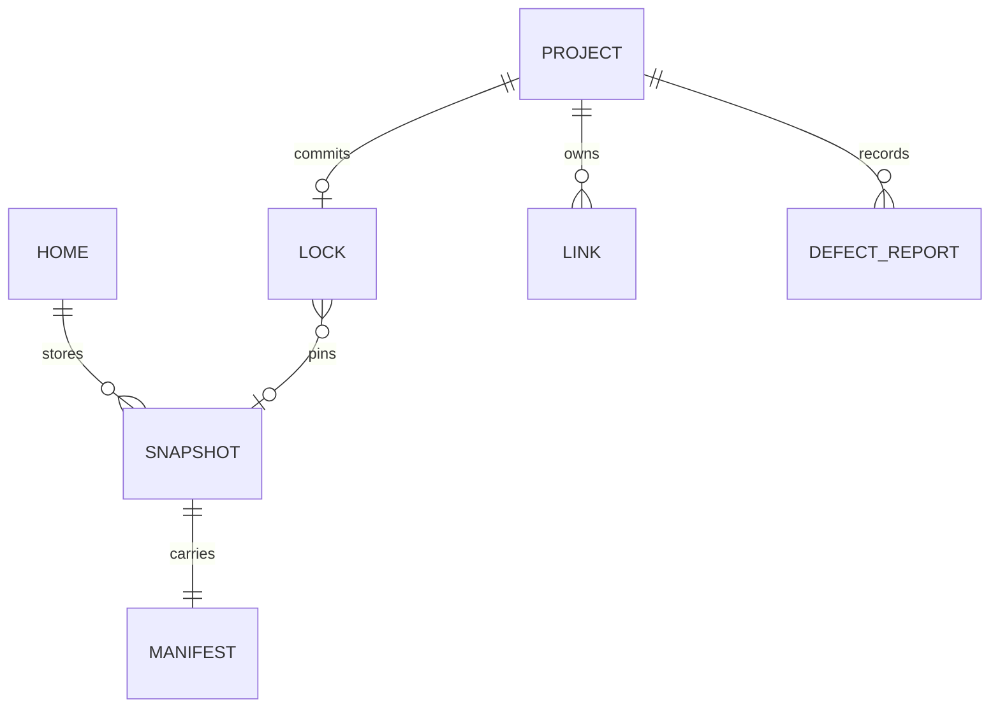

## Summary, Implementation Plan, Testing Strategy, Risks

New `validator/runtime/` package and thin Typer group `livespec runtime` (install, pin, upgrade, dev, status, defect) on Python ≥3.11 with frozen dataclasses, read-only git subprocesses (60 s timeout; `--no-optional-locks status`, `ls-tree` + `cat-file --batch`, never `git archive`, which applies export attributes; no index write), atomic staging/rename and temp/replace writes, pytest in `tmp_path`, ruff/pyright/mypy; no network, API, infrastructure or UI. Code conventions applied: one concept per file, typed docstrings, CLI-only exit mapping, `--json` on stdout, injected clock.

Constitution: ✅1 no new layer; ✅2 no LLM; ✅3, ✅5, ✅6 amended during planning by `.specs/stacks/decisions/ADR-004-pinned-runtime-snapshots.md` (home-only install writes, one `runtime` group, snapshots beside the editable install); ✅4 validation precedes writes, exits 0/1/2 and shim 3; errors in `validator/exceptions.py`; deviation: already-oversize `cli.py` (+3), `doctor/scanner.py` (+2) and `pipeline.py` (+3: public alias `write_phase_update` and a `report` keyword) grow minimally; splitting them is an unrelated refactor.

**Gherkin Scenarios + Mermaid Sequence Diagrams**

```gherkin
Feature: Runtime interactions
  Scenario: Install, pin and run
    Given a clean LiveSpec git source and a consumer project
    When the maintainer runs "livespec runtime install" and the developer runs "livespec runtime pin"
    Then the snapshot is staged, digested, made read-only and renamed atomically
    And the shim runs that snapshot's validator after reading only the lock and one manifest

  Scenario: Refusal and defect
    Given an untracked file in the source and no "--ref"
    When the maintainer runs "livespec runtime install"
    Then it exits 1 and the home is unchanged
    And "livespec runtime defect --command <cmd> --error <text> --feature 007-export --phase implement" writes a report and blocks the phase
```



**Gherkin Scenarios + Mermaid State Diagrams**

```gherkin
Feature: Lock lifecycle
  Scenario: Pin then upgrade
    Given an unpinned project
    When the developer pins "21-aaaaaaaaaaaa" then upgrades to "22-cccccccccccc"
    Then the lock is pinned to "22-cccccccccccc"

  Scenario: Upgrade refused
    Given a dev or invalid lock
    When the developer runs "livespec runtime upgrade"
    Then it exits 1 directing to "livespec runtime pin"
```



**Mermaid ER Diagrams**



Formats: manifest `.livespec-runtime.json` (schema 1, runtime_id, livespec_version, commit, source, UTC created_at, `sha256:` content_digest); digest = SHA-256 of sorted records `kind\0exec\0relpath\0sha256(payload)\n` except the manifest; lock keys exactly pinned {commit, livespec_version, mode, runtime_id, schema} or dev {mode, schema, source}, sorted, trailing newline.

**Step 1 — Errors, models, home:** `validator/exceptions.py` `LiveSpecRuntimeError` family; `validator/runtime/models.py`; `home.py` (`--home` > `$LIVESPEC_HOME` > `~/.livespec`, roots, project root = nearest `.specs/` ancestor, executing root). **FR covered:** FR-002.1: Manifest model, FR-004.1: Home and project resolution

**Step 2 — Install:** `git_tree.py`, `manifest.py`, `snapshot.py`: validate source (default: running checkout, else running manifest `source`), ref, dirty default ref, VERSION, filtered tree, D-01 before writing; reuse or refuse corruption; remove only `.staging-<id>-<pid>-*` dirs whose pid is not alive (write bits restored first); stage, D-15, rename (loser reuses); shim; `current` unless `--no-activate`. **FR covered:** FR-001.1: Committed snapshot build, FR-002.2: Atomic read-only snapshot, FR-003.1: Reuse and activation

**Step 3 — Shim:** stdlib `shim_core.py` (strict lock parser; project-root lock only, never a parent project's; manifest identity without digest; recorded interpreter, no bytecode; `runtime` fallback to `current` with a warning, else exit 3 `livespec-shim:`; LIVESPEC_HOME export; root first, purge `validator*`; args, stdin and exit status passed through unchanged; D-02, D-11) and `shim.py` (D-06; embeds `shim_core.py` source verbatim, never imports it). **FR covered:** FR-003.2: Shim on install, FR-004.2: Shim resolution and exit 3

**Step 4 — Selection:** `links.py` (owned links by link text, retarget, report missing) and `project.py` (pin: no `--runtime` and no `current` → exit 1 naming `livespec runtime install`, verify, version guard, report previous lock, warn when `git check-ignore` says `.specs/.livespec-path` is not ignored; upgrade: pinned lock required else exit 1 to `pin`, verify and version guard before no-op, report old/new ids and `migration_required` with `/spec-migrate`; dev: LiveSpec root, `.`/relative/absolute source; D-08, D-14). **FR covered:** FR-005.1: Pin writes, FR-006.1: Link retargeting, FR-007.1: Upgrade, FR-008.1: Dev lock

**Step 5 — Inspection:** `inspection.py` cumulative rules (skip LiveSpec roots and projects without lock or references; invalid lock, missing/invalid snapshot, executing mismatch naming PATH recovery, dirty checkout ERROR; drift, clean checkout, unpinned snapshot links WARNING; dev lock: only INFO (no checkout finding) or D-04; dirtiness via `--no-optional-locks status`, index unchanged); status JSON = mode, lock, resolved root, executing validator path, findings, exit 1 iff ERROR; `doctor/runtime_scan.py` adds the same findings (category `runtime`). **FR covered:** FR-012.1: Runtime scanner and doctor

**Step 6 — Defects:** `defects.py` blocks the phase via the public alias `pipeline.write_phase_update` (project lock and gates, slug `blocked`) and writes an `open(..., "x")` report (`-2`, `-3` on a same-day slug collision) with command, verbatim error, frozen lock identity (or `unpinned` + resolved runtime path, or dev source), feature, phase, `blocked-by-tool`, resume; `--feature` alone leaves the pipeline; failed update keeps the report, exit 1; no git. **FR covered:** FR-011.1: Report and blocked phase

**Step 7 — CLI:** `cli_commands/runtime_cmd.py` six handlers (exit 2 for `--phase` without `--feature`); `cli.py` adds `runtime` to `_MIGRATION_GUARD_ALLOWLIST`. **FR covered:** FR-001.2: install CLI, FR-005.2: pin CLI, FR-007.2: upgrade CLI, FR-008.2: dev CLI, FR-009.1: Guard bypass, FR-011.2: defect CLI, FR-012.2: status CLI

**Step 8 — Boundary, docs:** `system/tool-project-boundary.md` (four rules, D-03); one relative `**Read**` line also naming `.specs/.livespec-path` in `system/spec-system.md`, `.specs/spec-system.md`, and spec-feature/fix/implement/ship SKILL.md before `## Internal Command Invocations`, bumping `expectations.md`; README and `docs/cli-reference.md` (six commands, PATH before `/opt/homebrew/bin/livespec`, fresh machine, deletion, D-07, Handy block: install `--ref origin/main` after a fetch or with an explicit commit, PATH, pin, status, commit lock). **FR covered:** FR-010.1: Boundary and references, FR-013.1: Docs and migration

**Step 9 — Tests:** `tests/runtime_support.py` (temp repos, real-code copy, consumer fixture, independent digest, write-bit restore, temp HOME, protected-set check). **FR covered:** FR-009.2: Guard regression, FR-013.2: Migration fixture

**Decisions:** D-01 refuse absolute/escaping symlinks and gitlinks. D-02 shim prints `livespec-shim-notice:` for a dev source other than the project root; INFO `runtime_dev_mode`. D-03 resume: upgrade (pinned), `pin --runtime <fixed>` (unpinned), update dev checkout (dev). D-04 non-root dev source = ERROR `runtime_dev_source_invalid`. D-05 pin never creates links; fresh machine: snapshot `scripts/link-local.sh` then `pin --runtime <locked id>`. D-06 each install rewrites the shim atomically from `sys.executable`; whitespace paths refused. D-07 docs: `bash <home>/versions/<id>/scripts/install.sh`. D-08 `upgrade --to current`; `--project` = nearest `.specs/`. D-10 unverified upgrade target exits 1, no write. D-11 no snapshot and no current: recovery from the checkout with LiveSpec's own venv, `cd <livespec repo> && uv sync && .venv/bin/python -m validator.cli runtime install`. D-12 UTC date, slug `[a-z0-9-]` ≤60, `invalid-lock` identity. D-14 validate writes first; lock, path, links. D-15 read-only then same-parent rename.

**Testing:** `pytest tests/test_runtime_*.py -q`, `pytest tests/ --ignore=tests/integration -q`, `pyright validator`, `mypy .`, `ruff check .`, `ruff format --check .` (tools verified present). Files: snapshot AC-001..003; shim AC-004, AC-005, SC-003; project AC-006..009, AC-011; cli AC-010; inspection AC-015..017; defects AC-013, AC-014; docs AC-012, AC-018, SC-001, SC-002, SC-004.

**Risks:** editable shadowing (root first, purge, mismatch ERROR); deps from the installing interpreter; read-only cleanup; concurrent installs. Gaps: real install, Handy migration, cc-hub steps are operator actions.
