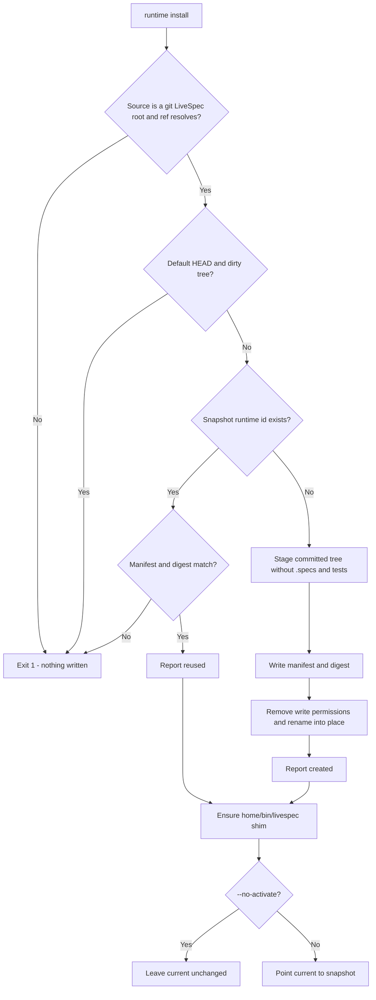
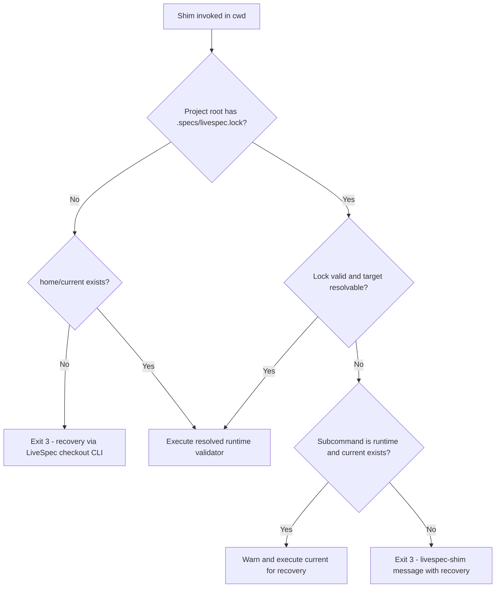
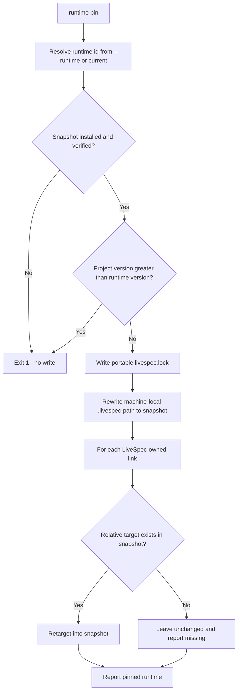
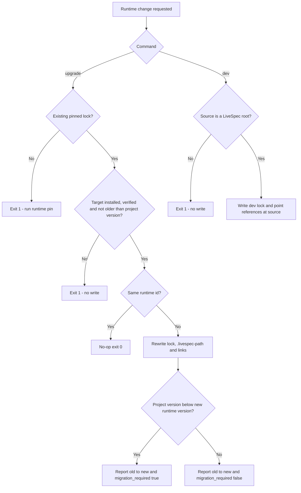
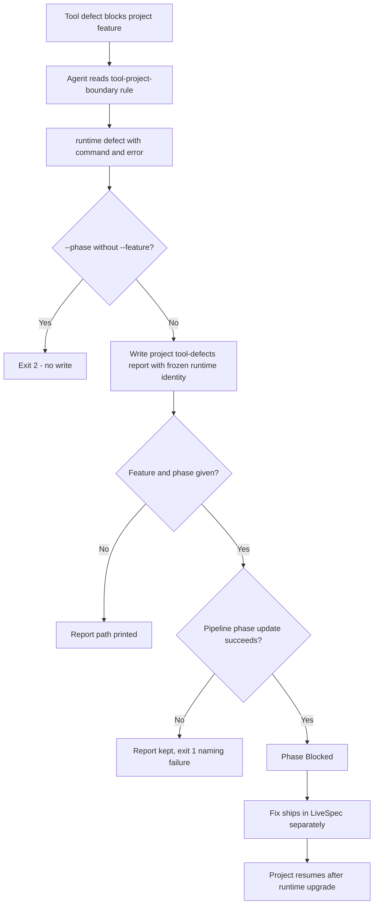
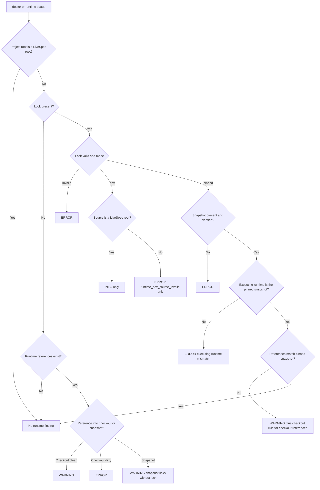
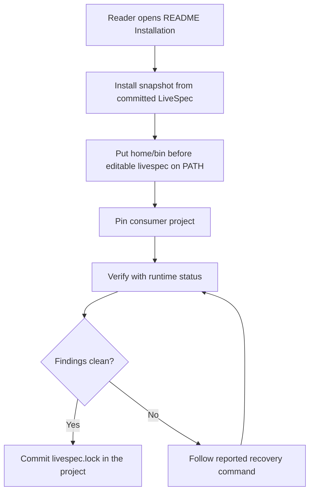

# Feature Spec: Pinned Runtime Isolation

- **Feature:** Pinned LiveSpec runtime for consumer projects + tool/project boundary
- **Feature Number:** 083
- **Branch:** `feat/pinned-runtime-isolation` (existing; no branch creation in this phase)
- **Date:** 2026-10-11
- **Status:** Implemented
- **Input:** Consumer projects must run an immutable, versioned LiveSpec runtime that they pin explicitly, instead of whatever uncommitted state the LiveSpec development checkout is in; LiveSpec tool defects must never enter a consumer project's feature critical path.

## Scope and Source Evidence

- **Observed problem:** `/opt/homebrew/bin/livespec` imports `/Users/julienm/projects/livespec/validator` directly (editable install of the development checkout).
- **Observed problem:** consumer projects such as `~/projects/handy` hold `.agent-sync.local/skills/spec-*` and `.agent-sync.local/rules/*.md` symlinks into `~/projects/livespec/.agent-sync/...` (for example `rules/commands.md -> .agent-sync/rules/livespec/commands.md`), and `.specs/.livespec-path` contains `/Users/julienm/projects/livespec`. Both are git-ignored, machine-local files in Handy. Consumer projects therefore executed the development checkout while it carried 121 modified and 267 untracked files; every LiveSpec repair changed the rules of the running consumer project.
- **Observed problem:** an orchestrator blocked by a LiveSpec tool defect during a Handy feature launched a full `$spec-fix` on the LiveSpec repository and made Handy feature closure depend on it.
- **Existing install architecture (inspected, not changed beyond this spec):** `scripts/install.sh` (global bootstrap of spec-init and spec-migrate through cc-hub, already writing outside projects); `scripts/link-local.sh` delegating to `scripts/sync-agent-assets.sh <project> <livespec-dir>` (projects skill/rule symlinks into `<project>/.agent-sync.local`, then cc-hub materializes provider outputs that link through `.agent-sync.local`); `validator/init_from_code.py` (LiveSpec root = package parent, writes `.specs/.livespec-path`); `validator/version_guard.py` (reads `.specs/.livespec-path` to find `VERSION`); `validator/doctor/` (`livespec doctor`); `validator/pipeline.py` (pipeline status slugs already include `blocked`, displayed `Blocked`).
- **Decided design (approved by the coordinator for this feature):** the six items below are the approved business scope: (1) immutable versioned snapshots installed by `livespec runtime install` into a runtime home selected by `--home`, `$LIVESPEC_HOME` or `~/.livespec`, with a `current` pointer and a generated CLI shim; (2) shim resolution pinned → snapshot, dev → declared checkout, no lock → `current`; (3) `livespec runtime pin`, `upgrade` and `dev`, with `runtime` commands bypassing the migration guard; (4) one boundary rule file plus `livespec runtime defect`, which writes a project-local report and marks the feature phase blocked; (5) drift detection in `livespec doctor` and `livespec runtime status`; (6) README and docs covering install, pin, upgrade, dev mode, defect reports and the exact migration of an existing consumer project such as Handy.
- **In scope:** exactly the decided design above.
- **Out of scope:** publishing to PyPI or a uv tool registry; removing the editable install; changing cc-hub; any network access; migrating consumer `.specs/spec-system.md` copies; project-local agent copies under `.agent-sync.local/agents/` (already isolated by feature 080) are not retargeted; refusing execution of a non-shim CLI (detection only).
- **Test isolation:** every test of this feature uses temporary directories only; no test installs into the real `~/.livespec`, modifies `/opt/homebrew`, or touches the real Handy project.

## Constitution Alignment

- **Runtime home writes:** `runtime install` writes only under the user-selected runtime home; like the existing bootstrap script, this is an explicit user-invoked machine-local install scope. Project-scoped commands (`pin`, `upgrade`, `dev`, `defect`, `status`) write only inside the target project.
- **CLI surface:** `runtime` is one command group, following the existing command-group pattern (`pipeline`, `goal`, `hooks`, `init`); options compose behavior as flags within it.
- **Installation model:** the snapshot plus shim model is added beside the editable install, which remains unchanged.
- **Decision record:** these three decisions are recorded here and must be captured during planning, before implementation, in an ADR under `.specs/stacks/decisions/` together with an amendment of constitution principles 3 (write scope), 5 (CLI surface) and 6 (installation), because the constitution takes precedence over ADRs.

## Definitions

- **LiveSpec root:** a directory containing a `VERSION` file, a `validator/` package and an `.agent-sync/` directory.
- **Runtime snapshot:** a LiveSpec root under `<home>/versions/<runtime_id>/` that contains a `.livespec-runtime.json` manifest.
- **LiveSpec checkout:** a LiveSpec root inside a git working tree that has no `.livespec-runtime.json` manifest.
- **Runtime home (`<home>`):** `--home` when given, else `$LIVESPEC_HOME` when set, else `~/.livespec`.
- **Runtime id:** `<VERSION>-<sha12>`, where `VERSION` is read from the snapshotted commit and `sha12` is the first 12 hexadecimal characters of the full commit hash.
- **Project root:** the nearest ancestor of the working directory (inclusive) that contains a `.specs/` directory.
- **LiveSpec-owned link:** a symlink directly under a project's `.agent-sync.local/skills/` or `.agent-sync.local/rules/` whose link target lies inside the `.agent-sync/` directory of a LiveSpec root.
- **Runtime references:** the target of `.specs/.livespec-path` plus every LiveSpec-owned link of a project.
- **Dirty working tree:** tracked changes (staged or unstaged) or untracked files that are not git-ignored, determined with read-only git queries (`git --no-optional-locks status --porcelain`), which never write the index.
- **Content digest:** SHA-256 over every snapshot entry except `.livespec-runtime.json`, in sorted POSIX relative-path order; each entry contributes its relative path, its type (file or symlink), its executable bit, and its file bytes or symlink target.
- **Committed versus machine-local:** `.specs/livespec.lock` is committed and portable (except dev locks whose source lies outside the project, which are machine-specific by declaration); `.specs/.livespec-path` and `.agent-sync.local/` are machine-local (git-ignored). On a fresh machine, links are created by the existing link script of the locked snapshot (`<snapshot>/scripts/link-local.sh <project> <snapshot>`, unchanged behavior) and `.specs/.livespec-path` by `livespec runtime pin --runtime <runtime_id from the lock>`; pin itself never creates links.
- **Version comparison:** VERSION values compare as integers; a missing `.specs/livespec-version` counts as 1, as in the existing migration guard.
- **Boundary reference resolution:** a relative reference inside a SKILL.md resolves from the physical location of that file (its real path after following symlinks).

## User Scenarios & Testing

### Story 1 — Install an immutable runtime snapshot `P1`

**As a** LiveSpec maintainer, **I want to** install a read-only runtime snapshot built only from a committed LiveSpec tree, **so that** consumer projects can run a fixed LiveSpec version that later development cannot change.

**Priority reason:** Without immutable snapshots, every uncommitted LiveSpec edit immediately changes running consumer projects.

**Independent test:** In a temporary git repository shaped as a LiveSpec root, run `livespec runtime install --source <repo> --home <tmp-home>` on clean, dirty, explicit-ref and invalid states; inspect the snapshot tree, manifest, independently recomputed digest, permissions, `current` pointer and shim.

```gherkin
Feature: Runtime snapshot installation
  Scenario: Clean HEAD is installed as an immutable snapshot
    Given a temporary LiveSpec git repository with a clean working tree whose committed VERSION is "21"
    And the repository tracks top-level ".specs/" and "tests/" directories
    When the maintainer runs "livespec runtime install --source <repo> --home <home> --json"
    Then the command exits 0 and reports status "created" with runtime id "21-<sha12>"
    And "<home>/versions/21-<sha12>/" contains the committed tree of HEAD without top-level ".specs/" and "tests/"
    And it still contains the conventions test evidence under "tests/" that the bundled catalogs cite
    And its ".livespec-runtime.json" records runtime_id, livespec_version, commit, source, created_at and a content digest equal to an independent recomputation
    And no file or directory in the snapshot has a write permission bit
    And "<home>/current" resolves to the snapshot and "<home>/bin/livespec" is an executable shim

  Scenario: Dirty default ref is refused
    Given the repository has an unstaged change to a tracked file and an untracked non-ignored file
    When the maintainer runs "livespec runtime install --source <repo> --home <home>"
    Then the command exits 1 and names the dirty paths
    And nothing is created or changed under "<home>"

  Scenario: Explicit commit is snapshotted from history only
    Given the same dirty repository and the full hash of its HEAD commit
    When the maintainer runs "livespec runtime install --source <repo> --ref <commit> --home <home>"
    Then the command exits 0
    And the snapshot contains the committed bytes of that commit and none of the uncommitted changes

  Scenario: Invalid source or ref is refused
    Given a source directory that is not a git LiveSpec root, or a ref that resolves to no commit
    When the maintainer runs "livespec runtime install"
    Then the command exits 1 naming the source or ref and nothing is written under "<home>"

  Scenario: Existing snapshots are reused or protected
    Given a valid snapshot already exists for the requested commit
    When the maintainer runs the same install again with "--no-activate"
    Then the command exits 0 and reports status "reused"
    And the snapshot bytes and "<home>/current" are unchanged
    When a snapshot file is altered so that its content digest no longer matches the manifest
    And the maintainer runs the same install again
    Then the command exits 1 naming the corrupted snapshot and its bytes remain unchanged
```

#### User Flow



### Story 2 — Run the pinned runtime through the CLI shim `P1`

**As a** consumer-project developer or agent, **I want** the `livespec` command to run the runtime pinned by the project I am in, **so that** the development checkout never executes unless dev mode is declared.

**Priority reason:** The shim is the only way the pin takes effect for commands invoked by skills and agents.

**Independent test:** With a temporary home holding two snapshots and an interpreter where the development checkout is installed editable, invoke `<home>/bin/livespec runtime status --json` from nested directories of projects with pinned, dev, invalid and absent locks; compare the reported runtime root and the imported `validator` module path.

```gherkin
Feature: CLI shim runtime resolution
  Scenario: Pinned lock selects its snapshot
    Given a project whose ".specs/livespec.lock" is pinned to installed runtime "21-aaaaaaaaaaaa"
    And "<home>/current" points to a different snapshot
    And the development checkout is installed editable in the shim interpreter
    When the developer runs "<home>/bin/livespec runtime status --json" from a nested subdirectory of the project
    Then the reported runtime root is "<home>/versions/21-aaaaaaaaaaaa"
    And the imported validator package path lies inside that snapshot
    And arguments, stdin and the exit status of the runtime are passed through unchanged

  Scenario: Missing pinned snapshot fails with recovery
    Given a project pinned to runtime "21-bbbbbbbbbbbb" that is not installed under "<home>"
    When the developer runs "<home>/bin/livespec status"
    Then the shim exits 3 without executing any runtime
    And stderr starts with "livespec-shim:" and names "21-bbbbbbbbbbbb" and the recovery "livespec runtime install --source <livespec repo> --ref <commit from lock>"
    When the developer runs that recovery "livespec runtime install" command in the same project
    Then the shim dispatches the runtime subcommand to "<home>/current" with a stderr warning

  Scenario: Unpinned and dev projects
    Given a project root without ".specs/livespec.lock" nested inside a parent project that has a lock
    When the developer runs the shim inside the nested project
    Then the runtime under "<home>/current" executes and the parent lock is ignored
    Given a project whose lock declares mode "dev" with source "../livespec-dev"
    When the developer runs the shim inside that project
    Then the checkout at "../livespec-dev" resolved from the project root executes

  Scenario: Invalid lock never falls back for non-runtime commands
    Given a project whose lock is not valid JSON or declares an unknown schema or mode
    When the developer runs "<home>/bin/livespec status" inside that project
    Then the shim exits 3 with a "livespec-shim:" message naming the lock path and executes neither "<home>/current" nor any checkout
    When the developer runs "<home>/bin/livespec runtime status" inside that project
    Then the shim dispatches it to "<home>/current" with a stderr warning and the status reports the invalid lock as an ERROR

  Scenario: Shim home reaches the executed runtime
    Given a shim generated in a temporary home and no LIVESPEC_HOME in the environment
    When the developer runs "<home>/bin/livespec runtime pin" without "--home"
    Then the executed runtime resolves "current" from that temporary home, not from "~/.livespec"
```

#### User Flow



### Story 3 — Pin a consumer project `P1`

**As a** consumer-project developer, **I want to** pin my project to one installed runtime in a committed lock and move its LiveSpec links into that snapshot, **so that** every machine and every agent session of the project uses the same LiveSpec runtime.

**Priority reason:** Pinning removes the observed dependency of Handy on the mutable development checkout.

**Independent test:** In a temporary consumer project whose `.specs/.livespec-path` and `.agent-sync.local` links point into a temporary LiveSpec checkout, run `livespec runtime pin --project <p> --home <home>`; inspect the lock, `.livespec-path`, every link target and project-owned files.

```gherkin
Feature: Project runtime pinning
  Scenario: Pin to the current runtime
    Given an installed valid snapshot "21-aaaaaaaaaaaa" that "<home>/current" points to
    And a consumer project whose ".specs/livespec-version" is "21"
    And whose ".agent-sync.local/skills/spec-check" links to "<checkout>/.agent-sync/skills/spec-check"
    And whose ".agent-sync.local/rules/commands.md" links to "<checkout>/.agent-sync/rules/livespec/commands.md"
    And whose ".agent-sync.local/skills/team-notes" is a project-owned real directory
    When the developer runs "livespec runtime pin --project <p> --home <home> --json"
    Then the command exits 0
    And ".specs/livespec.lock" contains exactly schema 1, mode "pinned", runtime_id "21-aaaaaaaaaaaa", livespec_version and commit
    And ".specs/.livespec-path" contains "<home>/versions/21-aaaaaaaaaaaa"
    And the two links resolve to the same relative paths inside "<home>/versions/21-aaaaaaaaaaaa/.agent-sync/"
    And "team-notes" keeps its bytes

  Scenario: Link target missing in the snapshot is reported
    Given a LiveSpec-owned link whose relative target does not exist in the snapshot
    When the developer pins the project
    Then that link is left unchanged and listed as missing in the output
    And all other LiveSpec-owned links are retargeted

  Scenario: Fresh machine re-materializes references from the lock
    Given a clone of a pinned project with no ".specs/.livespec-path" and no ".agent-sync.local" links
    And the locked runtime installed with "livespec runtime install --source <livespec repo> --ref <commit from lock>"
    When the developer runs "<snapshot>/scripts/link-local.sh <project> <snapshot>" and then "livespec runtime pin --runtime <runtime_id from lock>"
    Then the lock bytes are unchanged, ".specs/.livespec-path" points to the snapshot and every LiveSpec-owned link resolves inside the snapshot

  Scenario: Pin replaces an existing lock
    Given a project with a dev lock or a lock pinned to another installed runtime
    When the developer runs "livespec runtime pin --runtime 21-aaaaaaaaaaaa"
    Then the lock is replaced by a pinned lock for "21-aaaaaaaaaaaa" and the output reports the previous lock
    Given no "--runtime" option and no "<home>/current"
    When the developer runs "livespec runtime pin"
    Then the command exits 1 naming "livespec runtime install" and writes nothing

  Scenario: Unsafe pins are refused
    Given a requested runtime id that is not installed, or whose manifest or digest does not verify
    Or a project whose ".specs/livespec-version" is greater than the runtime livespec_version
    When the developer runs "livespec runtime pin"
    Then the command exits 1 with the reason
    And the lock, ".livespec-path" and every link are unchanged
```

#### User Flow



### Story 4 — Upgrade voluntarily or opt into dev mode `P2`

**As a** consumer-project developer or LiveSpec maintainer, **I want to** move a project to another installed runtime only when I choose, or explicitly declare development mode, **so that** runtime changes are deliberate, visible and migration-aware.

**Priority reason:** Pinned projects must still receive fixes, but only by an explicit action; the LiveSpec repository itself needs a declared dev mode.

**Independent test:** In temporary projects, run `livespec runtime upgrade` between two installed snapshots with project versions below and equal to the target, to the same id, without a lock, and on a stale project; run `livespec runtime dev` with valid and invalid sources.

```gherkin
Feature: Voluntary upgrade and explicit dev mode
  Scenario: Upgrade reports the move and migration need
    Given a project pinned to "21-aaaaaaaaaaaa" whose ".specs/livespec-version" is "21"
    And an installed valid snapshot "22-cccccccccccc"
    When the developer runs "livespec runtime upgrade --project <p> --to 22-cccccccccccc --home <home> --json"
    Then the command exits 0
    And the lock, ".livespec-path" and LiveSpec-owned links now reference "22-cccccccccccc"
    And the output reports old runtime "21-aaaaaaaaaaaa", new runtime "22-cccccccccccc" and migration_required true with "/spec-migrate"

  Scenario: Upgrade to the pinned runtime is a no-op
    Given a project pinned to "22-cccccccccccc"
    When the developer runs "livespec runtime upgrade --to 22-cccccccccccc"
    Then the command exits 0 reporting no change and every file keeps its bytes

  Scenario: Runtime commands work on a stale project
    Given a project whose ".specs/livespec-version" is below the VERSION of its resolved runtime
    When the developer runs "livespec runtime upgrade --to current" and "livespec runtime status"
    Then neither command is blocked by the migration guard
    And "livespec doctor" on the same project is still blocked by the migration guard

  Scenario: Upgrade requires an existing pin
    Given a project without ".specs/livespec.lock"
    When the developer runs "livespec runtime upgrade"
    Then the command exits 1 directing the developer to "livespec runtime pin" and writes nothing

  Scenario: Explicit dev mode for the LiveSpec repository
    Given the LiveSpec repository checkout as both project and source
    When the maintainer runs "livespec runtime dev --project . --source ."
    Then ".specs/livespec.lock" declares mode "dev" with source "."
    And a source directory that is not a LiveSpec root is refused with exit 1 and no write
```

#### User Flow



### Story 5 — Keep LiveSpec tool defects out of the project critical path `P1`

**As a** consumer-project agent blocked by a LiveSpec tool defect, **I want** a written boundary rule and a project-local defect report command, **so that** I block the feature phase with evidence instead of editing or running lifecycles in the LiveSpec repository.

**Priority reason:** The observed incident made Handy feature closure depend on a LiveSpec repository lifecycle.

**Independent test:** Grep the boundary references in the repository and resolve them from a pinned consumer fixture; in a temporary pinned project with a feature pipeline, run `livespec runtime defect` and compare the report, the pipeline phase and before/after hashes of the snapshot and of a temporary LiveSpec checkout.

```gherkin
Feature: Tool/project boundary
  Scenario: Boundary rule is reachable from every lifecycle entry point
    Given the LiveSpec repository
    When the maintainer inspects "system/tool-project-boundary.md"
    Then it states that a consumer-project session never edits, commits or runs lifecycle commands in a LiveSpec root
    And it states that a blocking tool defect is reported with "livespec runtime defect" and blocks the project phase
    And it states that project feature closure never depends on a LiveSpec repository lifecycle and resumes after "livespec runtime upgrade"
    And "system/spec-system.md", ".specs/spec-system.md" and the SKILL.md of spec-feature, spec-fix, spec-implement and spec-ship each contain exactly one line referencing it
    And from a pinned consumer project each linked lifecycle SKILL.md reference resolves to the boundary file inside the snapshot

  Scenario: Defect report blocks the project phase
    Given a project pinned to "21-aaaaaaaaaaaa" with feature "007-export" whose pipeline phase "implement" is "In Progress"
    When the agent runs "livespec runtime defect --command 'livespec finalize verify' --error 'KeyError: receipt' --feature 007-export --phase implement --title 'Finalize receipt crash'"
    Then ".specs/tool-defects/<YYYY-MM-DD>-finalize-receipt-crash.md" exists in the project
    And it records the command, the verbatim error, runtime_id, livespec_version and commit from the lock, the feature, the phase, status "blocked-by-tool" and the resume commands
    And the "implement" phase of "007-export" shows "Blocked" in pipeline.md
    And no file in the snapshot or in any LiveSpec checkout changes and no git command runs there

  Scenario: Defect report edge cases
    Given a report with the same date and slug already exists
    When the agent reports another defect with the same title
    Then a new report with a numeric suffix is written and the existing report is unchanged
    Given a project without a lock
    When the agent reports a defect
    Then the report records "unpinned" and the resolved runtime path
    Given "--phase" without "--feature"
    When the agent runs the command
    Then it exits 2 and writes nothing
    Given a feature without a pipeline
    When the agent reports a defect for that feature and a phase
    Then the report is kept and the command exits 1 naming the failed phase update
    Given a project without a lock, or with a dev lock
    When the agent reports a defect
    Then the resume commands are "livespec runtime pin --runtime <fixed runtime>" when unpinned, or updating the dev checkout when in dev mode, followed by resuming the phase
```

#### User Flow



### Story 6 — Detect unpinned or drifted runtime use `P1`

**As a** consumer-project developer, **I want** `livespec doctor` and `livespec runtime status` to report when my project still runs a development checkout or drifted from its pin, **so that** hidden dependencies on mutable LiveSpec state are visible before they break a feature.

**Priority reason:** Existing consumer projects are currently linked to the development checkout without any warning.

**Independent test:** Build temporary projects for each finding class and compare `livespec runtime status --project <p> --home <home> --json` findings, severities and exit codes with `livespec doctor` output.

```gherkin
Feature: Runtime drift detection
  Scenario: Unpinned project linked to a LiveSpec checkout
    Given a project without a lock whose runtime references resolve into a clean LiveSpec checkout
    When the developer runs "livespec runtime status --project <p> --json"
    Then a WARNING finding names the checkout and the command exits 0
    When the checkout working tree becomes dirty
    Then the finding becomes ERROR and the command exits 1
    And the checkout's git index and files are unchanged by the check

  Scenario: Unpinned project with snapshot links
    Given a project without a lock whose LiveSpec-owned links resolve into a runtime snapshot
    When the developer runs "livespec runtime status --project <p> --json"
    Then a WARNING finding reports snapshot links without lock

  Scenario: Pinned project drift
    Given a project pinned to "21-aaaaaaaaaaaa"
    When the snapshot directory is missing, or its manifest or content digest does not match
    Then "livespec runtime status" reports an ERROR and exits 1
    When the snapshot verifies but a LiveSpec-owned link points into another snapshot
    Then a WARNING finding names the mismatched reference
    When a LiveSpec-owned link left unchanged by pin still points into a dirty LiveSpec checkout
    Then an ERROR checkout finding and a WARNING mismatch finding are reported
    When the CLI executing "livespec runtime status" is not the pinned snapshot, for example the editable development install
    Then an ERROR finding names the executing runtime root and the shim PATH ordering recovery

  Scenario: Findings are cumulative
    Given a project without a lock whose links resolve partly into a dirty LiveSpec checkout and partly into a runtime snapshot
    When the developer runs "livespec runtime status --project <p> --json"
    Then both the checkout ERROR and the snapshot-links WARNING are reported
    Given a pinned project whose snapshot is missing and whose status runs through the runtime-subcommand fallback
    When the developer runs "<home>/bin/livespec runtime status --json"
    Then both the missing-snapshot ERROR and the executing-runtime mismatch ERROR are reported

  Scenario: Invalid lock and quiet cases
    Given a project whose lock is not valid JSON
    When the developer runs "livespec runtime status --project <p> --json"
    Then an ERROR finding names the lock path
    Given a consumer project whose lock declares dev mode with a LiveSpec root as source
    When the developer runs "livespec runtime status --project <p> --json"
    Then exactly one INFO runtime finding is reported and no checkout finding
    Given a consumer project whose dev lock source is not a LiveSpec root
    When the developer runs "livespec runtime status --project <p> --json"
    Then exactly one ERROR finding "runtime_dev_source_invalid" names the source, no checkout finding is reported and the command exits 1
    Given the LiveSpec repository itself, with or without a dev lock, or a project with no runtime references and no lock
    When the developer runs "livespec runtime status" and "livespec doctor"
    Then no runtime finding is reported
```

#### User Flow

The flowchart shows each rule; every applicable rule is evaluated and all resulting findings are reported (no short-circuit after the first finding).



### Story 7 — Document installation and consumer migration `P2`

**As a** LiveSpec user, **I want** documented, exact commands to install, pin, upgrade, use dev mode, report defects and migrate an existing consumer project such as Handy, **so that** I can adopt the pinned runtime without reading the code.

**Priority reason:** Existing consumer projects need a precise migration path; the feature has no value if adoption is guesswork.

**Independent test:** Read the README Installation section and `docs/cli-reference.md`; execute the documented migration sequence against a temporary copy of a consumer layout linked to a temporary LiveSpec checkout.

```gherkin
Feature: Runtime documentation
  Scenario: Documented migration works on a consumer fixture
    Given a temporary consumer project shaped like Handy, linked to a temporary LiveSpec checkout
    When the documented migration commands run in order with a temporary runtime home
    Then "livespec runtime status" run through the shim reports mode "pinned" and no ERROR or WARNING runtime finding
    And the real "~/.livespec", "/opt/homebrew" and Handy project are not modified

  Scenario: Documentation covers every runtime command
    Given the README Installation section and "docs/cli-reference.md"
    When a reader looks up runtime commands
    Then install, pin, upgrade, dev, status and defect are documented with exact commands
    And the PATH ordering of "<home>/bin" ahead of any editable livespec is documented, with "/opt/homebrew/bin/livespec" as the macOS example
```

#### User Flow



## Acceptance Criteria

### AC-001

Given a clean temporary LiveSpec git source, `livespec runtime install --source <repo> --home <home>` exits 0 and creates `<home>/versions/<VERSION>-<sha12>/` containing exactly the files of the commit tree of HEAD (git export attributes not applied) minus top-level `.specs/` and `tests/` except the conventions test evidence (`tests/fixtures/conventions_ast/` and the deterministic test files the bundled catalogs cite), a `.livespec-runtime.json` manifest with `schema` 1, runtime_id, livespec_version, commit (full hash), source (absolute path), created_at (UTC ISO-8601) and a content digest equal to an independent recomputation per the Definitions, no write permission bit on any snapshot file or directory, `<home>/current` resolving to the snapshot, and an executable `<home>/bin/livespec` shim.

### AC-002

With the default ref and a source holding tracked changes or untracked non-ignored files anywhere in its working tree (including excluded `.specs/` and `tests/`), install exits 1 naming the dirty paths and creates or changes nothing under `<home>`; with `--ref <commit>` on the same dirty source, the snapshot contains that commit's bytes and none of the uncommitted changes; an unresolvable ref or a source that is not a git LiveSpec root exits 1 with nothing written.

### AC-003

Re-installing an existing valid snapshot exits 0, reports `reused` and leaves snapshot bytes unchanged; an existing snapshot with a missing or mismatched manifest or a non-matching content digest exits 1 and leaves the snapshot and `<home>/current` unchanged; `--no-activate` leaves `<home>/current` unchanged while still ensuring the shim exists; an interrupted install leaves no directory under the final runtime id, and the next install removes leftover staging directories (restoring their write bits first).

### AC-004

From any directory below a project root whose `.specs/livespec.lock` is pinned to an installed snapshot, the shim executes that snapshot's `validator` package (imported module path inside the snapshot) even when the development checkout is installed editable in the shim interpreter, and passes arguments, stdin and exit status through unchanged; when the project root has no lock (parent project locks are ignored) it executes `<home>/current`; with a dev lock it executes the declared checkout, resolving a relative source from the project root.

### AC-005

The shim exits 3 with stderr starting `livespec-shim:` and without executing any runtime when: the pinned snapshot is missing or its manifest runtime_id or commit differs from the lock (stderr names the runtime id and `livespec runtime install --source <livespec repo> --ref <commit>`, run through the LiveSpec checkout's own CLI when `<home>/current` is also missing); the lock is not valid JSON or declares an unknown schema or mode (stderr names the lock path); a dev source is not a LiveSpec root; or no lock exists and `<home>/current` is missing (stderr names installing from the LiveSpec checkout's own CLI). When project resolution fails but `<home>/current` exists, `livespec runtime ...` subcommands alone are dispatched to `<home>/current` with a stderr warning so recovery and status work from inside the project. The shim exports the home it resolved as `LIVESPEC_HOME` to the executed runtime when that variable is not already set.

### AC-006

`livespec runtime pin` writes `.specs/livespec.lock` containing exactly `schema` 1, `mode` `pinned`, `runtime_id`, `livespec_version` and `commit` (no absolute path, never the literal `current`), and rewrites `.specs/.livespec-path` to the absolute snapshot path; on a fresh clone with the locked runtime installed and links created by the snapshot's own `scripts/link-local.sh`, `pin --runtime <locked id>` re-materializes `.specs/.livespec-path` without changing the lock bytes and pin itself never creates links; pin replaces any existing lock (pinned or dev) and reports the previous one; without `--runtime` and without `<home>/current` it exits 1 naming `livespec runtime install` with no write; when `.specs/.livespec-path` is not git-ignored in a git project, the output contains a warning and no ignore file is edited.

### AC-007

Pin retargets every LiveSpec-owned link to the same path relative to `.agent-sync/` inside the snapshot; project-owned real files and directories and symlinks pointing elsewhere keep their bytes and targets; a link whose relative target is absent from the snapshot stays unchanged and is listed as missing while the command still exits 0; pinning a runtime that is not installed or does not verify exits 1 with no write.

### AC-008

Pin and upgrade exit 1 with no write when the project `.specs/livespec-version` is greater than the target runtime livespec_version.

### AC-009

Upgrade on a pinned project to another installed, verified runtime rewrites the lock, `.livespec-path` and LiveSpec-owned links to the new runtime and reports the old and new runtime ids plus `migration_required`, which is true exactly when the project livespec-version is below the new runtime livespec_version and then names `/spec-migrate`; upgrade to the already pinned id is a no-op exiting 0 with unchanged bytes after the target verification (a corrupted pinned snapshot exits 1); upgrade without a lock or with a dev lock exits 1 directing to `livespec runtime pin` and writes nothing.

### AC-010

Every `livespec runtime` subcommand runs on a project whose livespec-version is below the resolved runtime VERSION, while non-runtime project commands such as `livespec doctor` remain blocked by the migration guard.

### AC-011

`livespec runtime dev --project <p> --source <checkout>` writes a lock with `schema` 1, `mode` `dev` and `source` (relative to the project root when inside it, `.` for the LiveSpec repository itself, absolute otherwise), points `.specs/.livespec-path` and LiveSpec-owned links at the checkout, and exits 1 with no write when the source is not a LiveSpec root.

### AC-012

`system/tool-project-boundary.md` states that a consumer-project session never edits, commits or runs lifecycle commands in any LiveSpec root (snapshot or checkout) in any lock mode; that a blocking tool defect is reported with `livespec runtime defect` and blocks the project feature phase; that project feature closure never depends on a LiveSpec repository lifecycle; and that the fix ships in LiveSpec separately and the project resumes after `livespec runtime upgrade`. `system/spec-system.md`, `.specs/spec-system.md` and the SKILL.md files of spec-feature, spec-fix, spec-implement and spec-ship each contain exactly one line referencing it by a path relative to the referencing file, and from a pinned consumer fixture each linked lifecycle SKILL.md reference, resolved from the physical location of the SKILL.md, reaches the boundary file inside the snapshot; each reference line also names `system/tool-project-boundary.md` in the LiveSpec root recorded in `.specs/.livespec-path` for agents reading through symlinks.

### AC-013

`livespec runtime defect --command <cmd> --error <text> --feature <slug> --phase <phase> --title <title>` writes `.specs/tool-defects/<YYYY-MM-DD>-<slug-of-title>.md` (slug of the command when no title is given) in the project, recording the command, the verbatim error, runtime_id, livespec_version and commit from the lock, the feature, the phase, status `blocked-by-tool` and the mode-dependent resume commands (pinned: `livespec runtime upgrade --to <fixed runtime>` then resuming the phase); it updates that pipeline phase with the existing status slug `blocked` so pipeline.md shows `Blocked`, never overwrites an existing report (numeric suffix), and changes no file and runs no git command in any LiveSpec root other than the target project itself (the LiveSpec repository may record its own defects).

### AC-014

Without a lock the defect report records `unpinned`, the resolved runtime path and the resume command `livespec runtime pin --runtime <fixed runtime>`; with a dev lock it records mode `dev`, the source and the resume step of updating the dev checkout; `--phase` without `--feature` exits 2 with no write; `--feature` without `--phase` writes the report without changing the pipeline; a missing feature pipeline or failed phase update keeps the report and exits 1 naming the failure.

### AC-015

For a project without a lock, runtime references into a clean LiveSpec checkout produce one WARNING, into a dirty checkout one ERROR, and into a runtime snapshot one WARNING (snapshot links without lock); for a pinned project, references into a checkout produce the same clean-WARNING or dirty-ERROR finding in addition to the mismatch WARNING; every applicable rule is reported cumulatively (for example mixed checkout and snapshot references yield both findings); dirtiness checks leave the checkout's index and files unchanged.

### AC-016

For a pinned project, a missing snapshot directory or a manifest or content digest mismatch produces an ERROR; an executing CLI whose runtime root is not the pinned snapshot (for example the editable development install) produces an ERROR naming the executing root and the PATH recovery; runtime references not matching the pinned snapshot produce a WARNING. For any project, an invalid lock produces an ERROR. For a consumer project with a dev lock, exactly one INFO finding and no checkout finding is produced when the source is a LiveSpec root; otherwise exactly one ERROR finding `runtime_dev_source_invalid` naming the source and no checkout finding is produced.

### AC-017

The LiveSpec repository itself (with or without a dev lock; the LiveSpec-root rule takes precedence) and a project with no runtime references and no lock produce zero runtime findings; `livespec runtime status [--project] [--home] --json` returns mode (`pinned`, `dev` or `unpinned`), lock content, resolved runtime root, the executing `validator` package path and findings and exits 1 if and only if an ERROR finding exists; whenever `livespec doctor` runs (it stays subject to the migration guard) it contains the same runtime findings and applies its existing status rules.

### AC-018

The README Installation section and `docs/cli-reference.md` document install, pin, upgrade, dev, status and defect with exact commands, the PATH ordering of `<home>/bin` ahead of any editable `livespec` (macOS example `/opt/homebrew/bin/livespec`), fresh-machine re-materialization, and the exact migration of an existing consumer project such as Handy; a fixture test running the documented migration sequence on a temporary consumer copy ends with mode `pinned` and no ERROR or WARNING runtime finding; no test writes to the real `~/.livespec`, `/opt/homebrew` or Handy project.

## Functional Requirements

- **FR-001:** `livespec runtime install [--source <repo>] [--ref <rev>] [--home <dir>] [--no-activate] [--json]` builds a snapshot only from a committed tree: the files of the resolved commit tree (export attributes not applied) with top-level `.specs/` and `tests/` excluded, except the conventions test evidence that shipped code reads at run time (`tests/fixtures/conventions_ast/` and the deterministic test files the bundled catalogs cite). The default source is the LiveSpec root of the running CLI when it is a git checkout, else the `source` recorded in the running snapshot's manifest; a source that is not a git LiveSpec root is refused. With the default ref (HEAD) a dirty source working tree is refused; an explicit `--ref` snapshots exactly that commit. **Maps to:** AC-001, AC-002.
- **FR-002:** Each snapshot directory is named by its runtime id and carries a `.livespec-runtime.json` manifest (schema, runtime_id, livespec_version, commit, source, created_at, content_digest as defined in Definitions). The snapshot is assembled in a staging directory under `<home>/versions/` on the same filesystem, made read-only (no write permission bit) and renamed into its final path in one operation, so no partial snapshot is visible under a runtime id. **Maps to:** AC-001, AC-003.
- **FR-003:** Install is idempotent: an existing snapshot whose manifest matches the runtime id and commit and whose digest recomputes equal is reused; any other existing content at that path is refused and never overwritten. Every successful install ensures `<home>/bin/livespec`; unless `--no-activate` is given it also points `<home>/current` at the snapshot with an atomic replacement. JSON output reports runtime_id, snapshot path, status (`created` or `reused`), activation and shim path. **Maps to:** AC-001, AC-003.
- **FR-004:** The shim resolves the runtime from the project root's `.specs/livespec.lock` only (pinned snapshot, dev checkout) or `<home>/current` when the project root has no lock or no project root exists, using `$LIVESPEC_HOME` when set and otherwise the home it was generated in, and exports that home as `LIVESPEC_HOME` to the executed runtime when unset. It checks only the lock and the snapshot manifest identity per invocation (no digest recomputation), executes the resolved runtime's `validator` package with the Python interpreter recorded at install time, the runtime root first on the import path and bytecode writing disabled, and on resolution failure exits 3 with a `livespec-shim:` recovery message, except that `runtime` subcommands fall back to `<home>/current` with a warning when it exists. Non-runtime commands never fall back. **Maps to:** AC-004, AC-005.
- **FR-005:** `livespec runtime pin [--project <dir>] [--runtime <id>|current] [--home <dir>] [--json]` (project defaults to the project root of the working directory, runtime defaults to `current`; no resolvable runtime exits 1) replaces any existing lock while reporting it, verifies the target snapshot (manifest and digest), writes the committed portable lock (schema 1, mode pinned, concrete runtime_id, livespec_version, commit; deterministic key order, trailing newline; unchanged bytes when already identical) and rewrites the machine-local `.specs/.livespec-path` to the snapshot path, warning when that file is not git-ignored. Pin never creates links; link creation on a fresh machine uses the snapshot's existing `scripts/link-local.sh`. **Maps to:** AC-006, AC-007, AC-008.
- **FR-006:** Pin, upgrade and dev retarget each LiveSpec-owned link to the same relative path under the selected runtime's `.agent-sync/`, leave project-owned entries and foreign symlinks untouched, and report entries whose relative target is absent from the selected runtime without changing them. Provider outputs that link through `.agent-sync.local` follow automatically; cc-hub is not invoked or changed. **Maps to:** AC-007, AC-009, AC-011.
- **FR-007:** `livespec runtime upgrade [--project <dir>] [--to <id>|current] [--home <dir>] [--json]` requires an existing pinned lock, verifies the target snapshot before any no-op decision, refuses a target whose livespec_version is lower than the project livespec-version (same rule for pin), performs the pin writes for the new runtime, and reports old and new runtime ids and `migration_required` (project livespec-version below the new runtime livespec_version, recovery `/spec-migrate`). The same runtime id is a no-op. **Maps to:** AC-008, AC-009.
- **FR-008:** `livespec runtime dev --project <dir> --source <checkout> [--json]` is the only way to declare dev mode: it validates that the source is a LiveSpec root, writes a dev lock (schema 1, mode dev, source path relative to the project root when inside it, else absolute), and points `.specs/.livespec-path` and LiveSpec-owned links at the checkout. **Maps to:** AC-011.
- **FR-009:** All `livespec runtime` subcommands bypass the migration guard; every other guarded command keeps its current guard behavior. **Maps to:** AC-010.
- **FR-010:** Add the boundary rule `system/tool-project-boundary.md` with the four rules of AC-012, referenced by exactly one line using a relative path from `system/spec-system.md`, `.specs/spec-system.md` and the SKILL.md files of spec-feature, spec-fix, spec-implement and spec-ship, so the skill references resolve inside any snapshot from the physical SKILL.md location; each line also names the file in the LiveSpec root recorded in `.specs/.livespec-path`. The rule applies in every lock mode; dev mode changes only which runtime executes. **Maps to:** AC-012.
- **FR-011:** `livespec runtime defect --command <cmd> --error <text> [--feature <slug>] [--phase <phase>] [--title <t>] [--project <dir>] [--json]` writes a never-overwritten project-local report under `.specs/tool-defects/` with the frozen runtime identity from the lock (or `unpinned` plus the resolved runtime path, or dev source), the feature, the phase, status `blocked-by-tool` and the mode-dependent resume commands; when feature and phase are given it applies the existing status slug `blocked` through the existing pipeline update authority (equivalent to `livespec pipeline update --feature <slug> --phase <phase> --status blocked`). It writes only inside the target project and never invokes git in any other LiveSpec root. **Maps to:** AC-013, AC-014.
- **FR-012:** One runtime scanner, shared by `livespec doctor` and `livespec runtime status [--project <dir>] [--home <dir>] [--json]`, classifies runtime references, lock state and the executing runtime root into the findings and severities of AC-015 through AC-017, evaluating every rule and reporting all findings cumulatively; it skips projects that are LiveSpec roots or have neither references nor lock, uses only read-only git queries that never write the index, and makes `runtime status` exit 1 exactly when an ERROR finding exists. **Maps to:** AC-015, AC-016, AC-017.
- **FR-013:** The README Installation section and `docs/cli-reference.md` document every runtime subcommand, the PATH ordering of `<home>/bin`, fresh-machine re-materialization, the defect-report workflow and the exact consumer migration (install from a committed LiveSpec tree, put the shim first on PATH, pin, verify status, commit the lock), verified by a fixture test that runs only in temporary directories. **Maps to:** AC-018.

## Key Entities

| Entity | Description | Key Fields |
|---|---|---|
| Runtime snapshot | Immutable read-only LiveSpec root built from one commit | runtime_id, path, manifest |
| Runtime manifest (`.livespec-runtime.json`) | Identity and integrity record of a snapshot | schema, runtime_id, livespec_version, commit, source, created_at, content_digest |
| Runtime lock (`.specs/livespec.lock`) | Committed, portable project pin | schema, mode (pinned/dev), runtime_id, livespec_version, commit, source (dev only) |
| Runtime home | Machine-local store of snapshots, current pointer and shim | versions/, current, bin/livespec |
| Tool defect report | Project-local record of a LiveSpec defect blocking a feature | command, error, runtime identity, feature, phase, status, resume commands |
| Runtime finding | Doctor/status diagnostic about runtime references | code, severity (INFO/WARNING/ERROR), path, suggested action |

## Edge Cases

- **Ref resolution:** a branch name, tag or abbreviated hash given to `--ref` resolves to its full commit; an unknown ref exits 1 with nothing written.
- **Committed VERSION absent or non-integer** in the selected commit: install exits 1 naming the commit; no snapshot is created.
- **Interrupted install** (signal or write failure): the staging directory is removed when possible; a leftover staging directory never occupies the final runtime id, is ignored by the shim, pin and doctor, and is removed by the next install.
- **Concurrent installs of the same commit:** exactly one rename wins; the other run reuses the verified snapshot or fails without corrupting it.
- **Read-only snapshots:** no bytecode is written into snapshots; this feature provides no deletion command, documentation states how to restore write permission before deleting a snapshot manually, and test fixtures restore write bits before temporary-directory cleanup.
- **Nested projects:** resolution stops at the project root; a nested project without a lock never inherits its parent project's lock.
- **Dev lock with a source missing on another machine:** the shim exits 3 naming the missing source; the portable alternative is a pinned lock, and dev locks are intended for the LiveSpec repository itself (`.`).
- **`.specs/.livespec-path` absent:** pin creates it; doctor treats only links as runtime references.
- **Broken LiveSpec-owned link** whose target no longer exists: classified by its link text; reported as a mismatch for pinned projects.
- **Project version greater than runtime version:** pin and upgrade refuse rather than run an older runtime against newer project data.
- **Strict dirtiness:** the default-ref dirty check covers the whole working tree, including excluded `.specs/` and `tests/`; the documented workaround is an explicit `--ref <commit>`.
- **Same-day defect slug collision:** suffix `-2`, `-3`, ...; existing reports are never modified.
- **Shim exit code overlap:** shim-originated failures are distinguished from runtime exit code 3 by the `livespec-shim:` stderr prefix.

## Quality Engineering

- **Risk:** High criticality; cross-system blast radius (every consumer project's command execution path); primary risk Contract (shim resolution, lock schema, link layout); confidence low until fixture evidence exists.
- **Applicable dimensions:** functional correctness, regression of existing install/sync/doctor/migration guard behavior, CLI and file-format compatibility (lock, manifest, defect report, doctor JSON), data integrity (immutability, digest, never-overwrite), security posture (no writes outside temporary or declared paths, no execution of an unverified runtime, only read-only git queries in LiveSpec roots from consumer flows), performance (shim adds no digest computation per invocation), operability (actionable recovery commands, constitution exit codes 0/1/2/3). Accessibility/UX is not applicable: CLI only.
- **P0 gates/evidence:** pytest fixture transcripts in temporary git repositories for dirty refusal, explicit ref, reuse and corruption refusal, read-only permissions, independent digest recomputation, shim resolution for every lock state with exit codes and imported module paths, pin/upgrade before/after link targets and project-owned file hashes, defect report content plus pipeline phase, doctor/status JSON per finding class, and before/after evidence that no write reaches the development checkout, snapshots or real home.
- **P1 gates/evidence:** structural validation, independent semantic spec and plan review, grep and resolution proof of the six boundary reference lines, migration-guard regression tests for non-runtime commands, documented migration fixture test, ADR recorded during planning.
- **Non-functional expectations:** no network access; shim reads at most the lock and one manifest per invocation (plus the `current` manifest on the runtime-subcommand fallback); invalid input is rejected before any write; macOS and Linux supported.
- **Gaps:** no implementation or runtime evidence exists in this specification phase; the real Handy migration is documented, not executed by tests.
- **Boundary:** QE defines expected proof; independent review assesses the spec and plan, `spec-test` executes tests, and any real installation into `~/.livespec` or migration of Handy is a later operator action outside this feature's tests.

## Clarifications

- Q: Split install, shim, pin, boundary and detection into separate features? -> A: No. Complexity thresholds are exceeded, but all parts share the snapshot manifest and lock contract and the coordinator decided one feature 083 with no new feature numbers; no roadmap deferral or seed is created.
- Q: Which source does install use by default? -> A: The LiveSpec root of the running CLI when it is a git checkout, else the source recorded in the running snapshot's manifest; `--source` selects another one.
- Q: Which interpreter runs a snapshot? -> A: The Python interpreter that ran `runtime install`, recorded in the shim, with the snapshot root first on the import path; snapshots carry LiveSpec sources only, not third-party dependencies.
- Q: Does dev mode relax the boundary rule? -> A: No. Dev mode only changes which runtime executes; editing LiveSpec still happens in a session whose project is the LiveSpec repository.
- Q: How does the boundary rule reach consumer sessions? -> A: Through the snapshot-linked lifecycle skills, whose relative references resolve inside the snapshot; consumer `.specs/spec-system.md` copies are not migrated by this feature.
- Q: What happens to links whose target is absent from the selected runtime? -> A: They stay unchanged, are listed in the command output, and doctor reports them as mismatched references (plus the checkout rule when they point into a checkout).
- Q: Which files are committed? -> A: Only `.specs/livespec.lock`; `.specs/.livespec-path` and `.agent-sync.local/` stay machine-local and are re-materialized by `pin --runtime <locked id>`. Dev locks with paths outside the project are machine-specific by declaration.
- Q: Is a pinned project still exposed when the editable CLI runs it? -> A: Yes, which is why status and doctor report an ERROR when the executing runtime root differs from the pinned snapshot; refusing execution is out of scope.
- Q: What does "no write" mean for tests? -> A: Tests run with temporary `HOME` and `LIVESPEC_HOME`. The canonical protected set compared before and after (test caches excluded; an absent location must stay absent) is: the development checkout's tracked files and `git status --porcelain` output, the real `~/.livespec` listing, the editable `livespec` entry point bytes (macOS `/opt/homebrew/bin/livespec`), the Handy project listing, and the bytes of every snapshot not created by the test itself.
- Q: How are links created on a fresh machine? -> A: By the locked snapshot's existing `scripts/link-local.sh` (unchanged behavior), followed by `livespec runtime pin`; pin never creates links.
- Q: What does `pin` do on a project that already has a lock? -> A: It replaces the lock (pinned or dev) and reports the previous one; `upgrade` is the migration-aware path that requires an existing pinned lock.
- Q: Are behaviors beyond the six decided items approved business scope? -> A: Yes, these five, approved by the user on 2026-10-15: `runtime install --no-activate`, which leaves `<home>/current` unchanged; the `pin` warning when `.specs/.livespec-path` is not git-ignored, with no ignore file edited; the shim's `livespec-shim-notice:` stderr line when a dev source is not the project root (plan decision D-02); the ERROR finding `runtime_dev_source_invalid` reported by `runtime status` (exit 1) and doctor for a dev lock whose source is not a LiveSpec root (plan decision D-04); and install refusing a runtime home or interpreter path that contains whitespace when it generates the shim (plan decision D-06). D-06 is a provisional guard while the shim does not quote paths.
- Q: Are the plan's implementation decisions approved? -> A: Yes. On 2026-10-15 the user approved every decision D-01 to D-15 listed in the plan, as written there: refusing absolute or escaping symlinks and gitlinks (D-01), the per-mode resume steps (D-03), pin never creating links (D-05), the docs bootstrap `bash <home>/versions/<id>/scripts/install.sh` (D-07), `upgrade --to current` and `--project` as the nearest `.specs/` (D-08), an unverified upgrade target exiting 1 with no write (D-10), recovery without snapshot or `current` through LiveSpec's own venv, `cd <livespec repo> && uv sync && .venv/bin/python -m validator.cli runtime install` (D-11), UTC report dates, slugs of at most 60 `[a-z0-9-]` characters and the `invalid-lock` identity (D-12), validating before any write then writing lock, path and links (D-14), and making a snapshot read-only before its same-parent rename (D-15), together with D-02, D-04 and D-06 above.

## Success Criteria

| ID | Criterion | How to Measure |
|---|---|---|
| SC-001 | All acceptance criteria (AC-001 through AC-018) have passing automated evidence executed only in temporary directories | AC-to-test matrix and pytest transcript |
| SC-002 | Zero changes to the canonical protected set defined in Clarifications during the test suite | Before/after comparison in the test harness |
| SC-003 | Shim invocations perform zero content digest computations and read at most one lock and one manifest, plus the `current` manifest only on the runtime-subcommand fallback path | Instrumented shim resolution test |
| SC-004 | The documented Handy migration sequence ends with mode `pinned` and zero ERROR or WARNING runtime findings on the consumer fixture | Fixture test transcript of `<home>/bin/livespec runtime status --json` run through the shim with the temporary home |
