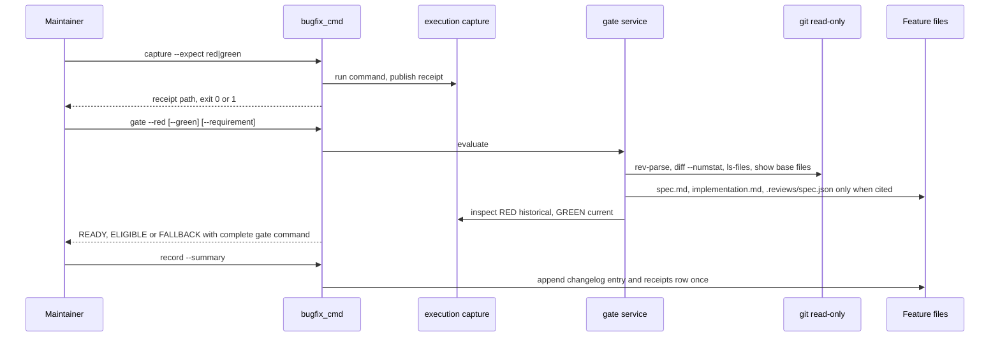
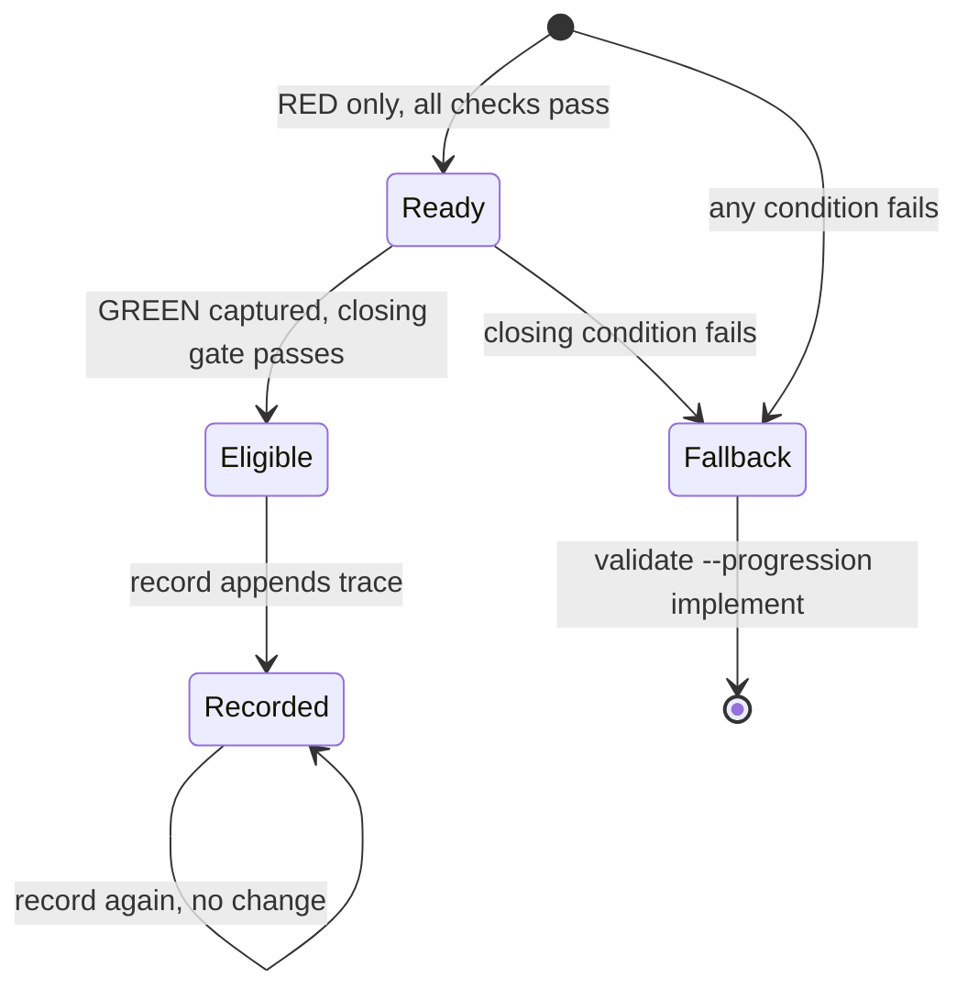

## Summary, Implementation Plan, Testing Strategy, Risks

New `validator/bugfix/` package plus a thin Typer group `livespec bugfix` (`capture`, `gate`, `record`) on Python ≥3.11: frozen dataclasses, read-only `git --no-optional-locks` subprocesses (60 s timeout), PyYAML for `.specs/bugfix.yaml`, pytest fixtures in `tmp_path` git repositories with real captures, ruff, pyright strict, mypy. Reuses `capture_execution`, `execution_evidence._inspect`, `junit_test_id` and `ReviewReceipt`; no network, LLM, UI or new dependency. Conventions: one concept per file, Google docstrings, exits mapped only in the CLI module, `--json` on stdout, clock injected into `record`.

Constitution: ✅1 no new layer; ✅2 no LLM; ✅3 reads `.specs/`, git and receipts, writes only runner-owned receipts (`capture`) and the owner changelog/implementation map (`record`), git never stores state; ✅4 arguments and configuration validated before any capture or write, exits 0/1/2/3, every reason carries its detail; ✅5 one `bugfix` group composing flags, like `pipeline`, `goal`, `finalize`, `runtime`; ✅6 local only. `validator/execution_evidence.py` (292 lines) gains one keyword parameter.

- **D-01 Protected spec text:** a heading definition (`### AC-001`) extends to the next heading; list, table or paragraph definitions to the next blank line, heading or definition; fenced `gherkin` blocks compare as an ordered list; text whitespace-normalized. Over-capture only makes the check stricter.
- **D-02 Historical RED:** `_inspect(..., require_current=True)`; RED passes `False`, dropping only the current-source comparison (integrity, provenance, in-run stability, report and assertion trace stay).
- **D-03 Regression identity and order:** node ids with a failed assertion whose node or JUnit id is a failed report test, and whose node or JUnit id is a passed GREEN test; the test file is the assertion path relative to the root (an assertion raised in a helper yields a spurious, fail-safe fallback), compared by manifest hash in both captures. RED `started_ns` must precede GREEN `started_ns` (`receipt_order_invalid`). `capture` tokenizes `--command` with `shlex.split`, never a shell.
- **D-04 Inputs, command, tests:** manifest keys differing between RED and GREEN (`@symlink` stripped, Regression test files set aside) must be non-empty, contain no Test file (`test_support_changed`) and lie in the Bugfix diff or traceability artifacts (`fix_not_in_diff`). Test command = captured argv minus runner-injected `--junitxml=`/`--junit-xml=`/`--json-report-file=`; must match (`command_mismatch`). A Counted diff Test file present at the base and not a Regression test file yields `existing_test_changed`; edits inside the Regression test file itself are a known, size-bounded limitation.
- **D-05 Diff:** `git diff --numstat -z --no-renames <base>` plus `git ls-files --others --exclude-standard -z`; numstat `-` or a NUL byte marks binary; untracked files count all lines; traceability artifacts include `.specs/.execution/` receipts.
- **D-06 Limits:** `git show <base>:.specs/bugfix.yaml`, so a fix cannot raise its own limits; unresolvable base → `diff_unavailable` with defaults; invalid YAML, unknown key or non-positive value → `BugfixConfigError`, exit 3 before any reason. Defaults 8 files / 300 lines, calibrated on the six audit bugs of 2026-10-12: the largest (037 runner signatures) touches about six files; a typical fix is one source file plus one test under 100 lines.
- **D-07 Reasons:** every independent condition is evaluated; an unavailable input (diff) is reported once instead of raising.
- **D-08 Goal:** `_fix_execution_branches` returns `{fix-execute, fix-bugfix}` with `--bugfix`, else `{fix-execute, fix-readiness[, fix-feature]}`; spec-fix rows for gap report, complete readiness, mapped acceptance, gap-report overwrite, README promotion and finalize move to `fix-readiness`, so non-bugfix inventories are unchanged. Finalize leaves the bugfix inventory because `record` owns the feature trace (AC-012) and the skill adds the global changelog line; a finalize entry would duplicate the feature changelog entry, and README status promotion is already excluded by AC-013. `outcome:passed` is proven by `verify_execution_observation(..., "passed")` in evidence policy and archive verification. RED stays documentary because goal receipts are re-verified against current sources at archive time.
- **D-09 Record:** changelog `## YYYY-MM-DD — [Bugfix]: <summary>` with standard fields (`Spec modified: Yes (non-requirement lines only)` when a `spec.md` is counted), base revision, RED/GREEN receipts and marker `<!-- bugfix:<green-invocation> -->`; row in `## Bugfix Receipts`. If both files already reference the GREEN invocation (read from the receipt file), return `already recorded` without the gate; otherwise re-run the gate and write only the missing part.
- **D-10 Review receipt:** opened only with `--requirement`; unreadable → `review_receipt_unreadable`.
- **D-11 Skill order:** the project test suite runs after the correction and before GREEN.

**Gherkin Scenarios + Mermaid Sequence Diagrams**

```gherkin
Feature: Bugfix lane interactions
  Scenario: RED, gate, GREEN, gate, record
    Given an implemented owner feature in a git project and a failing regression test
    When the maintainer captures RED, runs the gate, fixes, captures GREEN and runs the gate again
    Then both gates exit 0 and "livespec bugfix record" appends the trace once

  Scenario: Ineligible correction falls back
    Given the bugfix diff changes the text of FR-002
    When the maintainer runs "livespec bugfix gate --red <red> --green <green>"
    Then the gate exits 1, lists "spec_requirement_text_changed" and prints the complete gate command
```



**Gherkin Scenarios + Mermaid State Diagrams**

```gherkin
Feature: Bugfix evaluation lifecycle
  Scenario: Pre-edit then closing evaluation
    Given a valid RED receipt and no GREEN receipt
    When the gate runs
    Then the evaluation is READY
    When GREEN is captured after the fix and the gate runs again
    Then the evaluation is ELIGIBLE and record moves it to Recorded

  Scenario: Any failed condition
    Given an evaluation in any state
    When a condition fails
    Then the evaluation is FALLBACK and the complete gate applies
```



**Implementation Plan, Testing Strategy, Risks**

1. `validator/bugfix/models.py`, `config.py` — limits, reasons, report JSON, config errors (FR-006, FR-009).
2. `validator/bugfix/diff.py` — diff entries, base text, traceability artifacts (FR-004, FR-006).
3. `validator/bugfix/requirements.py` — protected text, cited requirement scope (FR-004, FR-008).
4. `validator/execution_evidence.py`, `validator/bugfix/receipts.py` — historical RED, current GREEN, regression conditions (FR-002, FR-005).
5. `validator/bugfix/gate.py`, `record.py` — owner, confinement, existing tests, idempotent trace (FR-003, FR-005, FR-006, FR-007, FR-009, FR-010).
6. `validator/cli_commands/bugfix_cmd.py` + registration (FR-001, FR-002, FR-009, FR-010).
7. `validator/goal_inventory.py`, `goal_contract_model.py`, `evidence_policy.py`, `run_requirement_receipts.py` (FR-011).
8. spec-fix `SKILL.md` and `expectations.md`, both spec-system copies, README (FR-012).

Tests: `tests/test_bugfix_capture.py` (AC-001, AC-002), `tests/test_bugfix_gate.py` (AC-003 to AC-011; SC-001 by a full-lane fixture (RED capture, READY, GREEN capture, ELIGIBLE, record) where `require_progression`, review preparation and `llm_provider.call_llm` raise if called; SC-002 by one fixture per reason code; SC-003 by before/after hashes of every working-tree file), `tests/test_bugfix_record.py` (AC-012, SC-003 write scope), `tests/test_bugfix_goal.py` (AC-013), `tests/test_bugfix_docs.py` (AC-014), shared `tests/bugfix_support.py`; the existing unit suite must stay green.

Risks: a false ELIGIBLE (mitigated by collecting all reasons, current GREEN, historical RED limited to the source comparison, a negative fixture per reason); GREEN staleness after record (owner changelog and map are excluded from feature manifests, and the already-recorded shortcut covers linked maps); goal drift (non-bugfix renders unchanged by test).
