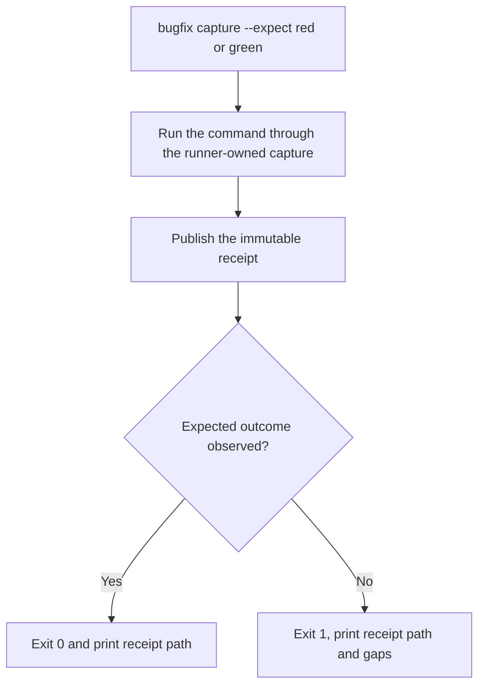
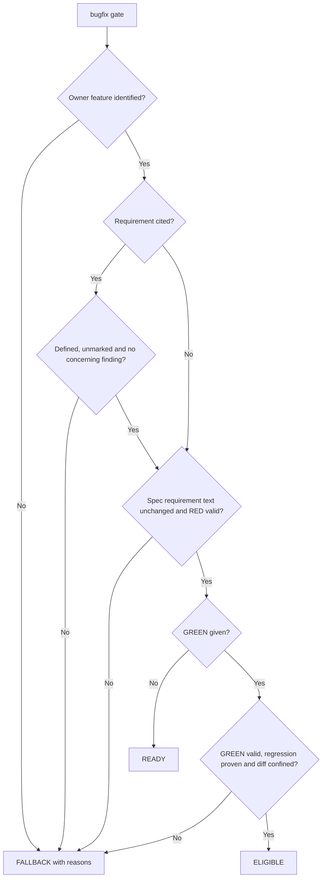
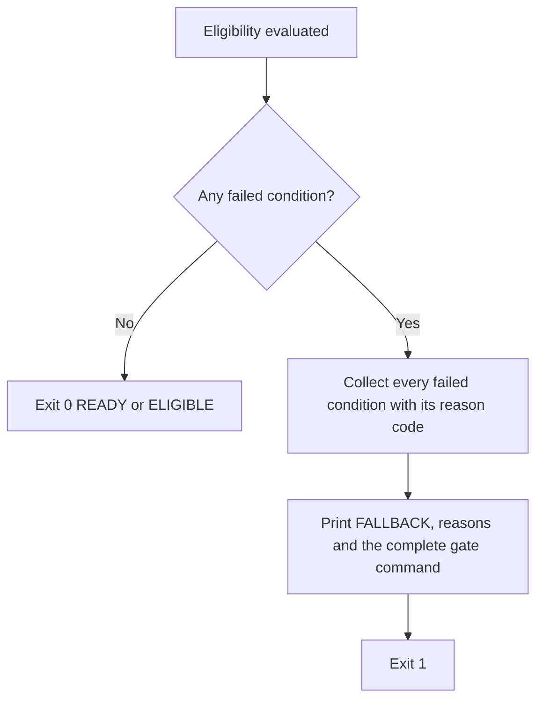
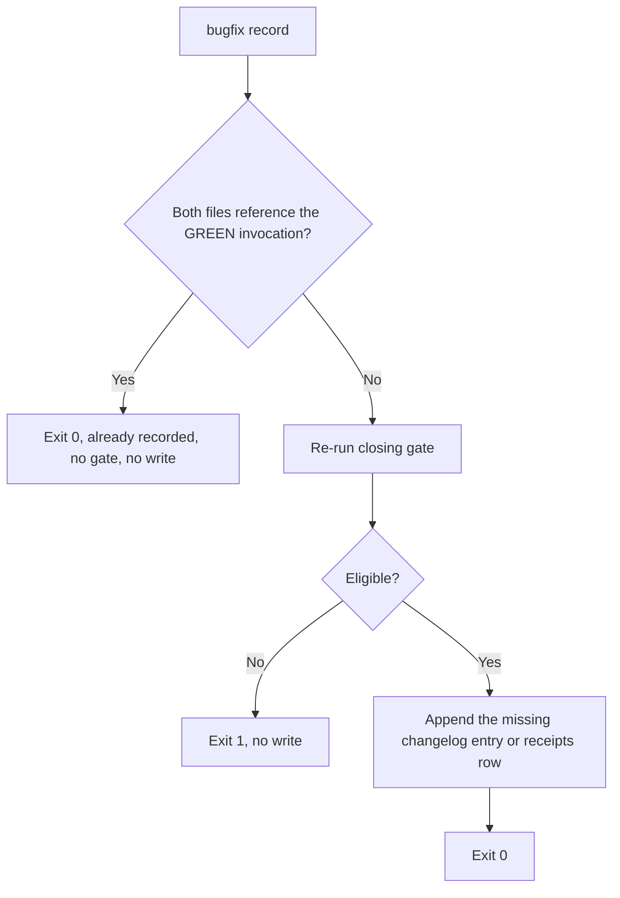
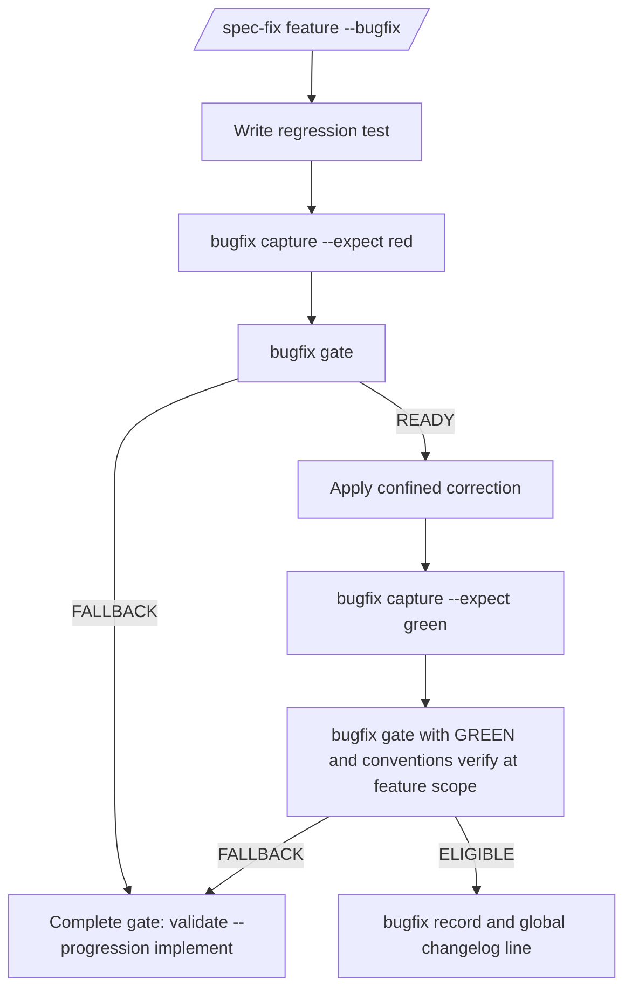

# Feature Spec: Bugfix Lane

- **Feature:** Lightweight `/spec-fix --bugfix` lane with CLI-verified eligibility
- **Feature Number:** 084
- **Branch:** `feat/bugfix-lane` (existing; no branch creation in this phase)
- **Date:** 2026-10-12
- **Status:** Implemented
- **Input:** `/spec-fix` requires `livespec validate <feature> --progression implement` READY, so current spec and plan reviews of the whole owner feature without any blocking finding. A two-line code correction is blocked by unrelated ambiguities and can cost up to 63 review calls. The maintainer decided to add a bugfix lane whose eligibility the CLI verifies instead of trusting a declaration.

## Scope and Source Evidence

- **Observed problem:** the current fix gate (`validator/progression_gate.py::require_progression`, called by `livespec validate --progression implement`) recomputes the complete clarification inventory and the complete Analyze report of the owner feature; any unrelated blocking finding blocks every code edit.
- **Existing evidence primitives (reused, not redesigned):** runner-owned execution captures (`validator/execution_capture.py`, immutable receipts under `.specs/.execution/<invocation>/receipt.json`), the RED/PASS observation verifier (`validator/execution_evidence.py::verify_execution_observation`, which requires a real failing assertion for RED), native review receipts (`.specs/features/<feature>/.reviews/spec.json`), the feature conventions gate (`livespec conventions verify --feature <slug>`) and registry finalization (`livespec finalize apply`).
- **Decided design (approved by the maintainer for this feature):** (1) a `/spec-fix <feature> --bugfix` mode plus the CLI equivalent that the fix gate reads; (2) eligibility verified by the CLI: owner feature identified, no FR/AC/SC definition text change in any `spec.md`, a regression test proven RED before and GREEN after the correction through runner-owned receipts, and a diff confined by configurable file and line thresholds; (3) in bugfix mode the complete feature readiness is not required: a cited FR/AC is checked alone, an uncited implementation bug needs no review, and the conventions gate stays at feature scope; (4) any ineligibility falls back explicitly to the complete gate with its reasons; (5) traceability through a Bugfix changelog entry and RED/GREEN receipts referenced in `implementation.md`; (6) updates of the spec-fix skill, its expectations, both spec-system copies and the README.
- **In scope:** exactly the decided design above.
- **Out of scope:** changing the complete fix gate, the review protocol or the receipt formats; bugfix support for non-pytest runners (they cannot produce runner-owned assertion receipts today); visual fixes (`--visual` keeps the visual gate and the complete readiness); automatic commits.
- **Test isolation:** feature tests build temporary git repositories and temporary `.specs/` trees; they never capture executions in the LiveSpec repository itself.

## Constitution Alignment

- **CLI surface:** `bugfix` is one command group (`capture`, `gate`, `record`) following the existing command-group pattern (`pipeline`, `goal`, `hooks`, `finalize`, `runtime`); options compose behavior as flags within it.
- **Write scope:** `capture` writes only runner-owned files under `.specs/.execution/`; `record` writes only the owner feature `changelog.md` and `implementation.md`; `gate` is read-only.
- **Exit codes:** 0 eligible, 1 ineligible or unobserved outcome, 2 invalid arguments, 3 invalid configuration.

## Definitions

- **Owner feature:** the feature directory `.specs/features/<feature>/` named by `--feature`; it is identified when that directory exists with both `spec.md` and `implementation.md`.
- **Base revision:** the git revision given by `--base`, default `HEAD`.
- **Bugfix diff:** every path that differs between the base revision and the working tree (tracked changes, staged or not, plus untracked files that are not git-ignored).
- **Traceability artifacts:** `.specs/changelog.md`, `.specs/README.md`, runner-owned receipts under `.specs/.execution/`, and inside any feature directory `implementation.md`, `changelog.md`, `progress.md`, `pipeline.md` and everything under `checks/` or `.reviews/`.
- **Counted diff:** the Bugfix diff minus traceability artifacts. Its line count is the sum of added plus deleted lines; an untracked file counts all its lines.
- **Requirement definition:** a line of a `spec.md` whose first token, after optional list, heading, table or bold markup, is an identifier `FR-NNN`, `AC-NNN` or `SC-NNN`, together with its body: for a heading line (for example `### AC-001`), every following line, blank lines included, up to the next heading of any level; for any other line, the following lines up to the next blank line, heading or requirement definition. Text is compared after whitespace normalization.
- **RED receipt:** a runner-owned execution receipt of the owner feature whose capture exited 1 and recorded at least one failing assertion.
- **GREEN receipt:** a runner-owned execution receipt of the owner feature whose capture exited 0, reports at least one passed test and no failed test, and whose inputs are current.
- **Regression test:** a test identifier recorded as failed by an assertion in the RED receipt and as passed in the GREEN receipt.
- **Protected spec text:** the Requirement definitions plus the content of every fenced `gherkin` block of a `spec.md`, because Gherkin is the behavioral source of truth (constitution, Spec Conventions).
- **Test command:** the argument list of a capture without the report-location arguments injected by the runner; RED and GREEN must use the same Test command.
- **Test file:** a path with a directory component `tests` or `test`, or a file named `test_*.py`, `*_test.py` or `conftest.py`.
- **Cited requirement:** an `FR-NNN`, `AC-NNN` or `SC-NNN` passed with `--requirement`; a bug without a cited requirement is an implementation bug against the spec already written.
- **Bugfix limits:** `max_files` and `max_lines`, read from `.specs/bugfix.yaml` at the base revision (so a correction cannot raise its own limits), defaulting to 8 and 300 when that file is absent at the base revision.
- **Concerning finding:** in a spec review receipt (used as is, even when stale against the current spec), a conclusion for the cited requirement whose disposition is not `covered`, a critical unresolved ambiguity for that requirement, or a blocking finding whose description or citation excerpts contain the cited identifier.

## User Scenarios & Testing

### Story 1 — Prove a regression test RED then GREEN `P1`

**As a** maintainer fixing a bug, **I want to** capture runner-owned proof that a regression test fails before my correction and passes after it, **so that** the lane certifies the regression instead of trusting my statement.

**Priority reason:** RED and GREEN receipts are the evidence every other eligibility check builds on.

**Independent test:** In a temporary project, run `livespec bugfix capture` on a test failing by assertion, on a test failing by another exception and on a passing test, with `--expect red` and `--expect green`.

```gherkin
Feature: Regression receipts
  Scenario: A failing assertion is captured as RED
    Given an implemented owner feature and a pytest test that fails by assertion
    When the maintainer runs "livespec bugfix capture --feature <feature> --expect red --command '<python> -m pytest <test>'"
    Then the command exits 0 and prints the runner-owned receipt path
    And the receipt records exit code 1 and the failing assertion of the test

  Scenario: A failure without a failing assertion is not RED
    Given a pytest test that fails by raising TypeError
    When the maintainer runs the same capture with "--expect red"
    Then the command exits 1, prints the receipt path and reports that no RED assertion was observed

  Scenario: A passing run is captured as GREEN
    Given the same test now passes
    When the maintainer runs the capture with "--expect green"
    Then the command exits 0 and prints the receipt path
```

#### User Flow



### Story 2 — Pass the scoped gate without whole-feature readiness `P1`

**As a** maintainer, **I want to** start and close a confined correction without spec and plan reviews of the whole owner feature, **so that** unrelated ambiguities no longer block a small fix.

**Priority reason:** this is the problem the lane exists to solve.

**Independent test:** In a temporary git project whose owner feature has no review receipt, run `livespec bugfix gate` before the correction with only a RED receipt, then after it with RED and GREEN receipts, with and without a cited requirement.

```gherkin
Feature: Scoped bugfix gate
  Scenario: Implementation bug passes without any review
    Given an owner feature with spec.md and implementation.md and no review receipt
    And a RED receipt for a regression test
    When the maintainer runs "livespec bugfix gate --feature <feature> --red <red>"
    Then the command exits 0 and prints "Bugfix gate: READY"
    And no clarification inventory, Analyze report or review receipt of the feature is required

  Scenario: Confined correction closes as eligible
    Given the correction is applied and a GREEN receipt exists for the same regression test
    When the maintainer runs "livespec bugfix gate --feature <feature> --red <red> --green <green>"
    Then the command exits 0 and prints "Bugfix gate: ELIGIBLE"
    And the report lists the regression tests, the counted files and the counted lines

  Scenario: Cited requirement is checked alone
    Given the spec review receipt has a blocking finding about AC-007 only
    When the maintainer runs the gate with "--requirement AC-002"
    Then the command exits 0
    When the maintainer runs the gate with "--requirement AC-007"
    Then the command exits 1 with reason "requirement_blocking_finding"
```

#### User Flow



The flowchart shows the decision order only; the gate evaluates every condition and reports all failed ones together (AC-011).

### Story 3 — Fall back explicitly to the complete gate `P1`

**As a** maintainer, **I want** an ineligible correction to stop with every reason and the exact complete-gate command, **so that** the lane can never become a silent bypass.

**Priority reason:** without an explicit fallback the lane would weaken the requirement-integrity guarantees.

**Independent test:** Make each eligibility condition fail in turn and inspect the exit code, the text output and the `--json` output.

```gherkin
Feature: Explicit fallback
  Scenario: A requirement text change leaves the lane
    Given the bugfix diff changes the text of FR-002 in spec.md
    When the maintainer runs the gate with RED and GREEN receipts
    Then the command exits 1 and prints "Bugfix gate: FALLBACK"
    And it lists reason "spec_requirement_text_changed" naming FR-002
    And it prints "livespec validate .specs/features/<feature> --progression implement"

  Scenario: A Gherkin change leaves the lane
    Given the bugfix diff changes a Gherkin scenario in spec.md
    When the maintainer runs the gate
    Then the command exits 1 with reason "spec_requirement_text_changed" naming "Gherkin scenarios"

  Scenario: A large diff leaves the lane
    Given the counted diff has more files than the configured max_files
    When the maintainer runs the gate with RED and GREEN receipts
    Then the command exits 1 with reason "diff_too_large" and both measured values and limits
```

#### User Flow



### Story 4 — Record bugfix traceability `P2`

**As a** maintainer, **I want** the eligible correction recorded in the owner feature changelog and implementation map with its receipts, **so that** reviewers can audit later why no full review was run.

**Priority reason:** traceability is required for every closed bugfix but follows the eligibility proof.

**Independent test:** Run `livespec bugfix record` on an eligible and on an ineligible correction, then run it twice on the eligible one.

```gherkin
Feature: Bugfix traceability
  Scenario: Eligible correction is recorded once
    Given an eligible correction with RED and GREEN receipts
    When the maintainer runs "livespec bugfix record --feature <feature> --red <red> --green <green> --summary '<text>'"
    Then the command exits 0
    And changelog.md gains one entry of type Bugfix naming both receipt paths
    And implementation.md gains one row in "## Bugfix Receipts" with both receipt paths
    When the maintainer runs the same command again
    Then both files are unchanged

  Scenario: Ineligible correction is not recorded
    Given an ineligible correction
    When the maintainer runs "livespec bugfix record" with its RED, GREEN and summary options
    Then the command exits 1 with the fallback reasons and changes no file
```

#### User Flow



### Story 5 — Follow the lane from the spec-fix skill `P2`

**As an** agent running `/spec-fix <feature> --bugfix`, **I want** the skill, its expectations, both spec-system copies and the README to describe the lane and its fallback, **so that** I run the scoped gate instead of the complete readiness gate only when it applies.

**Priority reason:** the lane is reached through the skill; the CLI alone is not discoverable.

**Independent test:** Inspect the documents for the mode, every eligibility condition, the fallback and the traceability step; render the spec-fix goal with and without `--bugfix`.

```gherkin
Feature: Skill and goal integration
  Scenario: Skill documents the lane
    Given the spec-fix SKILL.md
    Then it documents "--bugfix", the four eligibility conditions, "livespec bugfix gate", the fallback to "livespec validate <feature-dir> --progression implement" and "livespec bugfix record"

  Scenario: Bugfix goal omits whole-feature readiness
    When "livespec goal render spec-fix --feature <feature> --flags '--auto --bugfix'" runs
    Then the goal contains the bugfix RED, gate, GREEN and record tasks
    And it contains neither the complete readiness task nor the complete feature acceptance task
    When the same goal is rendered without "--bugfix"
    Then the complete readiness task is present and no bugfix task is present
```

#### User Flow



## Acceptance Criteria

### AC-001

`livespec bugfix capture --feature <feature> --expect red --command <cmd>` runs `<cmd>` once through the existing runner-owned capture, prints the receipt path in every case, exits 0 when the capture exited exactly 1 with at least one failing assertion of a failed test, and exits 1 otherwise (test failing without a failing assertion, command exit 0, or any other exit code such as pytest collection or usage errors 2 to 5); `--json` prints one object with `receipt_path`, `expected`, `observed`, `exit_code` and `gaps`.

### AC-002

`livespec bugfix capture --expect green` exits 0 when the capture exited 0, reports at least one passed test and no failed test, and exits 1 otherwise; a `--feature` whose directory does not exist under `.specs/features/` or an `--expect` value other than `red` or `green` exits 2 without running the command (owner identification itself is a gate condition).

### AC-003

Without `--green`, `livespec bugfix gate --feature <feature> --red <red>` exits 0 and prints `Bugfix gate: READY` for an identified owner feature with a valid RED receipt, an available Bugfix diff without any Protected spec text change, and clean cited requirements (AC-010), even when the feature has no spec or plan review receipt and its complete clarification inventory or Analyze report would block.

### AC-004

With `--green`, the gate exits 0 and prints `Bugfix gate: ELIGIBLE` when, in addition to AC-003, the GREEN receipt is valid and current, at least one Regression test exists, every Regression test file has identical content in the RED and GREEN captures, the RED capture started before the GREEN capture, both captures ran the same Test command, the inputs changed between the two captures are non-empty, contain no Test file and belong to the Bugfix diff or to traceability artifacts, and the Counted diff contains no binary file and respects both thresholds; the report lists Regression tests, counted files and counted lines.

### AC-005

A Bugfix diff that adds, removes or changes any Protected spec text of any `spec.md` yields exit 1, `Bugfix gate: FALLBACK` and reason `spec_requirement_text_changed` naming each changed identifier or `Gherkin scenarios`; changes to `implementation.md` mappings and to other lines of `spec.md` (status, dates, prose outside requirement definitions and Gherkin) do not trigger this reason.

### AC-006

A RED receipt that is missing, foreign to the owner feature, altered, or does not show exit 1 with a failing assertion yields reason `red_receipt_invalid`; a RED receipt is evaluated as a historical observation, so later source changes alone never invalidate it.

### AC-007

A GREEN receipt that is missing, foreign, altered, failing or stale yields reason `green_receipt_invalid`; a Regression test file whose content differs between the two captures yields `regression_test_changed`; no test failed in RED and passed in GREEN yields `no_regression_test`; a GREEN capture started before the RED capture yields `receipt_order_invalid`; a GREEN Test command different from the RED Test command yields `command_mismatch`; a Counted diff path that is a Test file existing at the base revision, other than a Regression test file, yields `existing_test_changed`; a changed input between the captures that is a Test file other than a Regression test file yields `test_support_changed`; identical inputs between the captures, or inputs changed outside the Bugfix diff and traceability artifacts, yield `fix_not_in_diff`.

### AC-008

A Counted diff with more files than `max_files` or more lines than `max_lines` yields reason `diff_too_large` with both measured values and limits; defaults are `max_files: 8` and `max_lines: 300`; an optional `.specs/bugfix.yaml` with positive integer `max_files` and/or `max_lines`, read at the base revision, overrides the keys it declares (an unknown key is invalid), and a working-tree change of that file has no effect on the evaluation that contains it; the configuration is parsed in both the pre-edit and the closing gate, and an unreadable or invalid file stops the evaluation with exit 3 naming the file and the key, before any reason is collected; a binary file in the Counted diff yields `diff_binary`; a missing git repository or unresolvable base yields `diff_unavailable` in both the pre-edit and the closing gate.

### AC-009

A feature directory that does not exist, lacks `spec.md` or lacks `implementation.md` yields reason `owner_not_identified` naming the missing path.

### AC-010

With `--requirement <ID>` (repeatable), the gate checks only the cited requirements: an identifier without a Requirement definition in the owner `spec.md` yields `requirement_unknown`; a definition containing `[NEEDS CLARIFICATION` or `[DECISION NEEDED` yields `requirement_ambiguous`; a Concerning finding in an existing `.reviews/spec.json` yields `requirement_blocking_finding`; findings about other requirements are ignored; a stale receipt is used as is and its staleness alone never yields a reason; an existing receipt that cannot be read or parsed yields `review_receipt_unreadable`; without a review receipt only the deterministic checks apply; without `--requirement` no review receipt is read.

### AC-011

Every ineligible evaluation exits 1, prints `Bugfix gate: FALLBACK`, every reason code with its detail, and the exact complete-gate command `livespec validate .specs/features/<feature> --progression implement`; `--json` prints one object with `verdict` (`READY`, `ELIGIBLE` or `FALLBACK`), `feature`, `reasons` (code and detail), `regression_tests`, `counted_files`, `counted_lines`, `limits` and `fallback_command`.

### AC-012

`livespec bugfix record --feature <feature> --red <red> --green <green> [--requirement <ID>] [--base <rev>] --summary <text>` re-runs the closing gate; when eligible it appends to the owner `changelog.md` one entry of type `Bugfix` (date, summary, `Spec modified: No` or, when the Counted diff contains a `spec.md`, `Spec modified: Yes (non-requirement lines only)`, counted files, cited requirements or `implementation`, base revision, RED and GREEN receipt paths) and to `implementation.md` one row of a `## Bugfix Receipts` table (date, requirement, Regression tests, RED path, GREEN path), creating the section when absent; when both files already reference the GREEN invocation, record reports `already recorded`, changes nothing and exits 0 without re-running the gate; when only one does, it re-runs the gate and writes only the missing part; when ineligible it exits 1 and writes nothing.

### AC-013

`livespec goal render spec-fix` with `--bugfix` activates the bugfix tasks (RED capture and pre-edit gate as documentary tasks, because the gate verifies RED historically while goal receipts are re-verified against current sources; GREEN capture proven as an execution task with expected outcome passed; closing gate and record) and deactivates the complete readiness task, the complete feature acceptance task and the gap-report tasks (spawning `/spec-check`, overwriting the gap report, promoting README status), because in bugfix mode the bug report replaces the gap report and a zero-gap report never stops the fix; without `--bugfix` the rendered tasks are unchanged; a GREEN receipt proves an `outcome:passed` execution task only when it is a current GREEN receipt.

### AC-014

The spec-fix `SKILL.md` documents the `--bugfix` mode, its four eligibility conditions, the scoped gate, the fallback, the unchanged feature-scope conventions gate, a non-certifying run of the project test suite after the correction and before the GREEN capture (so the run cannot make GREEN stale), the rule that `--visual` fixes never use the lane, and the record step; `expectations.md` documents the bugfix outcome and its `last_reviewed` is the change date; `system/spec-system.md` and `.specs/spec-system.md` each describe the lane in one section; the README lists the `bugfix` commands; every `livespec bugfix` command path cited by a skill exists in the CLI.

## Functional Requirements

- **FR-001:** Add the `livespec bugfix` command group with the subcommands `capture`, `gate` and `record`; usage errors exit 2. **Maps to:** AC-001, AC-002, AC-003, AC-012.
- **FR-002:** `bugfix capture --feature <feature> --expect red|green --command <cmd> [--json]` tokenizes `<cmd>` without a shell, runs it once through the existing runner-owned capture with the junit adapter, prints the receipt path in every case and exits 0 only when the expected outcome is observed (RED: exit 1 with a failing assertion; GREEN: exit 0, a passed test, no failed test, current inputs). **Maps to:** AC-001, AC-002.
- **FR-003:** The gate identifies the owner feature from `--feature` as defined in Definitions and reports `owner_not_identified` otherwise. **Maps to:** AC-009.
- **FR-004:** The gate extracts the Protected spec text of every `spec.md` in the Bugfix diff at the base revision and in the working tree and reports `spec_requirement_text_changed` with each added, removed or changed identifier or `Gherkin scenarios`. **Maps to:** AC-005.
- **FR-005:** The gate verifies the RED receipt as a historical observation and, with `--green`, the GREEN receipt as a current observation, then the Regression test, test-file identity, capture order, same Test command, test-support, existing-test and changed-input conditions of AC-004 and AC-007, reporting the reason codes of AC-006 and AC-007. **Maps to:** AC-004, AC-006, AC-007.
- **FR-006:** The gate reports `diff_unavailable` in both modes when the Bugfix diff cannot be computed; with `--green` it measures the Counted diff against the Bugfix limits and reports `diff_too_large` or `diff_binary`; invalid configuration exits 3. **Maps to:** AC-004, AC-008.
- **FR-007:** In both modes the gate first parses the Bugfix limits (invalid configuration exits 3; an unresolvable base yields `diff_unavailable` with default limits). Without `--green` it evaluates FR-003, FR-004, the RED part of FR-005, FR-008 and the `diff_unavailable` part of FR-006 and prints `READY`; with `--green` it also evaluates the remaining conditions and prints `ELIGIBLE`; it never evaluates the complete clarification inventory, the complete Analyze report or any whole-feature review. **Maps to:** AC-003, AC-004.
- **FR-008:** For each cited requirement the gate applies the deterministic and receipt checks of AC-010; without a citation it reads no review receipt. **Maps to:** AC-010.
- **FR-009:** Every failed condition is collected (no early stop after the owner check), and an ineligible evaluation prints the fallback output and JSON schema of AC-011 and exits 1. **Maps to:** AC-005, AC-011.
- **FR-010:** `bugfix record` returns `already recorded` without re-running the gate when both owner files already reference the GREEN invocation; otherwise it re-runs the closing gate and performs the idempotent writes of AC-012 only when eligible, writing nothing else. **Maps to:** AC-012.
- **FR-011:** The goal inventory recognizes `--bugfix` for spec-fix: it activates a `fix-bugfix` branch and deactivates the complete readiness, gap-report and complete feature acceptance tasks; an execution task declared with expected outcome `passed` is proven by a current GREEN observation. **Maps to:** AC-013.
- **FR-012:** Update the spec-fix `SKILL.md` and `expectations.md`, `system/spec-system.md`, `.specs/spec-system.md` and the README as stated in AC-014. **Maps to:** AC-014.

## Key Entities

| Entity | Description | Key Fields |
|---|---|---|
| Bugfix limits | Diff confinement thresholds | max_files, max_lines, source (default or `.specs/bugfix.yaml`) |
| Gate report | Result of one gate evaluation | verdict, feature, reasons, regression_tests, counted_files, counted_lines, limits, fallback_command |
| Fallback reason | One failed eligibility condition | code, detail |
| Bugfix trace | Changelog entry and implementation row of one eligible correction | date, summary, requirements, counted files, base revision, RED path, GREEN path |

## Edge Cases

- **Several regression tests:** every test failed in RED and passed in GREEN is a Regression test; at least one is required.
- **RED re-captured after a partial correction:** the latest valid RED receipt is passed explicitly; older receipts stay immutable and unused.
- **Correction already committed:** `--base <rev>` selects the revision before the correction; the default `HEAD` covers uncommitted corrections. Changes committed before the chosen base are outside the evaluated bugfix; the base is recorded in the trace so reviewers can audit it.
- **Spec status or changelog-like lines edited in spec.md:** allowed; only Protected spec text (Requirement definitions and Gherkin blocks) is compared.
- **Fix also needs a new requirement:** this is a spec change and leaves the lane through `spec_requirement_text_changed`; use `/spec-refine` then the complete gate.
- **Visual fix:** out of scope; the spec-fix skill states that `--visual` fixes never use the lane (AC-014), so they keep the complete gate and the visual gate.
- **Non-pytest runner:** the capture cannot observe assertions, so RED is never valid and the gate falls back.

## Quality Engineering

- **Risk:** High criticality; the lane relaxes a governance gate, so the primary risk is an unjustified bypass (false ELIGIBLE). Confidence low until fixture evidence exists.
- **Applicable dimensions:** functional correctness of each condition, negative paths for every reason code, integrity of receipts (historical RED versus current GREEN), CLI compatibility (exit codes, JSON), write scope (gate read-only, record idempotent), regression of the complete gate and of existing goal rendering. Accessibility/UX: not applicable, CLI only.
- **P0 gates/evidence:** pytest fixtures in temporary git repositories for READY, ELIGIBLE and every reason code; JSON schema assertions; before/after file hashes for gate and record; goal render comparisons with and without `--bugfix`.
- **P1 gates/evidence:** structural validation, independent spec and plan reviews, the skill CLI-path test, documentation assertions.
- **Gaps:** non-pytest runners cannot use the lane. The lane certifies the regression test only, not the complete feature acceptance; the skill still runs the project test suite before the GREEN capture as a non-certifying regression check. Changes to git-ignored files between the captures can only cause a spurious `fix_not_in_diff`, which fails safe.

## Clarifications

- Q: Why is ownership identified by the feature directory and its implementation map rather than by mapped file paths? -> A: Implementation maps cite facade modules while code lives in implementation modules (for example feature 037 maps `validator/ui_runner_web.py` while handlers live in `validator/runner_web_impl.py`), so path matching would reject legitimate owners; requiring `implementation.md` keeps Draft features without implementation out of the lane.
- Q: Does a cited requirement need a fresh review? -> A: No. Only the cited requirement is checked, deterministically and against an existing receipt when present; no new review is required.
- Q: Do the gap-report steps of `/spec-fix` apply in bugfix mode? -> A: No. The bug report and its regression test replace the gap report; `/spec-check` is not spawned and a zero-gap report never stops a bugfix.
- Q: Does the lane change the conventions gate? -> A: No. `/spec-fix` still runs `livespec conventions verify --feature <slug>` before its result.

## Success Criteria

| ID | Criterion | How to Measure |
|---|---|---|
| SC-001 | A confined implementation bug with a RED then GREEN regression test closes through the lane with zero review calls | Fixture in which review preparation and every LLM entry point raise if called, plus the capture, gate and record transcript |
| SC-002 | Every reason code of AC-005 to AC-010 has a fixture that yields FALLBACK with exit 1 | AC-to-test matrix and pytest transcript |
| SC-003 | Gate evaluations change no file of the project working tree, and record changes only the owner changelog and implementation map | Before/after hashes of every working-tree file outside `.git/`; git runs with optional locks disabled |
