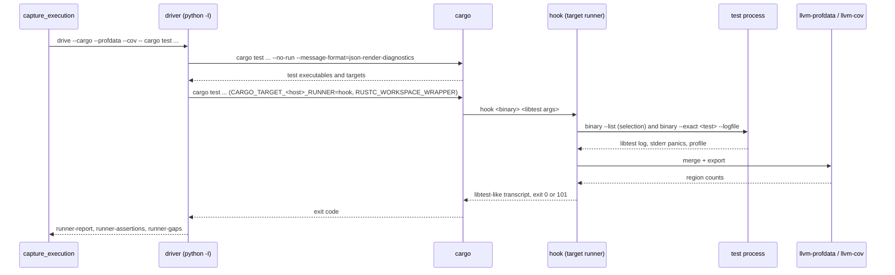
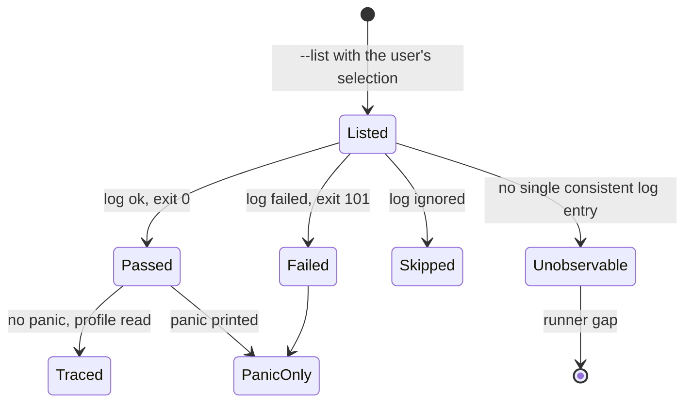

## Summary

A trusted `cargo test` runner made of stdlib-only Python modules executed with `python -I`, a POSIX `RUSTC_WORKSPACE_WRAPPER`, and LLVM source-based coverage read per test. Cargo still runs the user's exact command; the runner sits in Cargo's stable extension points (target runner, workspace wrapper) and publishes the existing JUnit report and strict assertion trace consumed by feature 078.

## Technical Context

| Item | Choice |
|---|---|
| Language | Python ≥3.11 (stdlib only in the runner child), POSIX `sh` wrapper |
| Rust toolchain | Stable only (verified on rustc/cargo 1.94.0, LLVM 21.1.8) |
| Coverage tools | `llvm-profdata`/`llvm-cov` from the `llvm-tools` component, Xcode, or `PATH` (verified with Apple LLVM 21.0.0) |
| Tests | pytest with a generated fixture crate in `tmp_path`; ruff, pyright strict, mypy |

## Technical Decision: why coverage, why not JSON, nextest or a harness

| Option | Verdict |
|---|---|
| libtest `--format json` | Unstable (`-Z unstable-options`, or `RUSTC_BOOTSTRAP`): rejected by the brief and not robust across toolchains. It also reports tests, not assertions. |
| cargo-nextest JUnit/JSON | Not installed on the reference machine; a global install is not justified. It reports per-test outcomes only: no assertion trace, so it cannot reach the pytest level alone. |
| `cargo test --no-run --message-format=json` + `--list` + `--exact` | Kept for identity and selection: stable, exact libtest filtering. Running binaries directly would lose the environment Cargo prepares (working directory, `CARGO_*`, dynamic library paths), so Cargo stays the executor through `CARGO_TARGET_<TRIPLE>_RUNNER`. |
| Tracing assertion harness (shadow `assert!` macros) | Requires changing every consumer test or rewriting sources; stable Rust cannot inject a macro prelude (`-Z crate-attr` is nightly). Rejected. |
| LLVM source-based coverage (`-C instrument-coverage`) | Stable since Rust 1.60, needs no source change. One process per test gives one profile per test; a positive region count at an assertion's first character is a runtime observation that the assertion was evaluated. Kept. |

`RUSTC_WORKSPACE_WRAPPER` adds `-C instrument-coverage` only to `rustc --test` crates of workspace members. Cargo hashes the workspace wrapper into artifact names, so instrumented artifacts live beside ordinary ones in the same target directory: dependencies are reused and later ordinary builds stay fresh (verified on the fixture crate and on Handy, 37 s first build).

## Constitution Check

✅ No new CLI surface (the existing `livespec test --execution-command` and capture paths). ✅ No LLM, no network. ✅ Writes only runner-owned files under `.specs/.execution/<invocation>/` plus Cargo's normal target directory. ✅ Fail closed: every unobservable condition is an explicit gap; unsupported environments still run the command. ✅ No new dependency.

## Gherkin Scenarios + Mermaid Sequence Diagrams

```gherkin
Feature: Trusted Cargo run
  Scenario: Certified run
    Given a supported cargo test command and located LLVM tools
    When the capture runs it
    Then the driver builds with --no-run, runs Cargo with the hook as target runner and publishes the report and trace

  Scenario: Build failure
    Given a test crate that does not compile
    When the capture runs it
    Then the driver returns Cargo's exit code and the runner gap "Cargo could not build the selected test binaries"
```



## Gherkin Scenarios + Mermaid State Diagrams

```gherkin
Feature: Per-test outcome
  Scenario: Passing test without panic
    Given a libtest log "ok <test>" and exit 0
    Then executed assertions come from its coverage profile

  Scenario: Panic observed
    Given a failing, should_panic or panic-catching test
    Then only assertions at panic locations are recorded, as failed
```



## Implementation Plan

1. `validator/execution_cargo_command.py` — classify cargo and libtest arguments (FR-001).
2. `validator/execution_cargo_toolchain.py` — host triple, LLVM tools, pinned provenance (FR-007).
3. `validator/execution_rust_source.py` — assertion lexer (FR-004).
4. `validator/execution_cargo_coverage.py`, `validator/execution_cargo_hook.py` — per-test run, coverage and panics (FR-002, FR-003).
5. `validator/execution_cargo_driver.py`, `validator/execution_cargo.py`, `validator/execution_cargo_rustc.sh` — driver, entry, wrapper (FR-001, FR-005).
6. `validator/execution_runner.py`, `execution_capture.py`, `execution_evidence.py` — routing, `runner-gaps`, provenance by runner kind (FR-001, FR-005, FR-007).
7. `validator/execution_mapping.py`, `execution_reports.py` — Rust bindings, Cargo identity (FR-004, FR-006).
8. `system/testing/execution-rules.md` — Cargo usage and limits.

## Testing Strategy

`tests/test_execution_cargo.py` (AC-001 to AC-006 on a real fixture crate: passing, failing, ignored, filtered, environment-reading and integration tests; skipped without Cargo or LLVM tools), `tests/test_execution_rust_source.py` (lexer, binding rules, identity resolution), `tests/test_execution_cargo_command.py` (accepted and refused options). Existing execution evidence suites must stay green.

## Risks & Considerations

- libtest `--logfile` prints a deprecation warning on 1.94; if it is removed, every result becomes an explicit `Unobservable test result` gap (fail closed), never a pass.
- Coverage regions start at statement boundaries; a passing test without panic executed every statement of an entered region, but a test that hides panics with a custom panic hook could hide a caught assertion failure.
- Per-test processes change test isolation compared with libtest threads (same model as cargo-nextest).
- A capture timeout stops the driver, not necessarily Cargo's children.
- Apple's `llvm-profdata` must match the rustc LLVM major version; a mismatch is an explicit coverage gap.
