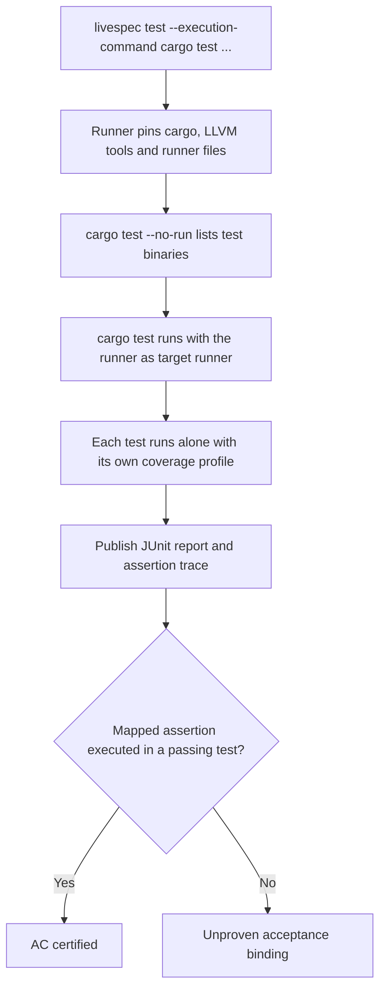
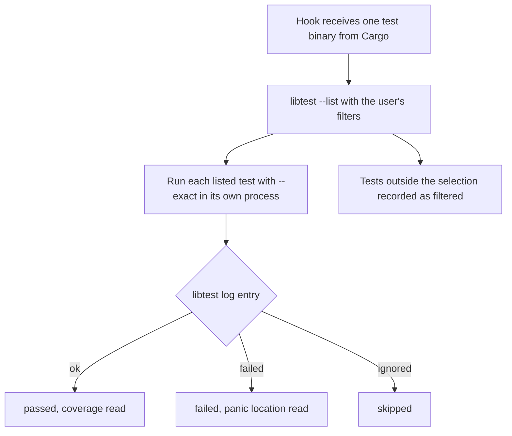
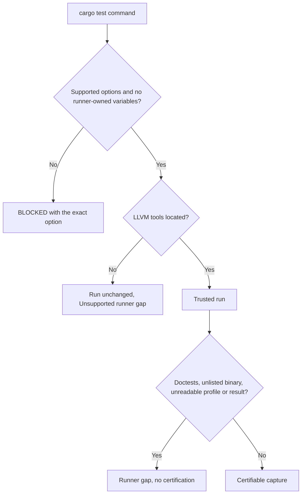

# Feature Spec: Cargo Execution Runner

- **Feature:** Trusted `cargo test` runner that certifies Rust test executions at the same level as pytest
- **Feature Number:** 085
- **Branch:** `worktree-agent-cargo-runner`
- **Date:** 2026-10-13
- **Status:** Implemented
- **Input:** Handy (a Rust/Tauri consumer project) proves almost every acceptance criterion with Rust tests. `livespec test --execution-command "cargo test ..." --report-adapter junit` fails with `Unsupported runner: structured reports alone cannot certify execution; Missing or unstable fresh report: runner-report; Missing actual assertion execution trace: runner-assertions` (Handy tool defect `2026-10-13-cargo-runner-lacks-native-execution-certification`). Delivery of Handy is paused until a Cargo runner exists.

## Scope and Source Evidence

- **Existing contract (reused, not redesigned):** runner-owned capture (`validator/execution_capture.py`), evidence verification (`validator/execution_evidence.py`), reviewed acceptance mappings (`validator/execution_mapping.py`), the strict assertion trace schema (`validator/execution_reports.py::AssertionTrace`) and the trusted pytest runner (`validator/execution_runner.py`, `validator/execution_pytest.py`) of feature [078](../078-requirement-evidence-integrity/spec.md) FR-010/FR-011.
- **Decided design:** stable toolchain only. No libtest JSON (`-Z unstable-options`), no `RUSTC_BOOTSTRAP`, no cargo-nextest (not installed on the reference machine and not required). Cargo itself runs the user's exact command; the runner is installed as Cargo's target runner (`CARGO_TARGET_<TRIPLE>_RUNNER`) and as `RUSTC_WORKSPACE_WRAPPER`, which instruments only libtest harness crates with LLVM source-based coverage (`-C instrument-coverage`, stable). Each selected test runs in its own process with its own coverage profile and libtest log; a positive region count at an assertion invocation's first character is the actual execution observation.
- **In scope:** `cargo test` commands passed to `livespec test --execution-command` (and every other caller of the runner-owned capture, such as `livespec bugfix capture` and driver captures); Rust bindings in acceptance mappings.
- **Out of scope:** doctests (rustdoc runs them outside libtest binaries), `harness = false` test targets, cargo-nextest, the execution input scope rules of `validator/execution_scope.py` (symlinks, ignored paths: owned by a parallel fix), installing LLVM tools.

## Definitions

- **Cargo test identity:** `<package>/<kind>/<target>::<module::test>`, where `kind` is `lib`, `bin`, `test`, `bench` or `example`, for example `handy/test/settings_platform::unix::occupied_probe_never_notifies_or_modifies_store`.
- **Bare test path:** the `<module::test>` part alone; a mapping may use it only when exactly one executed test has that path.
- **Assertion invocation:** a call of `assert!`, `assert_eq!`, `assert_ne!` or `assert_matches!` (optionally path-qualified, such as `std::assert_eq!`), from the first path character to its closing delimiter, found by a lexer that ignores comments, string, raw string, byte string and char literals.
- **Executed assertion:** an assertion invocation whose first character lies in a coverage region with a positive count in the profile of one passing test that printed no panic; a **failed assertion** is one whose position matches a panic location printed by the default panic hook.
- **LLVM tools:** `llvm-profdata` and `llvm-cov`, located in the toolchain's `llvm-tools` component, then Xcode (`xcrun`) on macOS, then `PATH`.

## User Scenarios & Testing

### Story 1 — Certify a mapped Rust assertion `P1`

**As a** maintainer of a Rust project, **I want** `livespec test` to certify an acceptance criterion from a reviewed mapping and a real `cargo test` run, **so that** Rust features reach the same execution proof as Python features.

**Priority reason:** this unblocks every consumer project whose acceptance tests are Rust tests.

**Independent test:** In a temporary crate with an integration test, review a mapping to its assertion and capture `cargo test --test integ`.

```gherkin
Feature: Cargo execution certification
  Scenario: Mapped integration assertion is certified
    Given a crate whose integration test "integ" asserts that add(2, 3) equals five
    And a reviewed mapping binds AC-001 to that assertion and test "fixture/test/integ::integration_adds"
    When the maintainer runs "livespec test --feature <feature> --acceptance-mapping <mapping> --execution-command 'cargo test --test integ' --report-adapter junit"
    Then the result is valid and certifies AC-001
    And the report lists the test with status passed and one executed assertion

  Scenario: Bare test path names a unique test
    Given the mapping names the test "integration_adds" without its binary
    When the same command runs
    Then AC-001 is certified because exactly one executed test has that path

  Scenario: Unreached assertion cannot certify
    Given a mapping binds AC-001 to an assertion inside a branch the test never takes
    When the command runs and the test passes
    Then the binding is reported as unproven
```

#### User Flow



### Story 2 — Report failed, ignored and filtered tests faithfully `P1`

**As a** maintainer, **I want** the runner to keep Cargo's real outcomes, **so that** a failure, an ignored test or a filter never turns into proof.

**Priority reason:** a runner that hides failures or skipped tests would weaken certification.

**Independent test:** Capture `cargo test --lib --no-fail-fast tests::` on a crate with passing, failing, ignored and filtered-out tests.

```gherkin
Feature: Faithful Cargo outcomes
  Scenario: Mixed outcomes
    Given a library with a passing, a failing, an ignored and a filtered-out test
    When the runner captures "cargo test --lib --no-fail-fast tests::"
    Then the capture exits 1
    And the report marks them passed, failed and skipped and lists the filtered test as filtered
    And the trace records the failing assertion as failed and no assertion of the ignored test
    And the RED observation is valid while acceptance certification is refused

  Scenario: Caller environment reaches the tests
    Given a test asserting that LIVESPEC_FIXTURE_FLAG equals "1"
    When the runner captures it with LIVESPEC_FIXTURE_FLAG=1 in the caller environment
    Then the test passes
    And without the variable the same test fails
```

#### User Flow



### Story 3 — Refuse what cannot be observed `P1`

**As a** maintainer, **I want** commands, tools or outputs the runner cannot observe to stay explicit gaps, **so that** certification is never inferred from an incomplete trace.

**Priority reason:** fail-closed behavior is the contract of feature 078 (AC-009, AC-010).

**Independent test:** Capture with doctests, with missing LLVM tools, with a changed runner provenance and with runner-owned options.

```gherkin
Feature: Unobservable Cargo executions
  Scenario: Doctests ran
    Given a library with a doc example
    When the runner captures "cargo test --no-fail-fast"
    Then the capture gaps contain "Runner: Doctests ran outside libtest binaries and cannot be traced"

  Scenario: LLVM tools are missing
    Given no llvm-profdata or llvm-cov can be located
    When the runner captures "cargo test --test integ"
    Then the command still runs unchanged
    And the capture gap starts with "Unsupported runner: assertion tracing needs llvm-profdata and llvm-cov"

  Scenario: Runner-owned option
    Given the command "cargo test --no-run"
    When the runner prepares it
    Then it refuses with "Unsupported cargo test option --no-run"
```

#### User Flow



## Acceptance Criteria

| ID | Criterion | Priority | Story |
|---|---|---|---|
| AC-001 | Given a reviewed mapping bound to an assertion of a passing Rust test, when `cargo test` is captured, then the verification is valid and certifies the mapped AC; the executed test carries its Cargo test identity and its executed assertion count. | P1 | Story 1 |
| AC-002 | Given a mapping that names a bare test path, when exactly one executed test has that path, then the binding resolves to it; when several do, it stays unproven. | P1 | Story 1 |
| AC-003 | Given an assertion the passing test never reaches, or a binding that does not cite exactly one complete assertion of the named test, then no AC is certified (unproven binding or rejected mapping). | P1 | Story 1 |
| AC-004 | Given passing, failing, ignored and filtered-out tests, when captured, then the report marks them passed, failed and skipped, lists filtered tests separately, the trace holds the failed assertion and no trace of ignored tests, the capture exits 1 and only a RED observation is valid. | P1 | Story 2 |
| AC-005 | Given caller environment variables, when the runner executes Cargo and each test, then the tests see them unchanged. | P1 | Story 2 |
| AC-006 | Given doctests, missing LLVM tools, a changed runner provenance, or runner-owned options and variables, when captured or verified, then the run is blocked or reported with an explicit gap and nothing is certified. | P1 | Story 3 |

### AC-001

Given a reviewed mapping bound to an assertion of a passing Rust test, when `cargo test` is captured, then the verification is valid and certifies the mapped AC; the executed test carries its Cargo test identity and its executed assertion count.

### AC-002

Given a mapping that names a bare test path, when exactly one executed test has that path, then the binding resolves to it; when several do, it stays unproven.

### AC-003

Given an assertion the passing test never reaches, or a binding that does not cite exactly one complete assertion of the named test, then no AC is certified (unproven binding or rejected mapping).

### AC-004

Given passing, failing, ignored and filtered-out tests, when captured, then the report marks them passed, failed and skipped, lists filtered tests separately, the trace holds the failed assertion and no trace of ignored tests, the capture exits 1 and only a RED observation is valid.

### AC-005

Given caller environment variables, when the runner executes Cargo and each test, then the tests see them unchanged.

### AC-006

Given doctests, missing LLVM tools, a changed runner provenance, or runner-owned options and variables, when captured or verified, then the run is blocked or reported with an explicit gap and nothing is certified.

## Functional Requirements

| ID | Requirement | AC |
|---|---|---|
| FR-001 | Route `cargo [+toolchain] test` commands of the runner-owned capture through a trusted Cargo runner executed in isolated mode; refuse options and variables the runner owns (`--no-run`, `--doc`, `--message-format`, `--config`, `-Z`, unknown options, `RUSTC_WORKSPACE_WRAPPER`, `CARGO_TARGET_*_RUNNER`). | AC-001, AC-006 |
| FR-002 | Install the runner as Cargo's target runner; for each test binary, list the user's selection with libtest, run each listed test alone with `--exact`, its own libtest log and coverage profile, honoring `--test-threads`/`RUST_TEST_THREADS` for parallel processes. | AC-001, AC-004, AC-005 |
| FR-003 | Instrument only libtest harness crates of workspace members through `RUSTC_WORKSPACE_WRAPPER`; derive passing executed assertions from per-test coverage of passing tests without any panic, and failed assertions from panic locations. | AC-001, AC-003, AC-004 |
| FR-004 | Identify Rust assertion invocations with a lexer, and require each Rust binding to cite exactly one complete invocation inside the function named by its test; match observed assertions by line and exact invocation text. | AC-003 |
| FR-005 | Publish a JUnit report (one suite per binary, failed and ignored cases, filtered tests as properties), the strict assertion trace and runner gaps (doctests, unlisted or untraced binaries, unreadable results or profiles); report exit 1 for failed tests. | AC-004, AC-006 |
| FR-006 | Identify Cargo tests as `<package>/<kind>/<target>::<path>` and resolve a bare path only when it is unique among executed tests. | AC-001, AC-002 |
| FR-007 | Pin the interpreter, every runner file, Cargo and the LLVM tools in the capture provenance and re-hash them at verification; when the LLVM tools are missing, run the command unchanged with an explicit `Unsupported runner` gap. | AC-006 |

### FR-001

Route `cargo test` through the trusted Cargo runner and refuse what it owns.

**AC References:** [AC-001](#ac-001), [AC-006](#ac-006)

### FR-002

Per-test libtest execution under Cargo's target runner.

**AC References:** [AC-001](#ac-001), [AC-004](#ac-004), [AC-005](#ac-005)

### FR-003

Executed assertions from per-test coverage and panic locations.

**AC References:** [AC-001](#ac-001), [AC-003](#ac-003), [AC-004](#ac-004)

### FR-004

Rust assertion identity and bindings.

**AC References:** [AC-003](#ac-003)

### FR-005

Report, trace and runner gaps publication.

**AC References:** [AC-004](#ac-004), [AC-006](#ac-006)

### FR-006

Cargo test identity and bare path resolution.

**AC References:** [AC-001](#ac-001), [AC-002](#ac-002)

### FR-007

Pinned provenance and missing tools.

**AC References:** [AC-006](#ac-006)

## Edge Cases

- A crate without `Cargo.lock`: Cargo creates it during the run, so inputs change and certification is refused; commit the lockfile.
- A test that catches a panic (`catch_unwind`) or a `#[should_panic]` test: its panic locations are recorded as failed assertions and no passing assertion is inferred for that test.
- A test that replaces the panic hook hides panic locations; a failure is still a failed test, but no failed assertion is recorded.
- A test that calls `process::exit` leaves no libtest log entry: the test is failed and a runner gap is recorded.
- Plain `cargo test` on a library runs doctests and therefore cannot certify; select `--tests`, `--lib` or `--test <name>`.

## Success Criteria

- **SC-001:** The Handy command of the tool defect produces a fresh `runner-report` and `runner-assertions` with no runner gap; any remaining gap comes from the mapping or from the execution input scope.
- **SC-002:** The repository unit suite stays green, and the Cargo fixture tests run on any machine with Cargo and LLVM tools (they skip otherwise).
