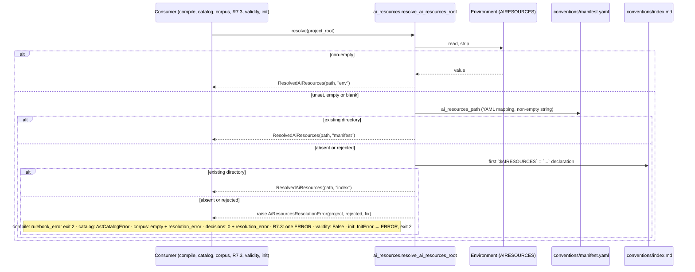

# Plan — Locate ai-ressources Without Hard-Coded Paths

## Summary

Add one small module `validator/ai_resources.py` exposing `resolve_ai_resources_root(project_root)` (non-empty `AIRESOURCES`, then the existing directory recorded in `.conventions/manifest.yaml` `ai_resources_path`, then the `.conventions/index.md` declaration, else `AiResourcesResolutionError`), route the six sites through it with their existing reactions, delete every hard-coded fallback, guard against its return with a pytest scan, and document `AIRESOURCES`.

## Technical Context

| Aspect | Choice | Reason |
|---|---|---|
| Language | Python ≥3.11 (typing `Literal`, `NotRequired`, frozen dataclasses) | From project stack |
| CLI | Typer (unchanged commands, flags and exit codes) | Constitution Principle 5 |
| Parsing | PyYAML `safe_load` for the manifest, the existing `re` declaration pattern for `index.md` | Already used by `catalog.py`, `corpus.py`, `conventions_rules.py` |
| Storage | None — read-only reads of the environment and `.conventions/` | Principle 3 |
| Testing | pytest + `monkeypatch` + `tmp_path` fake corpora; `typer.testing.CliRunner` for compile | From testing strategy |
| Quality | ruff (check + format), pyright strict on `validator/`, mypy (CI) | Stack + CI workflow |
| Platform / type | Local CLI library, no UI, no API, no infrastructure | Stack |

- **Scope:** M (7 FR, no new entity table, one internal service interaction reused by seven consumers). Output budget: one sequence diagram; no state diagram (the resolution keeps no state between calls and no entity has a lifecycle); no ER diagram (no database or persisted entity). No API endpoint, so no `contracts/`.
- **UI / Penflow:** non-UI feature with no `## Screens` section; Penflow contract inspection is `ABSENT` and certification is not requested.
- **Infrastructure:** none (the spec has no Infrastructure Requirements section; CI workflow is out of scope).
- **Conventions applied** (`$AIRESOURCES/code-conventions/general.md`, `python.md`, `cli.md`; `.specs/conventions-gates.yaml`): one concept per file; module header docstring; Google-style docstrings on every public function, class and constant group; domain error type; environment value validated at the single boundary function; errors propagated, caught only at consumer boundaries; inline comments on the regex, on every intentional catch and on the order-dependent resolution; files ≤ 500 lines (target 400), functions ≤ 60 lines (target 30); zero suppression directives (budget 0); the new environment variable is documented in the README (`cli.md` Environment Variables).

## Constitution Check

| Principle | Verdict | Note |
|---|---|---|
| 1. Layered validation | ✅ | No new layer; R7.3 (Layer 2) only changes how it finds the root and reports one explicit ERROR. |
| 2. Provider-agnostic LLM | ✅ | No LLM call added; `conventions compile` still calls `llm_provider` only after sources resolve. |
| 3. File system as source of truth | ✅ | Reads `AIRESOURCES` and `.conventions/`; writes nothing. |
| 4. Fail fast, exit clearly | ✅ with documented deviation | The error names the project root, each rejected path with its file, and the fix. **Exit code deviation (D-03):** an unresolved root is closest to "3 (config error)", but `livespec conventions compile` (`rulebook_error`) and `init --from-code` (`ERROR:` line) keep exit **2**: the spec mandates unchanged exit codes (Constitution Alignment, Principle 5 bullet), both commands already use 2 for every unmet precondition, and their contracts map 2 to `blocked` (`.agent-sync/skills/spec-init/expectations.md`, `system/expectations.md` outcome matrix, `validator/goal_outcome.py` runs the backend and reads its exit status). Switching to 3 would break those consumers for no operator benefit; the message, not the code, carries the fix. |
| 5. Minimal surface | ✅ | No new command or flag; one optional JSON field `resolution_error` in two existing payloads. |
| 6. No hosted infrastructure | ✅ | Local only. |
| Testing standards | ✅ | Unit tests per branch, consumer matrix with fixtures, chaos-style malformed manifest case; no real corpus needed. |
| Code conventions | ✅ | New module ~110 lines; error class in `validator/exceptions.py` (constitution: domain exceptions live there); `exceptions.py` stays ≈ 300 lines (268 today). Existing files over 300 lines (`corpus.py` 380, `conventions_rules.py` 365) shrink or stay stable; none passes the 500-line gate limit. |

## Decisions (resolving the spec review notes)

- **D-01 Visible failure in the rule decision manifest (FR-005 / AC-006):** `build_corpus_manifest` catches `AiResourcesResolutionError` at its boundary and returns `_empty_manifest("")` plus `resolution_error: str(exc)`. `build_rule_decision_manifest` no longer resolves the root a second time: it takes the root from the corpus manifest, builds zero decisions, and copies `resolution_error` into its own payload (`RuleDecisionManifest.resolution_error: NotRequired[str]`). The same message also reaches `catalog_load_errors` because the AST catalog loader raises `AstCatalogError(str(exc))` for `ai-ressources/` source paths, so `conventions verify` keeps blocking with `catalog_load_error:` blockers. Nothing is swallowed: both payloads carry the message and the gate's existing blocker path shows it. `validate_rule_decision_manifest` is unchanged (zero decisions remain internally consistent).
- **D-02 Rejected-path display form (clarify item `rejected-path-display-form`):** the error lists each rejected Recorded path as its absolute resolved path followed by its source file, `"<absolute path> (from .conventions/manifest.yaml)"` or `"(from .conventions/index.md)"`, in resolution order, separated by `; `. The message is one line so it fits `rulebook_error` JSON, R7.3 violations and the `ERROR:` line. Shape: `ai-ressources root not resolved for project <absolute project root>: AIRESOURCES is not set; rejected recorded paths: <path> (from .conventions/manifest.yaml); <path> (from .conventions/index.md). Run ./setup.sh from your ai-ressources clone, or export AIRESOURCES=<absolute path of the clone>.` With no recorded value: `...: AIRESOURCES is not set; no path recorded in .conventions/manifest.yaml or .conventions/index.md. Run ./setup.sh ...`. Without a project root: `ai-ressources root not resolved: AIRESOURCES is not set. Run ./setup.sh ...`.
- **D-03 Exit codes:** compile and init keep exit 2 (see Constitution Check row 4).
- **D-04 Path normalization:** every candidate is `Path(raw).expanduser()`, joined to the Project root when relative (the Environment root joins `Path.cwd()`), then `.resolve()` (non-strict). Resolving keeps `relative_to` containment checks in `conventions_rules.py` and R7.3 correct under symlinked temporary directories; tests compare with `.resolve()`d expectations. The Environment root is never checked for existence.
- **D-05 `init --from-code` boundary:** `_prepare_documents` calls a private `_ai_resources_for_init(root)` that converts `AiResourcesResolutionError` to `InitError(str(exc))`. `_prepare_documents` runs before the `--dry-run` return and before the `.specs` existence check, backup and every write, so `main` prints `ERROR: <message>`, returns 2 and writes nothing in both normal and `--dry-run` modes. `conventions_are_valid` returns `False` on a resolution error (commented intentional catch); the caller then surfaces the message when it renders.
- **D-06 AC-004 isolation:** the test sets `HOME` with `monkeypatch.setenv` and patches `Path.home` with `monkeypatch.setattr(Path, "home", classmethod(lambda cls: fake_home))`, writes a complete corpus at `fake_home/projects/ai-ressources`, patches `validator.init_from_code.LIVESPEC_ROOT` to `tmp/checkout/livespec` with a complete corpus at `tmp/checkout/ai-ressources`, removes `AIRESOURCES`, and runs from a project with no recorded path: the shared resolution, `build_corpus_manifest`, the AST catalog and `_prepare_documents` must all report the Resolution error.
- **D-07 Documentation form:** the three documents keep the **Read** instruction with a code span, `` **Read** `$AIRESOURCES/design/references/design-read-protocol.md` `` — a Markdown link whose target starts with `$AIRESOURCES` would render as a broken relative link on GitHub and in previews, while a code span states an environment-relative path honestly (the spec QE gap already records that it cannot be followed literally). `.agent-sync/skills/spec-specify/expectations.md` `last_reviewed` becomes `2026-10-13` (pre-commit hook `hooks/livespec-last-reviewed.py`). README gains a `### ai-ressources location (\`AIRESOURCES\`)` subsection under `## Installation` and its `/spec-init` paragraph replaces the "default sibling `ai-ressources` directory" sentence with a pointer to that subsection.
- **D-08 Index declaration pattern ownership:** the declaration regex moves from `conventions_rules._AIRESOURCES_RE` to `validator/ai_resources.INDEX_DECLARATION_RE` (same expression); R7.3's inline copy and `init_recovery`'s looser pattern are deleted. Source-line patterns (`_SOURCE_LINE_RE`, `→ $AIRESOURCES/` parsing) stay where they are.
- **D-09 Traceability:** each changed function or module carries a two-line anchor, e.g. `# @spec FR-001: Shared ai-ressources resolution` / `#   .specs/features/085-localiser-ai-ressources-sans-chemin-en-dur/spec.md#fr-001` (two lines keep ruff E501 green without `noqa`, matching `catalog.py`).

## Gherkin Scenarios + Mermaid Sequence Diagrams

```gherkin
Feature: Consumers resolve ai-ressources through the shared function
  Scenario: Conventions compile with the environment root
    Given AIRESOURCES points to "corpus-env" and the project records "corpus-recorded"
    When "livespec conventions compile --force" runs with a stubbed provider
    Then the shared resolution returns "corpus-env" with source "env"
    And every rulebook source hash is computed from "corpus-env"

  Scenario: Nothing resolves during conventions compile
    Given AIRESOURCES is unset and the manifest records the nonexistent "missing-corpus"
    When "livespec conventions compile --json" runs
    Then the resolution error is raised before any provider call
    And the command prints reason "rulebook_error" with the error message and exits 2

  Scenario: Nothing resolves while building the rule decision manifest
    Given AIRESOURCES is unset and no recorded path designates an existing directory
    When "livespec conventions verify --json" builds the corpus and rule decision manifests
    Then both manifests contain "resolution_error" with the error message
    And the catalog load error carries the same message as a blocker
```



## Implementation Plan

### Step 1 — Shared resolution and error (FR-001, FR-002)

- **New `validator/ai_resources.py`** (~110 lines, module docstring, anchors FR-001/FR-002):
  - Constants: `AIRESOURCES_ENV_VAR = "AIRESOURCES"`, `MANIFEST_RELATIVE_PATH = Path(".conventions/manifest.yaml")`, `INDEX_RELATIVE_PATH = Path(".conventions/index.md")`, `INDEX_DECLARATION_RE` (commented regex moved from `conventions_rules.py`), `ResolutionSource = Literal["env", "manifest", "index"]`.
  - `@dataclass(frozen=True) class ResolvedAiResources: path: Path; source: ResolutionSource` (docstring).
  - `resolve_ai_resources_root(project_root: Path | None, *, environ: Mapping[str, str] | None = None) -> ResolvedAiResources` (≤ 30 lines; `environ` defaults to `os.environ` read at call time; comment explaining why the order is env → manifest → index: committed files may come from another machine).
  - Private helpers: `_environment_root(environ) -> Path | None` (strip; blank is absent; expand + absolute against cwd), `_manifest_value(project_root) -> str | None` (commented catch of `OSError`, `UnicodeDecodeError`, `yaml.YAMLError`: a malformed manifest is not a source of Recorded path), `_index_value(project_root) -> str | None`, `_recorded_path(project_root, raw) -> Path`.
- **Modified `validator/exceptions.py`:** `AIRESOURCES_FIX_SENTENCE` constant and `class AiResourcesResolutionError(ValueError)` with `__init__(self, project_root: Path | None, rejected: Sequence[tuple[Path, str]])`, attributes `project_root`, `rejected`, and the one-line message of D-02 (built by a private `_resolution_message`).

**FR covered:** FR-001.1: Shared resolution order and source, FR-002.1: Dedicated error and message

### Step 2 — Remove forbidden fallbacks in the AST catalog and corpus (FR-003, FR-004, FR-005)

- **`validator/conventions_ast/catalog.py`:** `_resolve_source_path` calls `resolve_ai_resources_root(project_root).path` inside `try/except AiResourcesResolutionError as exc: raise AstCatalogError(str(exc)) from exc`; delete `_ai_resources_root` and the `os` import.
- **`validator/conventions_ast/corpus.py`:** `ai_resources_root(project_root=None)` keeps its public signature (tests import it) and returns `resolve_ai_resources_root(project_root).path` (docstring gains `Raises`). `build_corpus_manifest` catches the error and returns `_empty_manifest("", resolution_error=str(exc))`; `CorpusManifest` gains `resolution_error: NotRequired[str]`. A resolved root that is not a directory keeps today's empty manifest without `resolution_error` (spec edge case: AIRESOURCES pointing to a missing directory still wins).
- **`validator/conventions_ast/source_decisions.py`:** `build_rule_decision_manifest` uses `Path(corpus["ai_resources_root"])` instead of a second resolution; `_manifest_payload` adds `resolution_error` when the corpus manifest has it; `RuleDecisionManifest` (`source_decision_types.py`) gains `resolution_error: NotRequired[str]`; the `ai_resources_root` import is removed.

**FR covered:** FR-003.1: Remove catalog and corpus fallbacks, FR-004.1: Route catalog, corpus, decisions, FR-005.1: Catalog error, empty manifests with error

### Step 3 — Route the compiler and the R7.3 rule (FR-004, FR-005)

- **`validator/conventions_rules.py`:** `_resolve_convention_sources` calls `resolve_ai_resources_root(project_root).path` (after the `index.md` existence check, before reading sources); delete `_airesources_root` and `_AIRESOURCES_RE`; escape and missing-source checks unchanged; `compile_conventions_rulebook` docstring `Raises` lists `AiResourcesResolutionError`. The CLI already maps `ValueError` to `rulebook_error`, exit 2 (no CLI edit).
- **`validator/coherence/rules/r7_conventions_gates.py`:** after loading the rulebook (absent rulebook still returns `[]`), resolve with `specs_root.parent`; on `AiResourcesResolutionError` return exactly one `_violation("R7.3", f"conventions rulebook sources cannot be verified: {exc}")`; `_resolve_ai_source(display_path, ai_root: Path)` drops its `None` branch; delete `_airesources_root` and the `re` import.

**FR covered:** FR-004.2: Route compiler and R7.3, FR-005.2: rulebook_error and one R7.3 ERROR

### Step 4 — Route conventions validity and init from code (FR-003, FR-004, FR-005)

- **`validator/init_recovery.py`:** `conventions_are_valid(root)` requires both files, resolves the root (commented `except AiResourcesResolutionError: return False`), and checks routed sources through a new private `_routed_sources(index_text, resources) -> list[Path]` (existing comma-prefix rule); the manifest/index equality requirement is removed (AC-007).
- **`validator/init_from_code.py`:** new `_ai_resources_for_init(root) -> Path` (resolution error → `InitError`), used by `_prepare_documents`; delete the `LIVESPEC_ROOT.parent` fallback and the `os` import. `LIVESPEC_ROOT` stays for scripts and `.livespec-path`.

**FR covered:** FR-003.2: Remove init fallback, FR-004.3: Route validity and init, FR-005.3: Validity false, init ERROR exit 2

### Step 5 — Tests (FR-006)

- **`tests/conftest.py`:** fixture `without_airesources(monkeypatch)` that deletes `AIRESOURCES` (CI sets it at job level; fake-manifest tests must not see it).
- **New `tests/ai_resources_fixture.py`:** builders for a project with `.conventions/manifest.yaml` / `index.md` and named fake corpora whose files carry distinct content (`corpus-env`, `corpus-recorded`), plus a stub provider for compile.
- **New `tests/test_ai_resources.py`:** the seven request cases plus whitespace-only value, relative and `~` recorded paths, file-instead-of-directory, malformed and non-mapping manifest, manifest/index disagreement, no project root, message content (D-02), and the AC-004 isolation test (D-06).
- **New `tests/test_ai_resources_consumers.py`:** the AC-005 matrix, 7 consumers × 3 situations, each observing the root it used (table in Testing Strategy), plus AC-007 (another machine's recorded path valid with `AIRESOURCES`) and AC-008 (escape still rejected; no declaration needed with `AIRESOURCES`).
- **New `tests/test_ai_resources_failures.py`:** AC-006 reactions (compile text and `--json` exit 2, `AstCatalogError`, empty corpus manifest with `ai_resources_root == ""` and `resolution_error`, zero decisions with `resolution_error`, R7.3 silent without rulebook and one ERROR with it, validity false, `init_from_code.main([... , "--dry-run"])` and normal mode → `ERROR: ` on stderr, return 2, project tree unchanged).
- **New `tests/test_ai_resources_guard.py`:** `forbidden_fallbacks(tree: Path) -> list[str]` scanning `*.py` for `projects/ai-ressources`, `"projects" / "ai-ressources"`, `parent / "ai-ressources"`, reporting `file:line`; one test on `validator/` (empty), one on a temporary tree containing the forbidden expression (reports file and line), one asserting that `ai-ressources/code-conventions/general.md` does not match.
- **Adjust existing tests** (see Existing tests to adjust).

**FR covered:** FR-006.1: Resolution, consumer, guard tests

### Step 6 — Documentation (FR-007)

- `.specs/spec-system.md` line 425, `.agent-sync/skills/spec-specify/SKILL.md` line 650, `system/templates/spec-template.md` line 271: replace the absolute link with the D-07 code span; bump `.agent-sync/skills/spec-specify/expectations.md` `last_reviewed: 2026-10-13`.
- `README.md`: new subsection (role of `AIRESOURCES`; order environment → `ai_resources_path` of `.conventions/manifest.yaml` → `index.md` declaration; recorded paths used only when they are existing directories; the exact fix sentence; link to https://github.com/julien-m/ai-ressources and its `setup.sh`); `/spec-init` paragraph updated; no default sibling directory mentioned.
- New `tests/test_ai_resources_docs.py` (AC-010): README content, three documents reference the variable path and not `/Users/julienm/projects/ai-ressources`, `last_reviewed >= 2026-10-13`, and the request grep scope (`validator`, `.agent-sync`, `system`, `.specs/spec-system.md`, `README.md`) has no forbidden match.

**FR covered:** FR-007.1: README and three documents

## Existing tests to adjust

Run with `AIRESOURCES` set (pinned corpus and CI-like sparse corpus) and apply `@pytest.mark.usefixtures("without_airesources")` (or module `pytestmark` where every test is fake-corpus) wherever a test builds a fake `ai_resources_path` or `$AIRESOURCES` declaration; never weaken an assertion.

| File | Tests | Why |
|---|---|---|
| `tests/test_conventions_taxonomy.py` | tests using `_enforce_project` (verify summary, source manifest, governance exclusions, unknown markdown); `test_verify_cli_json_exposes_taxonomy_top_level` already sets `AIRESOURCES` to its fixture | corpus moves from manifest-first to env-first |
| `tests/test_conventions_source_decisions.py` | `test_rule_decision_manifest_decides_every_classified_source`, `test_catalog_load_failure_is_manifest_blocker`, `test_validate_rejects_incomplete_non_blocking_metadata`, `test_taxonomy_fields_expose_rule_decision_manifest`; keep `test_active_catalog_rules_include_executable_contract_metadata` on the real corpus | same |
| `tests/_conventions_source_decisions_serialization.py` | the four `_enforce_project` tests | same |
| `tests/test_conventions_sql.py`, `tests/test_conventions_css_tailwind.py`, `tests/test_conventions_source_family_checks.py` (corpus tests), `tests/test_conventions_ars_rules.py` (`test_rule_decision_manifest_exposes_rule_level_inventory`, `test_generated_decisions_use_ars_rule_backends_not_family_backends`) | `convention_corpus_project` users | same |
| `tests/test_conventions_generated_catalog.py` | keep the empty `HOME`; add the fixture; docstring no longer cites a home path | same |
| `tests/conventions_hermetic_catalogs.py` | keeps its `delenv`; `ai_resources_root` still exported | none beyond verification |
| `tests/test_conventions_compile.py` | `_write_conventions_project` users | compiler now env-first instead of declaration-only |
| `tests/test_coherence_rules.py` | `TestR7_3_ConventionsRulebookSourcesStale` | R7.3 now env-first |
| `tests/_goal_contracts_02.py` (+ `_04`, `_05`, `_06` users of `_write_conventions`) | verify by running; add the fixture to callers whose assertions depend on the declared fixture corpus | same |
| `tests/test_init_recovery.py` line 322 | `Path(env["AIRESOURCES"])` instead of the `ROOT.parent` fallback | removes a test-side fallback |
| `tests/test_init_hook_pipeline.py` | `monkeypatch.setenv("AIRESOURCES", env["AIRESOURCES"])` before the in-process `conventions_are_valid` | determinism across caller environments |
| Real-corpus AST tests (`test_conventions_ast_catalog.py`, `_engine.py`, `_multilang.py`, `gate_signal`, `verify*`, `baseline`, `diffguard`) | unchanged (AC-011) | they already require `AIRESOURCES`; repository `.conventions/` records no path |

## Testing Strategy

### Resolved Test Commands

| Action | Command | Tool | Status |
|---|---|---|---|
| Unit (feature) | `pytest tests/test_ai_resources*.py -v --tb=short` | pytest 8.x | Verified (runner available) |
| Unit (all, no LLM) | `pytest tests/ --ignore=tests/integration -n auto --tb=short` with `AIRESOURCES` set | pytest + xdist | Verified |
| CI-like corpus | same command with `AIRESOURCES` pointing to a 7-file copy of the pinned corpus (the `ci.yml` sparse set) | pytest | Verified (probe built) |
| Integration 3a | `pytest tests/integration/ -m level_3a -v --tb=short` | pytest | Resolved |
| Type check | `pyright validator/` and `mypy .` | pyright strict, mypy | Resolved |
| Lint + format | `ruff check validator/ tests/ && ruff format --check validator/ tests/` | ruff | Resolved |
| Conventions gate | `livespec conventions verify --feature 085-localiser-ai-ressources-sans-chemin-en-dur --json` | livespec | Resolved |
| Request grep | `grep -rnE 'projects/ai-ressources\|"projects" / "ai-ressources"\|parent / "ai-ressources"' validator .agent-sync system .specs/spec-system.md README.md` (expects no line) | grep | Resolved |

Baseline observed before implementation (2026-10-13, `AIRESOURCES` = pinned corpus): convention/init modules 303 passed, 8 failed — all `test_conventions_ast_multilang.py::test_real_backend_flags_fail_fixture` because `/usr/bin/sg` here is not ast-grep (environmental, unrelated). Without `AIRESOURCES` the real-corpus modules fail as expected.

### Test mapping

| Test Type | What | File | FR/AC |
|---|---|---|---|
| Unit | env wins, blank env, manifest, index, relative/`~`, rejected paths, nothing resolvable, no project root, message | `tests/test_ai_resources.py` | FR-001, FR-002, AC-001, AC-002, AC-003 |
| Unit | temporary `HOME` and LiveSpec parent with corpora still raise (D-06) | `tests/test_ai_resources.py` | FR-003, AC-004 |
| Integration (fixtures) | matrix: catalog (`load_ast_catalog` succeeds only when the hash of the expected corpus matches), corpus (`ai_resources_root`), decisions (`source_hash` of expected corpus), compile (rulebook hashes), R7.3 (no stale violation against expected corpus), validity (routed file present only in expected corpus for the both-set case), init (`_prepare_documents` index names the root) × env / recorded / both | `tests/test_ai_resources_consumers.py` | FR-004, AC-005, AC-007, AC-008, SC-003 |
| Integration + CLI | failure reactions, compile text/JSON exit 2, init `--dry-run` and normal no write | `tests/test_ai_resources_failures.py` | FR-005, AC-006 |
| Static guard | forbidden fallback scan, negative tree | `tests/test_ai_resources_guard.py` | FR-003, FR-006, AC-009, SC-001 |
| Docs | README, three documents, `last_reviewed`, request grep | `tests/test_ai_resources_docs.py` | FR-007, AC-010 |
| Regression | adjusted existing modules with `AIRESOURCES` set (full and sparse corpus) | listed above | AC-011, SC-004 |

### Quality Engineering

- **Dimensions considered:** functional correctness (order, blank env, recorded-path acceptance, error content); regression (seven consumers, graceful behaviors, existing fake-corpus tests now exposed to env priority); contract compatibility (`conventions compile` status/exit, `init --from-code` exit and no write, optional `resolution_error` in two JSON payloads, `ai_resources_root` kept public); operability (one-line actionable message with rejected paths). Security: display-path containment kept (AC-008). Data/migration, performance, accessibility/UX: not applicable (read-only path resolution, CLI only).
- **Gates required:** P0 — feature unit/consumer/failure/guard tests green; full unit suite green with `AIRESOURCES` = pinned corpus and = CI-like sparse corpus (except the pre-existing environmental `sg` failures); ruff, pyright, mypy clean. P1 — structural validation, independent plan review, request grep empty, `livespec conventions verify --feature 085-...` PASS. P2 — README rendering reviewed.
- **Expected evidence:** pytest transcripts (feature files and full suite, both corpora) under the run transcripts; `livespec conventions verify` feature-scope receipt; the request grep output; ruff/pyright/mypy outputs.
- **Gaps:** CI keeps the real pinned corpus through the job-level `AIRESOURCES` (out of scope); the `sg` binary on this host is not ast-grep, so `test_real_backend_flags_fail_fixture` cannot pass locally (pre-existing, unrelated); the documentation path is a variable reference that renderers cannot follow.
- **Boundary note:** QE fixes the evidence; `/spec-implement` and `/spec-test` execute it; the independent plan reviewer judges design; no security or API review is required beyond the unchanged CLI contracts.

## Risks & Considerations

- **Env priority exposes fake-corpus tests to the caller's corpus** (highest risk): mitigated by the `without_airesources` fixture and by running the suite with both full and sparse corpora before closing.
- **Unified resolution changes repo-root behavior:** with `AIRESOURCES` set, the corpus and rule decision manifests of a project without recorded path now classify the real corpus instead of an empty one. Probe (2026-10-13): the full pinned corpus yields 197 decisions and the CI sparse corpus 7 decisions, both with zero validation issues and zero catalog errors.
- **Symlinked paths:** resolved consistently (D-04) so containment checks do not reject valid sources.
- **Lost compile precondition:** `conventions compile` no longer needs the `index.md` declaration when `AIRESOURCES` is set (AC-008); projects scaffolded by `livespec conventions refresh` gain compile support.
- **Removed duplicate patterns:** tests import neither `_AIRESOURCES_RE` nor `_airesources_root` (checked); `corpus.ai_resources_root` stays public for `tests/conventions_hermetic_catalogs.py`.

Next: `/spec-implement 085-localiser-ai-ressources-sans-chemin-en-dur` after the independent plan review.
