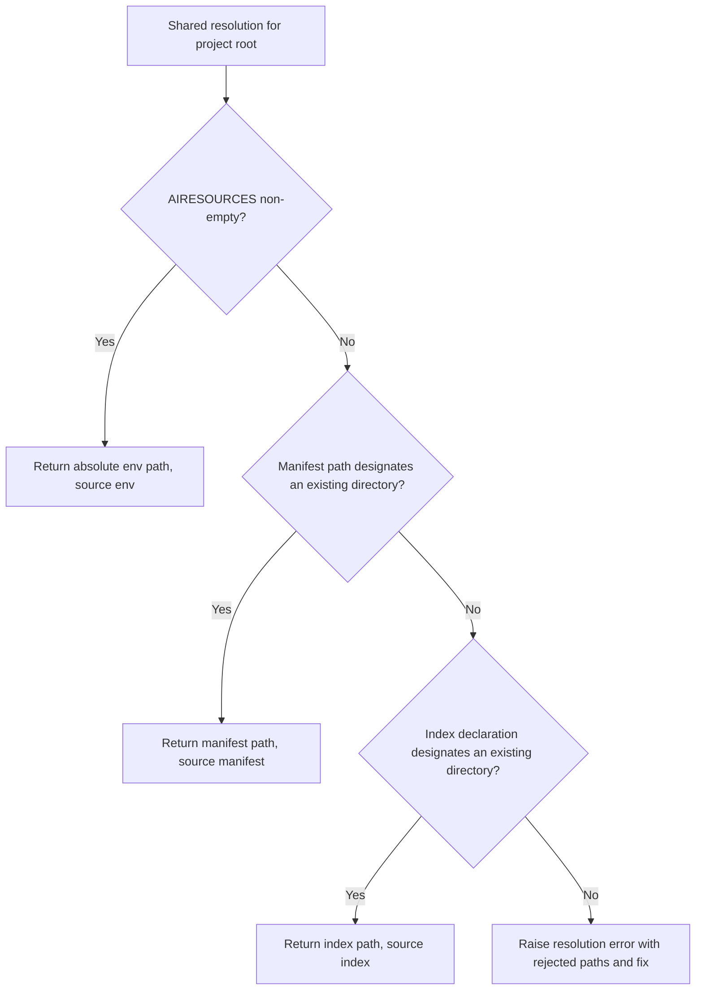
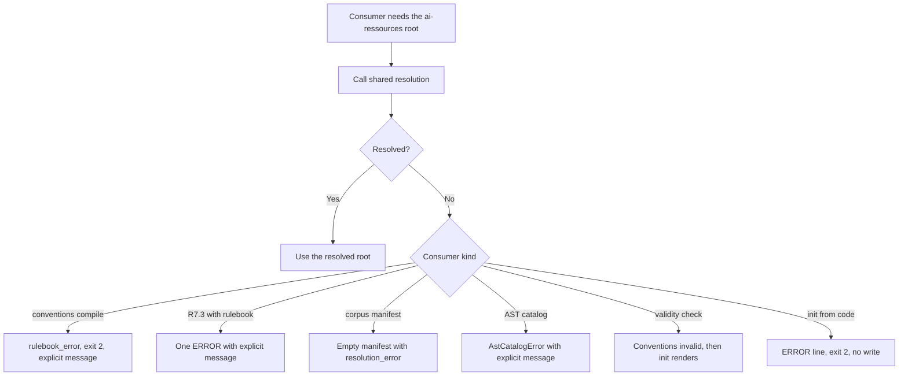
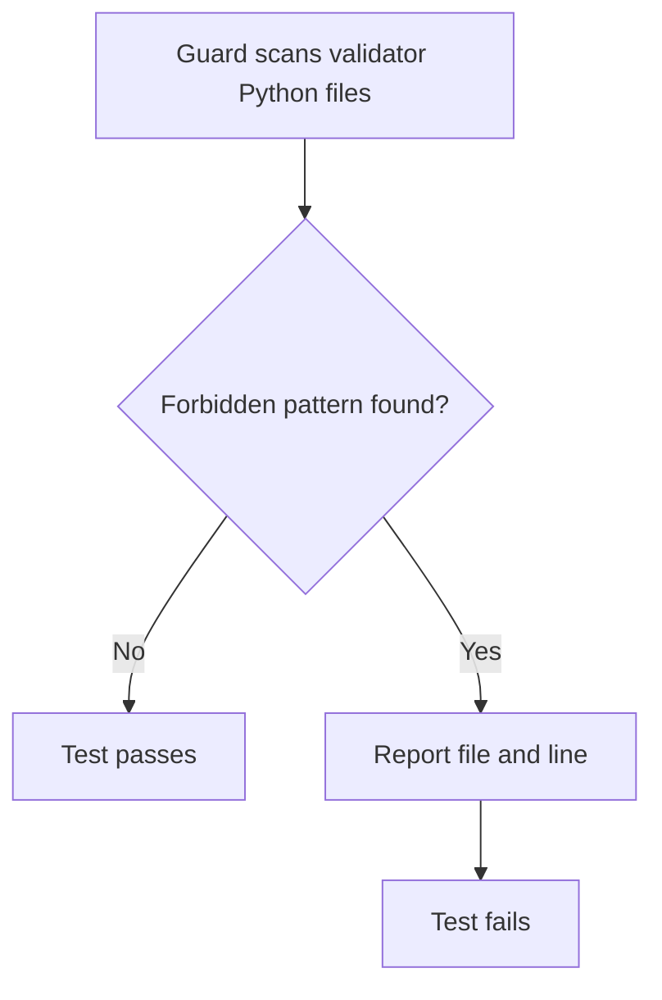
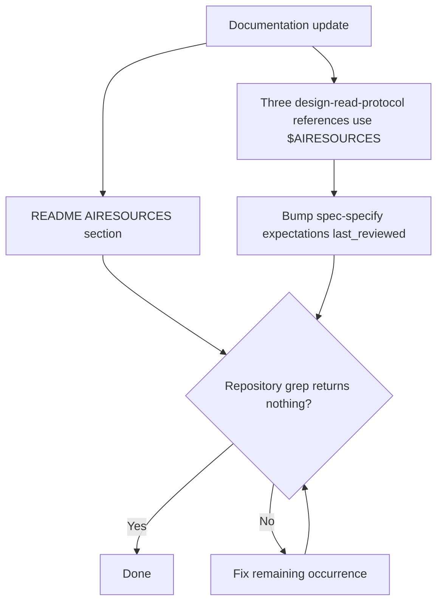

# Feature Spec: Locate ai-ressources Without Hard-Coded Paths

- **Feature:** One shared resolution rule for the ai-ressources root, used by every validator consumer, with no hard-coded fallback location
- **Feature Number:** 085
- **Branch:** none created in this phase (`/spec-feature --auto` pipeline; no branch, commit or push)
- **Date:** 2026-10-13
- **Status:** Implemented
- **Input:** Maintainer request "Localiser ai-ressources sans chemin en dur" (Julien, 2026-10-13). Today LiveSpec finds ai-ressources (the conventions corpus consumed by `spec-init`, the validator and the conventions gate) reliably only when it is cloned in `~/projects/ai-ressources`; a clone elsewhere produces inconsistent behavior across consumers. Goal: LiveSpec finds the clone anywhere through a single resolution rule.

## Scope and Source Evidence

- **Contract already delivered by ai-ressources (separate repository, not modified here):** its `setup.sh` exports `AIRESOURCES=<absolute path of the clone>` in the shell profile; `AIRESOURCES` is the only location variable (the former `AI_RESOURCES_PATH` no longer exists). Its `scripts/build-conventions.ts` writes into the consumer project `.conventions/manifest.yaml` with the key `ai_resources_path: <path>`, `.conventions/index.md` with the line `` > `$AIRESOURCES` = `<path>` `` (format unchanged, still matched by the current expressions of `conventions_rules.py` and `init_recovery.py`) and source lines `→ $AIRESOURCES/<folder>/<files>`. An empty `AIRESOURCES` counts as absent. These `.conventions/` files are committed, so a recorded path may come from another machine; the environment variable must therefore take priority.
- **Observed sites (verified 2026-10-13):**

| Site | Current behavior |
|---|---|
| `validator/init_from_code.py:74` | `AIRESOURCES` from the environment, else `LIVESPEC_ROOT.parent / "ai-ressources"` |
| `validator/conventions_ast/catalog.py:231` `_ai_resources_root` | environment, then manifest, then `Path.home() / "projects" / "ai-ressources"` |
| `validator/conventions_ast/corpus.py:116` `ai_resources_root` (also used by `source_decisions.py:35`) | manifest, then `Path.home() / "projects" / "ai-ressources"`; ignores the environment |
| `validator/conventions_rules.py:224` `_airesources_root` | only the `index.md` declaration; ignores the environment |
| `validator/coherence/rules/r7_conventions_gates.py:159` `_airesources_root` | only the `index.md` declaration; ignores the environment |
| `validator/init_recovery.py:133` (`conventions_are_valid`) | reads the base from `index.md` or the manifest and requires both to agree |

- **Current graceful behaviors (verified):** `build_corpus_manifest` returns an empty manifest when the root is not a directory; `R7_3_ConventionsRulebookSourcesStale` returns no violation when the rulebook is absent and reports every rulebook source as stale when no root is found; `livespec conventions compile` reports `rulebook_error` and exits 2 on `ValueError`; `livespec init --from-code` prints `ERROR: <message>` and exits 2 on `InitError`.
- **In scope:** the shared resolution function and its explicit error, routing the six sites through it, the documentation changes, and the tests listed in the request.
- **Out of scope:** `.github/workflows/ci.yml` (job-level `AIRESOURCES` and the deploy key `AIRESOURCES_READONLY_DEPLOY_KEY` stay untouched while ai-ressources is private); SC-004 of `.specs/features/073-conventions-multilang-catalog/spec.md` (historical measurement citing a real path); any change in the ai-ressources repository; the logical identifiers `ai-ressources/<path>` of the rule catalogs (`source_path` in `validator/conventions_ast/rule_catalog/`, `taxonomy.py`, `source_decision_*.py`), which are stable identifiers, not disk paths.

## Constitution Alignment

- **Explicit errors (Principle 4):** an unresolvable root raises one dedicated error with an actionable fix; no consumer silently substitutes a guessed location.
- **File system as source of truth (Principle 3):** resolution only reads the environment and the project's `.conventions/` files; it writes nothing.
- **Minimal surface (Principle 5):** no new CLI command or flag; existing commands keep their exit codes.
- **Conventions (`$AIRESOURCES/code-conventions/general.md` §7, §12; `python.md` Error Handling):** a domain-specific error type, environment values validated at the boundary, errors propagated rather than swallowed (consumers that already degrade gracefully keep doing so but surface the explicit message).

## Definitions

- **Project root:** the repository directory whose `.conventions/` files are consulted.
- **Environment root:** the value of the `AIRESOURCES` environment variable after stripping surrounding whitespace; an unset, empty or whitespace-only value is absent. A present value is expanded for `~` and made absolute against the current working directory; it is used as is, without any existence check.
- **Manifest path:** the value of the top-level key `ai_resources_path` of `<project root>/.conventions/manifest.yaml` when that file is readable YAML whose top-level is a mapping and the value is a non-empty string; otherwise there is no Manifest path.
- **Index declaration:** the first match in `<project root>/.conventions/index.md` of the existing declaration form `` `$AIRESOURCES` = `<path>` `` (backticks around `$AIRESOURCES` optional), as matched today by `conventions_rules.py`; otherwise there is no Index declaration.
- **Recorded path:** the Manifest path or the Index declaration, expanded for `~` and, when relative, made absolute against the Project root. A Recorded path is accepted only when it designates an existing directory.
- **Resolved root:** the absolute directory returned by the Shared resolution together with its source (`env`, `manifest` or `index`).
- **Shared resolution:** the single validator function that returns the Resolved root for a Project root by trying, in order: (1) the Environment root; (2) the Manifest path when accepted; (3) the Index declaration when accepted; otherwise it raises the Resolution error. Without a Project root, only step (1) applies.
- **Resolution error:** a dedicated error type (a `ValueError` subclass, so existing `ValueError` handlers surface it unchanged) whose message names the Project root, states that `AIRESOURCES` is not set, lists every Recorded path that was found but rejected with the file it came from, and ends with the fix: `Run ./setup.sh from your ai-ressources clone, or export AIRESOURCES=<absolute path of the clone>.`
- **Forbidden fallback:** any expression `Path.home() / "projects" / "ai-ressources"`, `LIVESPEC_ROOT.parent / "ai-ressources"`, the text `projects/ai-ressources`, or any other default location used when neither the environment nor a Recorded path resolves.
- **Consumers:** the six sites of the table above, plus `source_decisions.build_rule_decision_manifest`, which reads the root through `corpus.py`.

## User Scenarios & Testing

### Story 1 — Resolve the ai-ressources root through one rule `P1`

**As a** developer whose ai-ressources clone lives anywhere on disk, **I want** LiveSpec to resolve the root from `AIRESOURCES` first, then from the path recorded in my project, and otherwise to stop with an explicit fix, **so that** the clone location never depends on a hard-coded directory.

**Priority reason:** every consumer and every other story depends on this rule.

**Independent test:** Unit tests of the Shared resolution with temporary fake corpora and `monkeypatch` on `AIRESOURCES`, covering variable set, variable empty, manifest path, index declaration, nonexistent recorded path, nothing resolvable, and variable priority over a different recorded path.

```gherkin
Feature: Shared ai-ressources resolution
  Scenario: The environment variable wins over a recorded path
    Given AIRESOURCES is set to the temporary directory "corpus-env"
    And the project manifest records the existing directory "corpus-recorded"
    When the shared resolution runs for the project
    Then it returns "corpus-env" with source "env"

  Scenario: An empty variable falls back to the manifest path
    Given AIRESOURCES is set to an empty string
    And the project manifest records the existing directory "corpus-recorded"
    When the shared resolution runs for the project
    Then it returns "corpus-recorded" with source "manifest"

  Scenario: The index declaration is used when the manifest path does not exist
    Given AIRESOURCES is unset
    And the manifest records the nonexistent directory "missing-corpus"
    And index.md declares "`$AIRESOURCES` = `corpus-index`" for an existing directory
    When the shared resolution runs for the project
    Then it returns "corpus-index" with source "index"

  Scenario: Nothing resolvable raises the explicit error
    Given AIRESOURCES is unset
    And the manifest records the nonexistent directory "missing-corpus"
    And index.md has no AIRESOURCES declaration
    When the shared resolution runs for the project
    Then it raises the resolution error
    And the message names "missing-corpus" and ".conventions/manifest.yaml"
    And the message contains "Run ./setup.sh from your ai-ressources clone, or export AIRESOURCES=<absolute path of the clone>."
    And no directory under the home directory or next to the LiveSpec checkout is consulted
```

#### User Flow



### Story 2 — Every consumer uses the same root `P1`

**As a** developer running `init --from-code`, the conventions compiler, the AST catalog, the corpus manifest or the R7 coherence rules, **I want** all of them to use the Shared resolution, **so that** they agree on one root for one project and report the same explicit error when none exists.

**Priority reason:** the incoherence between consumers is the reported defect.

**Independent test:** For one temporary project with a fake corpus, run each consumer with `AIRESOURCES` set, then unset with a recorded path, then with nothing resolvable, and compare the root each one used and the message each one surfaces.

```gherkin
Feature: Consumers share the resolved root
  Scenario: All consumers use the environment root
    Given a project whose manifest and index record "corpus-recorded"
    And AIRESOURCES is set to "corpus-env" containing the routed convention sources
    When the AST catalog, the corpus manifest, the rule decision manifest, the conventions compiler, the R7.3 rule, the conventions validity check and init from code resolve ai-ressources
    Then every consumer uses "corpus-env"

  Scenario: Consumers surface the explicit error with their existing behavior
    Given AIRESOURCES is unset and no recorded path designates an existing directory
    When "livespec conventions compile" runs
    Then it reports "rulebook_error" with the resolution error message and exits 2
    When the R7.3 rule runs on a project with a compiled rulebook
    Then it reports exactly one ERROR whose message contains the resolution error message
    When the corpus manifest is built
    Then it is empty and its "resolution_error" field contains the resolution error message
    When "livespec init --from-code" must render conventions
    Then it prints "ERROR:" followed by the resolution error message, exits 2 and writes no project file
```

#### User Flow



### Story 3 — Hard-coded fallbacks cannot come back `P1`

**As a** maintainer, **I want** a test that fails when a Forbidden fallback reappears in `validator/`, **so that** the single rule stays the only way to locate ai-ressources.

**Priority reason:** without a guard, the next consumer can reintroduce a private default location.

**Independent test:** Run the guard test on the current tree (passes), then on a temporary copy of a validator module containing `Path.home() / "projects" / "ai-ressources"` (fails, naming the file and line).

```gherkin
Feature: Forbidden fallback guard
  Scenario: The validator tree contains no forbidden fallback
    Given the validator package after this feature
    When the guard test scans every Python file under "validator/"
    Then it finds no "projects/ai-ressources", no '"projects" / "ai-ressources"' and no 'parent / "ai-ressources"'
    And the test passes

  Scenario: A reintroduced fallback fails the guard
    Given a scanned file under the validator tree contains 'Path.home() / "projects" / "ai-ressources"'
    When the guard scan runs on that tree
    Then it reports the file and the line of the forbidden expression
    And the guard test fails
```

#### User Flow



### Story 4 — Documentation names AIRESOURCES and no private path `P2`

**As a** new contributor, **I want** the README to explain `AIRESOURCES` and the documents to reference `$AIRESOURCES` instead of a maintainer's home directory, **so that** I can set up ai-ressources without guessing.

**Priority reason:** the behavior change needs discoverable setup instructions, but it follows the code change.

**Independent test:** Inspect the README section and the three documents, check the `last_reviewed` date of the spec-specify `expectations.md`, and run the repository grep of the request.

```gherkin
Feature: AIRESOURCES documentation
  Scenario: README documents the variable
    Given the README after this feature
    Then it documents the role of "AIRESOURCES", the resolution order env then manifest then index.md, the resolution error message and the fix
    And it links "https://github.com/julien-m/ai-ressources" and its "setup.sh"
    And it no longer describes a default sibling "ai-ressources" directory

  Scenario: Documents reference $AIRESOURCES
    Given ".specs/spec-system.md", ".agent-sync/skills/spec-specify/SKILL.md" and "system/templates/spec-template.md"
    Then each references "$AIRESOURCES/design/references/design-read-protocol.md"
    And none contains "/Users/julienm/projects/ai-ressources"
    And the spec-specify expectations.md has last_reviewed equal to the change date
```

#### User Flow



## Acceptance Criteria

### AC-001

With `AIRESOURCES` set to a non-empty value, the Shared resolution returns that value expanded and made absolute with source `env`, without checking that it exists and without reading `.conventions/`, even when the manifest and `index.md` record a different existing directory.

### AC-002

With `AIRESOURCES` unset, empty or whitespace-only, the Shared resolution returns the Manifest path with source `manifest` when it designates an existing directory; otherwise it returns the Index declaration with source `index` when that designates an existing directory; a relative Recorded path is made absolute against the Project root and `~` is expanded.

### AC-003

When neither the environment nor any Recorded path resolves (no `.conventions/` files, unreadable or non-mapping manifest, missing key, nonexistent or non-directory Recorded paths), the Shared resolution raises the Resolution error whose message names the Project root, each rejected Recorded path with its source file, and contains exactly `Run ./setup.sh from your ai-ressources clone, or export AIRESOURCES=<absolute path of the clone>.`; without a Project root, an absent `AIRESOURCES` raises the same error type with the same fix sentence.

### AC-004

No Consumer and no part of the Shared resolution consults `~/projects/ai-ressources`, the directory next to the LiveSpec checkout, or any other location that is neither the Environment root nor a Recorded path; a test with `HOME` and the LiveSpec parent pointing to temporary directories that contain an `ai-ressources` corpus still raises the Resolution error when nothing else resolves.

### AC-005

For one Project root, the AST catalog (`ai-ressources/` source paths), the corpus manifest, the rule decision manifest, the conventions compiler, the R7.3 rule, `conventions_are_valid` and `init --from-code` use the same Resolved root in each of the three situations: `AIRESOURCES` set, only a Recorded path, both set to different existing directories (the environment wins).

### AC-006

When resolution fails: `livespec conventions compile` exits 2 with status `rulebook_error` and the Resolution error message (text and `--json`); the AST catalog raises `AstCatalogError` carrying the Resolution error message for an `ai-ressources/` source path; `build_corpus_manifest` returns the empty manifest with `ai_resources_root` set to an empty string and an additional `resolution_error` field holding the message, and `build_rule_decision_manifest` returns zero source decisions without raising; the R7.3 rule returns no violation when the rulebook is absent (unchanged) and exactly one ERROR violation containing the Resolution error message, instead of one stale violation per source, when a rulebook exists; `conventions_are_valid` returns false; `init --from-code`, including `--dry-run`, prints `ERROR: ` followed by the message, exits 2 and writes no project file when it must render conventions.

### AC-007

`conventions_are_valid` returns true when `.conventions/index.md` and `.conventions/manifest.yaml` exist, the Shared resolution succeeds, the index routes at least one `→ $AIRESOURCES/` source and every routed source exists under the Resolved root; it no longer requires the manifest and the Index declaration to be present and equal, and a project whose committed files record another machine's path is valid when `AIRESOURCES` points to a complete local clone.

### AC-008

The conventions compiler and the R7.3 rule resolve `$AIRESOURCES/<relative>` display paths against the Resolved root and keep rejecting a display path that escapes it; the `index.md` declaration is no longer required when `AIRESOURCES` is set, and source lines and the rulebook format are unchanged.

### AC-009

A pytest guard scans every `*.py` file under `validator/` and fails, naming file and line, when it finds `projects/ai-ressources`, `"projects" / "ai-ressources"` or `parent / "ai-ressources"`; the logical `ai-ressources/<path>` identifiers of the rule catalogs do not match these patterns and are unchanged.

### AC-010

The README documents `AIRESOURCES` (role, resolution order environment then `ai_resources_path` of `.conventions/manifest.yaml` then the `index.md` declaration, existing-directory condition for recorded paths, the Resolution error fix sentence, a link to `https://github.com/julien-m/ai-ressources` and its `setup.sh`) and no longer mentions a default sibling `ai-ressources` directory; `.specs/spec-system.md`, `.agent-sync/skills/spec-specify/SKILL.md` and `system/templates/spec-template.md` reference `$AIRESOURCES/design/references/design-read-protocol.md` instead of `/Users/julienm/projects/ai-ressources/design/references/design-read-protocol.md`, and the spec-specify `expectations.md` has `last_reviewed` equal to the change date.

### AC-011

All resolution and consumer tests build fake corpora in temporary directories and control `AIRESOURCES` with `monkeypatch`; they pass without any real ai-ressources checkout, and the existing AST tests that use the real corpus through CI are unchanged.

## Functional Requirements

- **FR-001:** Provide one Shared resolution function in a dedicated `validator/` module that applies the order of Definitions (Environment root, Manifest path, Index declaration) and returns the Resolved root with its source. **Maps to:** AC-001, AC-002.
- **FR-002:** Raise the dedicated Resolution error, with the message content of Definitions, whenever the Shared resolution cannot resolve a root. **Maps to:** AC-003.
- **FR-003:** Remove every Forbidden fallback from the Consumers and the Shared resolution. **Maps to:** AC-004, AC-009.
- **FR-004:** Route `catalog.py`, `corpus.py` (and through it `source_decisions.py`), `conventions_rules.py`, `r7_conventions_gates.py`, `init_recovery.py` and `init_from_code.py` through the Shared resolution. **Maps to:** AC-005, AC-007, AC-008.
- **FR-005:** On a Resolution error, each Consumer keeps its existing reaction (exit code, empty manifest, catalog error, validity false, coherence violation) while carrying the Resolution error message, as stated in AC-006, and invents no fallback. **Maps to:** AC-006.
- **FR-006:** Add the guard test of AC-009 and the unit and consumer tests of AC-001 to AC-008 using temporary fake corpora only. **Maps to:** AC-009, AC-011.
- **FR-007:** Update the README and the three documents, and bump the spec-specify `expectations.md` `last_reviewed`, as stated in AC-010. **Maps to:** AC-010.

## Key Entities

| Entity | Description | Key Fields |
|---|---|---|
| Resolved root | Result of one successful Shared resolution | path (absolute directory), source (`env`, `manifest`, `index`) |
| Recorded path candidate | A path read from a project `.conventions/` file | source file, raw value, absolute path, accepted (existing directory) |
| Resolution error | Dedicated `ValueError` subclass raised when nothing resolves | project root, rejected candidates, fix sentence |
| Corpus manifest | Existing machine-readable corpus report | `ai_resources_root`, counts, sources, optional `resolution_error` |

## Edge Cases

- **Committed path from another machine:** the Recorded path does not exist locally; with `AIRESOURCES` set it is ignored; without it the error names the rejected path and the fix.
- **`AIRESOURCES` points to a missing directory:** it still wins (explicit operator intent, no silent switch to a Recorded path); Consumers then report their existing missing-source errors naming that path (for example `conventions source not found`).
- **Manifest and index disagree:** the manifest path wins when it exists; the index declaration is used only when the manifest path is absent or rejected.
- **Recorded path is a file, not a directory:** rejected like a nonexistent path.
- **Project scaffolded by `livespec conventions refresh`:** its `index.md` has no declaration and its manifest no `ai_resources_path`; it works with `AIRESOURCES` set and otherwise raises the Resolution error (previously `conventions compile` required the declaration).
- **Malformed manifest YAML or non-string key:** ignored as a source of Recorded path; resolution continues with the index declaration.
- **`ai-ressources/` logical identifiers in catalogs:** unchanged; only their mapping to disk goes through the Shared resolution.
- **This repository's own `.conventions/`:** records no path, so local runs need `AIRESOURCES`; CI already sets it at job level.

## Quality Engineering

- **Risk:** Medium criticality, Shared blast radius (validator-wide location of the conventions corpus used by `init`, the conventions gate, the AST catalog and R7 coherence); primary risk Regression (a consumer resolving a different root or losing its graceful behavior); confidence Low until the consumer matrix tests exist.
- **Applicable dimensions:** functional correctness of the resolution order and each branch; regression of the six Consumers and their existing exit codes; contract compatibility of `livespec conventions compile` output, `init --from-code` exit codes and the corpus manifest JSON (one optional added field `resolution_error`); operability (actionable error message naming rejected paths). Security: not applicable beyond keeping display paths inside the Resolved root (AC-008). Data/migration, performance, accessibility/UX: not applicable (read-only path resolution, CLI only).
- **P0 gates/evidence:** pytest unit transcript of the Shared resolution cases of AC-001 to AC-004 with temporary `HOME` and fake corpora; consumer matrix tests of AC-005 to AC-008; guard test of AC-009; full unit suite green.
- **P1 gates/evidence:** structural validation, independent spec and plan reviews, the request grep `grep -rnE 'projects/ai-ressources|"projects" / "ai-ressources"|parent / "ai-ressources"' validator .agent-sync system .specs/spec-system.md README.md` returning nothing, and the feature-scope conventions gate PASS.
- **Gaps:** CI keeps using the real pinned corpus through the job-level `AIRESOURCES` (out of scope); the documentation link targets become a variable reference that cannot be followed literally by Markdown renderers.
- **Boundary note:** QE defines the evidence; `spec-test` executes it; the independent spec and plan reviews judge design and wording; no security review is required.

## Clarifications

- Q: Does a set `AIRESOURCES` need to designate an existing directory? -> A: No. The request makes a non-empty variable the first rule without a condition; it is explicit operator intent, so it wins as is and Consumers report their existing missing-source errors. Only Recorded paths require an existing directory, because they may come from another machine.
- Q: Does a whitespace-only `AIRESOURCES` count as set? -> A: No. It is treated as empty, hence absent.
- Q: How does each Consumer react to the Resolution error? -> A: Each keeps its existing reaction and carries the explicit message (AC-006): compile exits 2 with `rulebook_error`; the catalog raises `AstCatalogError`; the corpus manifest stays empty with `resolution_error`; rule decisions are empty; R7.3 stays silent without a rulebook and reports one explicit ERROR with a rulebook (replacing one misleading stale violation per source); the validity check returns false; init from code exits 2 before any write.
- Q: Should `conventions_are_valid` still require the manifest and index declarations to agree? -> A: No. With the environment taking priority, the committed declarations may legitimately differ from the local root; validity now means resolvable root plus existing routed sources (AC-007).
- Q: How are relative Recorded paths interpreted? -> A: Against the Project root, after `~` expansion; the generators write absolute paths, so this only makes hand-edited files deterministic.
- Q: How should the documents reference the protocol file? -> A: As the variable-based path `$AIRESOURCES/design/references/design-read-protocol.md`, keeping the **Read** instruction; the exact Markdown form (link or code span) is left to the plan as long as no absolute user path remains.

## Success Criteria

| ID | Criterion | How to Measure |
|---|---|---|
| SC-001 | No hard-coded ai-ressources location remains in the code and documents of the request | `grep -rnE 'projects/ai-ressources\|"projects" / "ai-ressources"\|parent / "ai-ressources"' validator .agent-sync system .specs/spec-system.md README.md` returns no line |
| SC-002 | The seven resolution cases of the request pass without a real ai-ressources checkout | pytest transcript of the resolution tests run with `HOME` set to an empty temporary directory and `AIRESOURCES` controlled by `monkeypatch` |
| SC-003 | All seven Consumers agree on one root per project in each of the three situations of AC-005 | consumer matrix test transcript (7 consumers × 3 situations, 21 assertions) |
| SC-004 | The project test suite passes and the conventions gate is PASS at feature scope | full pytest transcript and `livespec conventions verify --feature 085-localiser-ai-ressources-sans-chemin-en-dur` receipt |
