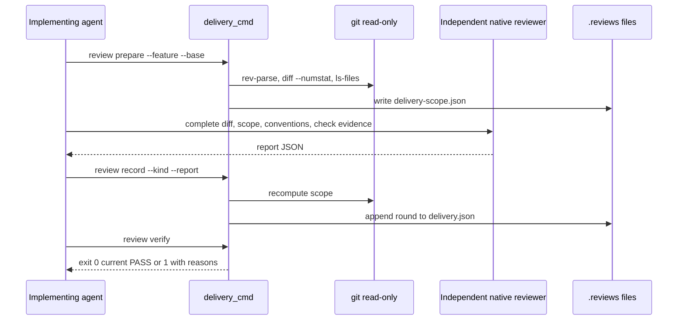
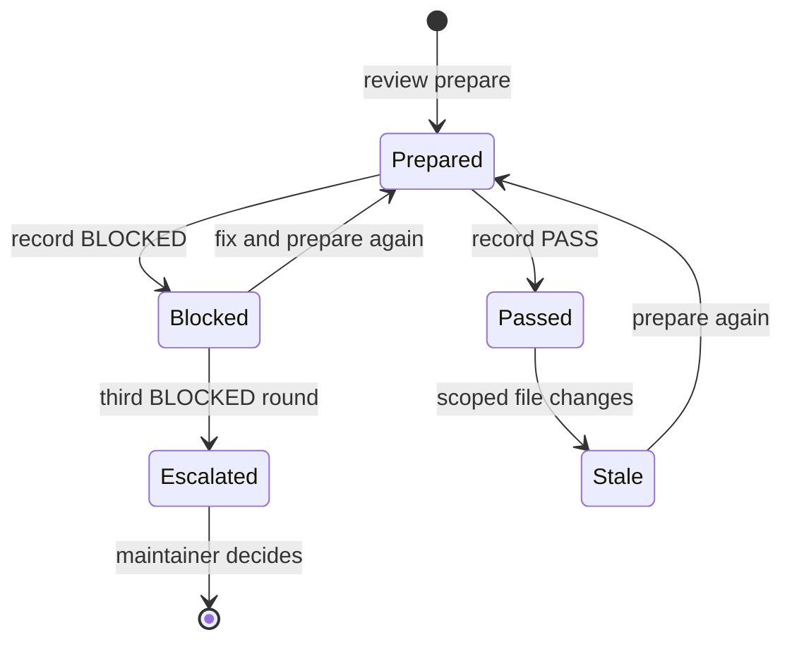

## Summary, Implementation Plan, Testing Strategy, Risks

New `validator/delivery/` package (`lane.py`, `review.py`) and a thin Typer group `livespec delivery` on Python ≥3.11: frozen dataclasses and strict pydantic report models, read-only git through `validator/bugfix/diff.py`, spec review currency through `prepare_feature_review` and `verify_review_receipt`, pytest fixtures in `tmp_path` git repositories, ruff, pyright strict, mypy. No network, LLM or new dependency.

Constitution: ✅1 no new layer; ✅2 no LLM call (the reviewer is the caller's native agent); ✅3 reads `.specs/` and git, writes only the two `.reviews/` files; ✅4 arguments validated before any write, exits 0/1/2, every reason carries its detail; ✅5 one `delivery` group; ✅6 local only.

- **D-01 Lane rule:** criticality Low/Medium and blast radius Local/Shared is light; High or Cross-system/External is full; parsing is per-section and case-insensitive; several distinct values for one field is `qe_classification_conflicting`. The `**Delivery lane:** full` line can only force full, never light.
- **D-02 Review currency:** model from `--model`, else `resolve_review_model` of `.specs/semantic/config.yaml`; empty model, missing receipt, failed `verify_review_receipt` or `ready: false` is `spec_review_not_current`. The classification is part of the reviewed normative spec, so a downgrade after review makes the receipt stale and the lane full.
- **D-03 Scope:** `collect_diff(root, base)` minus `is_traceability_artifact`; base resolved once with `git rev-parse` and stored as a commit; hashes are SHA-256 of working-tree bytes, `deleted` for removed paths.
- **D-04 Report:** pydantic strict model `DeliveryReport`; PASS requires zero blocking findings and every check exit 0; BLOCKED requires at least one blocking finding; effort must be `high` (the native review protocol of feature 050).
- **D-05 Rounds:** per kind, a list of rounds; the cap counts trailing BLOCKED rounds (initial plus two corrections = 3); a refused record writes nothing.
- **D-06 Required kinds:** light accepts `combined` or both `review` and `audit`; full requires `review` and `audit`; the lane is recomputed at verify time, so a lane change is seen.
- **D-07 Goal:** `_goal_runtime` computes the lane for `spec-implement` with a feature and passes `lane-<lane>` as an extra active branch; `finalize_required_tasks` injects `delivery.review` (after `conventions.gate`) for `spec-implement` with a feature; `_validate_generic_evidence` verifies `delivery_review_receipt_path` with `verify_delivery_review`.
- **D-08 Skills:** both lanes run only tests, lint, format and conventions per step; the old per-step Spec Reviewer, Code Quality Reviewer and native review are removed; `system/delivery-review.md` holds the end-of-feature protocol; `after-implement-step.md` keeps its name for hook resolution and points to it.

**Gherkin Scenarios + Mermaid Sequence Diagrams**

```gherkin
Feature: End-of-feature review
  Scenario: Prepare, review, record, verify
    Given an implemented feature diff
    When the agent prepares the scope, an independent native agent returns a PASS report and the agent records it
    Then verify exits 0 and the goal accepts the receipt

  Scenario: Late change
    Given a PASS receipt
    When a scoped source file changes
    Then verify exits 1 with "scope_changed"
```



**Gherkin Scenarios + Mermaid State Diagrams**

```gherkin
Feature: Review rounds
  Scenario: Blocked then pass
    Given an initial BLOCKED round
    When a corrected PASS report is recorded
    Then the kind is current PASS

  Scenario: Cap
    Given three trailing BLOCKED rounds
    When another report is recorded
    Then it is refused with "round_cap_reached"
```



**Implementation Plan, Testing Strategy, Risks**

1. `validator/delivery/lane.py` — QE parsing, lane rule, review currency (FR-002, FR-003).
2. `validator/delivery/review.py` — scope, report model, record, verify (FR-004, FR-005, FR-006).
3. `validator/cli_commands/delivery_cmd.py` + registration (FR-001).
4. `validator/goal_payload.py`, `goal_inventory.py`, `goal_contract_model.py`, `goal_tasks.py`, `goal_outcome.py`, `goal_generic_evidence.py` (FR-007).
5. `system/delivery-review.md`, `system/hooks/after-implement-step.md`, spec-implement, spec-feature and spec-ship skills and expectations, both spec-system copies (FR-008).

Tests: `tests/test_delivery_lane.py` (AC-001, AC-002), `tests/test_delivery_review.py` (AC-003 to AC-006), `tests/test_delivery_goal.py` (AC-007), `tests/test_delivery_docs.py` (AC-008); the existing unit suite must show no new failure.

Risks: a false light lane (mitigated by fail-safe parsing and the review currency requirement); a review recorded on a partial diff (mitigated by full coverage and hash checks); goal drift for other commands (render comparison test).
