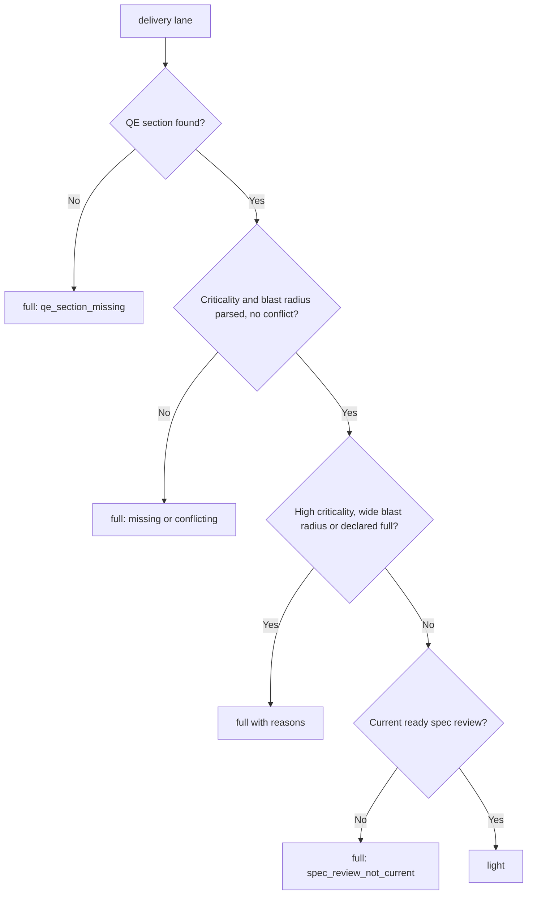
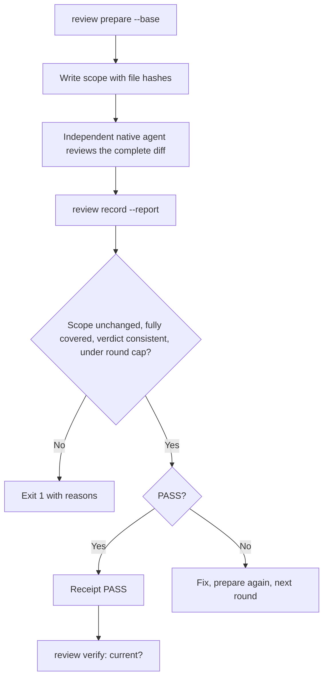
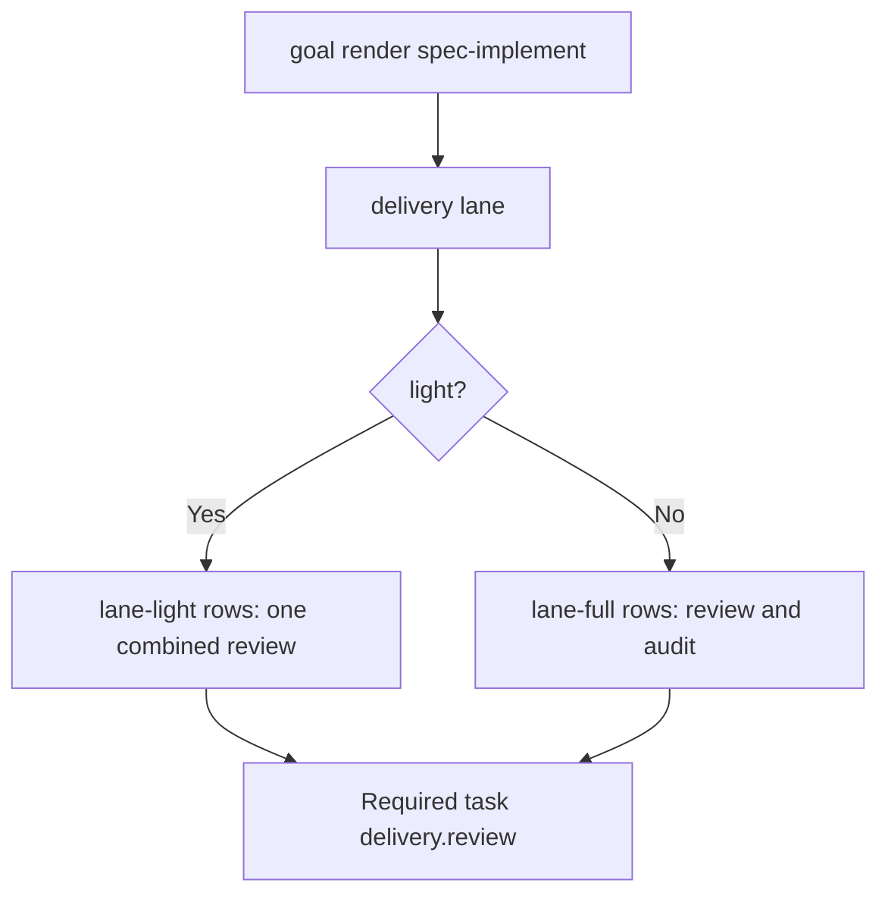
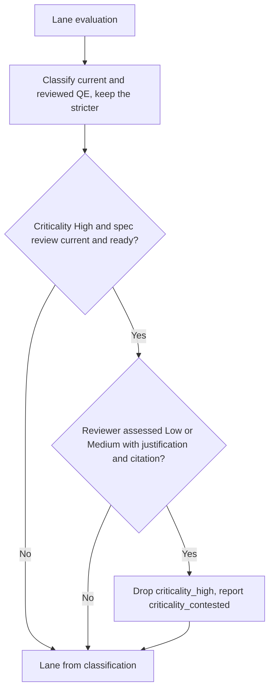

# Feature Spec: Risk-Proportional Delivery

- **Feature:** CLI-verified light or full delivery lane from the QE risk classification, and one independent review of the complete diff at the end of a feature instead of reviews and audits at every implementation step
- **Feature Number:** 086
- **Branch:** `feat/lighten-delivery-gates`
- **Date:** 2026-10-13
- **Status:** Draft
- **Input:** On the Handy program (10 Tauri features, 12-13 October 2026), every one-to-two-hour implementation step required an independent review, an audit through the `audit` skill (Codex, which fails in the sandbox and was refused by the OpenAI platform on a false positive), conventions receipts and an independently reviewed AC-to-test mapping. Feature 008 was 35% done after about four hours. The QE analysis already classifies criticality and blast radius, but no gate reads it. The maintainer decided: (1) a light lane for low or medium risk, a full lane for high risk, eligibility verified by the CLI like the 084 bugfix lane; (2) during steps only tests, lint, format and conventions; one review and one audit of the complete diff at the end, by independent native agents, never imposing Codex. Refinement (13 October 2026): a `High` criticality chosen by the spec author can be contested by the spec reviewer, otherwise the light lane stays theoretical.

## Scope and Source Evidence

- **Observed problem:** `system/hooks/after-implement-step.md` and `.agent-sync/skills/spec-implement/SKILL.md` (Multi-Agent Mode) require a Spec Reviewer, a Code Quality Reviewer and a native `high` review after every step. Nothing in the validator reads `## Quality Engineering`, and no CLI check proves that a review covered the complete diff (`validator/` has no reader of `features/<f>/checks/` reports).
- **Existing primitives reused:** the 084 read-only diff (`validator/bugfix/diff.py::collect_diff`, `is_traceability_artifact`), spec review receipts and their currency check (`validator/semantic/review_files.py::prepare_feature_review`, `review_receipts.py::verify_review_receipt`), goal branches (`validator/goal_inventory.py`) and injected receipt tasks (`validator/goal_outcome.py::conventions_gate_task`).
- **In scope:** the `livespec delivery` command group (`lane`, `review prepare`, `review record`, `review verify`), the `lane-light`/`lane-full` goal branches and the `delivery.review` goal task of `spec-implement`, the step gate and final review text of the spec-implement, spec-feature and spec-ship skills, `system/hooks/after-implement-step.md`, a new `system/delivery-review.md` protocol, both spec-system copies.
- **Out of scope:** changing spec or plan reviews (feature 088), the AC-to-test mapping (feature 087), the conventions gate, the bugfix lane, visual certification and Penflow gates; editing the user's global `audit` skill or hooks outside this repository (the procedure in `system/hooks.md` covers them).
- **Test isolation:** tests build temporary git repositories and `.specs/` trees; they never write in the LiveSpec repository.

## Constitution Alignment

- **CLI surface:** one command group `delivery` following the `bugfix`, `pipeline`, `goal` pattern.
- **Write scope:** `lane` and `review verify` are read-only; `review prepare` writes only `.specs/features/<f>/.reviews/delivery-scope.json`; `review record` writes only `.specs/features/<f>/.reviews/delivery.json`.
- **Exit codes:** 0 success (lane evaluated, review PASS recorded or current), 1 refused or not current, 2 invalid arguments.

## Definitions

- **QE classification:** the criticality (`Low`, `Medium`, `High`) and blast radius (`Local`, `Shared`, `Cross-system`, `External`) written in the feature `spec.md` section whose heading starts with `Quality Engineering`, in one of the existing forms: `<Value> criticality`, `<Value> blast radius`, `**Criticality:** <Value>`, `**Blast radius:** <Value>` or a table row `| Criticality | <Value> |`, `| Blast radius | <Value> |` (case-insensitive).
- **Light lane:** criticality `Low` or `Medium`, blast radius `Local` or `Shared`, no `**Delivery lane:** full` line in the QE section, and a current ready spec review receipt for the resolved reviewer model.
- **Full lane:** every other case. An unreadable, missing, or conflicting classification selects the full lane (fail safe).
- **Feature diff:** every path differing between the base revision and the working tree (tracked changes, staged or not, plus untracked non-ignored files) minus LiveSpec traceability artifacts as defined by feature 084.
- **Delivery review:** an independent native review of the complete Feature diff at the end of implementation. In the light lane one `combined` report covers spec compliance, code quality and audit; in the full lane a `review` report (spec compliance and code quality) and an `audit` report (security, robustness, conventions) come from two independent agents.
- **Correction round:** a recorded report following a BLOCKED report of the same kind. At most two correction rounds follow the initial report.

## User Scenarios & Testing

### Story 1 — Select the delivery lane from the QE risk `P1`

**As a** maintainer, **I want** the CLI to decide the lane from the reviewed QE classification, **so that** low-risk features skip ceremony without trusting an agent's declaration.

**Priority reason:** the lane is what every reduced gate builds on.

**Independent test:** In a temporary project, evaluate specs with each classification, with a missing section, with conflicting values, with a `full` declaration and without a current spec review.

```gherkin
Feature: Delivery lane
  Scenario: Medium risk with a current review is light
    Given a spec whose QE section says "Medium criticality; Shared blast radius"
    And a current ready spec review receipt
    When the maintainer runs "livespec delivery lane --feature <feature> --json"
    Then the command exits 0 and reports lane "light" with no reasons

  Scenario: High risk is full
    Given a spec whose QE section says "High criticality; Local blast radius"
    When the maintainer runs the lane command
    Then the command exits 0 and reports lane "full" with reason "criticality_high"

  Scenario: Missing classification fails safe
    Given a spec without a Quality Engineering section
    When the maintainer runs the lane command
    Then the lane is "full" with reason "qe_section_missing"
```

#### User Flow



### Story 2 — Prove one review of the complete diff `P1`

**As a** maintainer, **I want** one independent review of the complete feature diff to be recorded and checked by the CLI, **so that** per-step reviews and audits can be removed without losing evidence.

**Priority reason:** removing per-step reviews is the largest time saving and needs a verifiable replacement.

**Independent test:** In a temporary git project, prepare a scope, record PASS and BLOCKED reports with complete and incomplete coverage, modify a file after preparation, and exceed the round cap.

```gherkin
Feature: Delivery review
  Scenario: A complete PASS review is current
    Given a feature diff against base "<base>"
    When the maintainer runs "livespec delivery review prepare --feature <feature> --base <base>"
    And records a PASS combined report listing every scoped file
    Then "livespec delivery review verify --feature <feature>" exits 0

  Scenario: A file changed after preparation is refused
    Given a prepared scope
    When a scoped file changes before "review record"
    Then record exits 1 with reason "scope_changed"

  Scenario: The third correction is refused
    Given an initial BLOCKED report and two BLOCKED correction rounds of kind "combined"
    When the maintainer records another combined report
    Then record exits 1 with reason "round_cap_reached" and writes nothing
```

#### User Flow



### Story 3 — Follow the lane in the skills `P2`

**As an** implementing agent, **I want** the step gate and final review in the skills and the goal to follow the lane, **so that** steps run only tests, lint, format and conventions.

**Priority reason:** the CLI saves nothing unless the skills stop requiring per-step reviews.

**Independent test:** Render the spec-implement goal for a light and a full feature, and read the skill and hook texts.

```gherkin
Feature: Lane in skills and goal
  Scenario: Light goal
    Given a light-lane feature
    When "livespec goal render spec-implement --feature <feature>" runs
    Then the runtime context reports lane "light", the checklist contains the light-lane rows
    And the required tasks contain "delivery.review"

  Scenario: Per-step reviews are gone
    When the spec-implement skill and the after-implement-step hook are read
    Then a step requires only tests, lint, format and conventions
    And the final delivery review follows system/delivery-review.md without the audit skill or Codex
```

#### User Flow



### Story 4 — Contest a High criticality in the spec review `P2`

**As a** maintainer, **I want** the spec reviewer to be able to contest a `High` criticality chosen by the author, **so that** a feature is not sent to the full lane only because its author classified it cautiously.

**Priority reason:** on the Handy program most specs were classified `High` by default, which kept every feature in the full lane.

**Independent test:** Ingest a spec review with a criticality assessment, then evaluate the lane.

```gherkin
Feature: Contested criticality
  Scenario: The reviewer lowers High to Medium
    Given a spec classified High criticality with Shared blast radius
    And a current and ready spec review assessing Medium criticality with a cited justification
    When "livespec delivery lane --feature <feature>" runs
    Then the lane is light and the output reports the contested criticality

  Scenario: The reviewer raises the criticality
    Given a spec classified Medium criticality
    And a current spec review assessing High criticality
    When the lane is evaluated
    Then the lane is full with "criticality_high"
```

#### User Flow



## Acceptance Criteria

### AC-001

`livespec delivery lane --feature <feature> [--model <m>] [--json]` exits 0 and reports lane `light` with an empty reason list when the QE classification is `Low` or `Medium` criticality with `Local` or `Shared` blast radius, no `**Delivery lane:** full` line, and the spec review receipt is current and ready for the resolved model; `--json` prints `feature`, `lane`, `criticality`, `blast_radius`, `reasons` (objects with `code` and `detail`).

### AC-002

The lane is `full` with every applicable reason: `qe_section_missing`, `criticality_missing`, `blast_radius_missing`, `qe_classification_conflicting`, `criticality_high`, `blast_radius_wide` (`Cross-system` or `External`), `declared_full`, `spec_review_not_current`; an unknown feature exits 2.

### AC-003

`livespec delivery review prepare --feature <feature> --base <rev>` writes `.reviews/delivery-scope.json` with the resolved base commit, the lane and every Feature diff path with its SHA-256 (or `deleted`), prints the scope, and exits 1 with `diff_unavailable`, `empty_scope`, or `base_not_feature_start` when the base is not an ancestor of HEAD, the feature `spec.md` was never committed, or the base is newer than the parent of the commit that created that `spec.md` (the creating commit itself is accepted only when it changes nothing outside the feature directory); each path is identified by its SHA-256, `deleted`, its link target or its submodule commit; a feature `spec.md` or `plan.md` whose normative content equals the base is not in the scope, and changed ones are identified by their normative hash, so lifecycle metadata edits never change the scope.

### AC-004

`livespec delivery review record --feature <feature> --kind combined|review|audit --report <report.json>` records the report and exits 0 only for a PASS report when: the prepared scope exists (`scope_missing`), its base still satisfies the base rule of AC-003 (`base_not_feature_start`), the current hashes equal the prepared ones and no path was added (`scope_changed`), `reviewed_files` contains every scoped path (`scope_not_covered`), reviewer effort is `high` (`reviewer_effort_not_high`), PASS has no blocking finding and no failed check while BLOCKED has at least one blocking finding (`verdict_inconsistent`); a valid BLOCKED report is recorded and exits 1; an invalid report writes nothing.

### AC-005

When the initial report and two correction rounds of the same kind are all BLOCKED, another `record` of that kind exits 1 with `round_cap_reached` and writes nothing; a PASS round resets the count.

### AC-006

`livespec delivery review verify --feature <feature> [--json]` exits 0 only when the latest round of every kind the current lane requires (the latest `combined` round or the latest `review` and `audit` rounds for light; both `review` and `audit` for full) is PASS, its recorded base still satisfies the base rule of AC-003 and the current Feature diff against that base equals the recorded scope; verify re-validates the stored report text against its SHA-256 and the record conditions, and requires a `review` and an `audit` from different agents and reports; otherwise it exits 1 with `no_receipt`, `kind_missing:<kind>`, `latest_round_blocked:<kind>`, `receipt_invalid` (malformed receipt), `receipt_invalid:<kind>`, `base_not_feature_start`, `reviewers_not_independent` or `scope_changed`.

### AC-007

`livespec goal render spec-implement --feature <feature>` adds `delivery_lane` to `runtime_context`, activates the `lane-light` or `lane-full` branch of the skill inventory and adds the required task `delivery.review`, whose proof `delivery_review_receipt_path` is accepted only when `review verify` passes; goals of other commands are unchanged.

### AC-008

The spec-implement step gate requires only targeted tests, lint and format of touched files and the conventions gate per step; `system/hooks/after-implement-step.md` no longer dispatches any review per step; spec-implement, spec-feature and spec-ship run the delivery review once at the end following `system/delivery-review.md`, which forbids the `audit` skill, Codex and other external launchers; both spec-system copies describe the lanes.

### AC-009

A spec review may carry one `qe_assessment` (`criticality` `Low`, `Medium` or `High`, a non-empty `justification` and at least one citation of the reviewed sources), stored in the receipt. When the spec review is current and ready, an assessed `High` adds `criticality_high`, and an assessed `Low` or `Medium` against an author `High` removes `criticality_high` and adds `criticality_contested` (author and reviewer values, justification) to the lane output without making the lane full; the lane classifies both the current QE section and the QE section of the reviewed spec and keeps every reason of either, so a QE edit after the review never lowers the lane.

## Functional Requirements

- **FR-001:** Add the `livespec delivery` command group with `lane` and the `review` subgroup (`prepare`, `record`, `verify`); usage errors exit 2. **Maps to:** AC-001, AC-003, AC-004, AC-006.
- **FR-002:** Parse the QE classification as defined and select the lane, collecting every reason. **Maps to:** AC-001, AC-002.
- **FR-003:** Check spec review currency with the existing preparation and receipt verification, never calling a model. **Maps to:** AC-001, AC-002.
- **FR-004:** Build the review scope from the read-only 084 diff and write only the scope file. **Maps to:** AC-003.
- **FR-005:** Validate and record reports with the conditions of AC-004 and the round cap of AC-005. **Maps to:** AC-004, AC-005.
- **FR-006:** Verify the latest rounds against the lane and the current diff. **Maps to:** AC-006.
- **FR-007:** Integrate the lane and the `delivery.review` task in the spec-implement goal. **Maps to:** AC-007.
- **FR-008:** Update the skills, hook, protocol and spec-system copies as stated in AC-008. **Maps to:** AC-008.
- **FR-009:** Add the optional `qe_assessment` to the spec review response and receipt, apply it and the reviewed QE section in the lane, and document it in the spec-specify review instructions. **Maps to:** AC-009.

## Key Entities

| Entity | Description | Key Fields |
|---|---|---|
| Lane decision | Result of one lane evaluation | feature, lane, criticality, blast_radius, reasons |
| Review scope | Files under review | feature, base, base_commit, lane, files |
| Review report | Independent reviewer output | reviewer (agent, model, effort), verdict, reviewed_files, checks, findings |
| Delivery receipt | Recorded rounds per kind | feature, base_commit, kinds[kind].rounds[verdict, scope, report] |

## Edge Cases

- **Spec review absent (a project that skipped spec review):** the lane is full; nothing else changes.
- **QE re-classified downward after the review:** a QE edit no longer makes the spec review stale (feature 089), so the lane keeps the stricter of the current and the reviewed classification until a new review.
- **Contested blast radius:** the reviewer assessment covers criticality only; a wide blast radius always keeps the full lane.
- **Files changed during the Test phase after a PASS:** `verify` reports `scope_changed`; prepare and review again.
- **Traceability updates after the review** (`implementation.md`, changelogs, README, receipts): excluded from the scope, so they never invalidate the review.

## Quality Engineering

- **Risk:** Medium criticality (it relaxes ceremony, not proof: tests, conventions and certification stay mandatory); Shared blast radius (every implement goal); primary risk Contract.
- **Applicable dimensions:** functional correctness of the lane rule, fail-safe parsing, receipt integrity (scope hashes), CLI compatibility, goal render compatibility, skill text consistency. Accessibility not applicable.
- **P0 gates/evidence:** pytest fixtures in temporary git repositories for every reason code of AC-002, AC-004, AC-006; goal render comparisons; documentation assertions.
- **Boundary:** the delivery review finds defects; QE only defines the proof. This feature does not judge review quality.

## Success Criteria

| ID | Criterion | How to Measure |
|---|---|---|
| SC-001 | A light-lane feature of N steps needs one independent review dispatch instead of 3N (two step reviewers plus the native review per step) | Skill texts and the rendered goal rows |
| SC-002 | Every reason code has a failing fixture | AC-to-test matrix |
