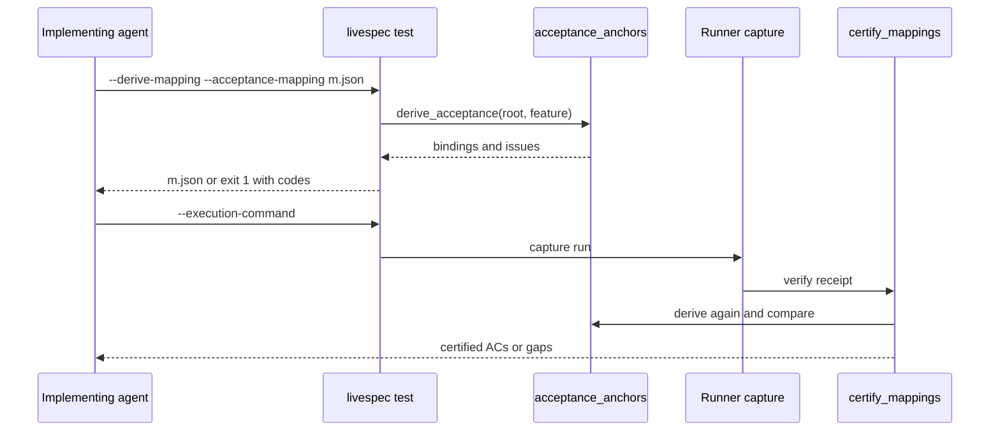
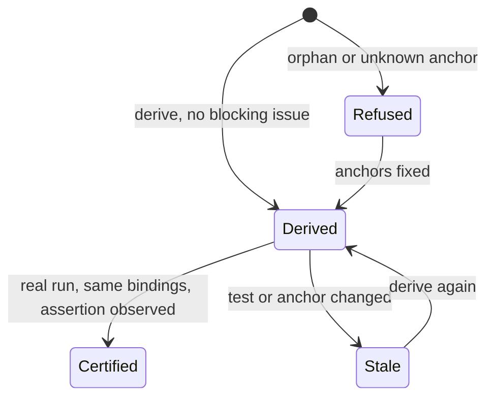

## Summary, Implementation Plan, Testing Strategy, Risks

New module `validator/acceptance_anchors.py` (stdlib `ast`, `re`, `subprocess` for `git ls-files`), a `derivation` field and an anchored certification path in `validator/execution_mapping.py`, one option of `livespec test`. Python ≥3.11, pytest with real pytest runs in `tmp_path`, ruff, pyright strict, mypy. No network, LLM or new dependency.

Constitution: ✅1 no new layer; ✅2 no LLM call, the mapping review is removed only for derived mappings; ✅3 reads tests and `.specs/`, writes only the mapping path; ✅4 every refusal carries its code and `path:line`; ✅5 one option of the existing native `test` operations; ✅6 local only.

- **D-01 Anchor syntax:** the comment block already used by the repository (`# @spec AC-003: label` then `#   — .specs/features/<f>/spec.md#ac-003`); `AC-<n>` is matched case-sensitively, so the `#ac-003` fragment is not counted twice.
- **D-02 Targets:** test header binds its last assertion (the outcome assertion in arrange-act-assert tests); an assertion line binds itself. Python tests are top-level `test*` functions or `test*` methods of `Test*` classes; Rust tests carry a `#[...test]` attribute. Production anchors in Rust are ignored; Python anchors are read only in test files.
- **D-03 Test ids:** Python `junit_test_id("<path>::<Class>::<name>")`; Rust bare Cargo path, which `resolve_test_id` resolves when unique. Parametrized Python tests are refused because a JUnit case id carries the parameter.
- **D-04 Compatibility:** `derivation` defaults to `review`; review preparation dumps the mapping without `derivation`, so the prepared hashes and receipts of existing mappings are unchanged; a model validator keeps `reviewer_model` and `review_receipt_path` mandatory for reviewed mappings.
- **D-05 Certification:** `certify_mappings` dispatches on `derivation`; the anchored path re-derives (tamper and staleness check), compares the spec normative hash and the test file digests with `capture.after`, then reuses `_assertion_span`, `resolve_test_id` and `_observed_assertion`. `_mapping_inputs` and `_acceptance_input_gaps` skip the review receipt.
- **D-06 Semantic judgment:** moved to the end-of-feature delivery review (086), which already reads the complete diff and the tests.

**Gherkin Scenarios + Mermaid Sequence Diagrams**

```gherkin
Feature: Derive then certify
  Scenario: Anchored tests certify without mapping review
    Given anchored tests for every execution AC
    When the agent derives the mapping and runs the execution command
    Then the receipt certifies every AC and no review receipt exists
```



**Gherkin Scenarios + Mermaid State Diagrams**

```gherkin
Feature: Mapping state
  Scenario: Stale after an anchor removal
    Given a derived mapping
    When an anchor is removed
    Then certification reports orphan_acceptance
```



**Implementation Plan, Testing Strategy, Risks**

1. `validator/execution_rust_source.py::rust_functions` (FR-003).
2. `validator/acceptance_anchors.py` (FR-001).
3. `validator/execution_mapping.py` `derivation`, `derived_mapping`, `_certify_anchored`; `validator/execution_evidence.py::_acceptance_input_gaps` (FR-002, FR-005).
4. `validator/cli_commands/test_cmd.py`, `execution_io.py`, `operation_options.py` (FR-004).
5. `system/testing/execution-rules.md`, spec-implement skill (FR-006).

Tests: `tests/test_acceptance_anchors.py` (AC-001 to AC-006) and the `--derive-mapping` row of `tests/test_native_test_option_matrix.py`; existing mapping, execution and Cargo suites unchanged.

Risks: an assertion anchored to the wrong AC (caught by the delivery review, not by the derivation); a hand-edited derived mapping (re-derivation); a production Rust anchor taken as a test (attribute check).
