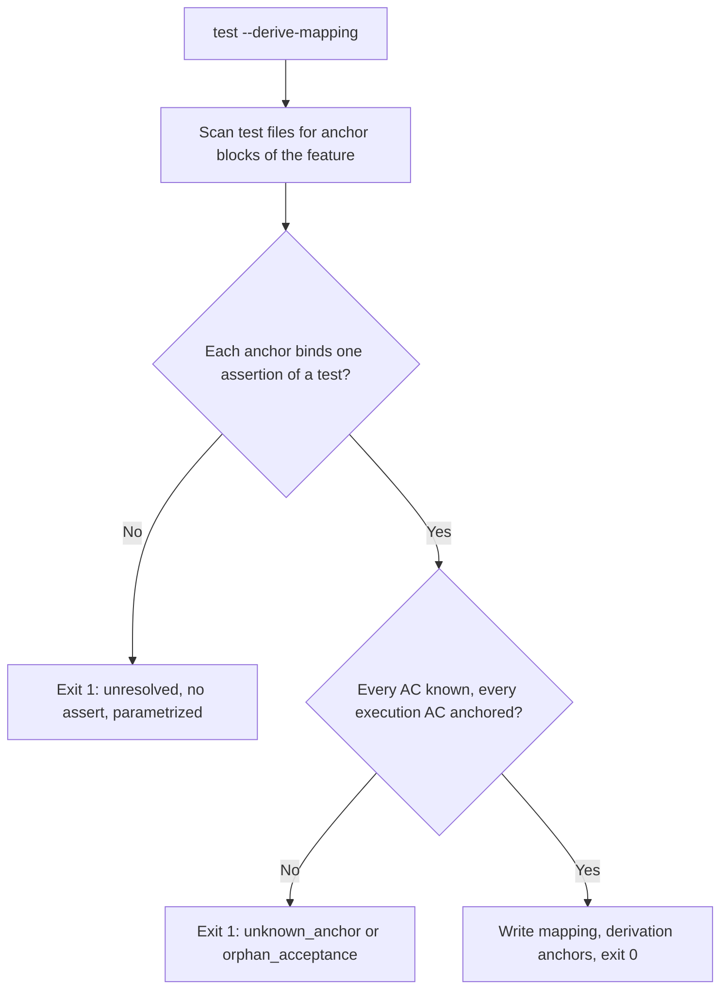
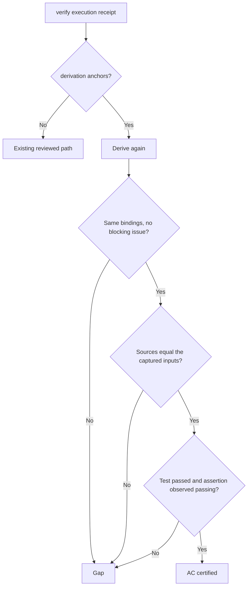

# Feature Spec: Anchor-Derived Acceptance Mapping

- **Feature:** derive the AC-to-assertion mapping from the `@spec AC-xxx` anchors already written in tests, refuse orphan acceptance criteria and unknown anchors, and certify a derived mapping without a separate mapping review
- **Feature Number:** 087
- **Branch:** `feat/lighten-delivery-gates`
- **Date:** 2026-10-13
- **Status:** Draft
- **Input:** On the Handy program every feature needed a hand-written acceptance mapping (test id, assertion lines, source SHA, justification per AC) and then an independent mapping review through `--prepare-mapping-review` and `--ingest-mapping-review`, although the tests already carried `@spec AC-xxx` anchors naming the same criteria. The maintainer decided: derive the mapping from the anchors, check that no AC is orphaned and no anchor is unknown, and drop the separate mapping review when the mapping is fully derived.

## Scope and Source Evidence

- **Observed problem:** `validator/execution_mapping.py::AcceptanceMapping` requires `reviewer_model` and `review_receipt_path`, and `certify_mappings` accepts a binding only when a ready review receipt cites its assertion span. `system/testing/execution-rules.md` states that anchors never establish the mapping. Nothing reads the anchors that tests already carry.
- **Existing primitives reused:** the acceptance inventory (`validator/acceptance_requirements.py::acceptance_inventory`), the assertion span checks (`_assertion_span`, `_rust_assertion_span`), the observed-assertion match (`_observed_assertion`), test id resolution (`junit_test_id`, `resolve_test_id`) and the Rust lexer (`validator/execution_rust_source.py`).
- **In scope:** a new `validator/acceptance_anchors.py`, the `derivation` field of the mapping, an anchored certification path in `certify_mappings`, `livespec test --derive-mapping`, `rust_functions` in the Rust lexer, `system/testing/execution-rules.md` and the spec-implement mapping line.
- **Out of scope:** changing hand-written reviewed mappings, their review, the runner capture, the Cargo runner and visual or documentary (`**Evidence:** review`) acceptance.
- **Test isolation:** tests build temporary projects; the real-run tests execute pytest inside them.

## Constitution Alignment

- **CLI surface:** one new option of the existing `livespec test` native operations, exclusive with `--prepare-mapping-review`, `--ingest-mapping-review` and `--execution-command`.
- **Write scope:** `--derive-mapping` writes only the `--acceptance-mapping` path, and only when no blocking issue remains.
- **Compatibility:** an existing mapping file without `derivation` is a reviewed mapping; its review preparation and hashes are unchanged.

## Definitions

- **Anchor block:** consecutive comment lines (`#` in Python, `//` in Rust), split into `@spec` entries (an `@spec` line and its continuation lines). An entry belongs to the feature when it qualifies ids as `<feature>:AC-<n>` (only those ids count) or names exactly the path `.specs/features/<feature>/`; in path form, the bare `AC-<n>` ids of the `@spec` line count, never ids qualified for another feature or ids in later prose lines. Entries naming another feature, several features or none are ignored.
- **Anchor target:** the first line after the block. A test function whose first decorator or header is on that line (Python `def` or `async def`; Rust after its attributes) binds its last assertion; an assertion inside a test function binds that assertion. A Rust function binds only with a test attribute of its own (`#[test]`, `#[<path>::test]`, `#[rstest]` or `#[test_case]`).
- **Test files:** Python `test_*.py` and `*_test.py`; every `.rs` file, where only `#[test]`-like functions and assertions bind. Files in dot directories and build directories are skipped.
- **Derived mapping:** an acceptance mapping with `"derivation": "anchors"`, no reviewer model and no review receipt path, whose bindings are exactly those derived from the anchors.

## User Scenarios & Testing

### Story 1 — Derive the mapping from test anchors `P1`

**As an** implementing agent, **I want** the CLI to build the mapping from the anchors already in the tests, **so that** I never hand-write line spans and digests.

**Priority reason:** the hand-written mapping and its review were a fixed cost of every Handy feature.

**Independent test:** In a temporary project, derive mappings for anchored Python and Rust tests, an orphan AC, an unknown anchor and unbindable targets.

```gherkin
Feature: Anchor derivation
  Scenario: Every execution AC is anchored
    Given a spec declaring AC-001 and a test anchored "@spec AC-001" for the feature
    When the agent runs "livespec test --feature <feature> --acceptance-mapping m.json --derive-mapping"
    Then the command exits 0 and m.json binds AC-001 to the test's last assertion with derivation "anchors"

  Scenario: An orphan AC refuses the mapping
    Given a spec declaring AC-002 with no anchor
    When the agent derives the mapping
    Then the command exits 1 with "orphan_acceptance" and writes nothing

  Scenario: An unknown anchor refuses the mapping
    Given a test anchored "@spec AC-009" that the spec does not declare
    When the agent derives the mapping
    Then the command exits 1 with "unknown_anchor"
```

#### User Flow



### Story 2 — Certify a derived mapping without a mapping review `P1`

**As a** maintainer, **I want** certification to re-derive the anchors and accept the observed passing assertions, **so that** the mapping review disappears without trusting a hand-edited file.

**Priority reason:** the derivation saves nothing if a review is still required.

**Independent test:** Run real pytest on a derived mapping, then hand-edit the mapping, remove an anchor and ask for a mapping review.

```gherkin
Feature: Anchored certification
  Scenario: A derived mapping certifies from a real run
    Given a derived mapping and no mapping review receipt
    When the tests run through the execution command and the receipt is verified
    Then AC-001 is certified

  Scenario: A hand-edited derived mapping is refused
    Given a derived mapping whose binding span was edited
    When the receipt is verified
    Then it is not valid and reports that the mapping differs from the current test anchors

  Scenario: A derived mapping has no review
    When the agent runs "--prepare-mapping-review" on a derived mapping
    Then the command exits 1 with "anchored_mapping_needs_no_review"
```

#### User Flow



## Acceptance Criteria

### AC-001

`livespec test --feature <feature> --acceptance-mapping <path> --derive-mapping` exits 0, writes a mapping with `"derivation": "anchors"`, empty `reviewer_model` and `review_receipt_path`, and one binding per anchored AC: the qualified AC, the JUnit test id (Python, including a `Test*` class) or the Cargo `module::test` path (Rust), the span of the bound assertion, the file SHA-256 and the justification `Derived from the @spec anchor at <path>:<line>`; it prints `feature`, `mapping_path`, `bindings`, `acceptance` and `issues`.

### AC-002

An execution AC with no anchor (`orphan_acceptance`) or an anchor naming an AC the spec does not declare (`unknown_anchor`) makes the command exit 1 and write nothing; an anchor naming a documentary (`**Evidence:** review`) AC is reported as non-blocking `anchor_to_review_ac`; anchors of another feature and unqualified anchors are ignored.

### AC-003

Inside a test function, an anchor that precedes no assertion (`anchor_target_unresolved`); above a test function, one without assertion (`anchor_test_without_assert`); a parametrized test, including a multi-line `parametrize` decorator (`anchor_test_parametrized`); or a test file that does not parse (`anchor_source_unparsable`) makes the command exit 1. An anchor outside any test function is reported as non-blocking `anchor_not_bound`; its AC is then an orphan unless anchored elsewhere.

### AC-004

Certification of a derived mapping derives the anchors again and requires identical bindings and no blocking issue, spec and test sources equal to the captured execution inputs, a passing test and an observed passing assertion in the bound span; it reads no review receipt.

### AC-005

`--prepare-mapping-review` or `--ingest-mapping-review` on a derived mapping exits 1 with `anchored_mapping_needs_no_review`; a reviewed mapping requires `reviewer_model` and `review_receipt_path`, and a derived mapping refuses both.

### AC-006

A Rust anchor above a `#[test]` function binds its last assertion with the Cargo path from the file module (`src/a/b.rs` gives `a::b`, `mod.rs` its directory, `lib.rs`, `main.rs` and `tests/*.rs` nothing), the inline modules and the function name; an anchor on a production function is ignored, and an unbindable anchor in `tests/` is `anchor_target_unresolved`.

## Functional Requirements

- **FR-001:** Scan test files for the feature's anchor blocks and bind each one as defined. **Maps to:** AC-001, AC-002, AC-003.
- **FR-002:** Add `derivation` (`review` by default, `anchors`) to the mapping, keep reviewed-mapping hashes unchanged and validate the review fields per kind. **Maps to:** AC-001, AC-005.
- **FR-003:** Add `rust_functions` to the Rust lexer (name, inline modules, header and closing lines). **Maps to:** AC-006.
- **FR-004:** Add `--derive-mapping` to `livespec test`, exclusive with the other native operations. **Maps to:** AC-001, AC-002, AC-003.
- **FR-005:** Certify derived mappings as stated in AC-004. **Maps to:** AC-004.
- **FR-006:** Document the anchors path in `system/testing/execution-rules.md` and the spec-implement skill, and keep the semantic judgment of anchored assertions in the end-of-feature delivery review (feature 086). **Maps to:** AC-004, AC-005.

## Key Entities

| Entity | Description | Key Fields |
|---|---|---|
| Anchor | One anchor block | path, line, target, AC ids, label |
| Derived binding | One AC bound to one assertion | requirement_id, test_id, assertion span, source_sha256, justification |
| Anchor issue | One derivation finding | code, detail, blocking |

## Edge Cases

- **One anchor naming several ACs:** each AC gets a binding on the same assertion.
- **One AC anchored in several tests:** every binding must be proven.
- **Anchor removed or test edited after derivation:** certification re-derives and refuses the stale mapping.
- **Semantic adequacy:** the derivation proves that an anchored assertion ran and passed, not that it proves the AC. The delivery review of feature 086 reads the tests of the complete diff and judges it once per feature.

## Quality Engineering

- **Risk:** Medium criticality (it removes a review from acceptance proof; certification still requires real passing assertions); Shared blast radius (every feature with execution acceptance); primary risk Contract.
- **Applicable dimensions:** deterministic derivation, fail-safe refusal, compatibility of reviewed mappings, real-run certification, tamper resistance. Accessibility not applicable.
- **P0 gates/evidence:** pytest fixtures with real pytest runs for certification, every blocking code, Rust derivation fixtures and the existing mapping and execution suites unchanged.

## Success Criteria

| ID | Criterion | How to Measure |
|---|---|---|
| SC-001 | A feature whose tests carry anchors needs no hand-written mapping and no mapping review dispatch | `--derive-mapping` then certification in the fixtures |
| SC-002 | Every blocking code has a failing fixture | AC-to-test matrix |
