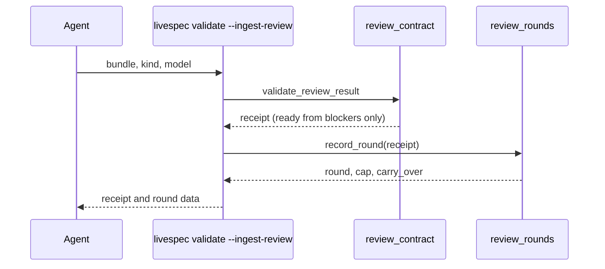
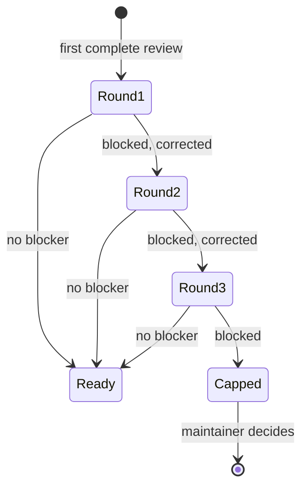

## Summary, Implementation Plan, Testing Strategy, Risks

Changes in `validator/semantic/review_contract.py`, a new `validator/semantic/review_rounds.py`, the native ingestion adapter `validator/cli_commands/review_io.py`, `validator/semantic_analysis.py` and `validator/clarify_gate.py`. Python ≥3.11, pydantic strict, pytest with real receipts, ruff, pyright strict, mypy. No network, LLM or new dependency.

Constitution: ✅1 no new layer; ✅2 no LLM call; ✅3 one generated ledger file per review kind; ✅4 fail-safe: only listed items relax; ✅5 no new command, output fields only; ✅6 local only.

- **D-01 Blockers:** `conclusion_blocks` keeps `missing` and `contradictory` blocking and an `ambiguous` conclusion blocking unless it names its ambiguities and all are non-critical or resolved.
- **D-02 Technical scope:** `kind` is optional in the response schema (default `business`), so old reviewer output and receipts parse; the context hash does not include the schema, so no receipt becomes stale by the schema change.
- **D-03 Compatibility:** readiness only relaxes, so a ready receipt rebuilds identically; the prompt and `PROMPT_VERSION` are unchanged so batching and identities are unchanged (feature 089 owns identity).
- **D-04 Ledger:** keyed by `context_hash`; written only for complete receipts; atomic write; a ready round ends the sequence. The cap is reported, not enforced on ingestion: the maintainer may still ingest a corrected review; the skills stop at `round_cap_reached`.
- **D-05 Clarify:** only `[NEEDS CLARIFICATION]` placeholders are critical; qualitative candidates keep their decision keys and metric resolution.

**Gherkin Scenarios + Mermaid Sequence Diagrams**

```gherkin
Feature: Ingest with rounds
  Scenario: Blocked review
    Given a blocked native review bundle
    When the agent ingests it
    Then the receipt is saved, the round is appended and the output carries round data
```



**Gherkin Scenarios + Mermaid State Diagrams**

```gherkin
Feature: Round states
  Scenario: Cap
    Given three blocked rounds
    Then round_cap_reached is true
```



**Implementation Plan, Testing Strategy, Risks**

1. `review_contract.py`: `ScopeFinding.kind`, `scope_accepted`, `conclusion_blocks`, `carry_over`, readiness (FR-001, FR-002).
2. `semantic_analysis.py`: same rules for plan analysis (FR-002).
3. `review_rounds.py` and `review_io.py` (FR-003).
4. `clarify_gate.py` and the clarify tests that asserted criticality (FR-004).
5. `system/review-protocol.md`, spec-specify, spec-plan and their expectations (FR-005).

Tests: `tests/test_capped_reviews.py` (AC-001 to AC-004); the clarify suites updated for AC-004; the review, analysis and Penflow suites unchanged.

Risks: a real business ambiguity marked non-critical by the reviewer (the reviewer prompt still asks for consequential decisions, and the delivery review sees the result); a reviewer labelling business scope `technical` (justification required and visible in `carry_over`).
