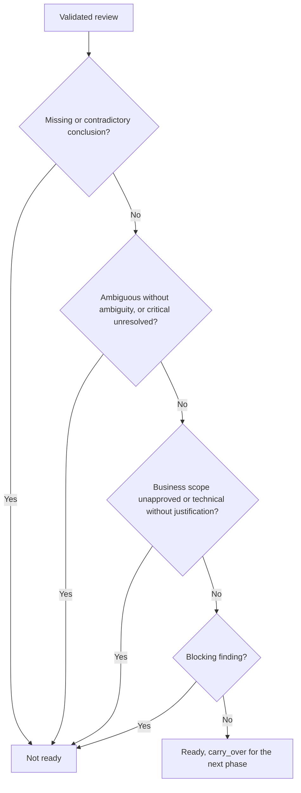
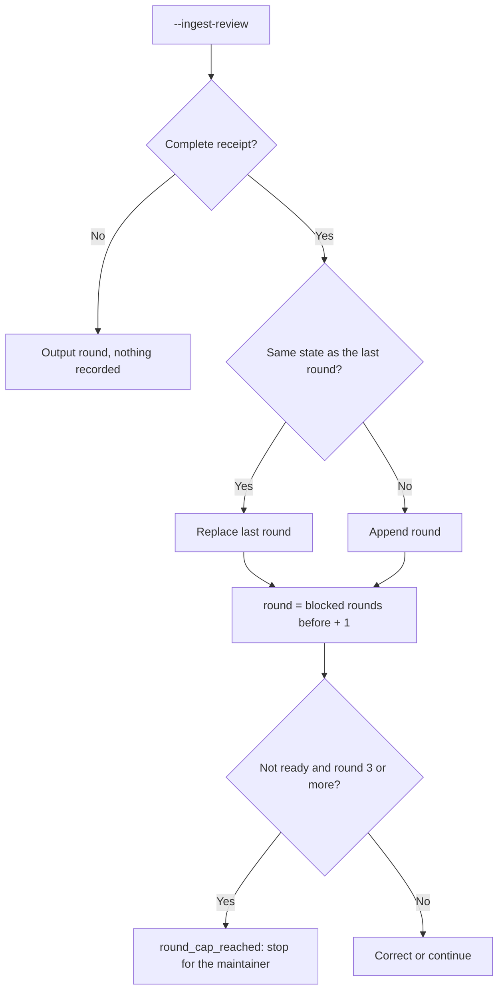

# Feature Spec: Capped Reviews

- **Feature:** spec and plan reviews are ready as soon as no blocker remains, carry warnings and non-critical ambiguities over to the next phase, approve justified technical necessities, never block on an isolated qualitative word, and report a cap of two correction rounds
- **Feature Number:** 088
- **Branch:** `feat/lighten-delivery-gates`
- **Date:** 2026-10-13
- **Status:** Draft
- **Input:** On the Handy program spec and plan reviews looped for many rounds: an `ambiguous` conclusion blocked even when its only ambiguity was minor, a justified technical choice (an atomic write, a lock) listed as extra scope blocked until someone marked it approved, and an isolated "fast" or "secure" in a requirement was a critical clarification. The maintainer decided: at most 2 correction rounds; ready as soon as no blocker remains, warnings and non-critical ambiguities carried over to the plan; justified technical necessities approved automatically; isolated qualitative words do not block without a quantified requirement.

## Scope and Source Evidence

- **Observed problem:** `validator/semantic/review_contract.py::validate_review_result` requires every conclusion `covered` and every `extra_scope` item `approved`; `validator/clarify_gate.py` marks a vague adjective in a requirement `critical`; nothing counts review rounds (the 2-retry rule exists only in skill prose).
- **Existing primitives reused:** the review receipt and its revalidation (`verify_review_receipt` rebuilds readiness from raw results), the native ingestion surface (`livespec validate <feature-dir> --ingest-review`), the semantic analysis of the plan (`validator/semantic_analysis.py`).
- **In scope:** readiness rules, the `kind` of a scope finding, a round ledger at ingestion, the clarify rule for qualitative words, `system/review-protocol.md`, the spec-specify and spec-plan correction text.
- **Out of scope:** review identity and budget (feature 089), the acceptance mapping review (feature 087), the bugfix lane requirement checks (they keep requiring `covered`), the prompt text and its version.
- **Test isolation:** tests build temporary projects with real review receipts.

## Constitution Alignment

- **Compatibility:** the rules only relax readiness. A receipt that was ready stays valid; a stored not-ready receipt that would now be ready is stale and is ingested again from the same raw results, without a model call. A scope finding without `kind` is `business`.
- **Write scope:** ingestion also writes `.specs/features/<f>/.reviews/<kind>.rounds.json`, a generated file excluded from execution inputs and review scopes.

## User Scenarios & Testing

### Story 1 — Ready as soon as no blocker remains `P1`

**As a** maintainer, **I want** warnings, non-critical ambiguities and justified technical necessities to carry over instead of blocking, **so that** reviews stop looping on items the next phase handles.

**Priority reason:** most extra rounds on Handy were caused by non-blocking items.

**Independent test:** Validate review results with each kind of item and read readiness and `carry_over`.

```gherkin
Feature: Blockers only
  Scenario: A non-critical ambiguity carries over
    Given a review whose only non-covered conclusion is ambiguous with one non-critical ambiguity and a warning
    When the result is validated
    Then the receipt is ready and carry_over lists the warning and the ambiguity

  Scenario: A justified technical necessity is approved
    Given an extra scope item of kind technical with a justification
    When the result is validated
    Then the receipt is ready

  Scenario: A critical ambiguity blocks
    Given an ambiguous conclusion with one critical unresolved ambiguity
    When the result is validated
    Then the receipt is not ready
```

#### User Flow



### Story 2 — Cap the correction rounds `P1`

**As a** maintainer, **I want** ingestion to number the rounds and report the cap, **so that** the agent stops after two corrections and hands me the remaining blockers.

**Priority reason:** the cap was prose only and was not applied consistently.

**Independent test:** Ingest blocked reviews of three successive spec states, then the same state again, then a ready review.

```gherkin
Feature: Round cap
  Scenario: The third blocked round reaches the cap
    Given two blocked spec reviews of different spec states
    When a third blocked review of a new state is ingested
    Then the output has round 3 and round_cap_reached true

  Scenario: Re-ingesting the same state is not a new round
    Given a blocked review at round 3
    When the same spec state is ingested again
    Then the output still has round 3
```

#### User Flow



## Acceptance Criteria

### AC-001

A complete review is ready when no conclusion is `missing` or `contradictory`, every `ambiguous` conclusion has at least one ambiguity and only non-critical or resolved ones, no critical ambiguity is unresolved, no finding is `blocking` and every extra scope item is accepted; `carry_over(receipt)` lists the non-blocking findings, the unresolved non-critical ambiguities and the accepted unapproved technical scope.

### AC-002

An extra scope item is accepted when `approved` is true or when its `kind` is `technical` with a non-blank justification; `kind` defaults to `business`, and plan analysis reports only blocking conclusions and unaccepted scope.

### AC-003

`livespec validate <feature-dir> --ingest-review <bundle> --review-kind spec|plan` adds `round`, `max_correction_rounds` (2), `round_cap_reached` and `carry_over` to its output; a complete review of a new normative state appends a round to `.reviews/<kind>.rounds.json`, the same state replaces the last round, `round` is the number of blocked rounds since the last ready one plus one, and `round_cap_reached` is true for a not-ready review at round 3 or more.

### AC-004

The clarification scan still reports an isolated qualitative word ("fast", "secure", "rapide", "sécurisé"…) without its own metric, but never as critical; `[NEEDS CLARIFICATION]` markers stay critical.

## Functional Requirements

- **FR-001:** Readiness from blockers only, and `carry_over`. **Maps to:** AC-001.
- **FR-002:** `ScopeFinding.kind` and `scope_accepted`, used by readiness and plan analysis. **Maps to:** AC-002.
- **FR-003:** The round ledger and its output at spec and plan ingestion. **Maps to:** AC-003.
- **FR-004:** Qualitative words are non-critical clarification candidates. **Maps to:** AC-004.
- **FR-005:** `system/review-protocol.md`, spec-specify and spec-plan describe blockers, `carry_over` and the cap. **Maps to:** AC-001, AC-003.

## Key Entities

| Entity | Description | Key Fields |
|---|---|---|
| Scope finding | Extra behavior found by a review | description, justification, approved, kind |
| Review round | One complete ingested review of a normative state | context_hash, ready |
| Ingestion output | Receipt plus round data | round, max_correction_rounds, round_cap_reached, carry_over |

## Edge Cases

- **Stored not-ready receipt that the new rules make ready:** stale; ingest the same raw bundle again.
- **Incomplete or malformed reviewer output:** not a round; the output reports the next round number without recording.
- **Qualitative word with a quantified requirement elsewhere:** the metric detection of feature 069 still resolves it; only the criticality changes.

## Quality Engineering

- **Risk:** Medium criticality (it relaxes review readiness; missing and contradictory coverage, critical ambiguities, business scope and blocking findings still block); Shared blast radius (every spec and plan review); primary risk Contract.
- **Applicable dimensions:** readiness rules, receipt compatibility, ledger determinism, clarify gate behavior. Accessibility not applicable.
- **P0 gates/evidence:** pytest fixtures with real receipts for every rule, CLI ingestion rounds, the existing review and clarify suites.

## Success Criteria

| ID | Criterion | How to Measure |
|---|---|---|
| SC-001 | A spec whose review leaves only warnings or non-critical ambiguities is ready in one round | Fixture with the Handy-like items |
| SC-002 | No review runs a fourth round without the maintainer | `round_cap_reached` at round 3 |
