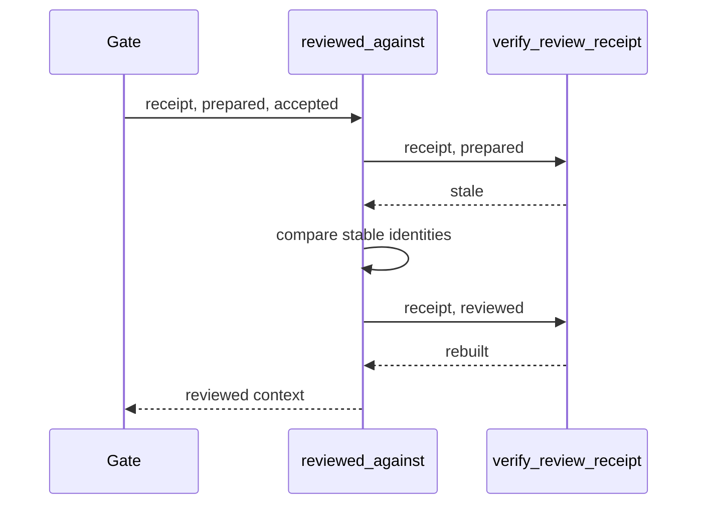
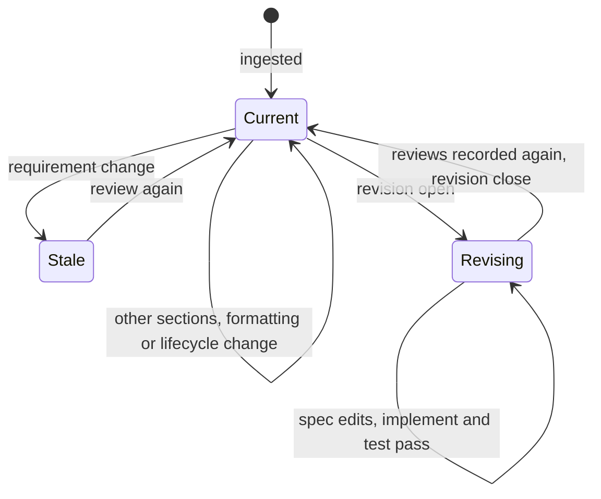

## Summary, Implementation Plan, Testing Strategy, Risks

Python ≥3.11. New modules `validator/semantic/review_stability.py` and `validator/delivery/revision.py`; changes in `review_contract.py`, `review_receipts.py`, `review_api.py`, `validator/clarify_inventory.py`, `validator/semantic_analysis.py`, `validator/pre_impl_analysis.py`, `validator/progression_gate.py`, `validator/delivery/lane.py`, `validator/delivery/review.py` and `validator/cli_commands/delivery_cmd.py`. pytest fixtures with real receipts. No new dependency.

Constitution: ✅1 no new layer; ✅2 no LLM call; ✅3 one receipt field and one record file; ✅4 a tampered context is stale; ✅5 one command group under `delivery`; ✅6 local only.

- **D-01:** `ReviewReceipt.reviewed` stores the prepared context without prompts, stamped with the running policy, schema and prompt versions; `verify_review_receipt` excludes it from the comparison.
- **D-02:** `stable_identity` hashes feature, kind, model, versions, requirement scope, dependencies, roles and one digest per source: the requirement projection for the feature spec, the normative hash for every other source. The budget is not part of it.
- **D-03:** `reviewed_against(receipt, prepared, accepted)` returns the context the receipt is valid against: the current one when the strict comparison passes, else the reviewed one when its hash is the receipt's, the versions match, the stable identities are equal (or the hash is in `accepted`) and the raw results rebuild against it.
- **D-04:** acceptance and mapping reviews keep calling `verify_review_receipt` directly.
- **D-05:** the revision record `.reviews/spec-revision.json` holds the spec and plan context hashes; `require_progression` passes them as `accepted` for `implement` and `test` and raises `spec_revision_open` for `complete`; `verify_review` blocks with the same code.

**Gherkin Scenarios + Mermaid Sequence Diagrams**

```gherkin
Feature: Verify
  Scenario: Edge case edited after review
    Given a ready spec review
    When an edge case changes
    Then reviewed_against returns the reviewed context
```



**Gherkin Scenarios + Mermaid State Diagrams**

```gherkin
Feature: Revision
  Scenario: Close after one review
    Given an open revision and a revised AC
    When both reviews are recorded again
    Then close removes the record
```



**Implementation Plan, Testing Strategy, Risks**

1. Reviewed context and stable identity (FR-001, FR-002).
2. Stable verification in review, Clarify, Analyze and the lane (FR-003).
3. Revision record, command and progressions (FR-004, FR-005).
4. Documentation (FR-006).
5. Tests: `tests/test_stable_review.py`, `tests/test_spec_revision.py`.

Risks: a requirement written outside the FR and AC sections and outside Gherkin is not part of the projection; the spec template keeps requirements in those sections, and the reviewed sections stay in the receipt for an audit.
