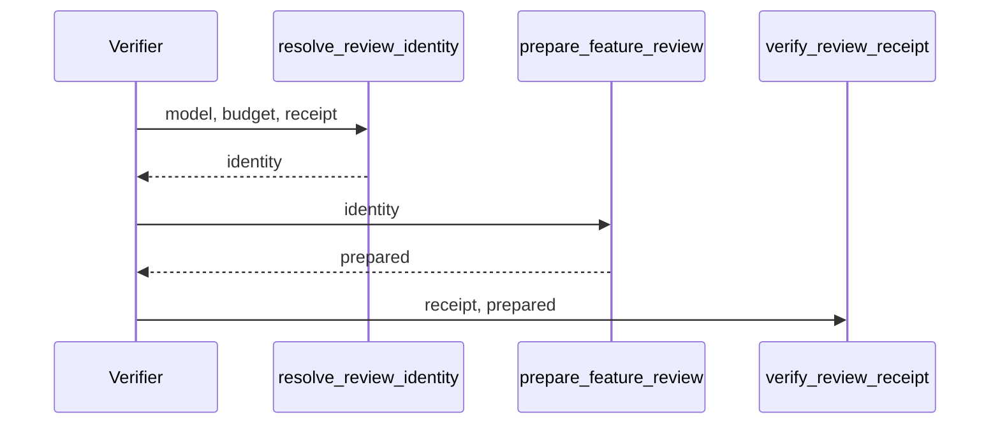
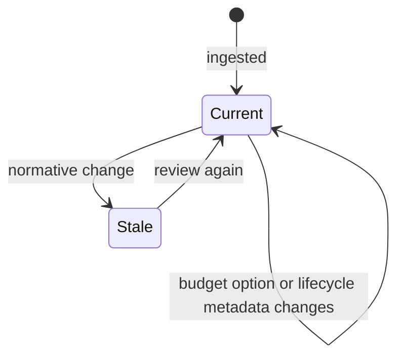

## Summary, Implementation Plan, Testing Strategy, Risks

Python ≥3.11 changes in `validator/semantic/review_contract.py`, `review_receipts.py`, `review_api.py`, `review_files.py`, `validator/progression_gate.py`, `validator/goal_payload.py` and `validator/delivery/lane.py`; pytest fixtures with real receipts. No new dependency.

Constitution: ✅1 no new layer; ✅2 no LLM call; ✅3 one receipt field; ✅4 out-of-bounds budgets refused; ✅5 no new command; ✅6 local only.

- **D-01:** `ReviewReceipt.review_max_chars: int | None = None`, set by `validate_review_result` from `prepared.max_chars`, excluded with `source_hashes` in `verify_review_receipt`.
- **D-02:** `resolve_review_identity(root, model, max_chars, receipt=None)` returns the explicit values, else the recorded budget, else the configuration; every verifier calls it.
- **D-03:** goal render reads `review_model` when `--model=` is absent and keeps requiring a model when neither exists.

**Gherkin Scenarios + Mermaid Sequence Diagrams**

```gherkin
Feature: Verify
  Scenario: Recorded budget
    Given a receipt with review_max_chars
    When a verifier gives no budget
    Then the recorded budget prepares the context
```



**Gherkin Scenarios + Mermaid State Diagrams**

```gherkin
Feature: Receipt state
  Scenario: Normative change
    Given a current receipt
    When a requirement changes
    Then it is stale
```



**Implementation Plan, Testing Strategy, Risks**

1. Receipt field and comparison exclusion (FR-001).
2. `resolve_review_identity` and its callers (FR-002).
3. Tests: `tests/test_review_identity_stability.py`.

Risks: a recorded budget hiding a changed configuration (acceptable: the budget only changes batching, never the reviewed bytes).
