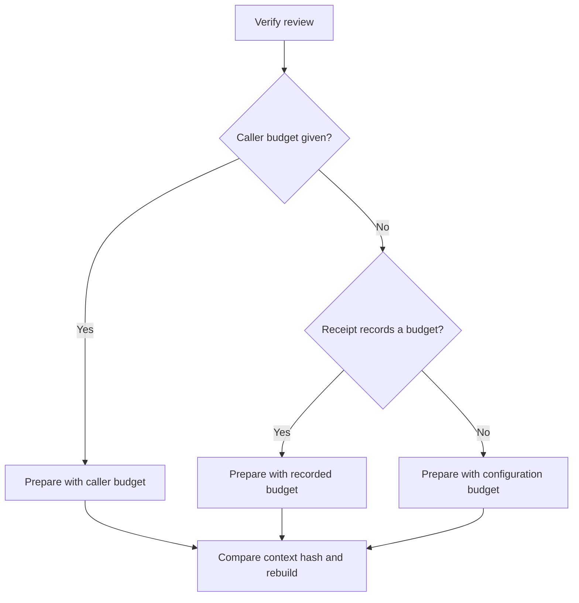
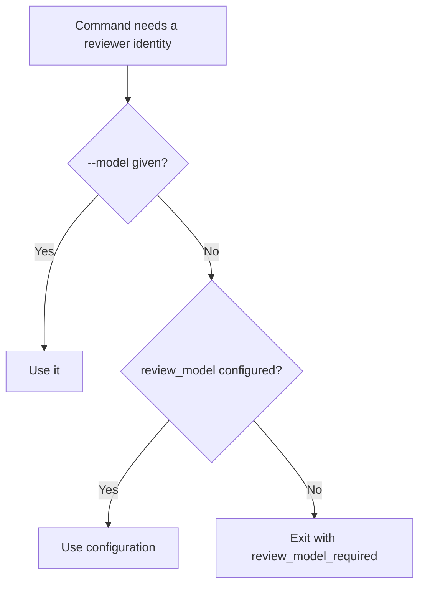

# Feature Spec: Stable Review Identity

- **Feature:** a review receipt records the budget it was prepared with, model and budget come from one project configuration, and only normative changes make a review stale
- **Feature Number:** 089
- **Branch:** `feat/lighten-delivery-gates`
- **Date:** 2026-10-13
- **Status:** Draft
- **Input:** On the Handy program a spec review prepared with `--review-max-chars 120000` was later checked by a goal or progression without that option. The budget is part of the context hash (`validator/semantic/review_identity.py`), so the current review was reported stale and redone. The model was also passed by hand at each command. The maintainer decided: record `--review-max-chars` in the receipt; take model and budget from `.specs/semantic/config.yaml`; only normative changes may make a review stale.

## Scope and Source Evidence

- **Observed problem:** `ReviewReceipt` (`validator/semantic/review_contract.py`) has no budget field; `verify_feature_review`, `progression_gate.require_progression` and `delivery.lane.spec_review_current` prepare with the caller's budget or the configuration default; `SemanticConfig.review_model` and `review_max_chars` exist but goal rendering asks for `--model=` explicitly.
- **In scope:** a `review_max_chars` receipt field excluded from the receipt comparison, verification with the recorded budget when the caller gives none, goal and progression resolution from `.specs/semantic/config.yaml`, a doctor check that reports a receipt whose identity differs from the configuration only by budget or model.
- **Out of scope:** the prompt, the policy version and batching; review readiness (feature 088).

## User Scenarios & Testing

### Story 1 — Verify with the recorded budget `P1`

**As a** maintainer, **I want** verification to reuse the budget recorded in the receipt, **so that** a review is never redone only because a later command omitted the option.

**Priority reason:** it removes the most frequent false staleness.

**Independent test:** Ingest a review prepared with a non-default budget, then verify it without a budget.

```gherkin
Feature: Recorded budget
  Scenario: Verification without a budget uses the recorded one
    Given a ready spec review prepared with review_max_chars 120000
    When "livespec validate <feature> --progression plan" runs without a budget
    Then the review is current

  Scenario: A normative change still makes it stale
    Given the same receipt
    When an acceptance criterion changes
    Then the review is stale
```

#### User Flow



### Story 2 — One configuration for model and budget `P2`

**As an** agent, **I want** every review command and goal to read the reviewer model and budget from `.specs/semantic/config.yaml`, **so that** I never pass them by hand.

**Priority reason:** a missing `--model` made goal renders fail or select another identity.

**Independent test:** Render a goal and run a progression with only the configuration set.

```gherkin
Feature: Configured identity
  Scenario: Goal render without --model
    Given review_model "m1" in .specs/semantic/config.yaml
    When "livespec goal render spec-plan --feature <feature>" runs without --model
    Then the review task expects reviewer_model "m1"
```

#### User Flow



## Acceptance Criteria

### AC-001

Spec and plan ingestion record `review_max_chars` in the receipt; verification without an explicit budget prepares with the recorded budget, and the receipt comparison excludes this field so older receipts stay valid.

### AC-002

A change to a normative section of a reviewed source makes the review stale; a change of lifecycle metadata, of the budget or of the configuration file alone does not.

### AC-003

`livespec goal render`, progression checks and `livespec delivery lane` resolve the reviewer model and budget from `--model`/`--review-max-chars`, else `.specs/semantic/config.yaml`, and exit with `review_model_required` when neither names a model.

## Functional Requirements

- **FR-001:** Receipt field and budget-aware verification. **Maps to:** AC-001, AC-002.
- **FR-002:** One resolution function for model and budget used by goal, progression and delivery. **Maps to:** AC-003.

## Key Entities

| Entity | Description | Key Fields |
|---|---|---|
| Review receipt | Existing receipt | + review_max_chars |
| Review identity | Resolved model and budget | model, max_chars, source |

## Edge Cases

- **Receipt without a recorded budget:** the configuration budget applies, as today.
- **Recorded budget out of bounds:** refused as invalid, never clamped.

## Quality Engineering

- **Risk:** Medium criticality; Shared blast radius; primary risk Contract.
- **P0 gates/evidence:** receipt fixtures with and without the field, progression and goal render tests.

## Success Criteria

| ID | Criterion | How to Measure |
|---|---|---|
| SC-001 | No review is redone when only the budget option differs | Fixture with a non-default budget |
| SC-002 | No review command needs `--model` when the configuration names one | Goal render and progression fixtures |
