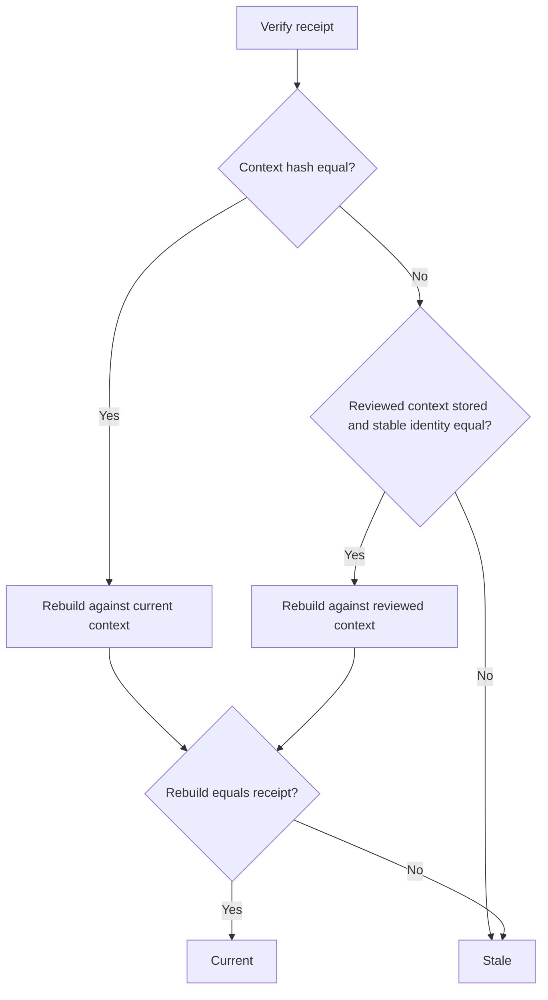
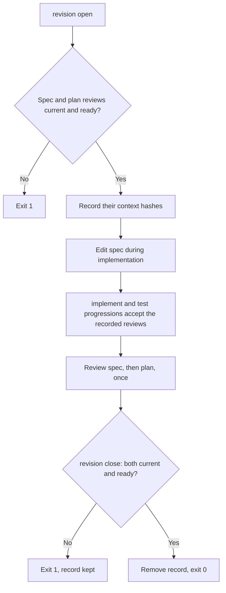

# Feature Spec: Stable Review Identity

- **Feature:** a spec or plan review stays current until the requirements it judged change: only the functional requirements, the acceptance criteria and the Gherkin scenarios of the feature spec make it stale, the review budget never does, and a spec revised during implementation is reviewed once, at the end
- **Feature Number:** 089
- **Branch:** `feat/lighten-delivery-gates`
- **Date:** 2026-10-13
- **Status:** Draft
- **Input:** On the Handy program a spec review prepared with `--review-max-chars 120000` was later checked without that option and reported stale, because the budget is part of the context hash (`validator/semantic/review_identity.py`). An edit to an edge case, to the Quality Engineering section or to the formatting of the spec also made the spec and plan reviews stale, and a spec corrected during implementation blocked the next phase until both were reviewed again. The maintainer decided (13 October 2026): a review becomes stale only when the FR, the AC or the Gherkin change, never for edge cases, QE sections or formatting; the receipt is no longer bound to the review budget; a grouped spec revision is allowed during implementation, with a single new review at the end. The reviewer model and budget configuration first planned here moved to feature 093.

## Scope and Source Evidence

- **Observed problem:** `context_identity` hashes every source byte outside lifecycle metadata and the budget; `verify_review_receipt` (`validator/semantic/review_receipts.py`) accepts a receipt only when that hash is equal and the raw results rebuild against the current sections, whose identifiers carry line numbers. Section edits that move lines therefore make every citation fail.
- **In scope:** the reviewed context stored in the receipt, a stable identity of spec and plan reviews, verification against the reviewed context, the spec revision record and its command, the progression and delivery checks that read it, `system/review-protocol.md` and the spec-implement skill.
- **Out of scope:** acceptance, mapping and delivery reviews, which stay strict; the review prompt and policy versions; reviewer model and budget resolution (feature 093).

## Constitution Alignment

- **No silent trust:** a stable receipt is still rebuilt from its raw reviewer output against the context it reviewed; only the comparison with the current sources changes.
- **CLI surface:** one subgroup `livespec delivery revision` (`open`, `close`, `status`), JSON output, exit codes 0, 1 and 2.
- **Compatibility:** a receipt written before this feature has no reviewed context and keeps the exact comparison.

## Definitions

- **Reviewed context:** the prepared review a receipt was validated against (sections, requirements, batches without their prompts, identity fields), stored in the receipt at ingestion.
- **Requirement projection:** for the feature `spec.md`, the lines of the `Functional Requirements` and `Acceptance Criteria` sections (numbered or decorated titles and their French forms included), of every line or table row that starts with an FR or AC id, and of every `gherkin` fenced block, with Markdown emphasis, code marks and runs of whitespace removed; blank lines do not count.
- **Stable identity:** feature, review kind, reviewer model, policy, schema and prompt versions, requirement scope, dependencies, the requirement ids under review (FR, AC and SC), and one hash per source: the requirement projection for the feature `spec.md`, the normative hash for every other source. It excludes the review budget.
- **Spec revision:** a record `.specs/features/<feature>/.reviews/spec-revision.json` naming the context hashes of the spec and plan receipts that were current and ready when it was opened.

## User Scenarios & Testing

### Story 1 — Only requirement changes make a review stale `P1`

**As a** maintainer, **I want** a review to stay current when an edge case, the QE section or the formatting of the spec changes, **so that** a review is redone only when the requirements it judged change.

**Priority reason:** these edits made both reviews stale on every Handy feature.

**Independent test:** Ingest spec and plan reviews, edit each kind of section, then verify both.

```gherkin
Feature: Stable review
  Scenario: Edge case edited
    Given current and ready spec and plan reviews
    When an edge case of the spec is rewritten and moves the following lines
    Then both reviews are still current

  Scenario: Acceptance criterion edited
    Given the same reviews
    When the text of AC-001 changes
    Then both reviews are stale

  Scenario: Another budget
    Given a spec review prepared with review_max_chars 120000
    When it is verified with the default budget
    Then it is current
```

#### User Flow



### Story 2 — Revise the spec once during implementation `P1`

**As an** implementing agent, **I want** to group spec corrections found during implementation and review them once at the end, **so that** implementation never stops for a review per correction.

**Priority reason:** a corrected requirement blocked the next implementation phase until two reviews were redone.

**Independent test:** Open a revision, change an AC, pass the implement and test progressions, refuse completion, then close after one new review.

```gherkin
Feature: Spec revision
  Scenario: Implementation continues during a revision
    Given an open spec revision and an edited acceptance criterion
    When "livespec validate <feature> --progression implement" runs
    Then it is READY with the reviews recorded at opening

  Scenario: Completion waits for the closing review
    Given the same open revision
    When the complete progression or the delivery review verification runs
    Then it is refused with "spec_revision_open"

  Scenario: Close after one review
    Given current and ready spec and plan reviews of the revised spec
    When the agent runs "livespec delivery revision close --feature <feature>"
    Then the revision record is removed and the command exits 0
```

#### User Flow



## Acceptance Criteria

### AC-001

Spec and plan review ingestion stores the reviewed context in the receipt; a spec or plan review whose context hash differs from the current one is current when its stored reviewed context has the same stable identity as the current preparation and its raw results rebuild exactly against that reviewed context; the review budget is not part of the stable identity, so a receipt prepared with another `--review-max-chars` stays current.

### AC-002

A change to the requirement projection of the feature `spec.md` (a functional requirement, an acceptance criterion or a Gherkin scenario) or to the normative content of any other reviewed source, including `plan.md`, makes the review stale; a change limited to other spec sections (edge cases, Quality Engineering, stories, scope), to Markdown emphasis or whitespace, or to lifecycle metadata does not.

### AC-003

Acceptance, mapping and delivery reviews, and receipts without a stored reviewed context, keep the exact context comparison; a receipt whose stored reviewed context does not prepare again, from its own section texts, to the receipt's context hash, or does not rebuild its own raw results, is stale.

### AC-004

`livespec delivery revision open --feature <feature> [--model <m>]` writes the spec revision record and exits 0 only when the spec and plan reviews are current and ready; otherwise it exits 1 with `spec_review_not_current` or `plan_review_not_current`. `status` prints the record or `{"open": false}`.

### AC-005

While a spec revision is open, the `implement` and `test` progressions accept a spec or plan receipt whose context hash is recorded in the revision and whose raw results rebuild against its reviewed context, even when the spec changed; the `complete` progression and `livespec delivery review verify` are refused with `spec_revision_open`.

### AC-006

`livespec delivery revision close --feature <feature> [--model <m>]` removes the record and exits 0 only when the spec and plan reviews are current and ready for the revised sources; otherwise it exits 1, names the stale review and keeps the record.

## Functional Requirements

- **FR-001:** Store the reviewed context in spec and plan receipts and exclude it from the receipt comparison. **Maps to:** AC-001, AC-003.
- **FR-002:** Compute the requirement projection and the stable identity, and verify spec and plan receipts against their reviewed context when the stable identity is equal. **Maps to:** AC-001, AC-002, AC-003.
- **FR-003:** Use stable verification in the spec review, Clarify, Analyze and delivery lane checks. **Maps to:** AC-001, AC-002.
- **FR-004:** Add `livespec delivery revision open|close|status` and the revision record. **Maps to:** AC-004, AC-006.
- **FR-005:** Accept the recorded receipts in the `implement` and `test` progressions and refuse `complete` and the delivery review verification while a revision is open. **Maps to:** AC-005.
- **FR-006:** Document stable reviews and spec revisions in `system/review-protocol.md` and the spec-implement skill. **Maps to:** AC-002, AC-005.

## Key Entities

| Entity | Description | Key Fields |
|---|---|---|
| Review receipt | Existing receipt | + reviewed (prepared context without prompts) |
| Stable identity | Digest of what a review judged | kind, model, versions, scope, dependencies, per-source hashes |
| Spec revision | Open revision record | feature, spec, plan (context hashes), opened_at |

## Edge Cases

- **New Success Criteria id:** it adds a review obligation, so the review is stale.
- **Requirement moved without change:** the projection keeps line order but not line numbers, so moving the Functional Requirements section is not a change; reordering acceptance criteria is.
- **Lane classification after a QE edit:** a QE edit no longer makes the spec review stale, so the delivery lane reads the classification of the reviewed spec as well as the current one and keeps the stricter (feature 086).
- **Review prepared with a larger budget:** the current preparation may not fit the default budget; its sections do not depend on the budget, so the stable comparison still applies.
- **Receipt written before this feature:** it has no reviewed context; `revision open` refuses it with `spec_review_not_current`, so review again first.
- **Malformed revision record:** progressions and `delivery review verify` are refused with `spec_revision_malformed`.
- **Revision opened twice:** `open` refuses an existing record with `spec_revision_open`.
- **Receipt replaced during a revision:** a receipt whose context hash is not in the record follows the normal rules.

## Quality Engineering

- **Risk:** Medium criticality (it widens what a current review accepts; every accepted receipt is still rebuilt from raw reviewer output); Shared blast radius (every feature review); primary risk Contract.
- **Applicable dimensions:** fail-safe staleness, compatibility of existing receipts, tamper resistance of the stored context, progression gates. Accessibility not applicable.
- **P0 gates/evidence:** pytest fixtures with real ingested receipts for each section kind, budget, tampered context, revision lifecycle and the existing review suites unchanged.

## Success Criteria

| ID | Criterion | How to Measure |
|---|---|---|
| SC-001 | An edge case, QE or formatting edit never requires a new spec or plan review | Stable review fixtures |
| SC-002 | A spec revised during implementation needs one spec review and one plan review in total | Revision lifecycle fixture |
