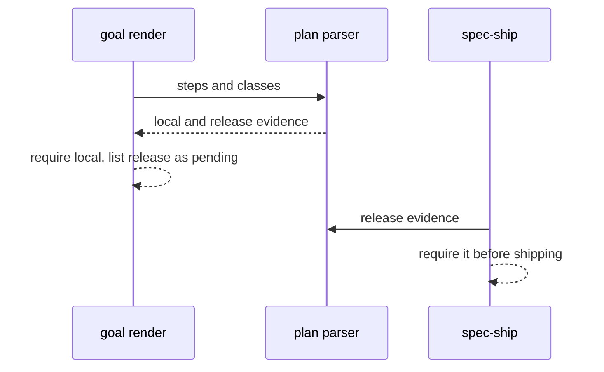
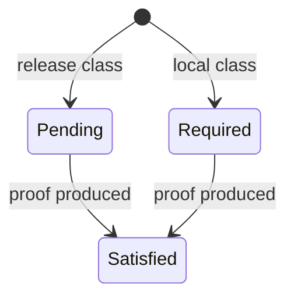

## Summary, Implementation Plan, Testing Strategy, Risks

Python ≥3.11 changes in the plan structural validator (`validator/rules/__init__.py`, new `validator/plan_evidence.py` and `validator/release_evidence.py`), the goal runtime context (`validator/goal_payload.py`), the progression gate (`validator/progression_gate.py`), the plan review prompt (`validator/semantic/review_batches.py`) and the spec-plan, spec-implement and spec-ship skills; a native rule `system/minimal-spec-scope.md`. No new dependency.

Constitution: ✅1 no new layer; ✅2 no LLM call; ✅3 plan text only; ✅4 unknown classes rejected; ✅5 no new command; ✅6 local only.

- **D-01:** the rule text lives in `system/minimal-spec-scope.md` (LiveSpec has no conventions pack of its own) and is cited by the plan review protocol and the plan review prompt; the reviewer reports untraced mechanisms with the 088 `kind`. The prompt version stays unchanged so current reviews are not made stale (089).
- **D-02:** evidence class is one bold line per step, parsed by the plan validator.
- **D-03:** the goal lists release evidence under `pending_release_evidence` in `runtime_context`, outside the required tasks; `/spec-ship` requires it through `livespec validate <feature-dir> --progression ship` (the `complete` checks plus every release step proven in the `## Release Evidence` table of `implementation.md`), with no new command.

**Gherkin Scenarios + Mermaid Sequence Diagrams**

```gherkin
Feature: Release step
  Scenario: Deferred
    Given a release step
    When the goal renders
    Then the evidence is pending
```



**Gherkin Scenarios + Mermaid State Diagrams**

```gherkin
Feature: Evidence state
  Scenario: Release evidence
    Given a pending release item
    When the release proof is produced
    Then the item is satisfied
```



**Implementation Plan, Testing Strategy, Risks**

1. Native rule and review protocol text (FR-001).
2. Plan validator, goal deferral, spec-ship requirement (FR-002).
3. Tests: `tests/test_plan_evidence_class.py`, review fixture.

Risks: release used to dodge local proof (only steps whose proof needs signing, a device fleet or production may declare it; the delivery review checks the classification).
