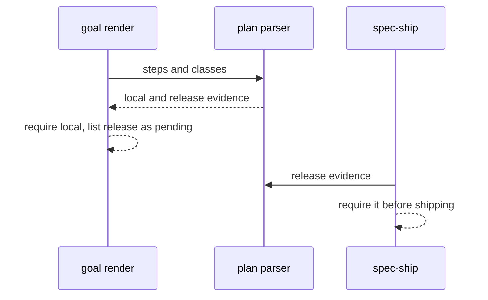
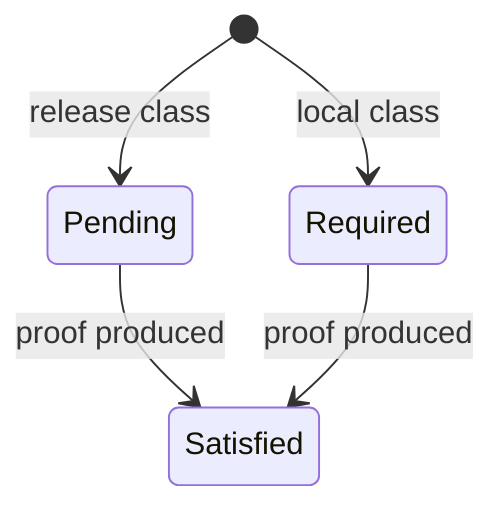

## Summary, Implementation Plan, Testing Strategy, Risks

Python ≥3.11 changes in the plan structural validator, `validator/goal_tasks.py` and the spec-plan, spec-implement and spec-ship skills; a native rule in the conventions pack. No new dependency.

Constitution: ✅1 no new layer; ✅2 no LLM call; ✅3 plan text only; ✅4 unknown classes rejected; ✅5 no new command; ✅6 local only.

- **D-01:** the rule text lives in the native conventions pack and is cited by the plan review protocol; the reviewer reports untraced mechanisms with the 088 `kind`.
- **D-02:** evidence class is one bold line per step, parsed by the plan validator.
- **D-03:** the goal lists release evidence under `pending_release_evidence` in `runtime_context`, outside the required tasks; `/spec-ship` turns it into a required task.

**Gherkin Scenarios + Mermaid Sequence Diagrams**

```gherkin
Feature: Release step
  Scenario: Deferred
    Given a release step
    When the goal renders
    Then the evidence is pending
```



**Gherkin Scenarios + Mermaid State Diagrams**

```gherkin
Feature: Evidence state
  Scenario: Release evidence
    Given a pending release item
    When the release proof is produced
    Then the item is satisfied
```



**Implementation Plan, Testing Strategy, Risks**

1. Native rule and review protocol text (FR-001).
2. Plan validator, goal deferral, spec-ship requirement (FR-002).
3. Tests: `tests/test_plan_evidence_class.py`, review fixture.

Risks: release used to dodge local proof (only steps whose proof needs signing, a device fleet or production may declare it; the delivery review checks the classification).
