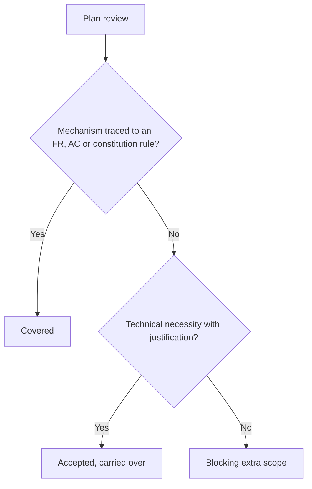
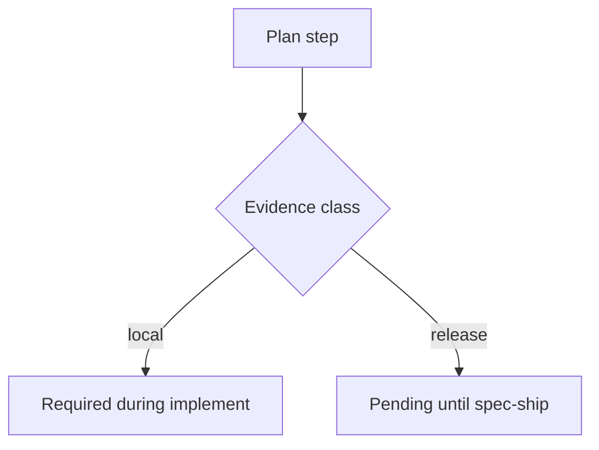

# Feature Spec: Minimal Plan Scope

- **Feature:** a native minimal-spec-scope rule for plans, a plan review that flags every mechanism the spec does not ask for, and two evidence classes so that no plan step blocks on evidence the machine cannot produce
- **Feature Number:** 090
- **Branch:** `feat/lighten-delivery-gates`
- **Date:** 2026-10-13
- **Status:** Draft
- **Input:** On the Handy program plans added mechanisms nobody asked for (caches, retry layers, telemetry), each of which then needed tests, reviews and evidence; some steps required release-signing or device evidence that could not be produced on the development machine and stayed blocked. The maintainer decided: a native "minimal spec scope" rule; plan review flags any mechanism absent from the spec; evidence classes "required locally" or "pending release evidence", and no step blocks on evidence the machine cannot produce.

## Scope and Source Evidence

- **Observed problem:** `system/` has no rule bounding plan scope; the plan review prompt asks for "extra business scope" only; plan steps have one evidence notion and the goal blocks on all of it.
- **In scope:** a native LiveSpec rule `minimal-spec-scope` (`system/minimal-spec-scope.md`, shipped with LiveSpec like `system/tool-project-boundary.md`, because `.conventions/` only lists ai-ressources sources), the plan review guidance and the `extra_scope` kind of feature 088 applied to mechanisms, a `**Evidence class:**` line per plan step (`local` default, `release`), the goal context that defers `release` evidence, and the `ship` progression (`livespec validate <feature-dir> --progression ship`) that `/spec-ship` runs before merging.
- **Out of scope:** any other `/spec-ship` requirement; certifying an acceptance criterion from release evidence (every AC stays provable locally).

## User Scenarios & Testing

### Story 1 — Flag mechanisms absent from the spec `P1`

**As a** maintainer, **I want** the plan review to flag every mechanism the spec does not require, **so that** plans stay within the spec.

**Priority reason:** every extra mechanism multiplied the downstream proof.

**Independent test:** Review a plan adding a cache that no FR mentions.

```gherkin
Feature: Minimal scope
  Scenario: An unrequested cache is flagged
    Given a spec without any caching requirement
    And a plan step adding a cache
    When the plan review is ingested
    Then extra_scope contains the cache with kind business and the plan is not ready
```

#### User Flow



### Story 2 — Defer release evidence `P1`

**As an** implementing agent, **I want** steps marked `release` to be deferred to shipping, **so that** I never wait on evidence this machine cannot produce.

**Priority reason:** blocked steps stopped whole features.

**Independent test:** Render the implement goal for a plan with one `release` step.

```gherkin
Feature: Evidence classes
  Scenario: Release evidence is pending, not blocking
    Given a plan step with "**Evidence class:** release"
    When the implement goal is rendered
    Then its evidence task is listed as pending release evidence and does not block finalize
```

#### User Flow



## Acceptance Criteria

### AC-001

The plan review guidance and the native rule `minimal-spec-scope` require every plan mechanism to trace to a spec FR, AC or constitution rule; an untraced mechanism is reported in `extra_scope` and blocks unless it is a justified technical necessity.

### AC-002

A plan step may declare `**Evidence class:** local` (default) or `release`; `release` evidence becomes a pending item of the implement goal that never blocks `finalize`, and `/spec-ship` requires it.

### AC-003

`livespec validate <plan.md>` rejects an unknown evidence class.

## Functional Requirements

- **FR-001:** Native rule and plan review guidance. **Maps to:** AC-001.
- **FR-002:** Evidence class parsing, goal deferral and ship requirement. **Maps to:** AC-002, AC-003.

## Key Entities

| Entity | Description | Key Fields |
|---|---|---|
| Plan step | Existing step | + evidence class |
| Pending release evidence | Deferred proof | feature, step, evidence |

## Edge Cases

- **Release evidence produced early:** accepted and recorded; the item is no longer pending.
- **A step with both classes:** split the step; validation rejects two classes on one step.

## Quality Engineering

- **Risk:** Medium criticality; Shared blast radius; primary risk Contract.
- **P0 gates/evidence:** review fixtures with an untraced mechanism, goal render with a release step, validation of evidence classes.

## Success Criteria

| ID | Criterion | How to Measure |
|---|---|---|
| SC-001 | No implement goal blocks on release-only evidence | Goal render fixture |
| SC-002 | Every untraced mechanism appears in the plan review | Review fixture |
