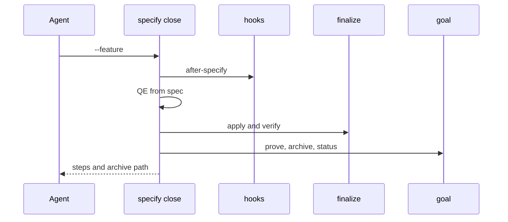
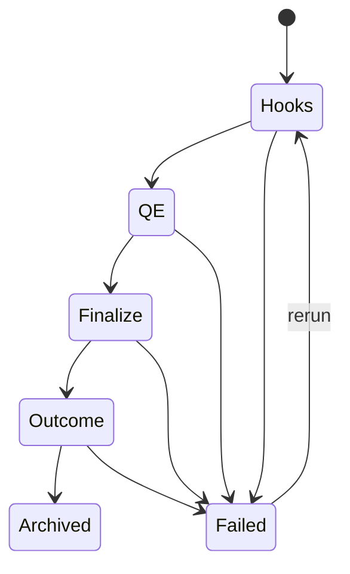

## Summary, Implementation Plan, Testing Strategy, Risks

A Typer group `validator/cli_commands/specify_cmd.py` calling the existing finalize, goal and hooks functions in process; Python ≥3.11, pytest. No new dependency.

Constitution: ✅1 no new layer; ✅2 no LLM call; ✅3 writes only what the reused steps write; ✅4 first failure stops with its reasons; ✅5 one `specify` group; ✅6 local only.

- **D-01:** steps are functions returning `(ok, reasons, receipt)`; the runner stops at the first failure.
- **D-02:** QE reuses `validator/delivery/lane.py::classify`.
- **D-03:** proofs submit the receipts produced by earlier steps; documentary tasks still need their evidence and fail the step when absent.

**Gherkin Scenarios + Mermaid Sequence Diagrams**

```gherkin
Feature: Close
  Scenario: Ordered steps
    Given a ready feature
    When close runs
    Then each step runs once in order
```



**Gherkin Scenarios + Mermaid State Diagrams**

```gherkin
Feature: Resume
  Scenario: Rerun after a fix
    Given a failed finalize step
    When the agent fixes it and reruns
    Then earlier steps are reused
```



**Implementation Plan, Testing Strategy, Risks**

1. `specify_cmd.py` and registration (FR-001, FR-002).
2. spec-specify skill Phase 7 and stop condition (FR-003).
3. Tests: `tests/test_specify_close.py`.

Risks: hiding a step's output (every step's reasons are printed).
