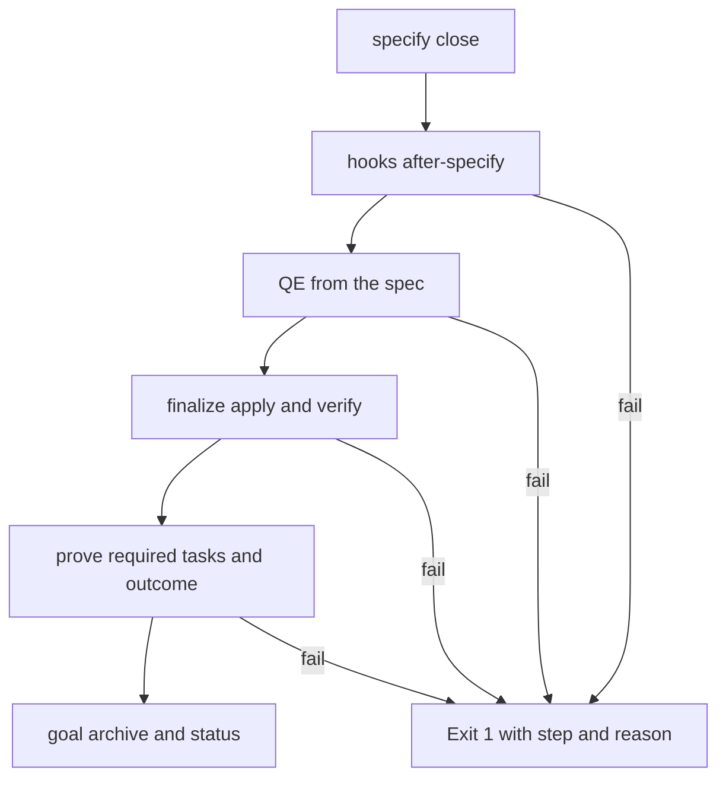

# Feature Spec: One-Command Specify Close

- **Feature:** `livespec specify close --feature <slug>` runs the end of `/spec-specify` in one command: hooks, QE classification read from the spec, registry finalize, outcome and archive
- **Feature Number:** 091
- **Branch:** `feat/lighten-delivery-gates`
- **Date:** 2026-10-13
- **Status:** Draft
- **Input:** On the Handy program closing `/spec-specify` took five to eight separate commands (`hooks resolve`, `finalize apply`, `finalize verify`, `goal prove` for each required task, `goal archive`, `goal status`), each needing the right flags, and the QE values were restated by hand although they are in the spec. The maintainer decided: one command such as `livespec specify close` that runs hooks, QE, finalize, outcome and archive, reading QE from the spec.

## Scope and Source Evidence

- **Observed problem:** `.agent-sync/skills/spec-specify/SKILL.md` Phase 7 and the goal stop condition list the steps separately; QE is parsed nowhere except `validator/delivery/lane.py` (feature 086).
- **In scope:** a `specify` command group with `close`, reusing `hooks`, `finalize apply/verify`, `goal prove`, `goal archive` and `goal status` in process, and the QE parser of feature 086.
- **Out of scope:** changing what each step checks.

## User Scenarios & Testing

### Story 1 — Close the specification in one command `P1`

**As an** agent, **I want** one command to run every closing step in order and stop at the first failure, **so that** closing a spec is one step instead of eight.

**Priority reason:** each manual step was a chance to forget a flag or prove the wrong path.

**Independent test:** Close a temporary feature with a ready spec review, then one with a missing QE section.

```gherkin
Feature: Specify close
  Scenario: Everything passes
    Given a specified feature with a current ready spec review and a QE section
    When the agent runs "livespec specify close --feature <feature>"
    Then hooks, finalize, outcome and archive run in order and the command exits 0 with the archived goal path

  Scenario: The first failure stops
    Given a spec without a Quality Engineering section
    When the agent runs the command
    Then it exits 1 at step "qe" with "qe_section_missing" and runs no later step
```

#### User Flow



## Acceptance Criteria

### AC-001

`livespec specify close --feature <slug> [--model <m>] [--json]` runs, in order, the after-specify hooks, the QE parse of the spec, `finalize apply` and `finalize verify`, the proofs of the goal's required tasks with the receipts it produced, `goal archive` and `goal status`, and exits 0 with every step and the archive path.

### AC-002

The command stops at the first failing step, exits 1 with the step name and its reasons, and leaves earlier receipts in place so that a rerun resumes.

### AC-003

The QE criticality and blast radius come from the spec's Quality Engineering section with the 086 parser; a missing or conflicting classification fails the `qe` step.

## Functional Requirements

- **FR-001:** The `specify close` command and its ordered steps. **Maps to:** AC-001, AC-002.
- **FR-002:** QE from the spec. **Maps to:** AC-003.
- **FR-003:** spec-specify Phase 7 and the goal stop condition use the command. **Maps to:** AC-001.

## Key Entities

| Entity | Description | Key Fields |
|---|---|---|
| Close step | One closing action | name, status, reasons, receipt |
| Close result | Whole run | feature, steps, archive_path |

## Edge Cases

- **Already archived goal:** the command reports it and exits 0 without redoing steps.
- **Documentary tasks without a receipt:** reported as the failing step with the task id.

## Quality Engineering

- **Risk:** Low criticality (it orders existing checks); Shared blast radius; primary risk Contract.
- **P0 gates/evidence:** temporary project fixtures for success, each failing step and a resumed rerun.

## Success Criteria

| ID | Criterion | How to Measure |
|---|---|---|
| SC-001 | Closing `/spec-specify` takes one command instead of five to eight | Skill text and fixture |
| SC-002 | QE is never restated by hand | The command reads the spec |
