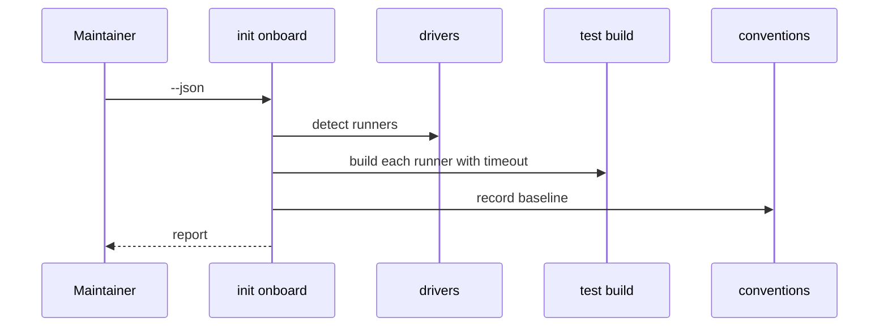
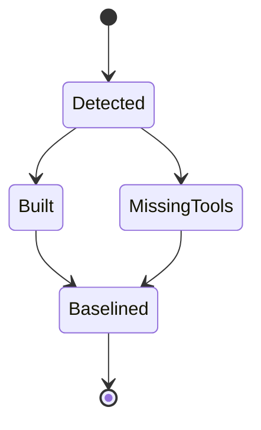

## Summary, Implementation Plan, Testing Strategy, Risks

A new `init onboard` subcommand under the existing `init` group, reusing driver resolution and the conventions engine; Python ≥3.11, subprocess with timeouts, pytest with fake tools on PATH. No new dependency.

Constitution: ✅1 no new layer; ✅2 no LLM call; ✅3 writes only the conventions baseline; ✅4 every failure reported with its runner; ✅5 one subcommand; ✅6 local only.

- **D-01:** runner detection reuses `livespec drivers` discovery and adds Cargo and Go manifests where missing.
- **D-02:** missing tools come from known requirement tables per runner and patterns in build output (`cmake not found`, `llvm-profdata`).
- **D-03:** the baseline reuses the conventions fingerprint format so the gate can subtract it.

**Gherkin Scenarios + Mermaid Sequence Diagrams**

```gherkin
Feature: Onboard
  Scenario: Report
    Given a repository
    When onboarding runs
    Then runners, builds, missing tools and the baseline are reported
```



**Gherkin Scenarios + Mermaid State Diagrams**

```gherkin
Feature: Baseline
  Scenario: New violation
    Given a baseline
    When a new violation appears
    Then only it is reported
```



**Implementation Plan, Testing Strategy, Risks**

1. Runner detection and builds (FR-001, FR-002).
2. Baseline and spec-init call (FR-003).
3. Tests: `tests/test_init_onboard.py`.

Risks: a long build at init (timeout, `--skip-build` option).
