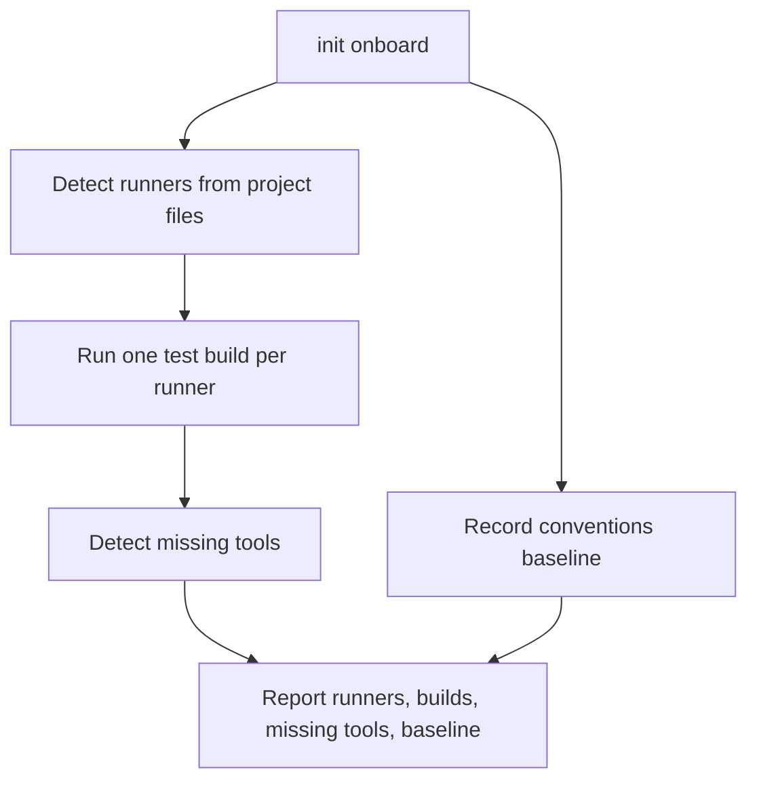

# Feature Spec: Existing Repository Onboarding

- **Feature:** `/spec-init` on an existing repository records a conventions baseline, detects the test runners, runs one test build and reports missing toolchain dependencies before the first feature
- **Feature Number:** 092
- **Branch:** `feat/lighten-delivery-gates`
- **Date:** 2026-10-13
- **Status:** Draft
- **Input:** On the Handy program (an existing Tauri repository) the first feature discovered late that the conventions gate reported pre-existing violations, that the Rust tests needed `cmake` and LLVM tools, and that the test commands were not resolved. Each discovery stopped an implementation step. The maintainer decided: `spec-init` onboarding for existing repositories covering a conventions baseline, test-runner detection (Cargo, pytest…), a test build and missing dependencies such as cmake.

## Scope and Source Evidence

- **Observed problem:** `.agent-sync/skills/spec-init/SKILL.md` targets new projects; `livespec conventions` has no baseline step at init; drivers are detected per command (`livespec drivers`) but no init step runs a build.
- **In scope:** an `livespec init onboard` helper with `--json`, called by `/spec-init` when the repository already has source files: conventions baseline, runner detection from project files (`Cargo.toml`, `pyproject.toml`, `package.json`…), one test build per runner (`cargo test --no-run`, `pytest --collect-only`…), missing tool detection from the build output and known requirements (cmake, llvm-tools, a C compiler).
- **Out of scope:** installing tools; changing the conventions rules.

## User Scenarios & Testing

### Story 1 — Onboard an existing repository `P1`

**As a** maintainer, **I want** init to tell me before the first feature what blocks tests and conventions, **so that** implementation steps do not stop on setup.

**Priority reason:** setup surprises cost the first Handy feature most of a day.

**Independent test:** Onboard temporary repositories with a Cargo crate needing cmake, a pytest project and pre-existing convention violations.

```gherkin
Feature: Onboarding
  Scenario: Cargo crate with a missing tool
    Given a repository with Cargo.toml whose build script needs cmake
    And cmake is not on PATH
    When the maintainer runs "livespec init onboard --json"
    Then the runner "cargo" is detected, the test build fails and "cmake" is listed as missing

  Scenario: Conventions baseline
    Given pre-existing convention violations
    When onboarding runs
    Then a baseline records them and the conventions gate reports only new violations
```

#### User Flow



## Acceptance Criteria

### AC-001

`livespec init onboard [--json]` reports every detected runner with its resolved test command, from `Cargo.toml`, `pyproject.toml`/`pytest.ini`, `package.json` and `go.mod`.

### AC-002

For each runner it runs one non-executing test build (`cargo test --no-run`, `pytest --collect-only -q`, …) with a timeout, and reports its exit code and the missing tools found in the output or in the known requirements (cmake, llvm-tools, a C compiler).

### AC-003

It records a conventions baseline of pre-existing violations so that the conventions gate reports only violations introduced after onboarding, and `/spec-init` runs onboarding when the repository already has source files.

## Functional Requirements

- **FR-001:** Runner detection and resolved commands. **Maps to:** AC-001.
- **FR-002:** Test build and missing tool detection. **Maps to:** AC-002.
- **FR-003:** Conventions baseline and the spec-init call. **Maps to:** AC-003.

## Key Entities

| Entity | Description | Key Fields |
|---|---|---|
| Runner | Detected test runner | name, manifest, command |
| Build result | One test build | runner, exit_code, missing_tools |
| Conventions baseline | Pre-existing violations | rule, path, fingerprint |

## Edge Cases

- **Monorepo with several runners:** every runner is reported and built.
- **Build longer than the timeout:** reported as `build_timeout`, not as missing tools.

## Quality Engineering

- **Risk:** Low criticality (read-only checks plus one baseline file); Local blast radius; primary risk Environment.
- **P0 gates/evidence:** temporary repositories with fake tools on PATH for each runner and missing tool.

## Success Criteria

| ID | Criterion | How to Measure |
|---|---|---|
| SC-001 | Missing build tools are reported at init, before the first feature | Cargo fixture without cmake |
| SC-002 | The first feature's conventions gate reports only its own violations | Baseline fixture |
