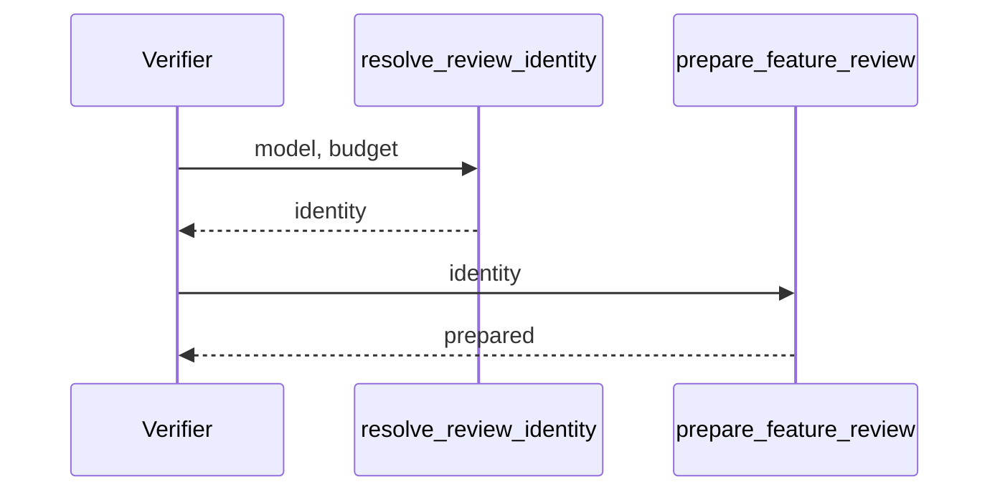

## Summary, Implementation Plan, Testing Strategy, Risks

Python ≥3.11 changes in `validator/semantic/review_files.py`, `validator/progression_gate.py`, `validator/goal_payload.py` and `validator/delivery/lane.py`; pytest fixtures with real receipts. No new dependency.

Constitution: ✅1 no new layer; ✅2 no LLM call; ✅3 no new state; ✅4 out-of-bounds budgets refused; ✅5 no new command; ✅6 local only.

- **D-01:** `resolve_review_identity(root, model, max_chars)` returns the explicit values, else the configuration, else raises `review_model_required`; every verifier calls it. Feature 089 already makes the budget irrelevant to staleness, so the receipt records no budget.
- **D-02:** goal render reads `review_model` when `--model=` is absent and keeps requiring a model when neither exists.

**Gherkin Scenarios + Mermaid Sequence Diagrams**

```gherkin
Feature: Resolve
  Scenario: Configured model
    Given review_model "m1" in the configuration
    When a verifier gives no model
    Then "m1" prepares the context
```



**Implementation Plan, Testing Strategy, Risks**

1. `resolve_review_identity` and its callers (FR-001).
2. Tests: `tests/test_review_identity_config.py`.

Risks: a configuration naming another model than the receipts makes them report `spec_review_model_mismatch`, which is the intended signal.
