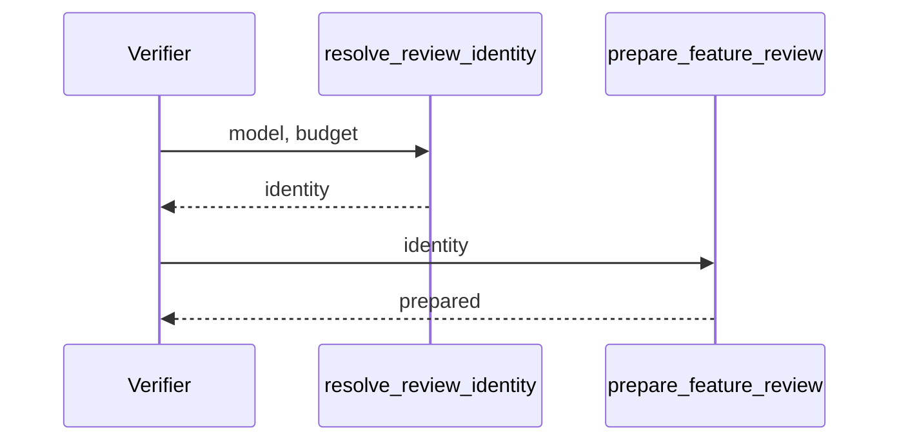

## Summary, Implementation Plan, Testing Strategy, Risks

Python ≥3.11 changes in `validator/semantic/review_identity_config.py` (new), `validator/semantic/review_files.py`, `validator/goal_review_identity.py`, `validator/goal_recompile.py`, `validator/goal_cli_actions.py`, `validator/progression_gate.py`, `validator/delivery/lane.py`, `validator/delivery/goal.py`, `validator/delivery/revision.py` and `validator/cli_commands/delivery_cmd.py`; pytest fixtures with real receipts. No new dependency. `validator/semantic/review_identity.py` already fingerprints prepared contexts, so the resolution gets its own module.

Constitution: ✅1 no new layer; ✅2 no LLM call; ✅3 no new state; ✅4 out-of-bounds budgets refused, every identity error is a domain error with an actionable message; ✅5 no new command; ✅6 local only. The domain exception `ReviewIdentityError` (a `ValueError` carrying `code`) lives beside the function, like the other review errors of `validator/semantic/`, so every existing `except ValueError` keeps failing closed.

- **D-01:** `resolve_review_identity(root, model, max_chars)` reads `.specs/semantic/config.yaml` first (an unreadable or unparsable file raises `review_config_invalid`, even with an explicit model), then resolves:
  - **budget:** `--review-max-chars`, else `review_max_chars` (default 60000); an integer from 1000 to 200000, else `review_max_chars_out_of_bounds` (booleans, floats and strings included, never clamped);
  - **model:** `--model`, else `review_model`, else the first `review_reviewers` entry; values are stripped, and blank, `default` or `unknown` name no model; none left raises `review_model_required`;
  - it returns `ReviewIdentity(model, max_chars, source)` with `source` `option` or `configuration`. Feature 089 already makes the budget irrelevant to staleness, so the receipt records no budget. `current_review_model` (review preparation) and `prepare_feature_review` reuse the same model and budget rules.
- **D-02:** goal render (`bind_review_model`) binds the resolved model as `--model=<model>` when `--model=` is absent and exits 2 with the identity error otherwise; `compile_goal` first refuses a `--review-max-chars=` goal flag that is not ASCII digits. The implement goal's internal lane (086 FR-007) keeps the full lane with the identity error as its reason until the model is bound.
- **D-03:** progressions (`require_progression`) turn an identity error into `ProgressionBlocked` (exit 1). `livespec delivery lane`, `review prepare` and `review verify` exit 2 with the identity error instead of the 086 full lane; `livespec delivery revision open|close` return it as their error code (exit 1). Each command keeps its existing code for a blocked input rather than the constitution's code 3, so callers branching on those codes are unaffected.

**Gherkin Scenarios + Mermaid Sequence Diagrams**

```gherkin
Feature: Resolve
  Scenario: Configured model
    Given review_model "m1" in the configuration
    When a verifier gives no model
    Then "m1" prepares the context
```



**Implementation Plan, Testing Strategy, Risks**

1. `resolve_review_identity` and its callers: goal render, progressions, delivery lane, review prepare and verify, revision open and close (FR-001).
2. Tests in `tests/test_review_identity_config.py`: option over configuration; configuration only (`review_model`, `review_reviewers` fallback, default budget); no model (`review_model_required`) and placeholders; budgets out of bounds, explicit and configured, with inclusive bounds; unreadable configuration with and without `--model`; `goal render spec-plan` with and without `--model` and with a malformed budget flag; `livespec validate --progression implement` with and without the configuration; `livespec delivery lane` (configuration, explicit model, exit 2 replacing the 086 full lane), `review verify` and `revision open` without a model; the implement goal's internal lane. Existing 086 tests that call `review prepare` pass `--model`.

Risks: a configuration naming another model than the receipts makes them report `spec_review_model_mismatch`, which is the intended signal.
