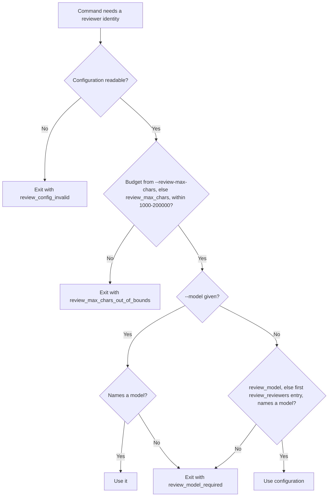

# Feature Spec: Configured Review Identity

- **Feature:** review commands, goals and the delivery lane take the reviewer model and budget from `.specs/semantic/config.yaml` when no option names them
- **Feature Number:** 093
- **Branch:** `feat/lighten-delivery-gates`
- **Date:** 2026-10-13
- **Status:** In Progress
- **Input:** Moved from feature 089 when the maintainer narrowed 089 to review staleness (13 October 2026). On the Handy program the reviewer model was passed by hand to every command, and a missing `--model` made goal renders fail or select another identity.

## Scope and Source Evidence

- **Observed problem:** `SemanticConfig.review_model` and `review_max_chars` exist, but goal rendering asks for `--model=` explicitly.
- **In scope:** one resolution function for model and budget used by goal rendering, progression checks and `livespec delivery lane`.
- **Out of scope:** review staleness (feature 089); the prompt and policy versions.

## User Scenarios & Testing

### Story 1 — One configuration for model and budget `P1`

**As an** agent, **I want** every review command and goal to read the reviewer model and budget from `.specs/semantic/config.yaml`, **so that** I never pass them by hand.

**Priority reason:** a missing `--model` made goal renders fail or select another identity.

**Independent test:** Render a goal and run a progression with only the configuration set.

```gherkin
Feature: Configured identity
  Scenario: Goal render without --model
    Given review_model "m1" in .specs/semantic/config.yaml
    When "livespec goal render spec-plan --feature <feature>" runs without --model
    Then the review task expects reviewer_model "m1"
```

#### User Flow



## Acceptance Criteria

### AC-001

`livespec goal render`, progression checks and `livespec delivery lane` resolve the reviewer model and budget from `--model`/`--review-max-chars`, else `.specs/semantic/config.yaml`, and exit with `review_model_required` when neither names a model; for `livespec delivery lane` this replaces the 086 behavior (exit 0, lane full with `spec_review_not_current`) only for the unresolved-model case.

## Functional Requirements

- **FR-001:** One resolution function for model and budget used by goal, progression and delivery. **Maps to:** AC-001.

## Key Entities

| Entity | Description | Key Fields |
|---|---|---|
| Review identity | Resolved model and budget | model, max_chars, source (`option` when `--model` names the model, `configuration` otherwise) |

## Edge Cases

- **Budget out of bounds in the configuration:** refused as invalid, never clamped.
- **No budget named:** `review_max_chars` defaults to 60000, the existing semantic configuration default.
- **Budget bounds:** an integer from 1000 to 200000 characters (the execution-mapping review bounds); a boolean, float or string is refused too, explicit or configured.
- **No `review_model`:** the first `review_reviewers` entry is the configured model (the existing fallback); `default`, `unknown` and blank values name no model.
- **Unreadable configuration:** invalid YAML, non-UTF-8 bytes or an unreadable path stop with `review_config_invalid`, even with `--model`.
- **Other delivery commands:** `livespec delivery review prepare|verify` evaluate the lane and exit 2 with `review_model_required` like `livespec delivery lane`; `livespec delivery revision open|close` report it as their error code (exit 1). The implement goal's internal lane keeps the full lane until goal render binds the model.
- **Exit codes and messages:** `livespec goal render` exits 2 (the code it already used for an unresolved model) and a progression exits 1 (`BLOCKED:`), for every identity error. `review_config_invalid` keeps each command's existing code for a blocked input rather than the constitution's configuration-error code 3, so that callers which already branch on these codes are unaffected. Each message names the code and the fix: pass `--model` or set `review_model` in `.specs/semantic/config.yaml`, or the offending budget and its bounds.

## Quality Engineering

- **Risk:** Medium criticality; Shared blast radius; primary risk Contract.
- **P0 gates/evidence:** goal render, progression and delivery lane fixtures with and without the configuration.

## Success Criteria

| ID | Criterion | How to Measure |
|---|---|---|
| SC-001 | No review command needs `--model` when the configuration names one | Goal render and progression fixtures |
