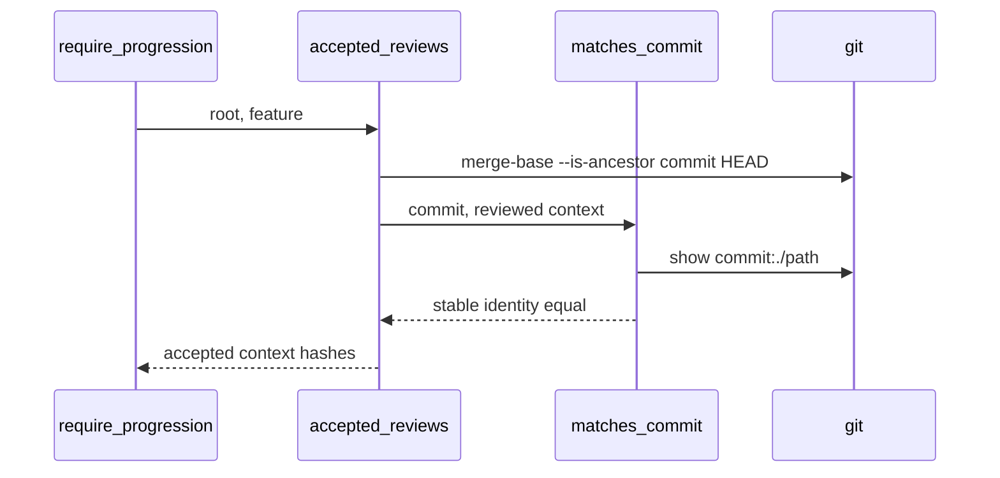

## Summary, Implementation Plan, Testing Strategy, Risks

Python ≥3.11 changes in `validator/semantic/review_context.py`, `validator/semantic/review_stability.py`, `validator/delivery/revision.py`, a new `validator/delivery/revision_commit.py` and `validator/progression_gate.py`; pytest fixtures in a temporary git repository with real receipts. No new dependency; git is already required by the delivery review.

Constitution: ✅1 no new layer; ✅2 no LLM call; ✅3 one prepared-review field and one record field; ✅4 an unverifiable record is refused; ✅5 no new command; ✅6 local only.

- **D-01:** `PreparedReview.source_roles` holds the roles passed to `prepare_review_context`; it is not part of the context hash, which already covers the roles. `reviewed_roles(reviewed)` returns the stored roles, else the roles inferred from the sections as in feature 089.
- **D-02:** `matches_commit(root, commit, reviewed)` extracts `.specs`, the reviewed sources outside it and symlink targets with `git archive <commit>` into a temporary directory, runs `prepare_feature_review` there, and requires the same source names, roles and stable identity, with no error but the budget; replace objects are ignored.
- **D-03:** `open_revision` records `commit` (HEAD) after checking both receipts against it; `accepted_reviews` checks that the commit is an ancestor of HEAD and that each recorded receipt still in place matches it, and raises `RevisionUnverified` otherwise; `require_progression` reports `spec_revision_unverified`.

**Gherkin Scenarios + Mermaid Sequence Diagrams**

```gherkin
Feature: Accept
  Scenario: Verified record
    Given a record opened at a commit matching both reviews
    When the implement progression runs after an AC edit
    Then the recorded receipts are accepted
```



**Implementation Plan, Testing Strategy, Risks**

1. Source roles (FR-001).
2. Commit at open and verification (FR-002, FR-003), protocol documentation.
3. Tests: `tests/test_review_continuity.py`; `tests/stable_review_support.py` commits its project.

Risks: a project outside git cannot open a revision (acceptable: the delivery review already needs git).
