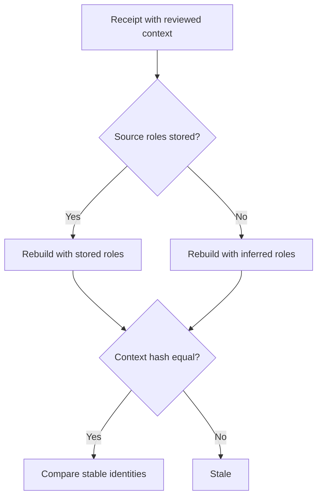
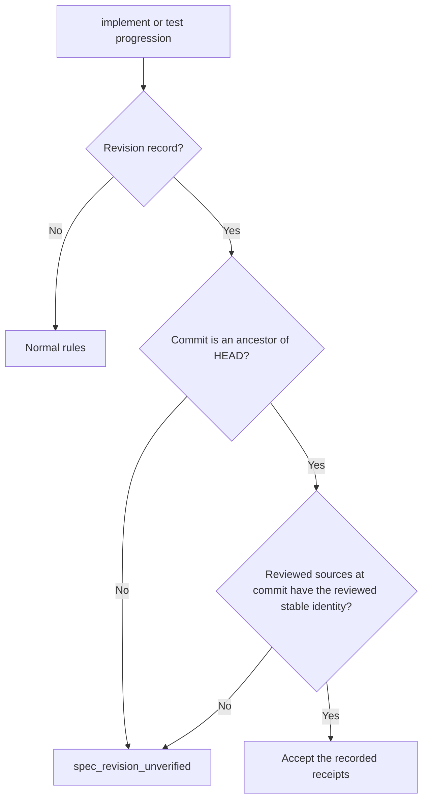

# Feature Spec: Verified Review Continuity

- **Feature:** the reviewed context of a spec or plan receipt names the role of every source, and a spec revision record is verified against the commit it was opened at, so neither an empty linked document nor a hand-written record changes what a review proves
- **Feature Number:** 094
- **Branch:** `feat/lighten-delivery-gates`
- **Date:** 2026-10-14
- **Status:** Draft
- **Input:** Two warnings carried from the feature 089 delivery review (13 October 2026), which the maintainer asked to fix (14 October 2026): an empty linked document whose role is not canonical made a current review fail the stable comparison, and `.reviews/spec-revision.json` was trusted as written, so a hand-written record made the `implement` and `test` progressions accept stale reviews.

## Scope and Source Evidence

- **Observed problem:** `_authentic` (`validator/semantic/review_stability.py`) rebuilds source roles from the stored sections, and an empty source has none, so its role is guessed; `accepted_reviews` (`validator/delivery/revision.py`) returns the recorded context hashes without checking that those reviews were ever current while a revision was open.
- **In scope:** the source roles of a prepared review, the revision record (`commit` field), `revision open` and the acceptance of recorded receipts, `system/review-protocol.md`.
- **Out of scope:** the stable identity rules of feature 089; signing local files (receipts and records stay local evidence).

## Constitution Alignment

- **No silent trust:** a recorded receipt is accepted only when the reviewed sources at the recorded commit, an ancestor of HEAD, have the stable identity the receipt reviewed.
- **CLI surface:** no new command; `livespec delivery revision open` gains one error code.
- **Compatibility:** a receipt without source roles keeps the roles inferred from its sections; a record without a commit is refused, and `close` or deleting it ends the revision.

## User Scenarios & Testing

### Story 1 — An empty linked document keeps the review stable `P2`

**As an** agent, **I want** a review whose sources include an empty linked document to stay current after an edge-case edit, **so that** I do not review again for nothing.

**Priority reason:** a spurious stale verdict costs a full review but never lets a stale review pass.

**Independent test:** Link an empty informative document, review, edit an edge case, verify.

```gherkin
Feature: Source roles
  Scenario: Empty informative document
    Given a spec linking an empty document as informative context
    And current spec and plan reviews
    When an edge case changes
    Then both reviews stay current
```

#### User Flow



### Story 2 — A revision record proves itself `P1`

**As a** maintainer, **I want** the recorded reviews of a spec revision to be checked against the commit the revision was opened at, **so that** writing the record by hand cannot make stale reviews pass implementation.

**Priority reason:** the record is the only thing that lets the `implement` and `test` progressions accept a changed spec.

**Independent test:** Write a record by hand for reviews that never matched a commit, run the `implement` progression.

```gherkin
Feature: Verified revision
  Scenario: Hand-written record
    Given spec and plan reviews that do not match any commit's sources
    And a spec revision record naming them
    When the implement progression runs
    Then it is refused with spec_revision_unverified
```

#### User Flow



## Acceptance Criteria

### AC-001

Prepared reviews carry the role of every source, including sources without sections; the stored reviewed context keeps them, `_authentic` rebuilds with them, and a review whose sources include an empty linked document stays current after an edge-case edit; a reviewed context without stored roles is rebuilt with the inferred roles.

### AC-002

`livespec delivery revision open` records the HEAD commit and refuses with `spec_revision_uncommitted` (exit 1) when the reviewed sources at HEAD do not have the stable identity of the current reviews, or with `spec_revision_unverified` outside a git repository.

### AC-003

While a revision is open, the `implement` and `test` progressions accept a recorded receipt only when the recorded commit, a full object id, is an ancestor of HEAD and the feature review prepared from that commit's tree (source discovery and roles included, no error but the budget) has the receipt's source names, roles and stable identity; otherwise, and for a record without a commit, they are refused with `spec_revision_unverified`.

## Functional Requirements

- **FR-001:** Add `source_roles` to the prepared review, set it in `prepare_review_context`, and use it in `_authentic`. **Maps to:** AC-001.
- **FR-002:** Record the HEAD commit at `revision open` and verify the reviewed sources at that commit. **Maps to:** AC-002.
- **FR-003:** Verify the record in `accepted_reviews` before the progressions use it, and document the verification in `system/review-protocol.md`. **Maps to:** AC-003.

## Key Entities

| Entity | Description | Key Fields |
|---|---|---|
| Prepared review | Review context of feature 078 | source_roles |
| Spec revision record | Feature 089 record | spec, plan, commit, opened_at |

## Edge Cases

- **Opened at a commit, then rebased:** the recorded commit is no longer an ancestor of HEAD; close the revision and open it again.
- **Record written by hand with an older commit at which the reviews were current:** accepted, as if the revision had been opened then; completion still requires current reviews.
- **Linked document added at the commit:** the review prepared at the commit has another source set, so the record is refused.
- **CRLF checkout, symlinked source, local filters or export attributes:** the commit's tree is written from raw objects, so local filters and attributes change nothing; line endings do not change the stable identity or the configuration comparison; a project in a repository subdirectory verifies like one at the top.
- **Uncommitted reviewed sources at open:** refused with `spec_revision_uncommitted`; commit them first.

## Quality Engineering

- **Risk:** Medium criticality; Shared blast radius; primary risk Contract.
- **Applicable dimensions:** fail-safe acceptance, compatibility of 089 receipts and records, git availability. Accessibility not applicable.
- **P0 gates/evidence:** pytest fixtures in a temporary git repository with real ingested receipts: empty linked document, hand-written record, rebased commit, uncommitted sources.

## Success Criteria

| ID | Criterion | How to Measure |
|---|---|---|
| SC-001 | No hand-written revision record makes stale reviews pass the implement progression | Hand-written record fixture |
