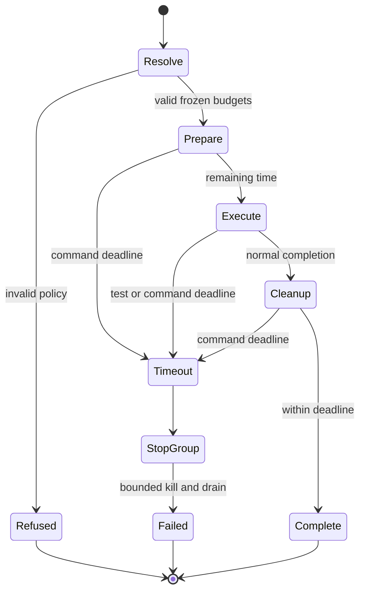

# Technical Plan: Test Time Budgets

## Summary

Extend existing managed execution with one strict budget policy, a shared wall-clock deadline and bounded subprocess termination; instrument existing pytest/Cargo runners and require proportional validation/recovery in agent contracts. No new runner, service or approval system.

## Technical Context

Python ≥3.11, Typer, Pydantic and PyYAML already available; pytest/Ruff/Pyright and Cargo are installed. Storage remains project-local files. Target macOS/Linux POSIX execution; no UI, remote infrastructure or database. The spec review carry-over requires explicit classification and scope matching, resolved below.

## Constitution Check

✅ Layered validation: validate policy before execution. ✅ Provider independence: no model call added. ✅ Filesystem authority: policy/evidence remain local. ✅ Fail fast: invalid declarations refuse before spawn; expiry is unsuccessful. ✅ Minimal composability: extend current entry points and instrumentation. ✅ No hosted infrastructure/dependencies. Keep new Python modules below 300 lines and functions below 50 lines; retain existing capture/public API compatibility through optional fields/defaults.

## Decisions

- **D-01 — Strict policy (FR-004):** Load `.specs/testing/test-budgets.yaml` once at managed entry, before preparation. Missing means fixed defaults: unit 2s, integration 10s, acceptance 30s, command 300s. Schema version 1 has only an `exceptions` list. Each exception has a unique `id`, exact canonical argv `command` (token list), optional exact `test` identity, `category`, nonempty `reason`, explicit `command_seconds` and optional `test_seconds`. Reject extra/duplicate keys, conflicting duplicate scopes, invalid types, nonfinite/nonpositive durations or any duration above 600s. A test-specific exception requires `test_seconds <= command_seconds`. A command-wide exception cannot enlarge unrelated individual tests. No broad wildcard/substring matches. Resolve argv before runner-owned wrapping; exact pytest nodeid or Cargo `binary_id::test_name` matches the collected identity. Existing `timeout` arguments may tighten the resolved maximum, never enlarge it. Benchmark/generation categories require a matching declaration; they have no implicit long default.
  Driver CLI identity is `['livespec', 'test']` followed in order by present canonical `--feature <slug>`, `--mutation`, `--no-coverage` options. Direct capture/capability and nested capability/test scopes use their exact pre-instrumentation argv. A child declaration never raises its enclosing invocation's cap: effective remaining duration is the minimum. A declaration raising a test above the parent's declared command maximum is refused before spawning that test; ordinary elapsed time only reduces remaining execution time. Resolve all declarations from the once-loaded policy.
- **D-02 — Classification (FR-002/004):** Freeze pytest unit/integration/acceptance category from collected markers/path classification before setup; precedence is explicit acceptance marker, integration marker or project `tests/integration/` path, then unit. Refuse conflicting explicit category markers; runtime marker/env changes cannot enlarge the frozen policy. Cargo uses its known test-target kind (integration targets under `tests/` versus unit targets); an exact declared acceptance/benchmark/generation test scope supplies its category. Unknown tests default to unit. Reuse the existing prepared Cargo configuration and pytest plugin context to carry immutable resolved policy, not a mutable caller environment lookup during each test.
- **D-03 — One bounded lifecycle (FR-001/003):** Start monotonic command deadline before managed preparation. The driver invocation shares one deadline across selection, preparation, coverage and mutation; an inner capability/capture never resets it. A direct `run_capability` or `capture_execution` starts its own scope when absent. Bound own Python preparation using a preserving POSIX main-thread alarm/deadline context; fail clearly when the required watchdog cannot be installed. Execute owned commands in a process group/session; on expiry terminate then force-kill ordinary descendants and drain/close pipes within a fixed short cleanup reserve inside the declared envelope. No unbounded `wait`, `communicate` or cleanup. Preserve prior signal state and restore it. No new worker-process architecture; this watchdog is the minimal necessity of AC-001/003.
- **D-04 — Honest evidence (FR-003/005):** Add optional budget provenance/outcome fields to existing result/capture models with compatible defaults for historical receipts. Include scope, category, command/individual limit, elapsed time, enforcement granularity, exception id/reason and diagnostics. Timeout result uses exit 124 at execution boundaries and a nonzero CLI failure; add an explicit certification gap. Do not republish stale reports or translate timeout into an assertion failure/RED assertion. Unsupported frameworks say `command-only` while retaining a hard command cap.
- **D-05 — Supported test watchdogs (FR-002/003):** Wrap pytest's complete runtest protocol (setup/call/teardown), retaining assertion callbacks. A hard watchdog must stop even a hung fixture/teardown and emit timeout identity before terminating; the parent then cleans the owned group. Cargo already launches every test with `--exact`: apply the resolved per-test deadline around that subprocess, including test-owned startup/cleanup; bound its profile/log processing by the enclosing command deadline. Keep listing, compile and instrumentation preparation in the command envelope. Ordinary passing reports/certification retain their existing authority.

## Gherkin Scenarios + Mermaid State Diagrams

```gherkin
Feature: Bounded managed lifecycle
  Scenario: Fixture hangs
    Given a short test whose setup blocks
    When its resolved individual deadline expires
    Then its command stops with a timeout scope and no passing certification
  Scenario: Several capabilities consume one budget
    Given coverage has consumed most of the command budget
    When mutation begins
    Then mutation receives only the remaining time
```



No external API interaction or new database entity: sequence/ER diagrams and API contracts are not applicable.

## Implementation Plan

### Step 1 — Bound the managed command lifecycle

**FR covered:** FR-001.1: Shared command deadline, FR-003.1: Bounded process-group termination, FR-004.1: Strict scoped exception policy, FR-005.1: Compatible timeout evidence

**Prerequisite:** Current spec/plan reviews and implement progression ready.
**Required inputs:** Existing driver/capture APIs, policy decisions D-01/D-03/D-04 and capture regression fixtures.
**Action:** Add small typed modules `validator/test_budgets.py` (policy loading/resolution) and `validator/execution_deadline.py` (deadline context and bounded owned-process execution). Modify `validator/cli_commands/test_cmd.py`, `test_selection.py`, `execution_io.py`, `validator/drivers/runner.py`, `validator/drivers/schemas.py` and `validator/execution_capture.py`: pass one scope across all capabilities (including direct multi-capability API calls), cover preparation and cleanup, normalize timeout and retain evidence compatibility. Update `validator/execution_evidence.py` only if needed to reject new timeout outcomes alongside existing nonzero/gap checks. Mutation failure must propagate instead of a final OK summary. Add `tests/test_test_budgets.py` and `tests/test_execution_deadline.py`; extend existing capture/driver regression tests.
**Execution evidence:** Deterministic policy/deadline assertions plus real subsecond subprocess proof of blocked preparation, child/grandchild termination (including ignored TERM), bounded inherited pipes, shared coverage/mutation deadline, stale-report refusal and unchanged passing captures.
**Success criteria:** AC-001/003/004 pass for captured and uncaptured paths, including direct calls; malformed policy never spawns; limits and gaps are inspectable.
**Failure handling:** Stop on failed guard evidence; diagnose before changing cause. No timeout inflation or identical retry. Emit canonical `ERROR step=1 type=verification_failed retry_count=0 timed_out=false message="<actual failure>"` when unresolved.

### Step 2 — Enforce supported individual test budgets

**FR covered:** FR-002.1: Frozen category and test deadlines, FR-003.2: Stop timed-out individual tests, FR-004.2: Exact declared test matching, FR-005.2: Individual timeout provenance

**Prerequisite:** Step 1 deadline/policy tests pass.
**Required inputs:** Existing `prepare_runner`, pytest plugin and Cargo per-test hook; D-02/D-05.
**Action:** Modify `validator/execution_runner.py`, `validator/execution_pytest.py`, `validator/execution_cargo_hook.py` and Cargo preparation/configuration modules as necessary to inject frozen budgets and implement the full-protocol watchdogs, including uncaptured managed runs without an adapter/feature. Preserve isolated Cargo stdlib-only loading; parent resolves YAML/Pydantic policy and transfers frozen data to a small stdlib runtime helper. Add focused `tests/test_execution_test_budgets.py`; extend existing Cargo/capture tests for classification, exact exceptions, unsupported granularity and assertion evidence preservation. Use separate small helper modules if required by the 300-line convention; no instrumentation for SDK/journey/device runners.
**Execution evidence:** Passing and hanging setup/body/teardown fixtures with injected limits ≤1s; category/default/explicit exception boundary assertions; pytest and Cargo ordinary-result regressions; timeout cannot certify or establish assertion RED.
**Success criteria:** AC-002/003/004 cover 2/10/30s resolved defaults without waiting those durations, exact declared increases and frozen runtime behavior; unsupported frameworks explicitly remain command-only.
**Failure handling:** Stop a failing scope and diagnose. At most one cause-changed evidence-backed retry within the original cumulative budget; unresolved evidence emits canonical `ERROR step=2 type=verification_failed retry_count=0 timed_out=false message="<actual failure>"`.

### Step 3 — Govern proportional plans and validate delivery

**FR covered:** FR-006.1: Requirement-backed volume and budgets, FR-007.1: Bounded evidence-first recovery

**Prerequisite:** Runtime guards and focused regressions pass.
**Required inputs:** Existing minimal-scope/review/execution contracts, relevant skill expectations, runtime upgrade docs and known preflight doctor baseline.
**Action:** Extend `system/minimal-spec-scope.md`, `system/review-protocol.md`, `system/anti-drift-block.md`, `system/testing/execution-rules.md` and existing planning/testing/implementation skill or agent instructions that dispatch tests (with current expectation dates): require minimum dataset/configuration count, FR/AC linkage, individual/aggregate estimates and lifecycle budgets; separate functional proof from capacity measurement. Every added test must prove a specific behavior, risk or regression; remove redundant tests and unjustified exhaustive matrices. Do not rerun an already passing suite without a relevant change, failure or unresolved concern. No arbitrary test quota or counting mechanism. Require native per-test timeout or bounded selection for uninstrumented direct shell runs, stop/diagnose on timeout, no identical relaunch/inflation, and at most one justified retry sharing 300s or a prior declared maximum ≤600s. Update README and existing runtime/migration guidance so pinned consumers receive changes only after updating; no new versioned migration is necessary unless an installed asset requires one. Add a focused instruction-contract check in `tests/test_test_budget_contracts.py`. Repair only the pre-existing doctor blockers needed by the commit hook: factual unfinished feature 035 progress checkpoint and feature 076 stale report/test pointers; do not declare unrelated features completed. Update feature mapping/changelog through normal finalization.
**Execution evidence:** Targeted policy/watchdog/instrumentation/contract and neighboring capture/driver tests; scoped Ruff lint/format, full configured Pyright, spec structural/coherence checks, native delivery review and feature conventions receipt; passing commit hook. Record executed coverage and any runtime gap.
**Success criteria:** AC-005 contracts and all runtime AC evidence mapped; no large capacity matrix or new unrequested approval flow; docs distinguish managed enforcement and agent policy; main commit/push remains owned by supervisor.
**Failure handling:** Stop at the failing gate, report the actual missing evidence and keep validation unresolved. Do not broaden proof volume without requirement justification or bypass hook/review failures.

## Resolved Test Commands

Availability is verified on PATH; these commands are planned, not yet executed evidence.

| Action | Command | Tool | Status |
|---|---|---|---|
| Focused guard tests | `pytest -q tests/test_test_budgets.py tests/test_execution_deadline.py tests/test_execution_test_budgets.py tests/test_test_budget_contracts.py` | pytest | Available |
| Neighbor regressions | `pytest -q tests/test_drivers.py tests/test_execution_evidence.py tests/test_execution_capture_policy.py tests/test_execution_cargo.py tests/test_cli_unified.py tests/test_cli_unified_exit_codes.py` | pytest | Available |
| Lint / format | `ruff check <changed Python files>`; `ruff format --check <changed Python files>` | Ruff | Available |
| Types | `pyright` | Pyright strict project configuration | Available |
| Spec | `livespec validate .specs/features/095-test-time-budgets --format compact` | LiveSpec | Available |
| Full suite | Existing no-LLM command in project strategy, only if focused evidence exposes an unresolved broad regression | pytest | Available; not mandatory large matrix |
| UI / external E2E | Not applicable | — | No UI/remote system |

## Testing Strategy

| Risk / requirement | Smallest sufficient proof | Evidence |
|---|---|---|
| AC-001 / FR-001 command scope | Fake monotonic clock plus short real blocking preparation/subprocess and shared multi-capability test | Guard/driver pytest transcript |
| AC-002 / FR-002 granularity | pytest setup/body/teardown timeout; Cargo exact-test timeout; classification table and command-only fallback | Instrumentation transcript |
| AC-003 / FR-003/005 cleanup and certification | TERM-ignoring child and inherited-pipe fixture, nonzero capture, stale previous report and historical passing receipt regression | Capture/kill assertions and receipt fields |
| AC-004 / FR-004 declarations | Tiny valid/invalid policy table, exact command/test match, CLI knob bypass refusal, inconsistent test/command budget | Policy assertions before-spawn spy |
| AC-005 / FR-006/007 agent behavior | Instruction-contract checks and independent review of proportional test plan/recovery guidance | Contract transcript and review receipt |

Every fixture uses only the minimum few tests/processes needed; no thousands-item datasets or cross-product configuration matrix. Timing fixtures use injected clocks or ≤1s limits and generous bounded scheduling assertions; run one selected suite with a 300s external wrapper and native unit limits, retaining its transcript. At most one evidence-backed retry shares that scope budget. Compilation/setup consumes the same budget; a test proof must not itself wait minutes.

## Risks & Considerations

- **QE:** Medium criticality, shared blast radius, operability primary. Blocking gates cover deadline correctness, evidence compatibility, configuration/CLI behavior and process cleanup; static guidance cannot certify runtime behavior. Data migration, accessibility and new authentication are not applicable.
- Process-group termination targets ordinary owned descendants on POSIX; detached/remote/hostile execution remains outside the guarantee. Do not claim universal interception. Preserve signals and report unsupported installation rather than pretending a watchdog exists.
- Existing plugin loading, Cargo assertion provenance and receipt hashes must remain authoritative. A timeout is never a passing assertion or fresh acceptance report; retain historical receipt readability.
- Consumer runtime pins require explicit update. No mutation of HandoffBox is authorized by this tooling change.
- **Evidence gaps before implementation:** All runtime tests/reviews/conventions receipts are pending; tool availability and this plan alone prove no delivered behavior.
