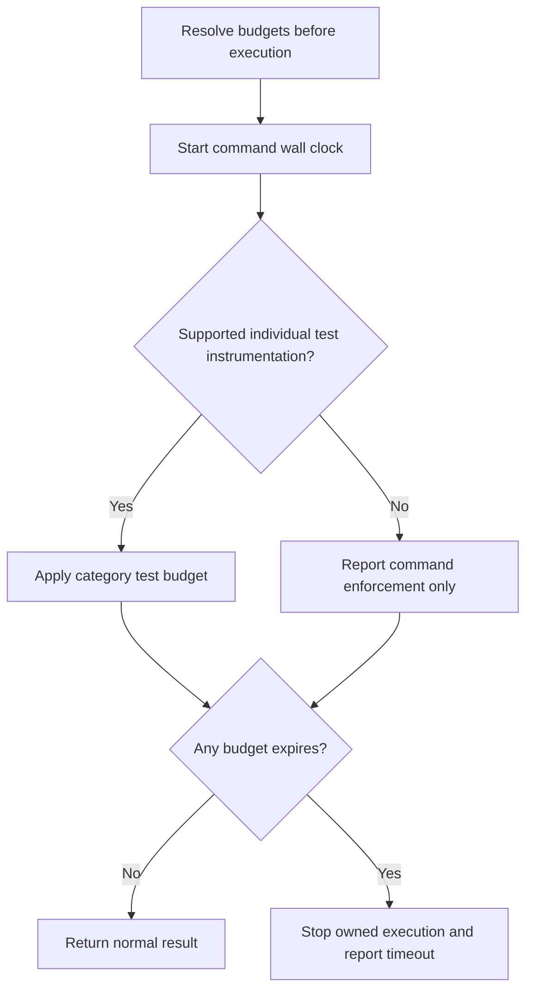
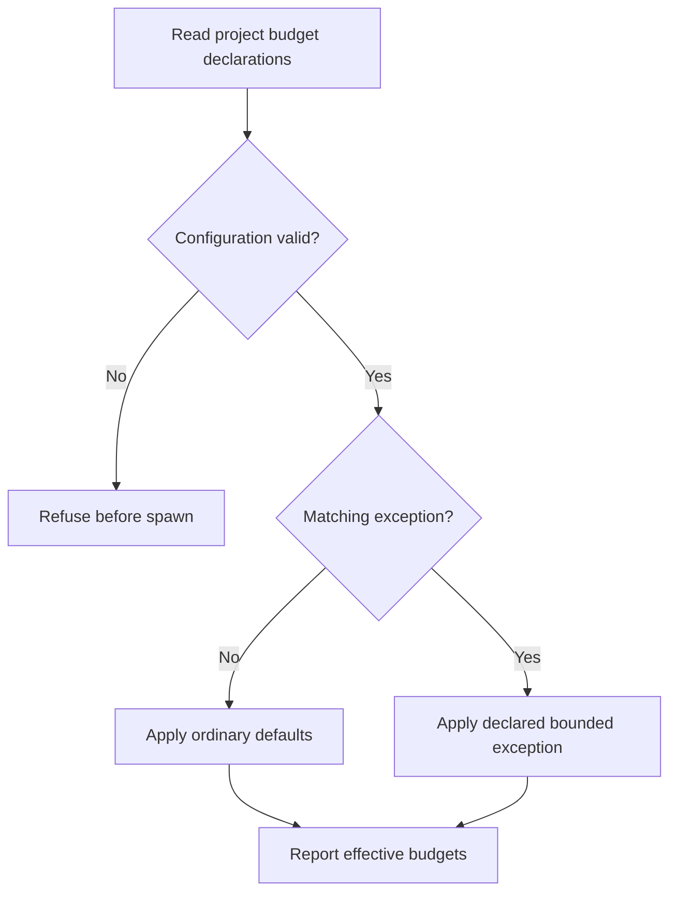
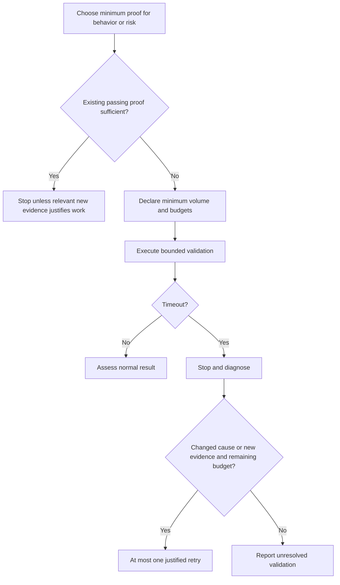

# Feature Spec: Test Time Budgets

- **Feature:** Bound validation work before it becomes a delivery bottleneck
- **Feature Number:** 095
- **Branch:** `main`
- **Date:** 2026-10-16
- **Status:** Implemented
- **Input:** A HandoffBox validation plan promoted a large capacity case into a blocking matrix and retried it for hours. The maintainer requests short ordinary tests, declared exceptions for long tests, and protection against repeating this failure.

## Scope

- Extend the existing `livespec test` driver and captured-execution paths, their pytest and Cargo test instrumentation, and existing planning/testing agent instructions.
- Enforce a command wall-clock budget even for commands whose framework cannot expose individual tests. Report this as command enforcement only; never claim individual-test enforcement without instrumentation.
- Outside these managed paths, agent instructions require the framework's native timeout or a bounded command wrapper before execution. Arbitrary direct shell commands, separately invoked journey/SDK/device runners, hostile test code and remote jobs are outside executable interception in this feature.
- No new orchestration system, benchmark service or CLI command; preserve current evidence/certification authority. Use a strict project policy at `.specs/testing/test-budgets.yaml`.
- Ship through LiveSpec runtime/migration mechanisms; a consumer pinned to an older runtime, including HandoffBox, gains these guards only after updating. Do not silently rewrite consumer projects.

## User Scenarios & Testing

### Story 1 — Ordinary validation stops within its budget `P1`

**As a** developer, **I want** test and command time limits applied automatically, **so that** a broken fixture or test cannot occupy hours.

**Priority reason:** Without executable limits, prose guidance cannot stop the original failure.

**Independent test:** Run tiny temporary projects with a passing test and a deliberately blocked preparation, test or child process through each managed entry point; use shortened injected clocks/budgets in guard tests instead of waiting minutes.

```gherkin
Feature: Bounded ordinary validation
  Scenario: Short tests finish normally
    Given a managed command with unit tests that finish within 2 seconds each
    When the developer runs livespec test
    Then normal test results and existing evidence remain available
    And the command uses a 300 second total wall-clock budget

  Scenario: Preparation or a test exceeds its budget
    Given a managed validation whose preparation or test blocks
    When the applicable command or individual-test budget expires
    Then the owned execution is stopped
    And validation exits unsuccessfully with the applicable budget and elapsed duration
    And the timed-out execution cannot certify acceptance
```

#### User Flow



### Story 2 — A long case has a declared exception `P1`

**As a** developer, **I want** a justified long-running case declared before it starts, **so that** benchmarks and generation jobs stay bounded without weakening ordinary defaults.

**Priority reason:** A timeout must not silently become permission to wait longer.

**Independent test:** Load valid, malformed and mismatched declarations and prove only a valid matching declaration changes the effective limit before spawning.

```gherkin
Feature: Declared long execution
  Scenario: Explicit benchmark exception
    Given a project declaration for a matching benchmark scope
    And the declaration contains its reason, category and a maximum of 600 seconds
    When that scope starts through livespec test
    Then its declared budget applies
    And the result identifies the exception and effective budgets

  Scenario: Missing or invalid declaration
    Given no matching valid long-running declaration
    When a caller requests an increased budget or the configuration is malformed
    Then the increase is refused before execution
    And a previous failure alone cannot authorize an increased limit
```

#### User Flow



### Story 3 — Plans and recovery keep work proportional `P1`

**As a** maintainer, **I want** only tests that prove a relevant behavior, risk or regression and justified retries, **so that** validation does not slow delivery with redundant work.

**Priority reason:** Executable timeouts alone do not prevent repeated expensive launches or unnecessary datasets.

**Independent test:** Inspect planning/testing contracts for a concrete proof purpose, existing-test reuse, bounded volume/recovery and a stop after relevant checks pass; use a short timeout fixture for the unsuccessful-result path.

```gherkin
Feature: Proportional validation and recovery
  Scenario: Existing passing tests already prove the change
    Given existing tests cover the changed behavior and relevant regression risks
    And those tests pass
    When the agent considers adding or repeating tests
    Then it stops validation unless a new change, failure or concrete unresolved concern justifies more proof
    And it does not add duplicate cases or exhaustive matrices without distinct proof value

  Scenario: A reviewer suggests a large counterexample
    Given a review proposes a 16385-item capacity case
    When the agent prepares the validation plan
    Then it links the case to an actual requirement or marks it optional
    And it states the minimum useful volume, configurations and time budget
    And the review suggestion alone does not create a blocking benchmark

  Scenario: A validation times out
    Given a validation exceeded its declared budget
    When the agent handles the failure
    Then it stops that validation and reports the scope, elapsed time and available diagnostics
    And it does not repeat the same attempt or raise the limit automatically
    And a retry requires a documented changed cause or new evidence within the cumulative budget
```

#### User Flow



## Acceptance Criteria

### AC-001

Ordinary managed validation uses a 300-second total command wall-clock cap, starting before command-owned preparation and including execution and cleanup. The entire `livespec test` driver invocation shares this budget across its invoked capabilities; captured execution has the same cap. A timeout cannot produce a successful or certified result. Existing successful runs retain their normal result/evidence behavior.

### AC-002

Supported individual instrumentation (pytest and Cargo) applies defaults of 2 seconds per unit test, 10 seconds per integration test and 30 seconds per acceptance test, including that test's setup and teardown. Unclassified tests default to unit. Unsupported individual instrumentation retains the command cap and explicitly reports that individual limits are not enforced; workflow instructions require native per-test limits or explicitly bounded selection before such execution.

### AC-003

The result records effective command and, where supported, individual limits and matching exception identity/reason. On timeout, the managed runner stops its owned subprocess group, including ordinary descendants, with bounded termination escalation and no unbounded wait for cleanup. It returns nonzero and reports the command/test scope, effective limit, elapsed duration, enforcement granularity, available diagnostics and timeout outcome. A timeout is distinguished from an assertion failure and never enters certified acceptance as a passing test.

### AC-004

Long-running exceptions are strict project declarations in `.specs/testing/test-budgets.yaml`, read and validated before spawn, scoped to the selected command/test, and contain a nonempty reason, category, explicit maximum and target scope. Categories include benchmark and generation. Every declared test or command duration is positive, finite and at most 600 seconds; an increased test duration also requires a sufficient declared command budget. Missing, malformed or unmatched declarations cannot authorize an increase; malformed active configuration fails before spawn. Ordinary defaults remain unchanged outside the declared scope. Existing CLI timeout knobs cannot silently bypass the declared maximum.

### AC-005

Existing agent planning/review/testing contracts require each proposed test to prove a named observable behavior, changed branch, concrete risk or regression. Reuse adequate existing tests; do not add tests solely to increase their number, duplicate covered cases or build exhaustive matrices without distinct proof value. Once relevant checks pass, stop validation; broaden or repeat it only for a new change, failure or concrete unresolved concern. This is a semantic necessity/proportionality rule, not a mechanical test-count quota. Contracts also require requirement linkage, minimum representative dataset/configuration count, individual and aggregate time estimates, and budgets for proposed expensive validation. A reviewer counterexample becomes a blocking capacity test only when an actual requirement justifies that scale; otherwise it is optional. Functional correctness proof remains separate from capacity measurement. Testing/generation instructions apply the same command budget to preparation, data generation and cleanup.

Existing agent execution/recovery contracts stop a timed-out scope, diagnose and report it, prohibit an identical automatic retry and prohibit timeout inflation based solely on failure. They allow at most one retry per validation scope after a documented changed cause or new evidence; initial attempt and retry share a cumulative budget of 300 seconds, or the explicitly declared long-command maximum up to 600 seconds. Exhaustion leaves validation unresolved and blocks its success claim. This agent retry policy is documented separately from runner-enforced individual/command limits and does not claim persistent interception of arbitrary shell invocations.

## Functional Requirements

- **FR-001:** Apply a shared ordinary command wall-clock budget to the existing managed test execution entry points. **Maps to:** AC-001.
- **FR-002:** Apply category-specific individual budgets in supported test instrumentation and report unsupported granularity honestly. **Maps to:** AC-002.
- **FR-003:** Stop owned execution on expiry with bounded termination and an actionable unsuccessful timeout result. **Maps to:** AC-003.
- **FR-004:** Validate scoped long-running declarations before execution and refuse implicit timeout increases. **Maps to:** AC-004.
- **FR-005:** Preserve effective budget provenance and timeout outcome in existing execution evidence without relaxing certification. **Maps to:** AC-003.
- **FR-006:** Require necessary behavior/risk/regression-backed tests, reuse of sufficient existing proof, no redundant expansion or repetition, proportional validation volumes and declared lifecycle budgets in existing planning/review/testing guidance. **Maps to:** AC-005.
- **FR-007:** Require a stop, diagnosis, changed-evidence retry and cumulative budget policy in existing agent recovery guidance. **Maps to:** AC-005.

## Key Entities

| Entity | Purpose | Fields |
|---|---|---|
| Test budget | Effective execution limits | category, individual seconds, command seconds, enforcement granularity |
| Long-running exception | Prior declared reason for a scoped increase | target scope, category, reason, maximum seconds |
| Timeout result | Existing execution evidence extended with budget outcome | scope, elapsed, limit, exception, status, diagnostics |

## Edge Cases

- A tiny test with expensive fixture/data generation still consumes the command clock; individually instrumented test fixtures also consume the individual clock.
- A command invokes multiple capabilities: they share remaining command time rather than receiving a fresh 300 seconds each.
- A child ignores graceful termination: bounded forced termination follows; deliberately detached descendants and remote jobs are outside the guarantee.
- A valid 600-second individual exception with an ordinary 300-second command budget is inconsistent and refused before spawn.
- An old passing report exists when the new command times out: the new attempt cannot certify with the old report.
- A framework lacks individual hooks: it cannot claim 2/10/30-second enforcement; its command is still forcibly bounded.
- Unit, integration and acceptance classification and exception matching are resolved before execution; test code is not allowed to enlarge a declared maximum during a run.

## Clarifications

- The maintainer additionally requires only necessary tests, without redundant test generation or repetition that slows the process.
- The maintainer accepted the proposed ordinary defaults (2/10/30 seconds and 5-minute command), prior exceptions up to 10 minutes and no automatic timeout escalation.
- Retry/cumulative limits govern agent behavior; persistent anti-retry storage across unrelated CLI invocations is outside scope. The runner enforces each invocation's declared time bounds.
- No UI or new external infrastructure is involved. Separate journey, SDK, device and hostile-code execution surfaces remain outside this feature's executable enforcement.

## Quality Engineering

- **Risk:** Medium criticality; Shared blast radius; primary risk Operability.
- **Applicable dimensions:** functional correctness of deadlines, regression of evidence capture and driver execution, CLI/config compatibility, performance bounds and actionable diagnostics. Data migration, accessibility and new authentication are not applicable.
- **Expected evidence:** deterministic deadline/config tests; real short subprocess fixtures for timeout/descendant cleanup and stale-report refusal; pytest and Cargo classification checks; regression of ordinary passing capture/driver behavior; static instruction/contract checks for proportional scope and retry policy. No large benchmark or minutes-long waiting is required to prove these guards.
- **Boundary:** review judges scope and contracts; tests prove actual termination and evidence behavior. Existing certification remains authoritative. Unsupported framework granularity is an explicit limitation, not a successful per-test enforcement claim.

## Success Criteria

| ID | Criterion | How to Measure |
|---|---|---|
| SC-001 | Managed test execution never waits without a finite effective command budget | Entry-point and blocked-child fixtures |
| SC-002 | Ordinary supported tests and declared long cases use their resolved limits | Category and exception fixtures |
| SC-003 | A timeout cannot produce passing acceptance evidence or justify an identical automatic retry | Capture/certification regression and instruction checks |
