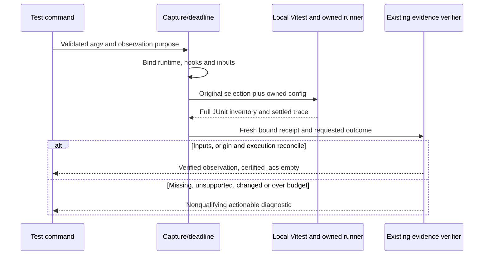
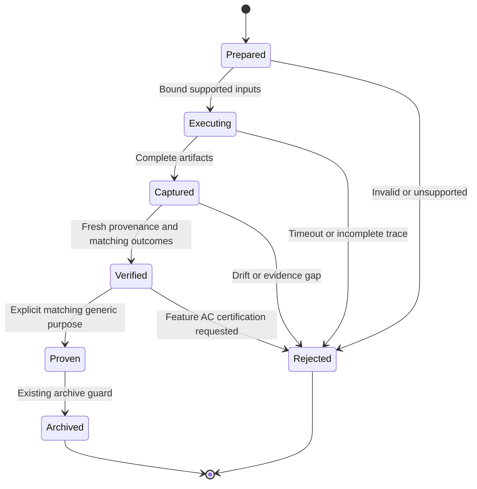

# Technical Plan: Node Vitest Execution Observations

## Summary

Extend the existing capture pipeline with an owned local Node 22/Vitest 2.1.x observer, expose explicit passed/red observations, and preserve strict AC acceptance and immutable history.

## Technical Context

| Aspect | Choice | Reason |
|---|---|---|
| Host | Python >=3.11, Typer, Pydantic | Existing CLI, deadline and evidence authority |
| Observed runtime | Genuine Node 22 and project-local Vitest 2.1.x; verify 2.1.9 | Bounded requested compatibility |
| Instrumentation | Small TypeScript ESM config/runner/reporter assets | Vitest/Vite transforms TS; no new consumer build or dependency |
| Transport | Existing JUnit plus strict runner-owned assertion trace | Reuse capture/evidence models and archive purposes |
| Storage | Existing local capture/run files | No database, service or telemetry |
| Platform | macOS/Linux POSIX | Existing command deadline and process-group cleanup |
| Test host | pytest, Ruff, Pyright | Existing deterministic toolchain |

Scope M: six FR, one execution-observation domain. One sequence and one state diagram; no database schema, UI, Penflow or HTTP API contract. No npm-script/npx fallback, general JS-to-AC mapping, workspace aggregator or multi-receipt goal engine.

## Constitution Check

- Pass, layered validation: reject arguments/provenance before spawn; verify runtime trace before goal proof.
- Pass, provider independence: no new model/provider dependency.
- Pass, filesystem authority: retain capture artifacts and existing immutable run archives; no hidden state.
- Pass, fail fast: actionable unsupported-version/form/config/selection diagnostics and existing exit conventions.
- Pass, minimal composability: one optional flag on `test`, existing observer and generic outcome marker.
- Pass, no hosted infrastructure: use installed local dependencies only.
- Pass, naming/structure: snake_case Python, kebab-case TypeScript assets; split focused modules before 300 lines, public typed/documented interfaces. The owned Node bridge is not a new CLI product; existing Typer parsing remains authoritative. Any necessary minimal native ESM loader must have a documented typing/build justification, not a second application stack.

## Infrastructure Setup

Verify the selected Node binary, package-local Vitest installation and npm lock before execution; the observation transport never installs packages and the original consumer dependencies/pins remain unchanged. Node 22.23.3 was observed at `/Users/julienm/.npm/_npx/52027bd8fc0022aa/node_modules/node/bin/node`. At planning time both `dashboard/node_modules` and `slides/node_modules` are absent under `/private/tmp/codex-brainstorm-ci-20261016`; preflight resolves a resident installation or explicitly prepares dependencies with npm ci in an isolated test copy whose source/config/lock identities match. The parent authorized this test preparation; the observer itself never installs dependencies and the original consumer remains untouched.

## Decisions

- **D-01, genuine command and provenance (FR-001/003/004):** Accept only a direct resolved Node 22 executable plus the selected project's confined locally installed `vitest/vitest.mjs`, `run`, confined file filters, optional `--root` and test-name filter. Use argv, never shell evaluation. Reject watch/workspace/project/config/runner/reporter/output/coverage/pool/plugin overrides and unknown options rather than silently changing their semantics. Resolve real paths and reject shadow/symlink escapes. Verify Node identity and version using the actual binary under the same deadline, bind its bytes, Vitest package/version and entry, actual loaded Vitest/runner/expect/Vite dependency files, owned assets, effective arguments and npm lock. Bind package manifest, configuration and transitive local config/setup imports even when ordinary source discovery ignores them; ordinary manifests still bind source/tests. Recompute bound identities after execution and before proof/archive. A copied package name/version alone is insufficient. Keep existing cooperative local threat model: this is not isolation from arbitrary hostile JavaScript with same-user access.
- **D-02, preserving config (FR-002/003/004):** Vitest 2.1.9 disables CLI `--runner`; never pretend this flag works. Prepare an ephemeral owned TS config in the capture directory that loads and evaluates the original governed configuration using its real config environment/root and the local Vite/Vitest APIs, then overlays only owned runner/reporter/output and tightening timeout controls. Preserve consumer include/exclude, setup and environment semantics. Resolve imports through the bound local modules rather than an arbitrary global installation. Reject an existing custom runner/reporter or unsupported config lifecycle instead of dropping it. Package all required TS assets through setuptools and verify an installed wheel can locate them; no editable-install-only success.
- **D-03, actual matcher execution (FR-002):** Extend the real `VitestTestRunner`, retaining superclass hooks. Observe built-in matcher dispatch and its synchronous/async settlement in the actual test context, with invocation nonce, source callsite, selected task identity and attempt. Assertion creation counters, prototype assertion counts, reporter summaries and bare `expect` are never matcher evidence. Use an explicit supported built-in matcher allowlist including the fifteen requested consumer methods (`toBe`, `toEqual`, `toMatchObject`, `toBeUndefined`, `toContainEqual`, `toHaveLength`, `toContain`, `toThrow`, `toMatch`, `toBeNull`, `toBeGreaterThan`, `toBeGreaterThanOrEqual`, `toBeLessThan`, `toHaveBeenCalledWith`, `toHaveBeenCalled`) and their supported negation/resolves/rejects forms. `toString` is not an assertion. Finalize after teardown/fixtures/onFinished, not just after the body. Reject selected custom matchers/`expect.extend`, concurrent tests, direct Chai, poll/alternate expect or unknown paths unless the observer genuinely covers them; do not quietly omit unsupported dispatch. Retry attempts must not merge to fabricate a passing final test.
- **D-04, async feasibility checkpoint (FR-002):** Before widening support, prove paired real Vitest 2.1.9 fixtures distinguish awaited/returned assertions from Vitest's automatic awaiting. Track consumer consumption of the returned thenable independently from observer-owned settlement: observer callbacks must not mark an unawaited assertion consumed. Merely reading `.resolves`/`.rejects`, catching/finally or seeing a settled promise cannot prove explicit await/return. Validate both successful and failing async dispatch. If the instrumented boundary cannot make this distinction, stop with the exact unsupported diagnostic and report the requirement unresolved; never certify by guessing or use warning text alone as positive evidence.
- **D-05, complete selection (FR-002/006):** Reconcile the reporter's complete collected task inventory, final outcomes and full file/suite/test identity against owned trace records; duplicates or ambiguous identities fail closed. Every executed selected test must have its own settled supported matcher; a passing assertion in one test cannot hide another empty/bare-expect/no-assert test. Preserve skipped/todo records visibly; they contribute no matcher evidence, and a skip/todo-only or zero-test selection never qualifies. Unsupported selected tests invalidate the run. Passed requires overall success; red requires an actual failed matcher joined to a failed test, never collection/setup/crash/timeout alone. For AC-006 both requested selections must account for exactly all 46 and 55 tests with no omission or skipped replacement, independently checked from their two artifacts.
- **D-06, observation boundary (FR-001/005):** Add `--execution-observation passed|red` to the existing native test I/O mode; require feature plus execution-command, reject incompatible mapping/derive/prepare/ingest/driver modifiers before project resolution. Capture with no acceptance mapping, call existing `verify_execution_observation`, emit `certified_acs=[]`, and return success only for a verified requested observation (a genuine red capture may have test exit 1). Keep acceptance-mode `_verify`, JS assertion anchor/mapping refusal and final feature acceptance unchanged. Add the existing `outcome:passed` marker only to canonical generic spec-implement task016; newly rendered contracts adopt it. For this delivery, hash the old contract/state/rejection artifacts, run official `goal render spec-implement --save` with the same active flags, require a different hash and new file paths, and compare old hashes afterwards. Never prove/archive the old pair: automatic in-place recompilation can discard rejected attempts. `goal status --state` is read-only; render has no latest pointer. Never reinterpret an empty historical outcome or hand-edit immutable contract/state/archive bytes. Existing archive purpose separation already supports this marker.
- **D-07, budgets (FR-004):** Reuse the current deadline beginning before preparation, including runtime/module/config resolution and hashes, spawn and cleanup. Native Vitest timeouts only tighten existing limits; freeze applicable test/hook timeout controls and honestly report command-only granularity where the framework cannot enforce full lifecycle limits. Keep the outer process-group hard cap and cancellation cleanup. Expiry is nonqualifying exit 124 with scope/limit/elapsed/granularity, never matcher RED. No identical timeout retry, automatic inflation or unrelated repeated full suite.

## Gherkin Scenarios + Mermaid Sequence Diagrams

```gherkin
Feature: Local observer interaction
  Scenario: Verify one fresh selection
    Given unchanged governed inputs and supported local Node and Vitest
    When the existing capture API executes the owned observer
    Then the reporter inventory and settled matcher trace reconcile
    And the verifier rechecks provenance before accepting observation
    And no AC is certified
```



## Gherkin Scenarios + Mermaid State Diagrams

```gherkin
Feature: Immutable observation lifecycle
  Scenario: Preserve rejected history
    Given a historical rejected immutable contract and archive
    When an official new run or recompile creates an explicit passed task
    And a new valid observation proves that task and is archived
    Then the new task is complete under its own contract
    And the old rejection retains its original bytes and interpretation
```



## Implementation Plan

### Step 1 — Prove the real Vitest observation boundary

**FR covered:** FR-002.1: Dispatch and async feasibility

**Prerequisite:** Current reviewed spec/plan, Clarify/Analyze and preflight ready.
**Required inputs:** D-02/D-03/D-04, installed Node 22 and local Vitest 2.1.9, existing trace schema.
**Action:** Add focused `tests/test_execution_vitest.py` and fixture support in `tests/execution_vitest_fixture.py`; introduce small owned TS assets under `validator/vitest/` (config, runner, matcher observer and reporter). Start with real dispatch/settlement and exact source/task attribution, superclass-preserving lifecycle and paired awaited/returned versus unawaited async fixtures. Check actual TS loading/config preservation before committing the implementation approach. Add only the minimum assets necessary for FR-002; split responsibilities rather than one large generated script.
**Execution evidence:** Real local fixture output and trace proving sync pass/fail, bare-expect refusal, async pass/fail and explicit-consumption separation; teardown fixture confirms finalization timing. Save exact command, versions, elapsed time and actual diagnostics.
**Success criteria:** AC-002 feasibility is demonstrated with actual matchers, including Vitest auto-await, with no report/count-only evidence or observer-induced consumption.
**Failure handling:** Stop on indistinguishable async semantics or unsupported loading; emit canonical ERROR step=1 with actual diagnostic, retain the evidence and report unmet AC-002. Do not proceed by weakening qualification.

### Step 2 — Bind and integrate the owned runner

**FR covered:** FR-001.1: Local Node Vitest capture, FR-002.2: Complete selected test reconciliation, FR-003.1: Runtime input artifact provenance, FR-004.1: Confined argv and shared deadline

**Prerequisite:** Step 1 boundary proof passes.
**Required inputs:** D-01/D-02/D-03/D-05/D-07; current capture, scope, deadline, JUnit and trace contracts.
**Action:** Add `validator/execution_vitest.py` for preparation/selection and focused provenance support module(s) only as needed. Modify `validator/execution_runner.py`, `execution_evidence.py` provenance dispatch and existing capture/scope modules where necessary to bind explicit ignored config/lock dependencies. Reuse JUnit/trace schemas; modify report parsing only for a demonstrated exact-ID need. Include TS assets in `pyproject.toml`. Enforce full inventory/trace reconciliation, unsupported selected forms and fresh identity checks at production/consumption/archive. Extend the same focused Vitest tests with distinct substitution, tamper, origin, selection and timeout failures.
**Execution evidence:** Genuine local capture receipts plus rejection assertions for wrong Node/version or shadow module/entry, unbound config/lock/runtime mutation, nonce/replay/artifact tamper, duplicate/mismatched identity, noassert/zero/skip-only/custom/concurrent/Chai and bounded preparation/runtime termination. Prove preservation of original config selection using a real config fixture. Verify packaged asset availability from a built wheel.
**Success criteria:** AC-001 through AC-004 capture requirements hold; wrong provenance never falls back to qualifying pytest evidence; timeout cannot qualify as red or passed.
**Failure handling:** Stop and diagnose a failing branch before edits/retry. A timeout has no identical retry or raised limit; at most one changed-cause retry shares the original command envelope. Report canonical ERROR step=2 with exact failure.

### Step 3 — Expose observation purpose and preserve acceptance

**FR covered:** FR-001.2: Explicit CLI observation mode, FR-005.1: Generic passed purpose and strict acceptance

**Prerequisite:** Step 2 captures pass focused integrity checks.
**Required inputs:** Existing `verify_execution_observation`, outcome-specific goal policy and archive receipt readers; D-06.
**Action:** Modify `validator/cli_commands/test_cmd.py`, `operation_options.py` and `execution_io.py` with an optional observation argument and early contradiction validation; route observation before mapping loading. Add `outcome:passed` to the existing generic execution line in `.agent-sync/skills/spec-implement/SKILL.md` and update its paired expectations review date and affected references. Extend `tests/test_native_test_option_matrix.py`, `test_execution_evidence.py`, `test_bugfix_goal.py` and relevant archive-purpose tests. Do not weaken `_verify`, JS mapping/anchors or historical evidence policy. Demonstrate official new goal/render with different hash/paths and before/after historical hashes rather than editing or proving the old pair.
**Execution evidence:** Real fresh observation proves generic passed task and archive guard; same receipt fails feature AC acceptance. Strict red/pass mismatch, missing matcher/setup-only red and contradictory CLI options reject. Historical rejected goal/archive bytes and interpretation stay unchanged; observation output has empty certified ACs and no acceptance mapping.
**Success criteria:** AC-001/005 pass, existing pytest/Cargo and all-review acceptance contracts remain intact.
**Failure handling:** Stop on any acceptance/history regression and emit canonical ERROR step=3; no compatibility fallback that reinterprets old contracts.

### Step 4 — Verify both unchanged consumer selections

**FR covered:** FR-003.2: Consumer input identity comparison, FR-004.2: Original bounded selections, FR-006.1: Two complete independent observations

**Prerequisite:** Steps 1-3 pass and preflight supplies installed local dependencies in the isolated test copy; no consumer lifecycle work.
**Required inputs:** Original Brainstorm dashboard/slides sources, configs, manifests/locks and requested 46/55 inventories; supported Node binary and new official observation CLI.
**Action:** Snapshot relevant consumer input identities and git status read-only. Execute two official `livespec test` observation commands, each containing direct Node/local Vitest argv, the original package root and its complete requested selection; retain two fresh receipt/artifact sets. Compare original/after identities, verify each result independently through the public observer verifier, and record all test identities/counts in feature delivery evidence. Keep old rejected artifacts unchanged. Do not resume/finalize/pipeline-update consumer feature 042 or change source/config/tests/dependencies/filters.
**Execution evidence:** Actual two command transcripts, separate receipt paths and nonce identities, complete 46/55 final inventories (101 accounted), verifier results and unchanged consumer identity comparison. Delivery review receives both full results; neither one representative matcher nor the generic task claims exhaustive coverage.
**Success criteria:** AC-006 passes with two fresh supported observations and no consumer input diff; unavailable dependencies or wrong counts remain an explicit gap.
**Failure handling:** Stop on mismatch, missing dependency, mutation or timeout and report canonical ERROR step=4. Never repair the consumer, shrink the selection, install a shadow framework or copy another run's receipt.

### Step 5 — Document and verify delivery compatibility

**FR covered:** FR-001.3: Document supported observation use, FR-002.3: Document unsupported semantics, FR-003.3: Delivery provenance review, FR-004.3: Budget and selection guidance, FR-005.2: Regression and new-run guidance, FR-006.2: Review both consumer results

**Prerequisite:** Earlier evidence exists; targeted checks pass.
**Required inputs:** Focused new tests, existing nearby regression tests, both consumer receipts and reviewed scope.
**Action:** Update root `README.md`, applicable execution docs/skill references and CI to exercise the real Node 22/Vitest 2.1.9 observer with explicitly installed test-only dependencies in CI, without adding consumer installation behavior. Resolve strict TypeScript asset checks using existing local tools or CI's fixture toolchain; no consumer dependency edit. Add feature implementation/progress mappings with actual Python integration assertion anchors for all six feature ACs; these assert real observer behavior, never fabricate consumer JS-to-AC mapping. Run targeted Python/Cargo regressions and static checks once; use the full-lane final independent review and audit on the complete diff, including both complete consumer results and cooperative threat-model limits. Parent handles authorized PR/remote delivery and immutable no-activate snapshot separately.
**Execution evidence:** AC mapping, focused test/lint/type results, current full-lane review/audit receipts, wheel asset check and complete delivery evidence index. Explicit no-general-JS-certification and official runtime/new-run instructions in docs.
**Success criteria:** All six feature ACs have actual evidence; generic observations cannot certify consumer ACs; reviews and required gates pass with no fabricated evidence or global runtime activation.
**Failure handling:** Retain unresolved gaps and canonical ERROR step=5; address blockers through current review protocol, never manufacture ready receipts or relax baseline/history.

## Resolved Test Commands

| Action | Command | Tool | Status at plan |
|---|---|---|---|
| Focused behavior | `uv run --locked --extra dev --extra integration pytest tests/test_execution_vitest.py -q` | pytest | uv found; new file planned |
| CLI/purpose regression | `uv run --locked --extra dev --extra integration pytest tests/test_native_test_option_matrix.py tests/test_execution_evidence.py tests/test_execution_capture_policy.py tests/test_bugfix_goal.py tests/test_acceptance_execution_join.py -q` | pytest | Existing files; not executed by Plan |
| Capture regression | `uv run --locked --extra dev --extra integration pytest tests/test_execution_collection_errors.py tests/test_execution_assertion_origin.py tests/test_execution_scope_links.py tests/test_execution_environment.py tests/test_execution_test_budgets.py -q` | pytest | Existing files; not executed by Plan |
| Cargo compatibility | `uv run --locked --extra dev --extra integration pytest tests/test_execution_cargo.py -q` | pytest/Cargo | Confirm installed Cargo in preflight |
| Type check | `uv run --locked --extra dev pyright validator/` | Pyright strict | Executable found |
| Lint/format | `uv run --locked --extra dev ruff check validator/ tests/` and `uv run --locked --extra dev ruff format --check validator/ tests/` | Ruff | Executable found |
| TS checks | Strict `tsc --noEmit` plus formatter/linter for owned assets using fixture/CI toolchain | TypeScript/Biome | Resolve exact local binaries in Step 1; not installed by Plan |
| Consumer selections | Two `livespec test --feature <consumer-owner> --execution-command '<node22> <local-vitest> run --root <package>' --execution-observation passed --report-adapter junit` invocations | Existing CLI, Node/Vitest | Node verified; both local node_modules absent at stated checkout |
| Full suite | No new local full-suite invocation planned | pytest | Only broaden for a concrete unresolved risk; existing CI remains authoritative |

The consumer command owner/project must resolve the existing actual feature without mutating its lifecycle; final exact argv and roots are recorded by execution, not invented from placeholders here.

## Testing Strategy

| Level | Distinct proof | Files/artifacts | FR/AC |
|---|---|---|---|
| Real integration, P0 | Dispatch versus counts, sync/async outcomes and consumption, teardown attribution, unsupported/missing matcher | New Vitest fixture/tests and genuine trace | FR-002; AC-001/002 |
| Boundary, P0 | Real argv/config preservation, runtime/input/artifact identity, replay and deadline refusal | Vitest tests plus existing capture scope/environment/budget tests | FR-003/004; AC-003/004 |
| CLI/goal/archive, P0 | Observation without mapping, explicit passed generic task, red/pass mismatch, no final acceptance substitution, immutable old policy | Option matrix, execution evidence, goal/archive regressions | FR-001/005; AC-001/005 |
| Real acceptance, P0 | Exactly 46 and 55 unchanged requested tests in two fresh verified runs | Two consumer receipts, inventories, before/after identity evidence | FR-006; AC-006 |
| Compatibility, P1 | Existing genuine pytest/Cargo and documentary acceptance behavior | Relevant existing tests above | FR-005; AC-005 |
| Packaging/static, P1 | Assets present outside editable checkout; host/TS typing and style | Built wheel inspection, strict checks, CI fixture | FR-001/003; AC-001/003 |

Use minimum fixtures for each distinct rejection branch; reuse adequate passing nearby tests. Real fixture cases are integration (10s each), consumer acceptance cases 30s each; command cap 300s including preparation/generation/cleanup, no new exceptions planned. Expected tiny-fixture cases are subsecond to a few seconds; the two consumer commands each retain a separate existing bounded capture envelope and no capacity benchmark. These are functional correctness proofs at the exact AC-006 volume, not a scalability target.

## Quality Engineering

- **Criticality:** High; **Blast radius:** Shared; **Primary risk:** Contract; confidence remains Medium pending Step 1 runtime proof.
- **qe_dimensions_considered:** Functional correctness, regression, CLI/evidence contract compatibility, immutable-history integrity, provenance/argument security posture, bounded performance, operability diagnostics; accessibility is not applicable.
- **qe_gates_required:** P0 actual async feasibility before expansion; P0 complete selection/provenance/budget refusal; P0 generic/final-acceptance/archive separation; P0 both unchanged consumer runs; P1 existing adapters and installed assets/static checks; final full-lane independent review/audit.
- **qe_expected_evidence:** Actual fixture transcripts/traces, fresh receipts, meaningful refusal assertions, unchanged-history checks, two complete consumer result sets, identity comparison, targeted regressions, current review/audit and finalization receipts.
- **qe_gaps_or_missing_evidence:** No implementation evidence yet; consumer node_modules absent at observed path; exact TS checking toolchain awaits preflight. No generalized JS AC certification is planned or claimed.
- **qe_boundary_note:** QE declares gates. Implement/Test produce evidence; independent review/audit evaluate design/provenance limits and both complete runs. Parent owns remote shipping/runtime snapshot; consumer feature 042 lifecycle and later runtime upgrade/resume remain outside this feature.

## Risks & Considerations

- High: Vitest async internals may make explicit consumption hard to observe. Step 1 blocks before any claim; do not infer from auto-await or warning absence.
- High: observer wrappers can accidentally count themselves or miss setup/teardown/custom assertion paths. Bind real origins, reject unsupported paths, and reconcile the whole selection.
- High: runtime/config substitution and stale proof cross shared goal/archive authority. Recompute bound inputs on consumption and retain existing policy-version interpretation.
- Medium: TS assets must load from packaged snapshots through local Vite. Demonstrate wheel availability and actual config import semantics, without a new build service.
- Medium: both real consumer dependency installations are currently missing at the stated checkout. Resolve this evidence gap through the parent-authorized isolated npm-ci preparation or verified resident dependency copy; compare original source/config/lock identities and never alter the canonical consumer.

## Next Action

After validated independent plan review and parent Analyze/preflight gates, run `/spec-implement 096-node-vitest-execution` with the reviewed carry-over and conventions.
