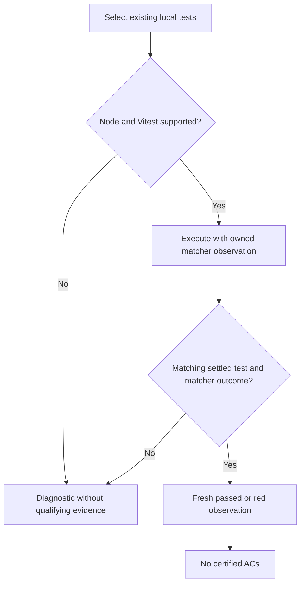
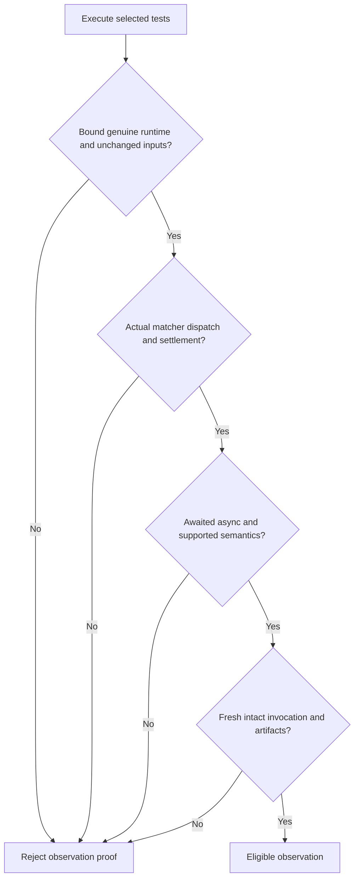
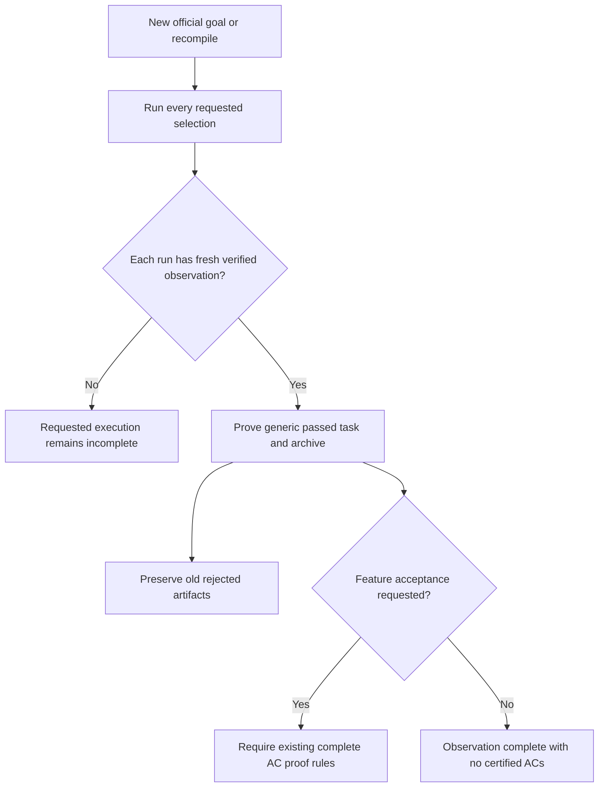

# Feature Spec: Node Vitest Execution Observations

## Header

- **Feature:** Node Vitest Execution Observations
- **Branch:** `feature/096-node-vitest-execution`
- **Date:** 2026-10-16
- **Status:** Implemented
- **Input:** Observe genuine execution of existing Brainstorm Vitest tests on Node 22 without modifying either consumer package or substituting a framework. Preserve strict feature acceptance and historical rejected runs.
- **Feature Number:** 096
- **Scope:** M; one execution-observation domain, no UI or Penflow input.

## User Scenarios & Testing

### Story 1 - Observe an existing local Vitest run `P1`

**As a** developer, **I want to** observe executed matchers in my existing tests, **so that** a real local run can prove a generic execution step.

**Priority reason:** The existing Node consumer cannot supply genuine execution evidence through the supported adapters.

**Independent test:** Run a small unchanged local Vitest fixture with a passing matcher, then a failing matcher, and inspect each fresh receipt and its goal proof.

```gherkin
Feature: Genuine Vitest observation
  Scenario: Observe a passing test
    Given Node 22 and a locally installed supported Vitest 2.1.x project
    And a selected test executes and passes a supported built-in matcher
    When livespec test runs with execution-observation passed
    Then a fresh execution receipt identifies the passed test and executed matcher
    And certified_acs is empty
  Scenario: Observe a failing matcher
    Given a selected test executes a supported built-in matcher that fails
    When livespec test runs with execution-observation red
    Then the fresh receipt records the executed failing matcher and failed test
    And the receipt cannot prove a passed execution step
```



### Story 2 - Reject incomplete or substituted evidence `P1`

**As a** workflow owner, **I want to** reject evidence without executed matcher provenance, **so that** a green process or report cannot masquerade as a test observation.

**Priority reason:** False execution evidence undermines the shared completion gates.

**Independent test:** Exercise one genuine run and focused negative fixtures for each distinct provenance or execution rejection branch.

```gherkin
Feature: Observation integrity
  Scenario: Reject a test without a dispatched matcher
    Given a test is empty or calls only bare expect without a matcher
    When an execution observation is requested
    Then no qualifying execution receipt is accepted
    And the diagnostic identifies missing executed matcher evidence
  Scenario: Reject unawaited asynchronous assertions
    Given a test calls an asynchronous built-in matcher without awaiting or returning it
    And Vitest automatically settles it and warns
    When an execution observation is requested
    Then the observation is noncertifying and cannot prove passed or red execution
  Scenario: Reject substituted or stale provenance
    Given the run uses a shadow runner or stale or tampered evidence
    When the receipt is produced or consumed or archived
    Then the run cannot establish execution proof
    And a diagnostic identifies the unsupported or mismatched provenance
```



### Story 3 - Use observations without widening acceptance `P1`

**As a** LiveSpec user, **I want to** prove each requested execution run while preserving final acceptance, **so that** adapter support does not certify unproven requirements.

**Priority reason:** Generic execution and final feature acceptance have different proof obligations.

**Independent test:** Prove a new generic passed step from a fresh observation, reject it at feature-AC acceptance, and verify two complete separately bound consumer runs without consumer edits.

```gherkin
Feature: Observation proof boundaries
  Scenario: Prove a generic execution task
    Given a new or officially recompiled goal declares a generic outcome passed execution task
    And a fresh valid observation contains a passed test and executed passed matcher
    When the observation is proved and its run archived
    Then the generic task and archive guard accept the bound evidence
    And the observation does not replace feature acceptance proof
  Scenario: Preserve historical rejection
    Given an earlier immutable goal rejected unsupported Node execution evidence
    When a new supported runtime run and goal are created through official commands
    Then the new run is evaluated against its own current contract
    And the historical contract and rejected archive keep their original interpretation
  Scenario: Observe every requested consumer run
    Given the existing Brainstorm packages contain 46 and 55 requested tests respectively
    When both complete selections run on Node 22 with their locally installed Vitest
    Then each selection has its own fresh verified execution evidence
    And all 101 requested tests are accounted for by those two runs
    And neither consumer source nor tests nor filters nor dependencies are rewritten
```



## Acceptance Criteria

AC-001: The existing `livespec test` command accepts explicit `--execution-observation passed|red` for Node 22 and locally installed Vitest 2.1.x (verified with 2.1.9). A passed observation requires at least one executed passed supported matcher in a passed test and a successful overall selected run; red requires at least one executed failing supported matcher associated with a failed test. A setup failure alone cannot qualify as red. Receipts retain actual test and matcher outcomes, including unsuccessful cases, without fabricating success.

**Evidence:** execution

AC-002: Observations identify actual built-in matcher dispatch, exact test/source origin and settlement. Bare `expect()`, assertion counters alone, JUnit alone, empty or zero-test runs, skipped/todo-only runs and tests without executed matchers cannot qualify. Awaited or returned supported asynchronous matchers can qualify; any unawaited asynchronous built-in assertion, including Vitest 2.1.9 auto-await with a warning, prevents qualifying proof for that run. Initially custom matchers, concurrent tests and direct Chai assertions fail closed when selected; unsupported forms produce actionable diagnostics.

**Evidence:** execution

AC-003: Every qualifying receipt is bound to a fresh invocation and genuine Node binary, local Vitest/runner/expect modules, owned observation hooks, project, source/test/configuration and npm lock identity, arguments and artifacts. Substituted executables/modules/hooks, stale/replayed or tampered receipts/artifacts, changed bound inputs during execution or before consumption/archive, and mismatched test origins fail closed. Retain the existing local threat model; do not claim a JavaScript same-process sandbox against arbitrary hostile code.

**Evidence:** execution

AC-004: Test file/name selection uses validated argument vectors with bounded subprocess execution, never shell interpolation or a shadow executable. No automatic installation or consumer dependency/configuration/source/test/filter rewriting is allowed. Preparation and runtime share the existing execution budgets and cancellation/timeout cleanup; over-budget preparation or execution yields nonqualifying evidence and an actionable diagnostic.

**Evidence:** execution

AC-005: A new or officially recompiled generic implementation-step execution task explicitly declares `outcome:passed`; a fresh observation with a real observed passed matcher and passed test can prove that task and its archive guard. Observations always emit `certified_acs=[]`, need no `acceptance_mapping`, and cannot satisfy feature-wide AC acceptance. Existing strict final acceptance, documentary review AC exclusion from runtime certification, pytest/Cargo evidence and old immutable goal/rejected-archive interpretations remain unchanged.

**Evidence:** execution

AC-006: Delivery uses two official test commands and demonstrates fresh separate verified observations for the existing Brainstorm selections of 46 and 55 tests on Node 22/local Vitest 2.1.x, with all requested tests accounted for and unchanged consumer inputs. Independent delivery review checks both complete results; the generic goal claims only its passed observation. No new multi-receipt/workspace mechanism is introduced. A representative matcher, one run or copied receipt cannot claim all 101 tests. Fresh official runs/contracts after the runtime upgrade preserve older rejection artifacts.

**Evidence:** execution


## Functional Requirements

- **FR-001:** Add opt-in passed/red execution observations to the existing test command for genuine local Node 22/Vitest 2.1.x execution; retain test outcomes and diagnostics (AC-001).
- **FR-002:** Observe supported matcher dispatch and settlement with exact test/source attribution, reject the non-evidence and unsupported forms in AC-002, and distinguish explicit async consumption from automatic settlement (AC-002).
- **FR-003:** Bind and verify invocation, runtime, observation hooks, inputs and artifacts at production, proof and archive boundaries; reject substitution, mutation, stale or tampered evidence (AC-003).
- **FR-004:** Validate bounded local selection arguments, retain shared preparation/execution budgets and preserve consumer files/dependencies without automatic installation (AC-004).
- **FR-005:** Support explicit generic `outcome:passed` observation proofs without AC mapping, preserve final acceptance and other adapters, and use official new-run/recompile paths without retroactively changing immutable history (AC-005).
- **FR-006:** Account separately for every requested consumer run, including the 46-test and 55-test Brainstorm selections, without consumer modifications (AC-006).

## Key Entities

- **Execution observation:** Fresh runner-owned evidence of test and dispatched matcher outcomes; never an AC certification.
- **Invocation provenance:** Bound runtime/module/hook identities, arguments, project/input identities and resulting artifacts.
- **Generic execution task:** An explicit expected observed outcome distinct from a feature acceptance task.

## Edge Cases

- Missing/wrong Node or local Vitest, unsupported version, configuration/load errors: actionable nonqualifying result; no install or framework fallback.
- A mixed selection with passing assertions and unrelated run failure cannot prove passed; skipped/empty/no-matcher tests remain visible and do not add matcher evidence.
- Rejected selection arguments, custom matcher, concurrency or direct Chai use: fail closed rather than silently omit their tests.
- Async settlement after test completion, auto-await warning, mutated owned hooks or input files, stale receipt and wrong source origin: reject proof.
- Old contracts are immutable; runtime upgrades require official new run/recompile behavior, preserving archived historical rejection.

## Success Criteria

- **SC-001:** Genuine passing and failing local Vitest runs produce separately bound observable matcher evidence; every defined negative integrity branch rejects qualifying proof.
- **SC-002:** Both existing Brainstorm selections account for 101 tests in two fresh verified runs with no consumer diff.
- **SC-003:** Generic observation proof succeeds while unsupported feature AC certification remains explicitly insufficient; targeted pytest/Cargo and immutable-history regression checks pass.

## Quality Engineering

- **Criticality:** High
- **Blast radius:** Shared
- **Primary risk:** Contract
- **Confidence:** Medium: runtime feasibility requires actual Vitest instrumentation and later test evidence.
- **qe_dimensions_considered:** Functional correctness, Regression risk, API/contract compatibility, Data/migration integrity (immutable history), Security posture (provenance and argument boundaries), Performance/scalability (shared bounded budgets), Observability/operability. Accessibility/UX is not applicable to this non-UI adapter.
- **qe_gates_required:** P0 real Node/Vitest matcher execution and negative integrity tests; P0 generic/final-acceptance separation and archive checks; P1 targeted existing-adapter regressions; independent spec/plan and final delivery review.
- **qe_expected_evidence:** Actual command transcripts, runner-owned receipts and artifacts, focused failure-branch tests, two complete consumer selection receipts, before/after consumer identity comparison, targeted regression results and current review receipts.
- **qe_gaps_or_missing_evidence:** No implementation/runtime proof exists at specification time. No general JS assertion-to-AC mapping is included; Vitest observations cannot certify consumer runtime ACs in this scope.
- **qe_boundary_note:** QE defines evidence gates; implementation/tests produce execution proof and independent review judges the provenance limits and contracts. This spec does not replace security review or final feature acceptance.
- **Non-functional expectations:** Reuse current execution limits including preparation; no new capacity targets, telemetry, cache, installation or hosted infrastructure.

## Clarifications

- Accepted scope: observation-only adapter; generalized JavaScript AC mapping/anchors, Jest, other frameworks, fake JUnit/pytest mirrors and consumer changes are excluded.
- Initial supported semantics: built-in nonconcurrent Vitest matchers, including explicitly awaited/returned asynchronous assertions when actually observed; unsupported selected forms fail closed.
- A real test run proves execution of its complete selection; one passing assertion never establishes all 101 requested tests.
- No independent domain split, emerging roadmap dependency or absorption is required. Existing execution/goal/finalization contracts are reused.
- The Brainstorm packages are integration subjects of this LiveSpec tooling session only: source reads and before/after identity comparison are allowed; no consumer feature 042 lifecycle, pipeline, finalization or resume is part of AC-006. Consumer runtime upgrade/resume belongs to a separate session after feature 096 delivery.
- Preflight ownership remains with the parent pipeline: local Node 22 and Vitest must exist; no automatic dependency installation is part of this feature.

## Infrastructure Requirements

- Local Node 22 binary and project-local Vitest 2.1.x/npm lock for actual execution; no remote service or credentials.
- Informative: [Vitest assertion creation](https://github.com/vitest-dev/vitest/blob/v2.1.9/packages/vitest/src/integrations/chai/index.ts#L16-L33) explains why a bare expect counter is insufficient.
- Informative: [Vitest asynchronous assertion handling](https://github.com/vitest-dev/vitest/blob/v2.1.9/packages/expect/src/utils.ts#L14-L68) describes automatic awaiting.
- Informative: [Vitest custom runner hooks](https://v2.vitest.dev/advanced/runner) and [test execution](https://github.com/vitest-dev/vitest/blob/v2.1.9/packages/runner/src/run.ts#L170-L315) provide implementation context rather than additional normative dependencies.
