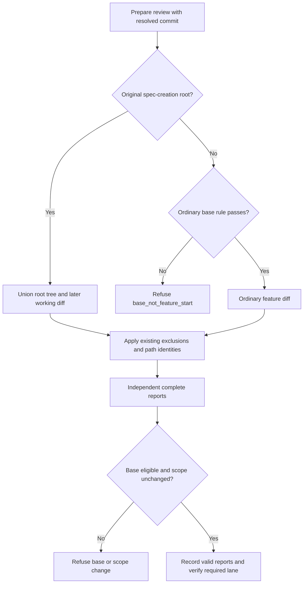

# Feature Spec: Root Feature Delivery Review

## Header

- **Feature:** Root Feature Delivery Review
- **Branch:** `codex/fix-root-feature-delivery-review`
- **Date:** 2026-10-17
- **Status:** Implemented
- **Feature Number:** 096
- **Input:** Support complete delivery review for a feature created in the repository root commit, including mixed bootstrap commits, without rewriting consumer history.

## Scope

- This feature supersedes only the root-baseline portion of feature 086 AC-003: the exact parentless commit that first created the selected feature spec is a valid base even when it contains paths outside that feature directory. Its SHA identifies the logical empty state before the root, rather than excluding the root's contents. The same exception governs the base checks consumed by 086 AC-004 and AC-006.
- All other 086 rules remain unchanged: lane selection, report validation, review independence, correction caps, existing traceability exclusions, path identities and lifecycle metadata normalization. Non-root base eligibility is unchanged.
- Informative: inspect [086's original contract](../086-risk-proportional-delivery/spec.md) for the prior base rule and shared review rules.
- No new command, flag, receipt schema, Git object, index write, history edit, consumer rebootstrap or history rewrite is introduced. Existing scope/receipt writes remain confined to their feature's review cache.

## User Scenarios & Testing

### Story 1 — Review a root-created feature completely `P1`

**As a** maintainer, **I want** a delivery review bound to the original root commit to cover bootstrap content and later work, **so that** a feature can close with verifiable complete scope.

**Priority reason:** a root commit has no parent; excluding it can hide the entire initial implementation.

**Independent test:** create temporary repositories whose parentless commit first adds the selected spec, alone or alongside documentation, other draft specs and application code; exercise prepare, record and verify with the original SHA and an ineligible later SHA.

```gherkin
Feature: Root-created feature delivery scope
  Scenario: The original mixed root commit is reviewed completely
    Given a parentless commit R first creates the selected feature spec and bootstrap files
    And later work modifies a bootstrap file, deletes another and adds an untracked source file
    When the maintainer prepares a delivery review using R
    Then the scope base_commit is R
    And the scope contains every root-tree path and later diff path except existing traceability exclusions
    And the deleted bootstrap path is identified as deleted
    When independent reviewers record valid complete PASS reports for the required lane
    Then delivery review verification succeeds

  Scenario: A newer base cannot omit the bootstrap tree
    Given a selected feature spec first committed in parentless commit R
    And HEAD is a later descendant N
    When the maintainer prepares a review using N
    Then preparation refuses with base_not_feature_start
    When a prepared scope or recorded receipt substitutes N for R
    Then record or verify refuses with base_not_feature_start

  Scenario: Scope currency preserves lifecycle metadata but detects real changes
    Given complete PASS reports recorded against root commit R
    When only normalized lifecycle metadata in a scoped spec or plan changes
    Then verification remains current
    When a scoped source file or normative spec or plan content changes
    Then record and verify refuse with scope_changed
```



## Acceptance Criteria

### AC-001

Given the selected spec was first committed in a parentless commit R that is an ancestor of HEAD, prepare accepts that exact resolved SHA as the base, regardless of whether R contains only the feature directory or mixed bootstrap files. The existing base_commit field remains R; no synthetic Git revision is written. Story 1, P1.

### AC-002

For that root base, the scoped paths are the union of every recursively inventoried path in R and every later tracked change (staged or unstaged) plus untracked non-ignored files, minus existing traceability exclusions. Root bootstrap files remain included when unchanged or later deleted; a root-created feature spec or plan is included even when its normative content still equals R. Story 1, P1.

### AC-003

Prepare, record and verify derive identical scope identities: ordinary file SHA-256, `deleted` for absent paths, link target for symlinks without following them, submodule commit for gitlinks, and normative hashes for feature spec/plan files. Normalized lifecycle metadata alone leaves a root spec/plan identity unchanged; changing normative content or any other scoped identity, adding a scoped path or deleting a scoped path makes record and verify refuse with `scope_changed`. Story 1, P1.

### AC-004

For root-created features, a later descendant, unrelated commit or otherwise ineligible base refuses with `base_not_feature_start` at prepare, record and verify, including when substituted into a saved scope or receipt. A never-committed spec remains refused. For non-root spec creation, the existing parent-or-older rule and feature-only creating-commit exception remain unchanged; an ordinary mixed creating commit remains refused. Story 1, P1.

### AC-005

With an unchanged root scope, existing valid complete reports for every kind required by the lane record and verify successfully; omission of any scoped bootstrap path refuses with `scope_not_covered`. The exception changes no existing traceability exclusions, report checks, reviewer independence, correction limits, lane policy, ordinary lifecycle-only exclusion, or CLI/receipt shape. Story 1, P1.

### AC-006

Preparing, recording and verifying the root review leave Git object inventory, index bytes and commit/ref history unchanged. They require no consumer history edit or rebootstrap; only the existing feature review-cache writes occur. Temporary-repository tests compare those Git states before and after the review cycle. Story 1, P1.

## Functional Requirements

- **FR-001:** Accept the original parentless spec-creation commit as a root baseline identity while preserving every other base restriction. **Maps to:** AC-001, AC-004.
- **FR-002:** Include the entire bootstrap tree and later working changes under existing exclusions and path/lifecycle identities. **Maps to:** AC-002, AC-003.
- **FR-003:** Apply the same root semantics at prepare, record and verify without weakening complete-report or currency checks. **Maps to:** AC-003, AC-004, AC-005.
- **FR-004:** Preserve Git storage, index and history and retain the existing CLI and cache boundaries. **Maps to:** AC-001, AC-005, AC-006.

## Key Entities

| Entity | Meaning | Identity |
|---|---|---|
| Root baseline | Logical empty state preceding the original parentless spec-creation commit | Original full commit SHA |
| Complete review scope | Root-tree paths union later working diff, less existing exclusions | Path to existing file/deleted/link/gitlink/normative identity |
| Delivery receipt | Existing independent reports and current scope | Existing feature, base_commit, kind and report fields |

## Edge Cases

- A bootstrap path deleted after R stays in scope as `deleted`, so the root inventory cannot be reconstructed solely from current files.
- A spec/plan present in R stays in root scope despite no normative change; ordinary non-root lifecycle-only exclusion remains applicable outside the exception.
- Root-only, mixed bootstrap and mixed source-code commits have the same root eligibility rule.
- Existing traceability artifacts are excluded even when present in the root tree.

## Quality Engineering

- **Criticality:** High. A faulty scope can certify an incomplete delivery or block the core closure workflow; a forged newer base can conceal changes.
- **Blast radius:** Shared. Only delivery scope/base preparation and its record/verify consumers change.
- **Primary risk:** Contract. **Confidence:** Medium until isolated repository evidence and independent review are current.
- **qe_dimensions_considered:** functional correctness (complete bootstrap union), regression (ordinary bases), API/contract compatibility (same fields/reason codes), data integrity (Git unchanged), security posture (link identity without traversal), performance (one bounded repository inventory per scope), operability (existing refusal reasons). Accessibility/UX is not applicable to this CLI-only scope.
- **qe_gates_required:** P0 root eligibility, scope equality/currency and Git-state checks; P1 ordinary-base and report-validation regressions; independent spec/plan and final delivery reviews plus existing conventions checks.
- **qe_expected_evidence:** deterministic pytest fixtures in temporary Git repositories for AC-001 through AC-006, checking exact path sets/identities and command refusal reasons; one complete prepare-record-verify cycle; current review receipts and AC-to-assertion mapping.
- **qe_gaps_or_missing_evidence:** implementation and runtime acceptance are pending; the uncommitted candidate is context, not proof of this feature's delivery.
- **Non-functional expectations:** no new dependencies, network calls, Git mutations or consumer migration; reuse targeted sufficient tests rather than repeated full suites. No new capacity/latency target is introduced.
- **qe_boundary_note:** QE defines required evidence; implementation/testing execute it, independent review/audit inspect defects and contract compatibility, and delivery gates certify the result.

## Clarifications

- Approved scope: add a bounded dedicated contract rather than rewrite 086's implemented requirements; supersede only its root-baseline restriction, preserving the remainder.
- Approved behavior: the root SHA identifies the logical pre-root empty state, and bootstrap content is reviewed even when unchanged.
- No unresolved business choices or emerging dependencies; existing delivery review primitives supply the required capabilities.

## Success Criteria

| ID | Criterion | How to Measure |
|---|---|---|
| SC-001 | Every scoped root-tree and later diff path has the required identity and no unauthorized base is accepted | Exact fixture path/identity assertions and negative base assertions |
| SC-002 | A complete root review verifies without any Git storage/index/history mutation | Successful review cycle and before/after Git-state equality |
