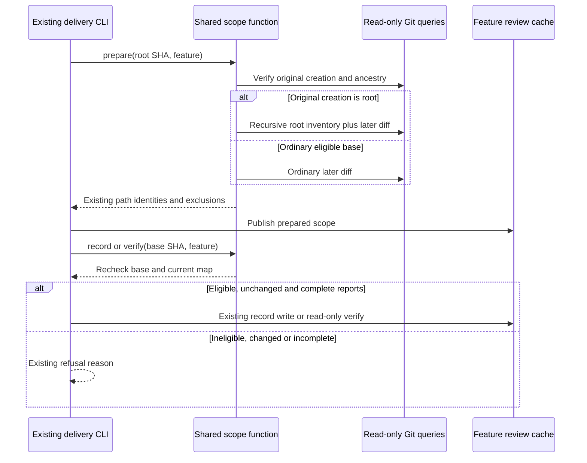
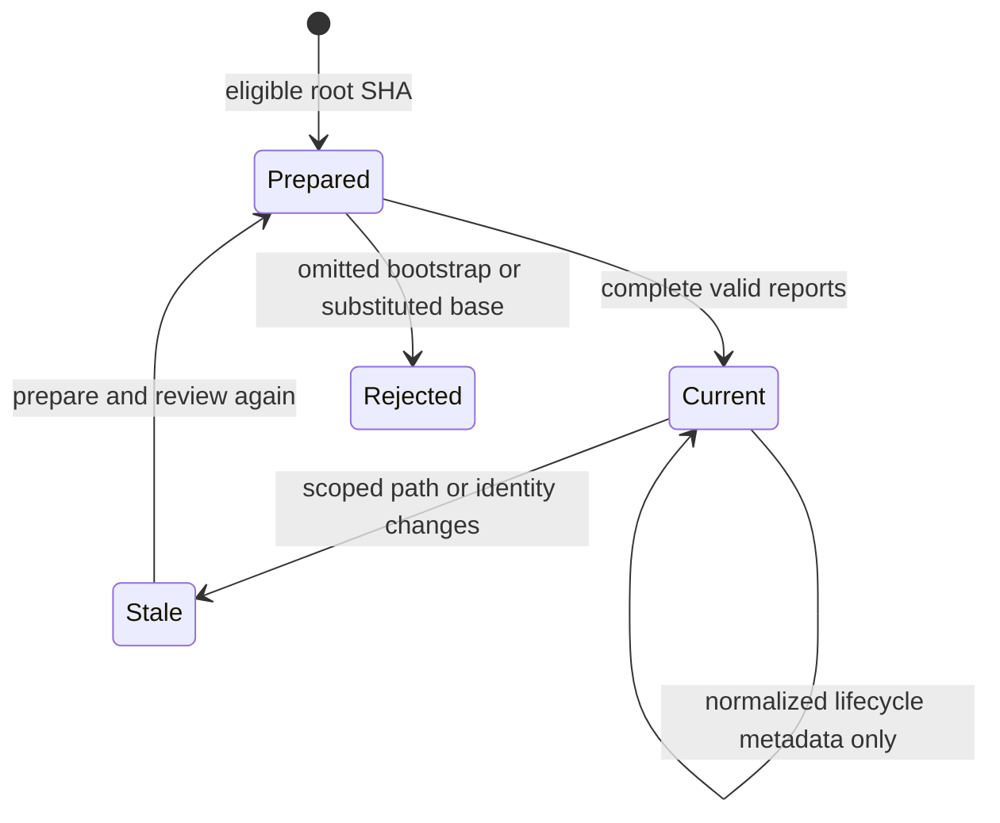

# Technical Plan: Root Feature Delivery Review

## Summary

Treat the exact original spec-creation root SHA as the logical pre-root baseline. Reuse existing delivery scope identities and exclusions, union the root tree with the later working diff, and recompute the same scope at prepare, record and verify. Two local steps; no new command, dependency, receipt field or Git mutation.

Informative: inspect the [candidate scope code](../../../validator/delivery/review_scope.py), [review consumers](../../../validator/delivery/review.py), [root regressions](../../../tests/test_delivery_review_root.py) and [ordinary base regressions](../../../tests/test_delivery_review_base.py). These uncommitted candidates and their earlier passing checks are implementation context, not feature 097 acceptance evidence.

## Technical Context

| Aspect | Choice | Reason |
|---|---|---|
| Runtime | Python 3.11+; system `python3` here | Existing stack; this interpreter exposes validator and pytest |
| CLI and data | Existing Typer commands and strict Pydantic reports | Preserve CLI/receipt shape and boundary validation |
| Git access | Existing `_git`, `collect_diff`, `base_problem` | Read-only queries with existing timeout/error handling |
| Identity | Existing `_identity`, normative hash and exclusions | Preserve byte/deleted/link/gitlink/lifecycle behavior |
| Tests | pytest temporary repositories, existing delivery fixtures | Real Git behavior without consumer mutation |
| Quality | Ruff and Pyright strict; conventions gate | Existing project checks |
| Infrastructure | None | No network, new storage, external API, UI or provisioning |

## Constitution Check

| Principle | Result |
|---|---|
| Layered validation | Pass: reuse delivery validation; no new layer |
| Provider agnostic | Pass: deterministic runtime code; independent native review remains external to scope calculation |
| Filesystem authority | Pass: only existing feature `.reviews/` writes; Git queries never store application state |
| Fail fast | Pass: retain `diff_unavailable`, `base_not_feature_start`, `scope_changed`, `scope_not_covered` and existing exits |
| Minimal composable surface | Pass: no new flag/command/schema, cache, retry layer or abstraction |
| Local operation | Pass: temporary-repository proof; no hosted service or new dependency |
| Test isolation and traceability | Pass: tests stay in temporary repositories; qualified 097 mappings bind exact executed assertions |

## Scope Decisions

- FR-001 / AC-001, AC-004: resolve the supplied base to its full SHA, retain the existing ancestor and first spec-creation checks, and accept only that creating commit when parentless. Preserve the non-root parent-or-older rule and feature-only exception; reject later, unrelated and uncommitted-spec bases before scope calculation. The selected feature binds the exception, rather than accepting any parentless commit containing an arbitrary path.
- FR-002 / AC-002, AC-003: use NUL-delimited recursive `git ls-tree` output for root paths, union those paths with `collect_diff` entries, then apply existing traceability exclusions. Keep unchanged root specs/plans in this root-only scope; ordinary non-root lifecycle-only omission remains unchanged. Later deletions remain inventoried as `deleted`; use the existing identity function for bytes, symlink targets without following the final link, staged gitlink commit and normative spec/plan hashes. Lifecycle-only changes retain the normalized identity; real identity/path changes invalidate currency.
- FR-003 / AC-003, AC-004, AC-005: pass the selected feature into the shared scope function at prepare, record and latest-round verification. Every stage rechecks eligibility and compares the same path/identity map. Preserve report coverage, checks, independence, correction caps and lane selection. Existing feature-only root receipts missing newly included paths must be stale and cannot silently pass.
- FR-004 / AC-001, AC-005, AC-006: retain the original root SHA and all CLI/receipt fields. Query Git only through the existing read-only helper with optional locks disabled. Add no `hash-object -w`, `write-tree`, staging, reset, commit, ref update or consumer migration. Scope and receipt publication keep their existing confined feature review-cache boundaries.

## Gherkin Scenarios and Mermaid Sequence Diagram

```gherkin
Feature: Root review cycle
  Scenario: Complete bootstrap review
    Given the feature was first created in root commit R
    When prepare unions R's tree with later working changes
    And independent complete reports are recorded and verified
    Then the stored base remains R and verification succeeds
    And Git objects, index bytes and history are unchanged

  Scenario: Refuse hidden bootstrap content
    Given a root scope was prepared
    When a report omits a bootstrap path or a saved base becomes a later commit
    Then coverage or base validation refuses the operation
```



## Gherkin Scenarios and Mermaid State Diagram

```gherkin
Feature: Root scope currency
  Scenario: Metadata stability and real change
    Given complete PASS reports for root scope R
    When normalized lifecycle metadata alone changes
    Then the reports remain current
    When a normative document or another scoped identity changes
    Then record and verify refuse with scope_changed
```



No ER diagram or API contract: no new data entity/table or external endpoint is introduced.

## Implementation Plan

### Step 1 — Align the candidate root baseline and protocol

**FR covered:** FR-001.1: Preserve root and ordinary eligibility; FR-002.1: Union root paths and existing identities; FR-003.1: Share scope across review stages; FR-004.1: Keep original SHA and read-only Git.

**Prerequisite:** Current spec/plan reviews and shared Analyze readiness.
**Required inputs:** Approved 097 spec, current scope consumers and existing exclusions/identity helper.
**Action:** Inspect and retain or minimally correct the existing candidate in `validator/delivery/review_scope.py` (`base_problem`, `_root_feature_base`, `current_scope`) and `validator/delivery/review.py` (prepare, record, latest-pass verification). Update `system/delivery-review.md` to explain root SHA semantics, the root-tree union, exclusions and reviewer inputs (`git show --format= --root <root-sha>` plus later diff and untracked content). Add 097 traceability where the exception is implemented; leave 086's unrelated spec/plan rules untouched.
**Execution evidence:** Bounded diff against the baseline, Ruff/Pyright outputs and targeted eligibility/identity regressions from Step 2.
**Success criteria:** AC-001 through AC-005 use identical root semantics; ordinary bases and report policies retain their prior behavior. No added dependency, public command or receipt field.
**Failure handling:** Fix only observed eligibility/identity/consumer failures, rerun affected checks after the change, and stop for a remaining shared progression or review blocker.

### Step 2 — Close distinct regression and acceptance evidence gaps

**FR covered:** FR-001.2: Assert eligible and rejected bases; FR-002.2: Assert complete normalized root identities; FR-003.2: Prove coverage and currency refusals; FR-004.2: Prove Git state and API stability.

**Prerequisite:** Step 1 candidate matches the reviewed design.
**Required inputs:** Existing root/base tests and temporary-repository fixtures; final test assertion sources.
**Action:** Inspect the current `tests/test_delivery_review_root.py` candidate and retain its existing assertions; extend only for proof still missing: root spec and plan lifecycle-only stability, real normative and source changes refused by record/verify, root symlink/gitlink identity, omitted-bootstrap report refusal, and byte-for-byte Git state equality across a complete successful cycle. Reuse the existing root-only/mixed/code variants and forged-newer-base cases; reuse ordinary base, uncommitted-spec, unrelated-base and report-policy tests where sufficient. Add a small nonparametrized temporary-repository case only when it supplies an uncovered assertion. For AC-006, snapshot the local fixture's complete object-ID inventory, raw index bytes, HEAD and refs/history after fixture setup and compare after prepare, record and verify; all setup mutations precede the snapshot. Observe no Git operations beyond existing read-only queries and no writes outside existing feature caches.
**Execution evidence:** Current pytest outcomes, exact AC-to-assertion mapping and its real independent review receipt, runner-owned JUnit execution receipt, conventions receipt, independent final delivery reports and verification.
**Success criteria:** AC-001 through AC-006 and SC-001, SC-002 have current exact assertion proof; required reports omit no bootstrap paths; Git snapshots are equal. Old root feature-only receipts missing bootstrap paths are rejected as stale. Existing ordinary lifecycle-only and non-root base behavior remains proven.
**Failure handling:** Diagnose a failing assertion from its actual source/output before changing code. Do not enlarge matrices or repeat passing suites without a new change or unresolved risk. Stop when required mapping/execution/review evidence is unavailable; do not manufacture readiness.

## Testing Strategy

| Obligation | Concrete proof | Test source |
|---|---|---|
| FR-001; AC-001, AC-004 | Original root SHA accepted across existing root variants; later/forged/unrelated base and uncommitted spec refused; non-root parent/feature-only rules retained | Existing root/base tests and existing delivery review tests; extend only uncovered branch |
| FR-002; AC-002, AC-003; SC-001 | Exact root-tree union including unchanged and deleted bootstrap paths, normative spec/plan identity, symlink/gitlink identity, lifecycle-only stability and real-change refusals | Root tests; reuse ordinary identity/base tests for unchanged policies |
| FR-003; AC-003, AC-004, AC-005 | Same map/base at prepare/record/verify; complete independent reports pass; omitted bootstrap reports fail `scope_not_covered`; forged bases and stale receipts refuse | Root tests plus existing delivery report-policy tests |
| FR-004; AC-001, AC-005, AC-006; SC-002 | Complete successful review cycle preserves object-ID inventory, raw index bytes and HEAD/refs/history; CLI/cache schema unchanged | Root cycle snapshot assertions and existing report/CLI tests |

Parameterization cannot use anchor-derived certification. Build the existing reviewed acceptance mapping with final qualified 097 AC IDs, actual executed node IDs (including variant IDs), exact single-assertion source spans/SHA and outcome justifications. Prepare mapping review with `python3 -m validator.cli test --feature 097-root-feature-delivery-review --acceptance-mapping <project-mapping-path> --prepare-mapping-review`; dispatch the complete prepared prompts/schema to an independent native reviewer, ingest its actual raw bundle with `--ingest-mapping-review <actual-bundle-path>`, then capture execution with `--execution-command '<resolved-test-command>' --report-adapter junit`. No test name, source anchor or passing percentage substitutes for observed reviewed assertions. Keep generated mapping/capture artifacts in the existing feature run area; introduce no new evidence format.

### Resolved Test Commands

| Action | Command | Availability / scope |
|---|---|---|
| Changed root/base regressions | `python3 -m pytest tests/test_delivery_review_root.py tests/test_delivery_review_base.py -q` | Verified pytest 9.0.3; run after new assertions |
| Additional existing delivery/bugfix regressions | `python3 -m pytest tests/test_delivery_*.py tests/test_bugfix_*.py -q` | Earlier candidate: 111 PASS; rerun only if runtime edits or unresolved regression risk require the broader family |
| Lint | `ruff check validator/delivery/review.py validator/delivery/review_scope.py tests/test_delivery_review_root.py` | Ruff executable verified |
| Format | `ruff format --check validator/delivery/review.py validator/delivery/review_scope.py tests/test_delivery_review_root.py` | Ruff executable verified |
| Type check | `pyright validator/` | Existing strict configuration; executable verified |
| Feature conventions | `python3 -m validator.cli conventions verify --feature 097-root-feature-delivery-review --json` | Existing CLI; implementation mapping determines changed scope |
| UI/E2E/release | Not applicable | Local CLI-only change; no UI, remote API or release-only proof |

### Quality Engineering and Validation Budget

- P0 Contract/data-integrity risks: root scope completeness, exact eligible base, unchanged Git state and forged/stale/incomplete report refusals. Temporary-repository integration assertions provide the proof; no capacity target requires a large fixture.
- P1 compatibility: reuse existing ordinary-base, lifecycle and report-policy checks; final native review judges the complete bounded diff and mapping semantics.
- Local functional proof uses the existing three root variants, one successful cycle per needed case and only missing distinct assertions. Expected root/base run is below 90 seconds; if the broader family is justified, its observed candidate duration is about 111 seconds, so declare a 180-second aggregate cap including capture preparation and cleanup before running it. Do not repeat it after PASS without new cause.
- Preserve the existing per-query 60-second Git timeout. A timeout means stop, inspect the exact failed phase and revise a justified execution plan; no identical rerun or automatic timeout inflation.
- Remaining gates at planning: verify the final assertions, obtain a current owner-097 reviewed mapping and runner-owned certification, conventions and final delivery reviews. Existing candidate assertions and prior owner evidence are context only; never duplicate adequate cases or relabel their receipts. Earlier 111-test evidence establishes candidate regression context only.

## Risks and Considerations

- Root inventory is a superset of an ordinary diff: unchanged bootstrap paths and later deletions must remain visible to reviewers and receipts.
- Lifecycle normalization applies to identities, not root path inclusion; mixing the ordinary omission rule into the root branch would hide root specs/plans.
- Full source paths are NUL-delimited; decoding/read/Git failures retain existing fail-closed `diff_unavailable` handling. Existing subproject-relative path behavior must remain intact.
- No review receipt from a partial root scope is grandfathered. Recompute and compare the complete map; use existing stale-scope/coverage refusals.
