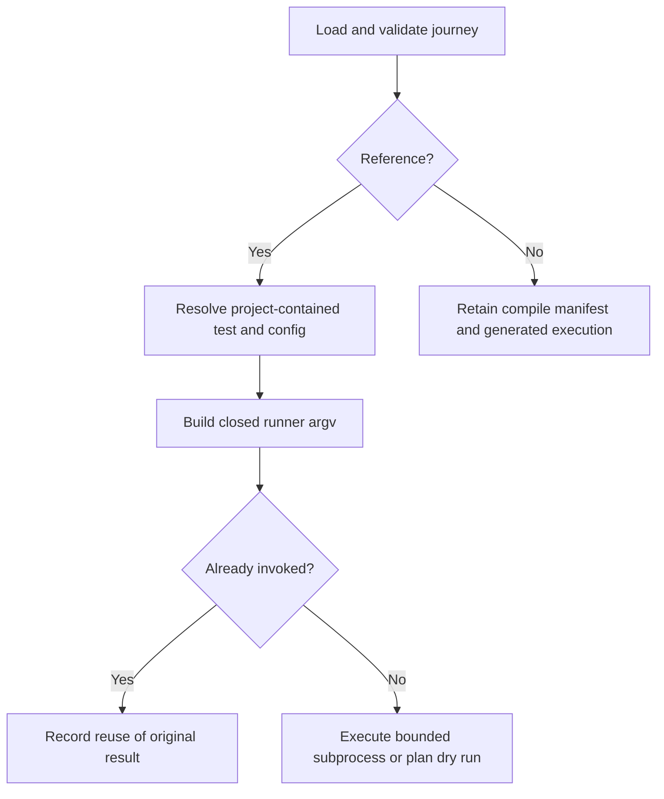

# Plan: Existing Test Journeys

## Summary

Add an optional reference mode to schema v2, reuse the original runner files, and retain the generated mode unchanged.

## Technical Context

Python/Pydantic validator, Typer CLI, YAML sources, pytest checks. Closed subprocess adapters reuse installed Playwright, the consumer-local Vitest public Node API, or the running Python's pytest. No added dependency, service, framework or database.

## Constitution Check

Retain filesystem ownership, early boundary validation, explicit errors and existing module responsibilities. The journey declares coverage/evidence; a successful runner does not certify more than it observed. Read [the delivery policy](../../../system/review-led-delivery.md) for useful checks and the coordinator's one independent final review.

## Contract and Ownership

| Boundary / convention | Implementation and verification |
|---|---|
| Schema, validation, typed model | Schema owner extends `validator/journeys/schema.py` and scan/validation/model paths; require exactly one supported target, project-contained existing files, nonblank evidence and reference/steps exclusion, and reject portable visual/precondition contracts in reference mode. Check missing/escape/symlink/config/runner cases and generated compatibility. |
| Catalogue and impact | Catalogue owner carries typed metadata through index and CLI list/inspect, and matches changed source/config paths alongside current feature dependencies. Check referenced-file and feature impact independently. |
| Native runner and compiler | Execution owner adds bounded argv adapters and invocation-local deduplication; original suites/config/fixtures remain owned by consumer. Check actual original pytest fixture/config execution, subprocess args for JS runners, failure reuse, compile non-mutation and machine-readable positive executed-test counts. Use anchored absolute escaped Playwright file filters and a packaged Vitest Node adapter resolving only consumer-local `vitest/node`; collect with `globTestSpecifications`, filter `moduleId` by exact realpath before `runTestSpecifications`, and close in `finally`. Require JSON reporters for JS runners and invocation-owned temporary JUnit XML for pytest; cleanup belongs to the invocation. |
| Result and CLI | Execution/CLI owners coordinate additive result fields: `selection_status=no_selection` for empty, `selection_status=planned` for dry run, `reused` ID-to-first-ID mapping, `planned` IDs and `planned_commands` ID-to-argv mapping without creating output reports. Check no-spawn previews and truthful execution counts. |
| Documents and traceability | Documentation owner writes this feature and the reference guide; coordinator owns implementation mappings, registries and global changelog. Resolve added relative links and compare documentation to integrated behavior. |

### Data contract

This is a filesystem YAML extension, not a relational model: SQL engines, indexes, transactions, migrations and FK semantics are not applicable. Existing `schema_version: 2` remains unchanged. A journey owns zero or one `existing_test`; several journeys can reference the same file. The journey author writes these fields; validation, catalogue, impact and execution read them. No automatic backfill or copy exists.

| Field | Type / absence / meaning |
|---|---|
| `path` | Required string; project-relative existing file, no absolute/escape path or escaping symlink; original suite remains authoritative. |
| `config` | Optional string, absent by default; same confinement/existence rules, passed to the selected runner. |
| `test_name` | Optional nonblank string, absent by default; runner-native selector passed as one argument, never shell code. |
| `evidence_level` | Required nonblank string; author's declared proof scope retained in output, no automatic promotion. |
| target runner | Exactly one of `playwright`, `vitest`, `pytest` in reference mode; no default adapter or arbitrary command. |
| `steps` | Omitted/default empty for reference; nonempty for generated mode. |
| reuse mapping | Invocation-local journey ID to first equivalent invocation's journey ID; no persistent cache or history rewrite. |

The original YAML schema owns text validation; files are resolved against the selected consumer root. Schema and filesystem checks happen before spawning. No numeric units, arithmetic or new retention lifecycle is introduced; existing history and privacy policies remain applicable.

## Implementation Plan

1. Add the optional typed schema/reference boundary and validation before executing any consumer source.
2. Carry reference metadata into list/inspect and file/config dependencies into impact.
3. Skip reference code generation; dispatch original suites directly, retaining all generated manifest checks on generated journeys.
4. Add invocation-local command deduplication, dry-run planning and explicit empty status; integrate CLI output with those contracts.
5. Run scoped behavioral and regression checks, reconcile docs/mappings, then send the integrated diff and actual results to the coordinator's independent final reviewer.

No API service calls or database entities are introduced. Run result labels describe invocation observations, not a new persisted entity lifecycle.

## Testing Strategy

Reuse existing journey schema/validation/compiler/index/impact/CLI/regression suites. Add only contract checks for invalid references, original fixture/config execution, exact safe adapter args, failed-result reuse, compile non-mutation, empty selection, no-spawn dry runs, malformed native reports and zero/all-skipped native tests. Use actual pytest and Node-based Playwright/Vitest integrations to verify fixture/config reuse without invoking browser or provider services. Run Ruff/typing for changed modules where available. Record actual commands, exit codes and limitations in progress; do not claim native JS/browser execution from adapter-argument tests.

## Runner compatibility

The bundled Vitest adapter uses the public advanced test API (`createVitest`, initialization, specification discovery/execution and close), preserving the real consumer configuration. Vitest 4.0.18 was observed; other versions require compatible APIs and are not proved supported by that observation. No package installation or new test framework is introduced. Read [the official advanced test API guide](https://vitest.dev/guide/advanced/tests) for the API lifecycle; current documentation may describe a newer signature than the observed 4.0.18 runtime.

## Risks & Considerations

A runner-native selector can select zero tests, and Vitest can exit zero when all selected tests are skipped. Require observed native result counts rather than exit status alone: zero/all-skipped results become `journey_no_tests_executed`, malformed/missing results become `journey_test_results_invalid`. Playwright expected plus flaky counts accept a successful retry only when the runner exits zero; native fail-on-flaky remains failure. Preserve the declared evidence level; even a passing observed test is not automatically physical proof. Runner dependencies remain consumer-owned. Preserve generated fixture contracts. Atlas currently has a newer private runtime: adoption means preparing a YAML reference to its existing suite at a safe product-session checkpoint, not repinning/downgrading runtime or adding a second bootstrap. No Atlas runtime or global-skill mutation is in this feature.
