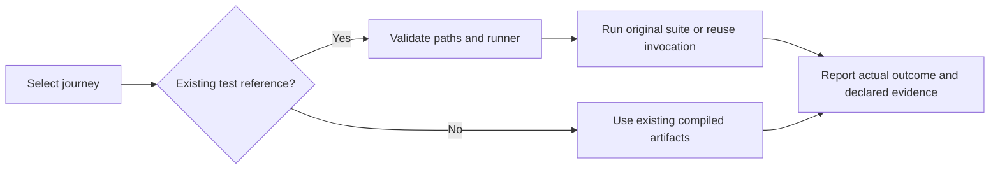
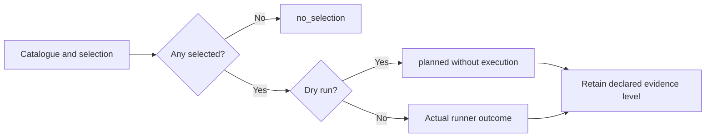

# Feature Spec: Existing Test Journeys

## Header

- **Feature:** Existing Test Journeys
- **Branch:** `feat/journey-existing-tests-20261116`
- **Date:** 2026-11-16
- **Status:** Implemented
- **Input:** Link journeys to existing suites/tests and runner configuration without duplicating assertions or fixtures; preserve generated journeys and distinguish an empty catalogue from executed success.

## User Scenarios & Testing

### Story 1 — Reuse an existing suite `P1`

**Priority reason:** Existing product tests remain the behavioral source of truth.
**Independent test:** Execute a referenced test from a temporary consumer and verify its original fixtures and configuration are used unchanged.

```gherkin
Feature: Existing test references
  Scenario: Run the original suite
    Given an active journey references an existing test file and runner configuration
    When I run that journey without compiling it
    Then its native runner executes the original file with that configuration
    And no test, assertion or fixture is copied or generated
  Scenario: Share an identical native invocation
    Given two selected journeys reference the same native command
    When I run both journeys
    Then the native command executes once
    And the second journey records reuse of the first journey's outcome
  Scenario: Preserve generated journeys
    Given a journey declares executable steps and no existing test reference
    When I compile and run it
    Then the existing compilation and execution contracts still apply
```



### Story 2 — Inspect coverage honestly `P1`

**Priority reason:** A coverage link or empty selection must not imply native product proof.
**Independent test:** Inspect/list a reference, change its test/config file, and compare an empty selection with a dry run and a real run.

```gherkin
Feature: Observable reference coverage
  Scenario: Trace an existing test
    Given a journey links current feature requirements and an existing test
    When I list or inspect journeys and analyze a changed referenced test or configuration
    Then the reference is visible and the journey is impacted
  Scenario: Nothing selected
    Given the catalogue is empty or selection matches no journey
    When I run journeys
    Then selection_status is no_selection and no native command executes
  Scenario: Preview execution
    Given an executable reference journey
    When I dry run it
    Then selection_status is planned and planned_commands exposes the command without execution
  Scenario: Keep declared evidence honest
    Given a passing suite declares its evidence level
    When its journey completes
    Then that declared level remains explicit without promotion to native product proof
```



## Acceptance Criteria

### AC-001
A schema-v2 reference journey declares exactly one supported target and `existing_test.path`, optional `config`/`test_name`, and a nonblank declarative `evidence_level`; `steps` is omitted or empty; portable visual contracts and preconditions are not accepted in reference mode because the original suite owns assertions, fixtures and setup. Invalid, missing, absolute or escaping paths and incompatible runner/step combinations are rejected before execution.

### AC-002
`list` and `inspect` expose the reference and existing covers links. `impact` includes changes to the referenced test or config plus existing feature impact behavior. Covered IDs are resolved from actual Markdown requirement definitions: legacy bold/list declarations, criterion/requirement tables and headings, including inline HTML anchors. Prose references, mappings, links, code examples, comments and bare anchors do not create requirements.

### AC-003
`run` invokes the original existing file directly without requiring compilation, preserving its runner configuration, assertions and fixtures. `compile` emits no reference test files and does not modify the original.

### AC-004
Reference execution accepts only Playwright, Vitest and pytest adapters, uses bounded argument-vector execution without a shell, and supports the optional runner-native selector and config. File selection is exact: Playwright uses an anchored escaped absolute resolved path; the bundled Vitest Node adapter loads the consumer configuration through its installed public API and filters collected specifications by exact realpath before execution. No neighbouring file may execute merely because its name contains the referenced path. Success additionally requires machine-readable native results showing at least one test actually executed: JSON reporter output for Playwright/Vitest or an invocation-owned temporary JUnit XML report for pytest. Zero selected/all-skipped tests produce `journey_no_tests_executed`; unreadable or invalid results produce `journey_test_results_invalid`, even when the runner exits zero. Playwright expected and flaky counts both establish an executed test when the runner exits zero; a nonzero native exit, including configured fail-on-flaky, remains failure.

### AC-005
Identical reference invocations execute once per run invocation; the result maps each reused journey ID to the first executing journey ID and retains failures honestly.

### AC-006
An empty selection reports `selection_status: no_selection`; dry run reports `selection_status: planned`, lists selected IDs in `planned`, exposes selected argv in `planned_commands` and never counts them as executed. Preview exposes selected argv, executes no tests and writes no reports. Neither is reported as successful native execution.

### AC-007
The evidence level remains explicitly declarative. Coverage links to AC, FR and historical requirements do not upgrade test results to physical/native product evidence or rewrite historical outcomes.

### AC-008
Generated journeys retain required nonempty steps, compilation manifests, existing fixture/bootstrap behavior and execution semantics. No consumer runtime or global skill is changed as a side effect.

## Functional Requirements

### FR-001
Extend the existing v2 boundary/model with an optional typed existing-test reference and validate mutually exclusive execution modes and confined paths. Covers AC-001 and AC-008.

### FR-002
Carry reference metadata through catalogue output and include referenced file/config dependencies in impact analysis. Covers AC-002 and AC-007.

### FR-003
Dispatch existing references directly through closed native adapters; compilation skips reference generation. Covers AC-003 and AC-004.

### FR-004
Deduplicate equivalent commands within a run and expose reuse, planned commands, explicit empty/planned status and unpromoted evidence. Covers AC-005, AC-006 and AC-007.

### FR-005
Document adoption with existing source tests and configuration, additive v2 compatibility and safe consumer runtime boundaries. Covers AC-007 and AC-008.

## Key Entities

`existing_test` belongs to one journey; several journeys may reference one suite. `path` and `config` identify existing project-contained files, `test_name` is an optional native selector, and `evidence_level` is a required nonblank declaration. No database or duplicated test source is introduced. Execution reuse lasts one invocation only.

## Edge Cases

Zero selected/all-skipped native tests, invalid native result reports, missing references, directory paths, symlink escape, unsupported runners, mixed steps/reference, failed shared invocation, empty catalogue, filtered-empty selection, disabled/manual journeys and dry-run previews must remain explicit. Reference tests can themselves require browsers, services or credentials; declaring them does not provision or prove those dependencies.

## Success Criteria

- SC-001: One original fixture/config-dependent suite runs unchanged through a journey without compilation.
- SC-002: Duplicate references execute once with traceable reuse; invalid references never spawn a process.
- SC-003: Empty, planned and executed outcomes remain distinguishable, and generated journey regressions pass.
