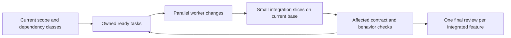

<!-- @spec FR-001, FR-003: Automatic useful delegation — .specs/features/122-review-led-delivery/spec.md#fr-001 -->
# Parallel delivery

Read [the shared delivery policy](review-led-delivery.md); this protocol makes its automatic dispatch concrete for existing `spec-feature`, `spec-ship`, `spec-specify`, `spec-plan`, `spec-implement` and other commands that load it. These are existing skills, not new Python CLI verbs. Existing selection/count/tier/resume scope remains binding; no new flag or scheduler is introduced.

## Determine ready work before dispatch

- Use the existing plan/progress and current code to identify selected tasks, inputs and affected files/resources, including ready work in an already-authorized program/goal/backlog. Evaluate inter-feature concurrency automatically at stable boundaries without a separate batch opt-in. Keep brief notes there when useful; no separate queue document or machine receipt is required. Do not expand the authorized feature scope.
- Classify each actual dependency at the task/contract boundary:

| Relationship | Scheduling decision |
|---|---|
| Hard prerequisite | The particular consumer task waits for its required accepted input; other tasks can proceed. |
| Shared interface | Agree the minimal contract and its owner first; implementations can proceed independently against that stable interface. |
| Later extension | Core behavior proceeds now; only the extension waits for its future provider/interface. A reciprocal spec link alone is not a hard dependency cycle. |
| Independent work | Dispatch now when ownership, tools and capacity permit, regardless of feature number. |

- Resolve a real contract cycle through a minimal shared interface or a scoped functional decision. Never invent provider behavior to break it. An interface not yet fixed permits independent analysis/preparation but delays dependent implementation, not all work or an automatic human question. Separate specification, implementation and delivery dependencies: authorized specification/planning can advance alongside another feature's implementation without pretending either is delivered or bypassing its own required design work.
- Identify shared hotspots before parallel writes: API types/routes/code generation, schema/migrations, registries, lockfiles, shared fixtures/components, canvas variables and final build/install resources. Assign ownership or an early integration boundary instead of discovering overlapping authorship at the end.

## Assign ownership and isolate changes

- One root coordinator owns integration and shared decisions; each worker receives a disjoint task and the self-contained brief required by the shared policy. For a shared hotspot, name its writer and how other workers hand off changes. Reassign ownership explicitly before another worker edits it.
- Allocate migration identifiers/order through that owner before dependent coding; workers must not independently choose the same next migration number. Allocate other collision-prone identifiers through the existing project mechanism. This adds no new database or global lock service.
- The accepted base means actual relevant accepted source, including necessary uncommitted changes; Git HEAD alone may be older. Identify those inputs before creating a worktree. When needed, preserve a confined reversible source snapshot/patch including relevant untracked source files, excluding secrets, personal data and unrelated artifacts. Apply that input layer to the isolated checkout and describe its actual base in the worker brief; never claim an old HEAD contains later accepted work.
- Use authorized isolated worktrees/branches when separate mutable checkouts help, retaining worker results in their own checkout or scoped patch. If a safe accepted-source snapshot is inappropriate, use disjoint ownership in the shared checkout instead. Neither approach requires an automatic prerequisite commit/push or permits stashing, resetting or cleaning human/concurrent dirty work. Do not mix unrelated edits into another worker's checkout.
- Worktrees do not isolate shared services, external data, installed applications, ports, user profiles or a pen.dev canvas. Allocate owned test profiles/ports before concurrent runtime observations; do not use personal data as an implicit branch test fixture.
- In one canonical product canvas, assign screens/frames/components to workers and use actual returned/read-back node identities. Parallel disjoint edits are allowed; shared variables/components/root layout have a named owner. Preserve existing screens and concurrent changes, and reconcile uncertain mutations before retrying. Never create a canvas per feature to obtain isolation.
- `--dry-run` and `--audit-only` remain read-only. Specification/plan tasks may write only their requested artifacts; they do not authorize production implementation. Explicit single-agent scope, requested models/roles, external-write authority and actual tool refusals remain binding.

## Dispatch and integrate incrementally



- Dispatch all useful ready tasks within actual available capacity; avoid duplicate work and agents waiting on each other. Indivisible work runs directly with a brief concrete reason. These are planning decisions, not a quota or a new blocking gate.
- Distinguish ready input, work in progress, ready-to-integrate result, integrated result and accepted delivery in ordinary progress notes. A worker finishing or its tests passing does not mark the whole feature Implemented.
- Integrate small contract/implementation slices while other work continues. Check the current accepted base and worker changes first; review the relevant diff, coordinate conflicts and run affected contract/behavior checks against the integrated tree. Feed accepted interface changes back to affected workers promptly. Do not postpone all reconciliation until every feature is complete.
- Unique migration identifiers do not prove semantic compatibility. Integrate shared data/type contracts early and exercise the cumulative migration/application behavior on an owned isolated profile before installing the affected cumulative artifact; retain actual failures without restarting unrelated work.
- Before applying a merge/patch again, inspect current history and tree: skip changes already integrated, and reconcile partially applied changes instead of replaying them blindly. A timeout or lost acknowledgement is an unknown outcome until inspected. Avoid duplicate migration execution or other side effects merely to repeat an integration attempt.
- Rebase/merge stale worker work through the current project-supported process, preserving its changes first. Resolve only impacted files/contracts. If a slice must be rolled back, preserve its source changes and scope the rollback to that slice; never reset/delete other workers' accepted or pending work. Integration does not authorize reversing real data migrations or external side effects.
- One installation owner publishes cumulative artifacts compatible with all migrations already applied to the target profile. Never launch an older branch binary against a profile advanced by another branch without established compatibility; isolated worktrees alone do not make that safe. Installation and external delivery retain their existing authority and selected-profile boundaries.
- Reuse passing evidence with unchanged relevant inputs and run proportional integration checks. Each feature's final independent review sees its actual integrated result, shared-boundary consequences and real check outcomes; no per-agent/per-step review chain or full-suite loop is added. Deliver in dependency-compatible order within authorization.

## Recover without stopping independent work

- If a worker fails or disappears, inspect its checkout/document and actual completed, pending and uncertain operations. Preserve partial results, give the next worker a fresh scoped brief, and reassign only unfinished work. An agent stopping is not evidence that its requested outcome was accepted.
- If a contract or base changes, pause only affected mutations, refresh their inputs and ownership, then continue; unrelated ready tasks keep running. A missing tool/capability is reported at its exact scope, never hidden as PASS or treated as failure of the whole batch.
- Respect applicable refusals and user-imposed decisions. Do not change tools, agents or worktrees to bypass them. Report a true missing authority or unresolved functional choice while continuing independent authorized work.

## Acceptance cases for review

```gherkin
Scenario: Two selected features have independent ready tasks
  Given their interfaces and ownership are stable
  When the lower-numbered feature is still in progress
  Then both tasks are dispatched without waiting for numeric order
Scenario: A later extension links two feature specs
  Given the core behavior does not require that extension
  When the extension's provider is not implemented
  Then core work continues and only the extension waits
Scenario: Parallel tasks need new migrations
  Given one owner allocates distinct ordered identifiers before coding
  When workers implement their assigned changes
  Then integration cannot silently reuse the same migration identifier
Scenario: Accepted work is newer than Git HEAD
  Given relevant accepted source changes are not committed
  When a worker needs an isolated checkout
  Then it receives that preserved source layer or uses safe shared-checkout ownership
  And no human dirty work is stashed, reset or silently omitted
Scenario: A shared interface is not fixed yet
  Given independent preparation is authorized
  When a consumer implementation needs that interface
  Then preparation continues and only dependent implementation waits
Scenario: An installed profile has advanced
  Given another branch binary lacks an applied migration
  When preparing a runtime observation or installation
  Then its owner uses an isolated compatible profile or a compatible cumulative artifact
Scenario: Integration acknowledgement is lost
  Given a slice may already be applied
  When the coordinator recovers
  Then it inspects the current tree and applies only missing changes
Scenario: A worker stops with partial work
  Given another task is independent and ready
  When the coordinator preserves and reassigns the unfinished scope
  Then the independent task continues without declaring the stopped task accepted
```
