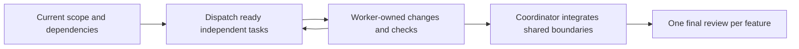

<!-- @spec FR-001, FR-003: Default delivery — .specs/features/122-review-led-delivery/spec.md#fr-001 -->
# Review led delivery

This is the default delivery policy for init, migrate, feature, specify, plan, implement, fix, test, check, refine, preflight and ship skills, including direct, nested, autonomous and resumed invocations. It replaces their former automatic certification workflow. Read the applicable project conventions and honor the user's scope and decisions.

## Automatic useful parallelism

This policy automatically dispatches workers for every feature; delegation is not an optional flag or a new human approval step when already authorized. It applies equally to direct, nested and resumed commands that read this policy. Existing optional-worker wording does not select a serial default.

Read [the parallel delivery protocol](parallel-delivery.md) before dispatch. It applies to the current command's authorized scope and selected features without a new scheduler, flag, persistent state format or certification prerequisite.

- At each feature's start and whenever dependencies change, identify ready independent tasks from the current plan, contracts and owned files. Dispatch available native subagents for all useful independent work instead of doing those tasks serially by default. Start ready work as soon as its inputs are stable; do not wait for unrelated tasks or a whole previous feature to finish.
- Maximize useful concurrency within actual tool access, agent slots and shared resource capacity. Reuse available workers; do not create duplicate assignments, idle chains, one goal-bearing agent per phase, or an agent-count target. A small indivisible task can run directly: record its concrete dependency, shared resource or unavailable delegation capability briefly and continue. Lack of subagents alone is not a product failure or an automatic stop.
- Give every worker a self-contained brief: target repository and workflow/skill to load, applicable conventions and accepted decisions, exact task and ownership of files/contracts or canvas frames, stable inputs and dependencies, available tools and exact permission/refusal scope, requested models/roles, done condition and expected evidence. State that others are working in the same project: preserve their changes and reconcile instead of reverting them. Workers return scoped changes and real results to the owning coordinator; they do not restart the entire pipeline or launch a separate final review for their task.
- One coordinator owns integration. Assign disjoint implementation areas such as backend, API/CLI, UI and independent checks when their contracts permit it. Coordinate edits to shared API contracts, migration ordering, registries, shared components and final packaging; these shared writes do not serialize unrelated implementation. Run affected checks at the appropriate boundary, reuse unchanged evidence and retain one independent final review per feature.
- For a selected batch or already-authorized program/goal/backlog, automatically evaluate ready features at stable boundaries from actual dependency and file/resource relationships, not their numeric order. Independent features or independent parts of dependent features can advance together; authorized specification/planning may run alongside another feature's implementation. Use separate worktrees when checkout isolation helps and is authorized; worktrees do not remove semantic dependencies, shared migration conflicts, installed-artifact/profile conflicts or external-service limits. Integrate and deliver in dependency-compatible order without sharing mutable checkout state accidentally.
- Keep one canonical design file per product and reuse existing screens. Several agents may work on that same pen.dev canvas: assign disjoint screens, frames or components and coordinate mutations of shared nodes, variables and common components. Use each agent's actual permitted plugin access; do not invent a universal single-operator limitation, create a second product canvas or redraw existing interfaces. After an uncertain mutation, read the affected nodes before retrying and distinguish editor readback from saved-file evidence.
- Scope and authority still apply: plan-only, audit-only, `--dry-run`, explicit single-agent requests, requested models/roles and applicable external refusals are preserved. Parallel preparation or checking does not authorize implementation, deployment, external writes or broader access. A blocked capability delays only its actual dependent work while independent authorized tasks continue.

## Checks inform the review

- Run useful tests, builds, typing, lint and runtime observations for the affected behavior. Keep checks proportional and reuse passing results when their relevant inputs are unchanged.
- Preserve the actual command, exit code, concise result and limitations. An error, warning, missing baseline, unavailable checker, legacy debt or missing certification is a finding for review, never an automatic stop or a reason to restart the feature pipeline.
- Fix a failure when it reveals a real defect in the requested change. Let the reviewer judge the impact of other failures. Do not require every script to be green or every warning to disappear before review or delivery.
- Do not manufacture PASS results, delete failing tests, adopt baselines blindly, weaken requirements or claim that an unexecuted interaction occurred. An essential missing observation remains unverified and goes to the reviewer with its impact.
- A failure in LiveSpec's bookkeeping does not prevent direct product checks or review. Note the issue in the current report and continue; do not start a framework repair mission as a prerequisite to the feature.

## One independent final review

Reuse an existing plan review as context. Do not create another automatic review before implementation; run a separate plan review only when the user requests it.

- Dispatch one fresh native reviewer without the implementer's conversation history. Give it the user request, current spec/plan, accepted decisions, applicable conventions, complete change and real check outcomes, including failures and unavailable checks. It must inspect relevant existing files as well as the diff. Use the host's generic native reviewer if a project-local named agent still injects the former certification requirements; do not select that obsolete definition for the new workflow.
- Review functional correctness, acceptance coverage, file placement, architecture, maintainability and concrete security/data risks. A missing receipt, model declaration, hash, registry marker or test percentage is not a product defect.
- Return a concise verdict and concrete findings with file references, impact and necessary correction. No strict JSON, raw-transcript ingestion, complete-file enumeration or reviewer identity certificate is required. Keep the host's actual response as the review record.
- Only a concrete material defect, an essential unverified behavior with material risk, a missing authority or an unresolved functional decision delays delivery. Carry minor findings and irrelevant/pre-existing test failures as reported follow-ups. Do not introduce another whole-feature review or audit by default.
- The implementer corrects findings and reruns affected checks. The reviewer inspects those corrections and their consequences without a full pipeline restart. A reviewer may correct trivial non-normative documentation, showing the diff; code changes return to the implementer so it does not approve its own edits.
- If the native reviewer is unavailable, report the missing review honestly. Do not replace it with self-approval. Independence reduces context bias; it is not a guarantee of exhaustive detection.

## No automatic certification

- Do not render/prove/archive nested LiveSpec goals, ingest semantic review receipts, classify repair patches, generate certifying manifests, run delivery-continuity/revision certificates, or require conventions, visual, Penflow, finalize or verify-output receipts to advance normal delivery.
- Read relevant design references and observe the real UI when needed. Design tooling stays useful; its certification protocol has no automatic veto over feature delivery.
- Apply the same rule to inherited hooks, child commands, phase/result wrappers and completion helpers: they cannot silently reintroduce the former certification gates. Explicit external tool refusals and user-imposed authorization limits remain in force.
- Legacy flags such as `--auto`, `--resume`, `--bugfix` and `--economy` do not reactivate certification. Honor their useful scope/read-only meaning. Read each command's retained `certification.md` only for an explicitly requested historical diagnostic.
- Existing CLI diagnostics keep their real exit codes and immutable historical interpretation. Do not turn an old BLOCKED into PASS, edit old evidence, reset mission counters or silently move an active mission to another policy. Independent work can continue while the current delivery review reports that history accurately.

## Completion

- Update the feature's spec/implementation mappings, registry and changelog as ordinary project documents. Use confined edits that preserve unrelated content and concurrent work. Do not make a metadata write depend on a certification helper.
- Mark the feature Implemented only when the independent review accepts the requested behavior with no unresolved material finding; disclose accepted limitations and nonblocking failures. This is review-led delivery, not a claim of legacy machine certification.
- Report the result, review verdict, useful checks and remaining limits. Commit, publish, merge or deploy only within the user's existing authorization. An explicit no-write or preview request remains read-only.

## Initialization and format migration

- Bootstrap skills use this same policy. Their technical installer/migration procedures remain available without nested goals, semantic receipts or a separate plan review. Report useful checks to the shared final reviewer or parent.
- Preserve explicit preview/read-only scope, force-recovery backups, effective runtime/pin identity, ordered migrations, inverse integrity and history. Failed essential setup, missing authority or an unsafe migration is a real problem; never claim initialization or migration succeeded when it did not.
- Requested or configured continuity remains a functional need: when supported and authorized, initialize or attach the project-bound process through the current review-led interface, preserving runtime/project identity without nested goals or implicit global installation. Missing continuity does not block independent feature delivery and is not silently removed from the plan. If not requested, no host observation is needed; if unsupported, unauthorized or explicitly refused, retain the unmet need and report the affected unexecuted action `NOT_RUN`. Never retry a known refusal or broaden permissions automatically.
